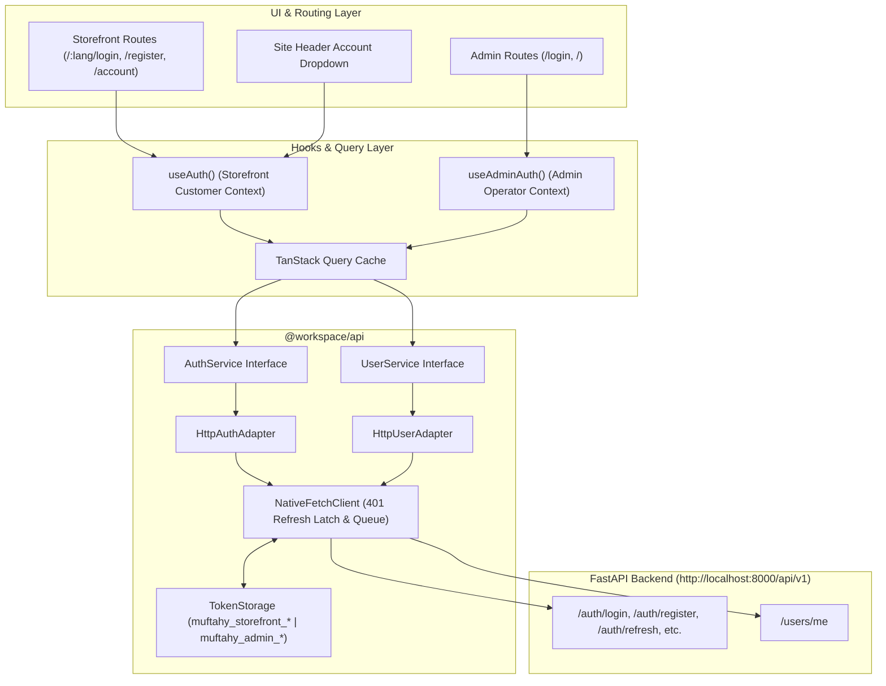

# Storefront and Admin Authentication Integration

* **Author:** Abdelrahman Eltokhy
* **Status:** Draft
* **Date:** 2026-11-18

--------------------------------------------------------------------------------

## Overview

Muftahy is a digital marketplace for software licenses, digital keys, game codes, and subscriptions tailored to the Middle East and GCC. A production-ready marketplace requires trusted identity verification, persistent authenticated sessions, and strict access controls across two distinct user surfaces:
1. **The Storefront (`apps/storefront`):** Used by retail consumers to browse products, purchase digital keys, access their personal profile, and manage account security in Arabic (RTL) or English (LTR).
2. **The Admin Dashboard (`apps/admin`):** Used by back-office operators and support staff to manage catalog inventory, review payments, and oversee platform operations.

This design document specifies the frontend authentication architecture integrating both applications with the backend authentication API described in `docs/examples/authentication.md`. It covers customer registration with background auto-login, credential and Google OAuth sign-in, email OTP verification, password recovery, a dual-state storefront header account menu, protected account profile routing with `returnTo` preservation, and isolated admin dashboard authentication.

## The Problem

Prior to this work, neither the storefront nor the admin application had a functional authentication layer:
- The storefront header contained non-functional placeholder links to `/account` that led nowhere or triggered catch-all redirects.
- No client-side service layer existed in `@workspace/api` for authentication, session verification, or token refresh.
- The admin application existed only as an unrouted placeholder component (`App.tsx`) with no authentication gate or role verification, allowing anyone loading the app to view the raw shell.
- Retail customers had no self-service mechanism to register, verify their email address via OTP, reset forgotten passwords, or view their account details.
- Attempting to implement authentication naively on `localhost` risks cross-contaminating tokens between customer (`aud: "customer"`) and operator (`aud: "admin"`) sessions, while concurrent requests risk destroying single-use refresh tokens during 401 token rotations.

This design establishes a zero-dependency, type-safe authentication and session boundary built on native browser `fetch` and Base UI primitives that solves these challenges without adding external runtime dependencies.

## Goals

* Provide a self-contained, typed `AuthService` in `@workspace/api` implementing all endpoints from `docs/examples/authentication.md` using native browser `fetch`.
* Prevent token thrashing and 401 thundering-herd session invalidation through an atomic single-flight promise latch in the HTTP client.
* Guarantee multi-app session isolation on shared origins through app-scoped storage prefixes (`muftahy_storefront_*` and `muftahy_admin_*`) and client-side audience claim validation.
* Deliver an accessible customer registration experience that eliminates redundant credential re-entry by performing immediate background authentication upon account creation.
* Provide Google OAuth login via Google Identity Services in popup mode, with runtime fallback for missing client IDs and contextual guidance for restricted in-app mobile WebViews.
* Implement email OTP verification and password recovery flows using the installed Base UI `input-otp` component.
* Replace placeholder header links with an accessible, keyboard-navigable dual-state account menu reflecting real-time authentication status.
* Secure customer account views behind a client-side route guard that preserves same-origin relative `returnTo` parameters across sign-in redirects.
* Introduce React Router v7 into `apps/admin` with a public `/login` route and an authenticated dashboard route guarded by `aud === "admin"`.
* Enforce bilingual parity across Arabic (RTL) and English (LTR) with semantic Tailwind tokens and Western digits (0-9).

## Non-Goals

* Implementing full customer order history, license key reveals, payment receipt uploads, or support ticket messaging threads (these domain views are deferred to separate feature milestones).
* Adding external HTTP client libraries such as `axios` or modifying `pnpm-lock.yaml`.
* Supporting SMS-based OTP verification (the backend contract is strictly email-based).
* Building self-serve admin registration or administrative user management.
* Intercepting unauthenticated users with modal dialogs (dedicated full-page routes are used to ensure deep-linking and bookmarkability).
* Changing backend endpoint signatures, token schemas, or rate-limiting rules.

## Open Questions

* None. (All architectural boundaries, storage isolation rules, and scope limits were resolved during the brainstorm phase).

## Critical User Journeys (CUJs)

### CUJ 1: New Customer Registration and Immediate Onboarding
* **Given**: An unauthenticated visitor on the storefront who wants to create an account.
* **When**: The user navigates to `/:lang/register`, fills out their full name, email, and password (>= 8 characters), and submits the form.
* **Then**: The client posts to `POST /api/v1/auth/register`. Upon receiving `201 Created`, the client immediately and transparently issues `POST /api/v1/auth/login` with the submitted credentials. Raw password memory is purged. The resulting access and refresh tokens are stored under the storefront prefix, the global session activates, and the user is redirected to `/:lang/account` with an active session and a non-blocking "Verify your email" banner.

### CUJ 2: Existing Customer Login with Protected Route Redirection
* **Given**: An unauthenticated visitor clicks a link to `/:lang/account`.
* **When**: The route guard intercepts the navigation because no valid customer session exists.
* **Then**: The user is redirected to `/:lang/login?returnTo=%2Faccount`. Upon submitting valid credentials, the tokens are stored, the session initializes, and the client redirects the user directly back to `/account`.

### CUJ 3: Google OAuth Popup Sign-In in Standard and In-App Browsers
* **Given**: A customer visiting the login page on a mobile device or desktop browser.
* **When**: In a standard browser, the user clicks "Continue with Google". A popup window opens via Google Identity Services. The user authorizes, and the resulting authorization code is sent to `POST /api/v1/auth/login/google`.
* **Then**: The backend provisions the account (if new), returns tokens, the popup closes, and the user is signed in without page reloads. If the visitor is inside an in-app WebView (Instagram/Facebook), an informational alert informs them that Google popup sign-in is restricted and encourages email login or opening the link in their system browser.

### CUJ 4: Forgotten Password Recovery via 6-Digit Email OTP
* **Given**: A customer who has forgotten their password.
* **When**: The user clicks "Forgot password?", enters their email at `/:lang/forgot-password`, and submits.
* **Then**: `POST /api/v1/auth/password/reset-request` is called. The UI advances to the OTP confirmation view. The user types or pastes the 6-digit code received via email into `input-otp`, inputs a new password (>= 8 characters), and submits. `POST /api/v1/auth/password/reset-confirm` executes. Upon success, a confirmation message appears and the user can log in with their new credentials.

### CUJ 5: Admin Operator Authentication and Dashboard Access
* **Given**: An administrative operator navigating to the admin application on `localhost` or admin domain.
* **When**: The user accesses `/` without an active admin session.
* **Then**: The admin route guard redirects them to `/login`. The operator enters their credentials, posting to `POST /api/v1/auth/admin/login`. The issued tokens carry `aud: "admin"` and are stored under `muftahy_admin_*`. The operator is redirected to the root dashboard (`/`). If a customer token is present in local storage instead, the admin guard rejects it, clears invalid tokens, and keeps the operator on the login screen.

--------------------------------------------------------------------------------

## Technical Plan (Architecture)

### 1. High-Level Architecture & Data Flow



### 2. Package Boundaries and Responsibilities

#### A. `@workspace/domain` (Contracts & Validation)
- Located at `packages/domain/src/schemas/auth.ts`.
- Defines all request and response Zod schemas and TypeScript types:
  - `loginRequestSchema` & `LoginRequest`: `{ email: string, password: string }`
  - `registerRequestSchema` & `RegisterRequest`: `{ email: string, password: string (min 8), full_name: string (2-255), phone?: string | null }`
  - `googleLoginRequestSchema` & `GoogleLoginRequest`: `{ code: string }`
  - `tokenResponseSchema` & `TokenResponse`: `{ access_token: string, refresh_token: string, token_type: "bearer", expires_in: number }`
  - `passwordResetRequestSchema` & `PasswordResetRequest`: `{ email: string }`
  - `passwordResetConfirmSchema` & `PasswordResetConfirm`: `{ email: string, code: string (6 digits), new_password: string (min 8) }`
  - `otpRequestSchema` & `OTPRequest`: `{ email: string, purpose?: string }`
  - `otpVerifySchema` & `OTPVerify`: `{ email: string, code: string (6 digits), purpose?: string }`
  - `userProfileSchema` & `UserProfile`: `{ id: string, email: string, full_name: string, phone: string | null, is_active: boolean, created_at: string }`
  - `apiErrorResponseSchema` & `ApiErrorResponse`: `{ error_code: string, message: string, details?: Record<string, unknown> }`

#### B. `@workspace/api` (Service Abstraction & Native Fetch Client)
- **Token Storage (`token-storage.ts`):**
  - Parameterized with a prefix (`"muftahy_storefront_"` or `"muftahy_admin_"`).
  - Methods: `getAccessToken()`, `getRefreshToken()`, `setTokens(tokens)`, `clearTokens()`, `hasValidToken(expectedAudience)`.
  - On inspection, decodes the unverified base64url JWT payload (`JSON.parse(atob(...))`) in a safe `try/catch` to check `aud` and `exp`. If the audience mismatches or token has expired, storage is cleared immediately.
- **Native Fetch Client (`fetch-client.ts`):**
  - Manages `baseURL` (configurable via `VITE_API_URL` with default `http://localhost:8000/api/v1`).
  - Automatically attaches `Authorization: Bearer <access_token>` from `TokenStorage` when present.
  - **Single-Flight 401 Refresh Latch:**
    - When an HTTP request returns `401 Unauthorized` and is not already a retry or refresh call:
      1. If a refresh is already in progress, create and append a new Promise resolver to the in-memory `failedQueue`.
      2. If no refresh is in progress, engage the lock (`isRefreshing = true`) and dispatch a single `POST /auth/refresh` with the active refresh token.
      3. On refresh success: update `TokenStorage` with both the new access token and the rotated refresh token, drain the `failedQueue` resolving all pending promises with the new token, and retry the original request.
      4. On refresh failure (or missing refresh token): clear all stored tokens, drain the `failedQueue` with rejection, and trigger a session expired event to redirect to `/login`.
- **Auth Service Interface (`auth-service.ts`) & Http Adapter (`http-auth-adapter.ts`):**
  - Implements: `login`, `register`, `loginWithGoogle`, `refreshToken`, `logout`, `requestPasswordReset`, `confirmPasswordReset`, `requestOtp`, `verifyOtp`, `adminLogin`.
- **User Service Interface (`user-service.ts`) & Http Adapter (`http-user-adapter.ts`):**
  - Implements: `getProfile()` -> `GET /api/v1/users/me`, `updateProfile()` -> `PATCH /api/v1/users/me`.
- **Service Factory (`factory.ts`):**
  - Exposes `getAuthService(app?: 'storefront' | 'admin')` and `getUserService(app?: 'storefront' | 'admin')`.

#### C. `packages/ui` (Base UI Form Primitives)
- Exports the already-installed `input-otp.tsx` primitive.
- Provides accessible forms, inputs, alert banners, cards, buttons, and popover menus.

#### D. `packages/i18n` (Bilingual Resources)
- Adds a comprehensive `auth` namespace to both `packages/i18n/src/locales/en.json` and `ar.json` covering:
  - Form field labels, validation messages, and placeholders.
  - Error codes mapped from backend `error_code` enums (`AUTHENTICATION_FAILED`, `EMAIL_ALREADY_EXISTS`, `INVALID_CREDENTIALS`, `RATE_LIMIT_EXCEEDED`, `PERMISSION_DENIED`).
  - Dual-state header account dropdown labels and in-app browser warnings.

#### E. `apps/storefront` (Customer Authentication & Protected Profile)
- **Features (`features/auth/`):**
  - `useAuth()` hook: Exposes `user`, `isAuthenticated`, `isLoading`, `login`, `register`, `logout`, and `loginWithGoogle`. Synchronized with TanStack Query.
  - `LoginForm`: Adapted from shadcn `login-03` with email/password, password visibility toggle (`end-3` placement), "Continue with Google" button, and links to registration and password reset.
  - `RegisterForm`: Adapted from shadcn `signup-03` with full name, email, password, and confirmation, triggering immediate background sign-in upon registration.
  - `ForgotPasswordForm` & `ResetPasswordConfirmForm`: Multi-step password recovery with 6-digit `InputOTP` entry.
  - `InAppBrowserHint`: Lightweight alert that checks for embedded WebViews and suggests using email/password or system browser.
- **Routes (`routes/`):**
  - `/:lang/login` (`LoginRoute`)
  - `/:lang/register` (`RegisterRoute`)
  - `/:lang/forgot-password` (`ForgotPasswordRoute`)
- **Account Shell & Guard (`features/account/`):**
  - `AccountGuard`: Checks `isAuthenticated`. If false, computes safe relative `returnTo` path and redirects to `/:lang/login?returnTo=...`.
  - `AccountLayout`: Responsive sidebar navigation with links to Profile, Orders, Keys, Tickets, and a Logout action button.
  - `ProfilePage`: Connected to `useAuth()` and `useProfile()` querying `GET /api/v1/users/me`, displaying user ID, email, full name, phone number, and account creation date.
- **Site Header (`components/site-header/`):**
  - Replaces dead placeholder links with an `AccountDropdown` component:
    - Unauthenticated: Pill trigger showing "Sign In" or user icon, opening a menu with Sign In and Register actions.
    - Authenticated: Avatar pill with user's initials/name, displaying Profile (`/account`), Orders, Keys, Support, and Logout button.

#### F. `apps/admin` (Operator Authentication & Guarded Dashboard)
- **Dependencies & Monorepo Links:**
  - Adds `@workspace/api`, `@workspace/domain`, `@workspace/i18n`, and `react-router` v7 to `apps/admin/package.json`.
- **Router Setup (`apps/admin/src/app/router.tsx`):**
  - Root browser router containing `/login` and protected `/`.
- **Features (`features/auth/`):**
  - `useAdminAuth()`: Manages admin token state using the `muftahy_admin_` storage prefix, verifying `aud === "admin"`.
  - `AdminLoginForm`: High-density operator login form.
  - `AdminGuard`: Route wrapper redirecting unauthenticated or non-admin visitors to `/login`.
- **Dashboard Placeholder:**
  - Authenticated root `/` renders a structured dashboard shell (`dashboard-01` layout).

### 3. Detailed Security & Resilience Mechanisms

#### Single-Flight Refresh Latch (Sequence Diagram)

```mermaid
sequenceDiagram
    autonumber
    participant UI as Component / Hook
    participant FC as NativeFetchClient
    participant TS as TokenStorage
    participant API as FastAPI Backend

    UI->>FC: Request 1: GET /users/me
    UI->>FC: Request 2: GET /users/me/orders
    Note over FC: Access token has expired (15 min elapsed)
    FC->>API: GET /users/me (Bearer expired_token)
    FC->>API: GET /users/me/orders (Bearer expired_token)
    API-->>FC: 401 Unauthorized
    API-->>FC: 401 Unauthorized

    Note over FC: Request 1 triggers Refresh Latch (isRefreshing = true)
    Note over FC: Request 2 queues in failedQueue awaiting resolution
    FC->>TS: getRefreshToken()
    TS-->>FC: uuid_refresh_token_1
    FC->>API: POST /api/v1/auth/refresh { refresh_token: uuid_refresh_token_1 }
    API-->>FC: 200 OK { access_token_2, refresh_token: uuid_refresh_token_2 }
    
    FC->>TS: setTokens(access_token_2, uuid_refresh_token_2)
    Note over FC: Drain failedQueue with access_token_2; release latch (isRefreshing = false)
    
    FC->>API: Retry Request 1: GET /users/me (Bearer access_token_2)
    FC->>API: Retry Request 2: GET /users/me/orders (Bearer access_token_2)
    API-->>FC: 200 OK (Profile Data)
    API-->>FC: 200 OK (Orders Data)
    FC-->>UI: Return Profile Data
    FC-->>UI: Return Orders Data
```

#### Safe `returnTo` Sanitization Logic
```typescript
export function sanitizeReturnTo(rawReturnTo: string | null | undefined, fallback: string): string {
  if (!rawReturnTo) return fallback;
  const decoded = decodeURIComponent(rawReturnTo).trim();
  // Must start with single '/', must NOT start with '//' or '/\', must not contain protocol
  if (/^\/[^\/\\]/.test(decoded) && !/^[a-zA-Z][a-zA-Z0-9+.-]*:/.test(decoded)) {
    return decoded;
  }
  return fallback;
}
```

#### In-App Browser WebView Detection
```typescript
export function isInAppBrowser(): boolean {
  if (typeof window === 'undefined') return false;
  const ua = window.navigator.userAgent || window.navigator.vendor || '';
  return /FBAN|FBAV|Instagram|TikTok|Line|Twitter|Snapchat/i.test(ua);
}
```

--------------------------------------------------------------------------------

## Alternatives Considered

### Alternative A: Axios Interceptor with Global State
* **Pros**: Direct copy of the recipe in `docs/examples/authentication.md`; well-known library API.
* **Cons**: Introduces external dependency, increases JavaScript bundle footprint, and requires modifying `pnpm-lock.yaml`, which is restricted by project rules.
* **Reason for Rejection**: Rejected by author: A lightweight native `fetch` client in `@workspace/api` delivers the same interceptor and refresh queueing capabilities with zero external dependencies and zero lockfile friction.

### Alternative B: Comprehensive 5-View Account Portal
* **Pros**: Delivers complete implementation of Order History, Digital Key Library, and Ticket Messaging per `customer-account-routes.md` in one release.
* **Cons**: Multiplies implementation scope by 5x, requires building multipart receipt upload flows, and obscures verification of the core authentication boundary.
* **Reason for Rejection**: Rejected by author: Scope hygiene requires isolating authentication and session integrity as a dedicated milestone. Sibling domain views are explicitly stubbed in navigation and deferred to their own focused feature implementations.

### Alternative C: Auth Modal Slide-Over Sheets
* **Pros**: User never leaves their current catalog browse or cart page to authenticate.
* **Cons**: Complicates browser history and back-button behavior, complicates mobile responsive viewports, interferes with URL bookmarking, and prevents clean `returnTo` query parameter routing.
* **Reason for Rejection**: Rejected by author: Dedicated route pages (`/:lang/login`, `/:lang/register`) provide superior accessibility, predictable deep-linking, and cleaner state boundaries.

### Alternative D: Unprefixed Shared LocalStorage Keys
* **Pros**: Identical storage code across storefront and admin applications.
* **Cons**: In local development (`localhost`) and shared-subdomain production topologies, storefront (`aud: customer`) and admin (`aud: admin`) tokens overwrite each other, causing constant session invalidations.
* **Reason for Rejection**: Rejected by author: Strict namespace prefixing (`muftahy_storefront_*` and `muftahy_admin_*`) combined with audience claim validation guarantees total session isolation between user roles.

### Alternative E: Radix UI Blocks with `asChild` Polymorphism
* **Pros**: Direct drop-in from standard shadcn registry without adapting primitives.
* **Cons**: Violates repository architecture rule in `AGENTS.md` requiring Base UI primitives with the `render` prop pattern.
* **Reason for Rejection**: Rejected by author: All form and OTP blocks must be constructed using Base UI and semantic design tokens to maintain monorepo compliance.

--------------------------------------------------------------------------------

## Non-Functional Requirements

### 1. Security & Privacy
- **Credential Sanitization**: Passwords submitted during registration and login are immediately discarded from component state and memory upon API dispatch.
- **XSS & Token Exposure**: While tokens reside in `localStorage` in this phase per the API specification, access is encapsulated behind `TokenStorage` to facilitate a drop-in migration to `httpOnly` cookies once the backend supports them.
- **Open Redirect Protection**: All `returnTo` values are strictly sanitized against open redirect attacks (CWE-601).
- **Audience Enforcement**: Tokens with `aud: "customer"` cannot be used to unlock the admin dashboard, and tokens with `aud: "admin"` cannot authenticate storefront customer accounts.

### 2. Performance & Resilience
- **Zero Third-Party Bundling**: The authentication client adds 0 KB of external NPM dependencies to the client bundle.
- **Atomic Concurrency**: The 401 single-flight promise latch ensures that 10 parallel queries encountering token expiration generate exactly 1 refresh call instead of 10.
- **Rate-Limit Visibility**: Responses with `429 Too Many Requests` parse the `Retry-After` header and display a localized countdown timer to the user.

### 3. Localization & Design System
- **RTL & LTR Balance**: Form layouts, input icons, and OTP slot alignments conform to logical CSS directional properties (`start-*`, `end-*`, `ms-*`, `me-*`, `text-start`).
- **Western Numerals**: All OTP slots and timer numbers enforce Western digits (0-9) across both Arabic and English locales.
- **Dark Mode**: All components leverage semantic tokens (`bg-background`, `text-foreground`, `border-input`, `bg-card`) with zero arbitrary hex overrides.

--------------------------------------------------------------------------------

## Detailed Implementation Plan

### Target Files to Create/Modify

#### 1. `@workspace/domain` (Contracts & Validation)

* **`packages/domain/src/schemas/auth.ts`** (`Create`):
  - **Scope**: TypeScript domain schemas and Zod models.
  - **Proposed Changes**: Implement schemas for `loginRequestSchema`, `registerRequestSchema`, `googleLoginRequestSchema`, `tokenResponseSchema`, `passwordResetRequestSchema`, `passwordResetConfirmSchema`, `otpRequestSchema`, `otpVerifySchema`, `userProfileSchema`, and `apiErrorResponseSchema`.
  - **Rationale**: Single source of truth for request payload validation and response parsing.

* **`packages/domain/src/schemas/auth.test.ts`** (`Create`):
  - **Scope**: Unit test suite.
  - **Proposed Changes**: Validate password length constraints (min 8 chars), email format parsing, 6-digit OTP formatting, and positive schema parsing.
  - **Rationale**: Verifies schema invariants per the definition of done.

* **`packages/domain/src/schemas/README.md`** (`Modify`):
  - **Scope**: EGM Peanut Contract.
  - **Proposed Changes**: Document exported auth schemas and types.
  - **Rationale**: Keeps documentation synchronized with code.

* **`packages/domain/src/README.md`** (`Modify`):
  - **Scope**: EGM Blueprint.
  - **Proposed Changes**: Update interface list with `auth.ts`.
  - **Rationale**: Blueprint synchronization.

#### 2. `@workspace/api` (Service & Native Fetch Client Layer)

* **`packages/api/src/services/auth-service.ts`** (`Create`):
  - **Scope**: Service interface.
  - **Proposed Changes**: Declare `AuthService` interface with `login`, `register`, `loginWithGoogle`, `refreshToken`, `logout`, `requestPasswordReset`, `confirmPasswordReset`, `requestOtp`, `verifyOtp`, and `adminLogin`.
  - **Rationale**: Seam separating UI from transport protocols.

* **`packages/api/src/services/user-service.ts`** (`Create`):
  - **Scope**: Service interface.
  - **Proposed Changes**: Declare `UserService` interface with `getProfile` and `updateProfile`.
  - **Rationale**: Seam for customer profile management.

* **`packages/api/src/adapters/http/token-storage.ts`** (`Create`):
  - **Scope**: Storage abstraction.
  - **Proposed Changes**: Implement `TokenStorage` class managing prefixed `localStorage` keys (`muftahy_storefront_*` and `muftahy_admin_*`), token decoding, audience checking, and expiration cleanup.
  - **Rationale**: Prevents multi-app token collisions on `localhost` and abstracts storage mechanism for future `httpOnly` cookie support.

* **`packages/api/src/adapters/http/token-storage.test.ts`** (`Create`):
  - **Scope**: Unit tests.
  - **Proposed Changes**: Test setting, reading, clearing, prefix separation, and audience mismatch invalidation.
  - **Rationale**: Guarantees session storage reliability.

* **`packages/api/src/adapters/http/fetch-client.ts`** (`Create`):
  - **Scope**: HTTP transport client.
  - **Proposed Changes**: Implement `NativeFetchClient` wrapping `window.fetch`, injecting Bearer tokens, catching `401 Unauthorized`, and coordinating the single-flight refresh promise queue.
  - **Rationale**: Zero-dependency replacement for Axios interceptor.

* **`packages/api/src/adapters/http/fetch-client.test.ts`** (`Create`):
  - **Scope**: Unit tests with Mock Fetch.
  - **Proposed Changes**: Test base URL concatenation, header attachment, 401 refresh triggering, concurrent request deduplication, and refresh failure queue rejection.
  - **Rationale**: Prevents regressions in the critical 401 queueing state machine.

* **`packages/api/src/adapters/http/http-auth-adapter.ts`** (`Create`):
  - **Scope**: HTTP service adapter.
  - **Proposed Changes**: Implement `AuthService` using `NativeFetchClient`.
  - **Rationale**: Concrete adapter executing real backend requests.

* **`packages/api/src/adapters/http/http-user-adapter.ts`** (`Create`):
  - **Scope**: HTTP service adapter.
  - **Proposed Changes**: Implement `UserService` using `NativeFetchClient`.
  - **Rationale**: Concrete adapter fetching user profile from `GET /api/v1/users/me`.

* **`packages/api/src/factory.ts`** (`Modify`):
  - **Scope**: Service factory.
  - **Proposed Changes**: Add `getAuthService(app?: 'storefront' | 'admin')` and `getUserService(app?: 'storefront' | 'admin')` to registry.
  - **Rationale**: Provides singleton instances across components and hooks.

* **`packages/api/src/services/README.md`** & **`packages/api/src/adapters/README.md`** (`Modify`):
  - **Scope**: EGM Peanut contracts.
  - **Proposed Changes**: Document new services and HTTP adapters.
  - **Rationale**: Preserves EGM documentation compliance.

#### 3. `@workspace/i18n` (Bilingual Resources)

* **`packages/i18n/src/locales/en.json`** (`Modify`):
  - **Scope**: English translation catalog.
  - **Proposed Changes**: Add `auth` and `account` namespaces (titles, labels, validation errors, server error messages, button labels, and in-app browser hints).
  - **Rationale**: Eliminates hardcoded strings per monorepo rules.

* **`packages/i18n/src/locales/ar.json`** (`Modify`):
  - **Scope**: Arabic translation catalog.
  - **Proposed Changes**: Add mirrored `auth` and `account` namespaces in natural, professional Arabic.
  - **Rationale**: Maintains 100% bilingual parity.

#### 4. `apps/storefront` (Customer Feature & Routing Layer)

* **`apps/storefront/src/features/auth/hooks/use-auth.ts`** (`Create`):
  - **Scope**: React hook & context.
  - **Proposed Changes**: Wrap `getAuthService('storefront')`, `getUserService('storefront')`, and `TokenStorage('muftahy_storefront_')`. Expose reactive state (`user`, `isAuthenticated`, `isLoading`) and mutation actions (`login`, `register`, `logout`, `loginWithGoogle`).
  - **Rationale**: Centralized authentication interface for storefront UI.

* **`apps/storefront/src/features/auth/hooks/use-google-auth.ts`** (`Create`):
  - **Scope**: OAuth integration hook.
  - **Proposed Changes**: Load Google Identity Services script dynamically, initialize code client with `VITE_GOOGLE_CLIENT_ID`, and trigger popup authorization code callback.
  - **Rationale**: Encapsulates third-party OAuth popup lifecycle with zero npm dependencies.

* **`apps/storefront/src/features/auth/lib/in-app-browser.ts`** (`Create`):
  - **Scope**: Utility function.
  - **Proposed Changes**: Detect WebView User-Agent signatures.
  - **Rationale**: Identifies environments where Google popup OAuth is known to fail.

* **`apps/storefront/src/features/auth/lib/sanitize-return-to.ts`** (`Create`):
  - **Scope**: Security utility.
  - **Proposed Changes**: Whitelist validate `returnTo` query parameter against open redirects (CWE-601).
  - **Rationale**: Protects customers against phishing redirection.

* **`apps/storefront/src/features/auth/components/login-form.tsx`** (`Create`):
  - **Scope**: UI presentation component.
  - **Proposed Changes**: Adapted from shadcn `login-03` with email/password inputs, password visibility toggle, "Continue with Google" button, in-app browser warning, and links to register and forgot password.
  - **Rationale**: High-conversion, accessible customer sign-in view.

* **`apps/storefront/src/features/auth/components/register-form.tsx`** (`Create`):
  - **Scope**: UI presentation component.
  - **Proposed Changes**: Adapted from shadcn `signup-03` with full name, email, password, and confirmation. On submission, executes background login with submitted credentials.
  - **Rationale**: Frictionless onboarding experience without redundant credential entry.

* **`apps/storefront/src/features/auth/components/forgot-password-form.tsx`** (`Create`):
  - **Scope**: UI presentation component.
  - **Proposed Changes**: Email submission form requesting password reset OTP via `POST /auth/password/reset-request`.
  - **Rationale**: Initial step in password recovery.

* **`apps/storefront/src/features/auth/components/reset-password-confirm-form.tsx`** (`Create`):
  - **Scope**: UI presentation component.
  - **Proposed Changes**: Form with Base UI `InputOTP` for 6-digit code entry, new password field, and submission to `POST /auth/password/reset-confirm`.
  - **Rationale**: Second step in password recovery.

* **`apps/storefront/src/routes/login-route.tsx`** (`Create`):
  - **Scope**: Thin route module.
  - **Proposed Changes**: Mounts `LoginForm` with page metadata and `returnTo` propagation.
  - **Rationale**: Route endpoint for `/:lang/login`.

* **`apps/storefront/src/routes/register-route.tsx`** (`Create`):
  - **Scope**: Thin route module.
  - **Proposed Changes**: Mounts `RegisterForm` with page metadata.
  - **Rationale**: Route endpoint for `/:lang/register`.

* **`apps/storefront/src/routes/forgot-password-route.tsx`** (`Create`):
  - **Scope**: Thin route module.
  - **Proposed Changes**: Mounts `ForgotPasswordForm` and transitions to `ResetPasswordConfirmForm`.
  - **Rationale**: Route endpoint for `/:lang/forgot-password`.

* **`apps/storefront/src/features/account/components/account-guard.tsx`** (`Create`):
  - **Scope**: Security route guard.
  - **Proposed Changes**: Checks `isAuthenticated`. Redirects unauthenticated visitors to `/:lang/login?returnTo=<encoded_path>`.
  - **Rationale**: Enforces session requirement on protected routes.

* **`apps/storefront/src/features/account/components/account-layout.tsx`** (`Create`):
  - **Scope**: Layout component.
  - **Proposed Changes**: Sidebar navigation with tabs for Profile, Orders, Keys, Support, and Logout action.
  - **Rationale**: Structural container for the account portal.

* **`apps/storefront/src/features/account/pages/profile-page.tsx`** (`Create`):
  - **Scope**: Page container.
  - **Proposed Changes**: Displays user ID, email, full name, phone number, and creation date queried from `GET /api/v1/users/me`.
  - **Rationale**: Primary self-service profile view.

* **`apps/storefront/src/routes/account-route.tsx`** (`Create`):
  - **Scope**: Thin route module.
  - **Proposed Changes**: Combines `AccountGuard`, `AccountLayout`, and `ProfilePage`.
  - **Rationale**: Route endpoint for `/:lang/account`.

* **`apps/storefront/src/components/site-header/account-dropdown.tsx`** (`Create`):
  - **Scope**: Header component.
  - **Proposed Changes**: Dual-state dropdown: unauthenticated shows Sign In / Register; authenticated shows user avatar pill, Profile link, and Logout action.
  - **Rationale**: Replaces dead header links with dynamic session navigation.

* **`apps/storefront/src/components/site-header/site-header.tsx`** (`Modify`):
  - **Scope**: Header landmark.
  - **Proposed Changes**: Insert `AccountDropdown` into the header action bar alongside Search and Cart.
  - **Rationale**: Exposes account controls on desktop and mobile.

* **`apps/storefront/src/components/site-header/mobile-menu.tsx`** (`Modify`):
  - **Scope**: Mobile drawer.
  - **Proposed Changes**: Render account links or sign-in buttons in the mobile navigation drawer.
  - **Rationale**: Provides mobile account access.

* **`apps/storefront/src/app/router.tsx`** (`Modify`):
  - **Scope**: Router tree.
  - **Proposed Changes**: Register `/login`, `/register`, `/forgot-password`, and `/account` under `/:lang`.
  - **Rationale**: Activates route endpoints.

* **`apps/storefront/src/features/auth/README.md`** & **`apps/storefront/src/features/account/README.md`** (`Create`):
  - **Scope**: EGM Component Package contracts.
  - **Proposed Changes**: Document interfaces, invariants, and side effects.
  - **Rationale**: EGM compliance.

#### 5. `apps/admin` (Operator App Layer)

* **`apps/admin/package.json`** (`Modify`):
  - **Scope**: Manifest.
  - **Proposed Changes**: Add `@workspace/api`, `@workspace/domain`, `@workspace/i18n`, and `react-router` dependencies.
  - **Rationale**: Supplies routing and service access to admin app.

* **`apps/admin/src/app/router.tsx`** (`Create`):
  - **Scope**: Router tree.
  - **Proposed Changes**: React Router v7 configuration with `/login` and protected `/`.
  - **Rationale**: Enables multi-page navigation in admin app.

* **`apps/admin/src/features/auth/hooks/use-admin-auth.ts`** (`Create`):
  - **Scope**: Admin authentication hook.
  - **Proposed Changes**: Connects to `getAuthService('admin')` and `TokenStorage('muftahy_admin_')`, enforcing `aud === "admin"`.
  - **Rationale**: Admin session state management.

* **`apps/admin/src/features/auth/components/admin-login-form.tsx`** (`Create`):
  - **Scope**: UI presentation component.
  - **Proposed Changes**: Operator login form with email/password and error handling.
  - **Rationale**: Secure login view for administrative staff.

* **`apps/admin/src/features/auth/components/admin-guard.tsx`** (`Create`):
  - **Scope**: Route guard.
  - **Proposed Changes**: Redirects unauthenticated or non-admin visitors to `/login`.
  - **Rationale**: Restricts dashboard access to verified admin tokens.

* **`apps/admin/src/routes/admin-login-route.tsx`** (`Create`):
  - **Scope**: Thin route module.
  - **Proposed Changes**: Mounts `AdminLoginForm`.
  - **Rationale**: Route endpoint for `/login`.

* **`apps/admin/src/routes/admin-dashboard-route.tsx`** (`Create`):
  - **Scope**: Thin route module.
  - **Proposed Changes**: Minimal operator dashboard placeholder (`dashboard-01` layout).
  - **Rationale**: Route endpoint for `/`.

* **`apps/admin/src/App.tsx`** (`Modify`):
  - **Scope**: Application entry.
  - **Proposed Changes**: Render `RouterProvider` with admin router.
  - **Rationale**: Mounts routing tree.

* **`apps/admin/README.md`** & **`apps/admin/src/README.md`** (`Modify`):
  - **Scope**: EGM Blueprints.
  - **Proposed Changes**: Document new routes, auth feature, and dependencies.
  - **Rationale**: EGM compliance.

### Verification Plan

* **Typechecking**: Run `pnpm typecheck` across all packages and apps to ensure zero TypeScript errors.
* **Unit Tests**:
  - Run `pnpm test` in `packages/domain` to verify Zod auth schemas.
  - Run `pnpm test` in `packages/api` to verify `TokenStorage` isolation and `NativeFetchClient` 401 refresh latch.
* **Linting & Code Standards**: Run `pnpm lint` to ensure strict ESLint compliance and formatting.
* **Production Build**: Run `pnpm build` to verify successful bundle generation across both `storefront` and `admin` applications.

--------------------------------------------------------------------------------

*Drafted with EGM*
