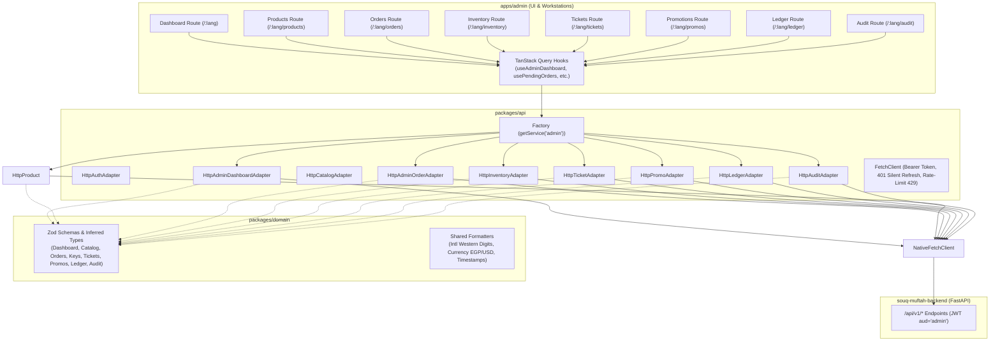
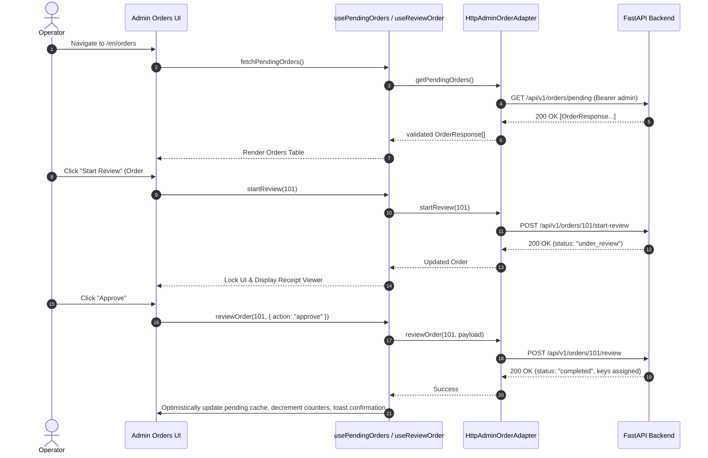

# Admin Dashboard Backend API Integration & UI Redesign

*   **Author:** Abdelrahman Eltokhy
*   **Status:** Proposed
*   **Date:** 2026-11-21

--------------------------------------------------------------------------------

## Overview

This project integrates the Muftahy Admin Dashboard (`apps/admin`) with the FastAPI backend (`souq-muftah-backend`), replaces all mock data and hardcoded metrics with live typed service adapters, and redesigns the administrative user interface following the design guidelines in `docs/design-system.md` and `AGENTS.md`.

The admin console provides operational tooling for Muftahy operators. It enables operators to monitor platform health, verify bank transfer payment receipts, fulfill and release sensitive digital activation keys, manage catalog pricing and availability, inspect double-entry financial ledger accounts, and adjudicate customer dispute tickets across both Arabic (RTL) and English (LTR) locales.

## The Problem

The current admin dashboard implementation has three architectural deficiencies:

1.  **Synthetic Mocks & Hardcoded State**: The dashboard route displays static mock metrics (e.g., hardcoded revenue, static key counts, fake activity logs), while core administrative workstations (Products, Orders, Inventory, Audit) only render static `EmptyState` stubs with no live backend communication.
2.  **Schema Mismatches & Missing Endpoints**: The existing frontend assumes features not provided by the backend (such as a customer management workstation), while omitting workstations for features provided by the backend (support dispute resolution, promo campaigns, and financial ledger accounting).
3.  **Interface and Usability Deficits**: The current workstation interfaces lack the density, keyboard shortcuts, clear visual hierarchy, and real-time operational feedback required for high-volume marketplace administrators.

To resolve these issues, the project introduces typed HTTP service adapters in `@workspace/api` backed by Zod domain schemas in `@workspace/domain`, prunes unsupported routes and mocks, connects TanStack Query hooks, and builds a standardized, high-density workstation interface conforming to `AGENTS.md`.

## Goals

*   **Full Backend Integration**: Connect every administrative endpoint provided by `souq-muftah-backend`:
    *   Dashboard analytics (`/api/v1/admin/dashboard/overview`, `/api/v1/admin/dashboard/sales`, `/api/v1/admin/dashboard/preorders`).
    *   Product catalog mutations and queries (`/api/v1/products`, `/api/v1/products/categories`).
    *   Payment verification workflow (`/api/v1/orders/pending`, `/api/v1/orders/{id}/start-review`, `/api/v1/orders/{id}/review`, `/api/v1/orders/{id}/receipts`, `/api/v1/orders/{id}/items/{item_id}/refund`).
    *   Key pool vault management (`/api/v1/keys/import`, `/api/v1/keys/stats`, `/api/v1/keys`, `/api/v1/keys/{id}`).
    *   Security and audit log inspection (`/api/v1/audit/logs`, `/api/v1/audit/export`).
    *   Customer support dispute tickets (`/api/v1/tickets`, `/api/v1/tickets/{id}/comments`, `/api/v1/tickets/{id}/resolve`).
    *   Promotions and discount codes (`/api/v1/promos`, `/api/v1/promos/{id}`).
    *   Double-entry financial ledger overview (`/api/v1/ledger/balance`, `/api/v1/ledger/summary`, `/api/v1/ledger/entries`).
*   **Zero Mock Footprint**: Eliminate all mock data and synthetic stubs across `apps/admin`. All UI state must derive exclusively from authenticated backend responses or optimistic mutations.
*   **Schema Authority**: Enforce strict Zod validation matching backend Pydantic schemas in `@workspace/domain`. No invented fields or ungrounded data properties.
*   **High-Density User Interface**: Apply frontend design system requirements:
    *   Dense, scan-friendly tabular layouts with tabular numbers (`tabular-nums font-mono`).
    *   Equal content margins, distinct visual hierarchies, and semantic tokens only (`bg-background`, `text-foreground`, `border-border`).
    *   No empty states without actionable guidance, no generic templates, and no purely decorative elements.
    *   Full dark mode and light mode parity.
    *   Strict logical CSS properties for RTL (`ar`) and LTR (`en`) layouts.
    *   Safe key reveal and copy patterns protecting sensitive digital activation keys.
*   **Test Coverage**: Achieve unit and integration test coverage across all domain schemas, API adapters, TanStack Query hooks, and workstation pages using Vitest and React Testing Library.

## Non-Goals

*   **Backend Modifications**: The frontend does not modify `souq-muftah-backend`. Backend API and database schemas remain authoritative.
*   **Customer Management**: The backend exposes no `/admin/users` or customer management endpoints. The frontend will not simulate or mock customer management and will prune the unsupported `customers` route.
*   **Modifying `@workspace/ui` Internals**: Base UI and shadcn primitives in `@workspace/ui` will be composed via wrapper components, without altering package source files or `components.json`.
*   **Public Storefront Changes**: Storefront routes and components are out of scope.

## Open Questions

*   **Question 1: Sidebar Layout for Specialized Workstations**: How should Financial Ledger (`/ledger`), Promotions (`/promos`), and Dispute Tickets (`/tickets`) be structured in the navigation?
    *   *Decision (Author Approved)*: Surface them as top-level workstation items in the sidebar under primary operational navigation to provide direct operator access.
*   **Question 2: Bulk Key Ingestion Format Support**: Should the key ingestion drawer support raw paste, file upload, or both?
    *   *Decision (Author Approved)*: Support both raw newline-delimited text pasting and CSV/TXT file drag-and-drop parsing directly in the client before submitting to `POST /api/v1/keys/import`.

## Critical User Journeys (CUJs)

### CUJ 1: Operator Reviews Bank Transfer Receipt and Adjudicates Payment

*   **Given**: An authenticated administrator visits the admin portal at `/en/orders` with pending orders awaiting review (`status: "payment_uploaded"` or `status: "under_review"`).
*   **When**: The operator selects an order:
    *   If `order.status === "payment_uploaded"`, clicking "Start Review" dispatches `POST /api/v1/orders/{order_id}/start-review` (locking review state).
    *   If `order.status === "under_review"`, the client bypasses `start-review` and displays an "Under Review" operational notice, directly enabling review adjudication actions.
    *   The operator inspects the uploaded receipt image, claimed amount, and previous payment attempts.
    *   The operator takes one of three review decisions:
        1.  **Approve**: Dispatches `POST /api/v1/orders/{order_id}/review` with action `approve`.
        2.  **Reject (Wrong Amount)**: Dispatches review with action `reject_wrong_amount` and reason.
        3.  **Reject (Fraud/Refund)**: Dispatches review with action `reject_refund` and reason.
*   **Then**:
    *   On **Approval**: The backend transitions order status to `completed` and allocates available keys. If stock was depleted, backend sets `item.is_preorder = true` and the client alerts the operator of preorder backorder conversion. Upon receiving the response, the client updates the local cache optimistically (removing the order from the pending list and decrementing counters) without triggering immediate invalidation refetches.
    *   On **Reject (Wrong Amount)**: If attempt counter <= 1, order status resets to `pending_payment` with an extended deadline; if attempt counter > 1, order transitions to `cancelled`. The review queue updates optimistically.
    *   On **Reject (Fraud/Refund)**: Order transitions to `refunded` and is cleared from the pending queue optimistically.

### CUJ 2: Operator Ingests Batch License Keys into Product Vault

*   **Given**: An administrator navigates to `/en/inventory` to replenish stock for "Windows 11 Pro".
*   **When**: The operator opens the "Ingest Keys" sheet (Base UI Sheet), selects the product, specifies the total acquisition cost in USD, pastes raw activation keys (or uploads a `.txt`/`.csv` file), chooses regular vs replacement pool, and submits.
*   **Then**: The client validates the payload and issues `POST /api/v1/keys/import`. 
    *   If all keys import cleanly, the backend returns `201 Created` with `failed_count: 0`. The client refetches inventory statistics and closes the sheet.
    *   If duplicate or invalid keys are detected (`failed_count > 0`), the sheet remains open and renders a "Reconciliation Table" displaying failed serials and error codes, alongside a "Copy Failed Serials Only" button for supplier return.

### CUJ 3: Operator Adjusts Catalog Product Pricing

*   **Given**: An operator visits `/en/products` and identifies a product requiring pricing adjustment.
*   **When**: The operator opens the edit dialog, updates the base price in EGP, and saves changes.
*   **Then**: The client sends `PATCH /api/v1/products/{product_id}`. On success, the product table updates immediately, and the catalog reflects the updated price.

### CUJ 4: Operator Adjudicates Customer Dispute Ticket with Key Replacement

*   **Given**: A customer opened a support ticket regarding a defective activation key, visible in `/en/tickets`.
*   **When**: The operator inspects the customer's error screenshot attachment, adds an internal or customer comment, and resolves the ticket by selecting outcome `replacement` with a replacement key ID from the pool. If the customer's item replacement entitlement was already consumed, the UI prompts for an "Admin Override Replacement Policy" checkbox.
*   **Then**: The client submits `POST /api/v1/tickets/{id}/resolve` (passing `admin_override: true` if checked). The backend sets ticket status to `closed` with `outcome: "replacement"`, assigns the replacement key, and the ticket is locked.

--------------------------------------------------------------------------------

## Technical Plan (Architecture)

### 1. High-Level System Architecture

The architecture enforces strict unidirectional dependency boundaries: `apps/admin` imports from `@workspace/api`, `@workspace/domain`, `@workspace/i18n`, and `@workspace/ui`, never the reverse. All network calls are encapsulated in typed HTTP adapters implementing abstract service interfaces.



### 2. Domain Schema Definitions (`@workspace/domain`)

The domain layer defines Zod validation schemas that mirror backend Pydantic models. In compliance with `AGENTS.md`, all monetary and financial quantities are strictly validated and transformed into canonical decimal strings (e.g. `"585.00"`), eliminating floating-point math and loose `string | number` unions across client state:

```ts
export const decimalStringSchema = z
  .union([z.string(), z.number()])
  .transform((val) => (typeof val === 'number' ? val.toFixed(2) : val))
```

1.  **Dashboard Analytics (`schemas/admin-dashboard.ts`)**:
    *   `lowStockProductItemSchema`: `{ product_id: string, product_name: string, net_stock: number }`
    *   `dashboardOverviewResponseSchema`: `{ pending_orders_count: number, open_tickets_count: number, low_stock_products: z.array(lowStockProductItemSchema), today_sales_count: number, today_revenue_egp: decimalStringSchema }`
    *   `salesSummaryResponseSchema`: `{ date_from: string, date_to: string, total_orders: number, total_sales_egp: decimalStringSchema, daily_breakdown: z.array(z.object({ date: z.string(), orders_count: z.number(), sales_egp: decimalStringSchema })) }`
    *   `preorderSummaryResponseSchema`: `{ total_pending_preorders: number, per_product_preorders: z.array(z.object({ product_id: string, product_name: string, count: number, oldest_preorder_age_hours: number })) }`
2.  **Key Pool Inventory (`schemas/inventory.ts`)**:
    *   `keyBatchImportRequestSchema`: `{ product_id: string (uuid), total_cost_usd: number (gt 0), serials: z.array(z.string().min(1)).min(1).max(500), replacement_only: z.boolean().default(false) }`
    *   `keyImportResultItemSchema`: `{ id: string (uuid), serial: string, status: string, replacement_only: boolean }`
    *   `keyImportErrorItemSchema`: `{ serial: string, error_code: string, error_message: string }`
    *   `keyImportResponseSchema`: `{ total_submitted: number, successful_count: number, failed_count: number, imported_keys: z.array(keyImportResultItemSchema), failures: z.array(keyImportErrorItemSchema) }`
    *   `keyStatsResponseSchema`: `{ product_id: string, product_name: string, available_count: number, sold_count: number, reported_count: number, replaced_count: number, cancelled_count: number }`
    *   `keyResponseSchema`: `{ id: string, product_id: string, product_name: string | null, serial: string, status: string, replacement_only: boolean, cancel_reason: string | null, cost_usd: decimalStringSchema, created_at: string }`
    *   `keyUpdateSchema`: `{ status: z.enum(['available', 'cancelled', 'reported']).optional(), replacement_only: z.boolean().optional(), cancel_reason: z.string().optional() }`
3.  **Order Review & Refund (`schemas/order.ts`)**:
    *   `orderReviewRequestSchema`: `{ action: z.enum(['approve', 'reject_wrong_amount', 'reject_refund']), reason: z.string().optional() }`
    *   `paymentAttemptSchema` (reused/extended from `order.ts`): `{ id: string, order_id: string, receipt_image_path: string, amount_claimed_egp: decimalStringSchema | null, status: string, rejection_reason: string | null, created_at: string }`
    *   `orderItemRefundRequestSchema`: `{ gateway_fee_egp: z.number().nonnegative().default(0) }`
4.  **Promotions (`schemas/promos.ts`)**:
    *   `promoCreateRequestSchema`: `{ code: string, discount_percentage: number (1-100), max_total_uses: number | null, max_uses_per_user: number | null, expires_at: string | null, eligible_product_ids: string[] | null, eligible_user_ids: string[] | null }` *(Note: `eligible_user_ids` is kept optional/null and omitted from UI creation forms due to the absence of customer management endpoints)*
    *   `promoDetailResponseSchema`: `{ id: string, code: string, discount_percentage: number, is_active: boolean, max_total_uses: number | null, max_uses_per_user: number | null, current_total_uses: number, expires_at: string | null, created_at: string }`
    *   `promoUpdateRequestSchema`: `{ is_active: boolean | null, max_total_uses: number | null, max_uses_per_user: number | null, expires_at: string | null }`
5.  **Ledger Accounting (`schemas/ledger.ts`)**:
    *   `balanceResponseSchema`: `{ egp_cash_balance: decimalStringSchema, usd_wallet_balance: decimalStringSchema, held_deferred_revenue_egp: decimalStringSchema, last_updated: string }`
    *   `financialSummaryResponseSchema`: `{ total_revenue_egp: decimalStringSchema, total_cogs_egp: decimalStringSchema, total_gateway_fees_egp: decimalStringSchema, net_gross_profit_egp: decimalStringSchema, egp_cash_on_hand: decimalStringSchema, usd_wallet_balance: decimalStringSchema, held_funds_egp: decimalStringSchema, total_equity_deposits_by_admin: z.record(z.string(), decimalStringSchema), total_withdrawals_by_admin: z.record(z.string(), decimalStringSchema) }`
    *   `ledgerEntryResponseSchema`: `{ id: string, entry_type: string, currency: string, amount: decimalStringSchema, running_balance: decimalStringSchema, is_deferred_revenue: boolean, exchange_rate: decimalStringSchema | null, description: string, admin_id: string | null, order_id: string | null, order_item_id: string | null, correction_of: string | null, created_at: string }`
6.  **Support Tickets (`schemas/ticket.ts`)**:
    *   `ticketResolveRequestSchema`: `{ outcome: ticketOutcomeSchema, replacement_key_id: z.string().uuid().optional(), admin_override: z.boolean().default(false), customer_message: z.string().optional() }` *(reusing existing `ticketOutcomeSchema`: `'replacement' | 'refund' | 'refused'`)*
7.  **Audit Logs (`schemas/audit.ts`)**:
    *   `auditLogResponseSchema`: `{ id: string, admin_id: string, admin_name: string, action: string, target_type: string, target_id: string, old_value: Record<string, unknown> | null, new_value: Record<string, unknown> | null, success: boolean, failure_reason: string | null, ip_address: string | null, created_at: string }`
    *   `auditLogListResponseSchema`: `{ items: z.array(auditLogResponseSchema), total: number, page: number, limit: number }`

### 3. API Service Adapters (`@workspace/api`)

Each service interface defines asynchronous methods returning validated domain objects:

*   `AdminDashboardService`: `getOverview()`, `getSales(dateFrom, dateTo)`, `getPreorders()`.
*   `InventoryService`: `importKeys(payload)`, `getStats(productId?)`, `listKeys(params)`, `getKey(keyId)`, `updateKey(keyId, payload)`.
*   `AdminOrderService` (dedicated admin contract): `getPendingOrders()`, `getOrder(orderId)`, `startReview(orderId)`, `reviewOrder(orderId, payload)`, `getReceipts(orderId)`, `getInvoice(orderId)`, `refundItem(orderId, itemId, payload)`.
*   `ProductService` (reused directly via `getProductService('admin')`): `getProducts(params?)`, `getProductById(id)`, `getCategories()`, `createProduct(payload)`, `updateProduct(id, payload)`, `deleteProduct(id)`.
*   `TicketService`: `listTickets(status?)`, `getTicket(id)`, `addComment(id, content)`, `uploadAttachment(id, file)`, `resolveTicket(id, payload)`.
*   `PromoService`: `listPromos(isActive?, limit?, offset?)`, `getPromo(id)`, `createPromo(payload)`, `updatePromo(id, payload)`, `deactivatePromo(id)`.
*   `LedgerService` (read-only): `getBalance()`, `getSummary()`, `getEntries(limit?, offset?)`.
*   `AuditService`: `getLogs(params)`, `exportLogs(format, params)`.

All adapters interact with the backend via `NativeFetchClient` initialized with `TokenStorage('muftahy_admin_', 'admin')`. Requests carry the operator bearer token (`Authorization: Bearer <token>`) with automatic token renewal via `POST /api/v1/auth/refresh`.

**Rate-Limit Mitigation & Caching Strategy**:
To respect the backend's strict 30 requests / 60 seconds per IP budget (`admin_limiter`), TanStack Query in `apps/admin` is configured with:
*   `refetchOnWindowFocus: false` and `refetchOnReconnect: false` across administrative queries.
*   `staleTime: 30_000` (30 seconds) minimum for overview metrics, sales charts, and preorders.
*   Optimistic local updates on mutation success: mutations use `queryClient.setQueryData` to update pending queues and badge counts immediately, avoiding query invalidation refetch storms.
*   Global 429 interceptor rendering a countdown notification (`retry_after_seconds`) and throttling outgoing requests.

### 4. Workstation Component Architecture (`apps/admin`)

The UI prioritizes information density and scannability:

1.  **Dashboard Workstation (`routes/admin-dashboard-route.tsx`)**:
    *   **Live Metrics Strip**: 4 compact KPI cards: Today's Revenue (`today_revenue_egp`), Today's Orders (`today_sales_count`), Pending Review Queue (`pending_orders_count`), Open Dispute Tickets (`open_tickets_count`).
    *   **Stock Health Monitor**: Alert banner listing low-stock products (`low_stock_products`) with a direct link to the replenishment sheet in `/inventory`.
    *   **Sales Trend Chart**: Daily sales breakdown (`daily_breakdown`) rendered using semantic, accessible SVG/CSS bar visualizations with Tailwind semantic tokens (`bg-primary`, `bg-muted`) over selectable time windows (7d, 30d, 90d), without external charting dependencies.
    *   **Pre-order Watch**: Real-time counter of unfulfilled pre-orders and oldest waiting customer order.
2.  **Orders & Fulfillment Workstation (`routes/admin-orders-route.tsx`)**:
    *   **Split Master-Detail Layout**: Data table of pending orders on the start edge; review pane on the end edge.
    *   **Receipt Inspection**: Receipt image viewer with pan/zoom controls and comparison between the claimed amount and calculated order total.
    *   **Review Decision Actions**: 
        *   If `order.status === "payment_uploaded"`, operator claims review lock via "Start Review".
        *   If `order.status === "under_review"`, client bypasses `start-review` and displays an "Under Review" operational notice, directly enabling review adjudication actions.
        *   Primary "Approve & Dispatch Keys" action: transitions order to `completed` (if stock was depleted, alerts operator of preorder backorder conversion).
        *   "Reject Receipt" dialog with reason selection (`reject_wrong_amount` resetting attempt counter/deadline or cancelling; `reject_refund` transitioning order to `refunded`).
    *   **Item Refund Action**: Per-item refund dialog with gateway fee adjustment.
3.  **Inventory Vault Workstation (`routes/admin-inventory-route.tsx`)**:
    *   **Inventory Summary Header**: Status distribution badges per product (Available, Reserved, Sold, Defective, Replacement Available).
    *   **Key Batch Ingestion Sheet (Base UI Sheet)**: Single multi-line text input with file drag-and-drop plaintext loading, status preview, and pool selection (Standard delivery vs Customer replacement). On partial failure (`failed_count > 0`), sheet remains open with a "Reconciliation Table" displaying failed serials and error codes with a "Copy Failed Serials Only" action.
    *   **Key Explorer Table**: Monospace masked key view (using reusable `MaskedKeyReveal` component), status filtering, and "Mark Defective" action.
4.  **Catalog Management Workstation (`routes/admin-products-route.tsx`)**:
    *   **Product Data Table**: SKU, category badge, live price formatted via `formatMoney` from `@workspace/domain`, stock level, and active status toggle.
    *   **Create / Edit Product Dialog**: Form validated via React Hook Form + Zod (`productCreateSchema` / `productUpdateSchema`).
    *   **Soft Delete Confirmation**: Dialog to deactivate product without breaking order history.
5.  **Dispute Tickets Workstation (`routes/admin-tickets-route.tsx`)**:
    *   **Ticket Queue**: Status filters (`open`, `in_progress`, `resolved`, `closed`).
    *   **Conversation Thread**: Timeline showing customer messages, admin responses, and attachment downloads.
    *   **Resolution Console**: Sheet to resolve dispute with outcome (`replacement`, `refund`, `refused`). If replacement entitlement was consumed, provides an "Admin Override Replacement Policy" confirmation checkbox.
6.  **Promotions Workstation (`routes/admin-promos-route.tsx`)**:
    *   **Active Campaigns Table**: Promo code uppercase tag, discount percentage, usage ratio (`current_total_uses / max_total_uses`), expiration date, and quick deactivate button.
    *   **Create Campaign Dialog**: Form with code normalization, expiration picker, and usage limits (omitting customer ID selection).
7.  **Financial Ledger Workstation (`routes/admin-ledger-route.tsx`)**:
    *   **Balance & Net Position Cards**: Live platform balance, total revenue, total refunds, and pending settlements.
    *   **Double-Entry Audit Journal**: Chronological transaction stream with credit/debit indicators and reference IDs.
8.  **Security & Audit Trail Workstation (`routes/admin-audit-route.tsx`)**:
    *   **Immutable Audit Log**: Operator name, IP address, timestamp, action type, target entity, and structured JSON diff viewer (before / after).
    *   **Export Trigger**: Direct CSV / JSON download using streaming blob (redacting plaintext license keys by default).

### 5. Sensitive Key Reveal & Security Architecture

In strict adherence to `AGENTS.md` and marketplace security requirements:
*   Activation keys and serial numbers are **never** logged to the browser console.
*   In tables, keys are rendered in masked form (`XXXX-****-****-XXXX`).
*   Operators must click an explicit "Reveal" action to unmask the key in the UI.
*   A "Copy Key" button writes to `navigator.clipboard` without exposing the plain key text in page markup.
*   An ephemeral timer automatically re-masks revealed keys after 15 seconds; clipboard copies display a transient visual confirmation without modifying or clearing the OS clipboard in the background.



--------------------------------------------------------------------------------

## Alternatives Considered

### Alternative A: Retaining Synthetic Mock Adapters as Offline Fallback

*   **Pros**: Allows developers to view UI states without running the backend database container.
*   **Cons**: Conceals contract mismatches, introduces maintenance drift between mock fixtures and backend models, and leaves dead mock code paths in client packages.
*   **Reason for Rejection**: Synthetic mocks conceal contract mismatches, bloat client bundle size with dead mock fixtures, and contradict the strict requirement to purge all mock services and rely on real backend APIs.

### Alternative B: Simulating Customer Accounts in Frontend UI

*   **Pros**: Preserves the existing "Customer Accounts" workstation tab in the sidebar without requiring backend changes.
*   **Cons**: Fakes customer data and mutations that cannot persist; violates project rule against inventing backend capabilities; misleads administrative operators.
*   **Reason for Rejection**: The backend does not expose customer management or administrative user listing endpoints (`app/users/routes.py` only implements `/me`). Inventing simulated data violates the strict requirement to remove any extra data or mocks not provided by the backend.

### Alternative C: Monolithic Admin Page with Global Client-Side In-Memory Filtering

*   **Pros**: Simple initial implementation where all catalog, orders, and key inventories are downloaded in one payload and filtered in JavaScript memory.
*   **Cons**: Drastically degrades browser performance as key pools scale to thousands of records; creates high initial bundle and memory overhead; breaks server-driven pagination and rate-limited backend boundaries.
*   **Reason for Rejection**: Incurred unacceptable memory pressure and network transfer overhead when managing bulk key batches, and broke server-side pagination boundaries enforced by backend rate limits.

--------------------------------------------------------------------------------

## Non-Functional Requirements

### Security & Cryptographic Key Protection
*   **Zero Console Leakage**: Sensitive activation codes and user personally identifiable information (PII) are strictly barred from `console.log` or error telemetry.
*   **Masked Key Render**: Keys default to masked tokens (`XXXX-****-****-XXXX`). Unmasking requires deliberate operator clicks.
*   **Token Refresh Cycle**: Access tokens expire after short durations; the client `NativeFetchClient` transparently cycles refresh tokens via `POST /api/v1/auth/refresh` without interrupting operator workflows.

### Performance & Latency
*   **Optimistic Cache Updates**: Mutations in TanStack Query update local cache optimistically (e.g., removing adjudicated orders from the pending queue and decrementing badge counters) rather than triggering query invalidation refetch storms, strictly conserving the backend's 30 req/60s rate limit budget.
*   **Tabular Virtualization**: Where tables exceed 100 rows, viewport virtualization or server-side pagination is applied to maintain 60fps scrolling and eliminate DOM bloat.
*   **Bundle Splitting**: Workstation routes are loaded via dynamic code splitting to keep the initial admin shell payload under 150KB gzipped.

### Accessibility & Internationalization (WCAG 2.1 AA)
*   **Directional Neutrality**: Strictly logical CSS utilities (`ms-*`, `me-*`, `ps-*`, `pe-*`, `start-*`, `end-*`, `border-s`, `border-e`, `rounded-s-*`, `rounded-e-*`). No physical `ml/mr/pl/pr/left/right`.
*   **Tabular Numbers**: Financial figures, serial hashes, and counters use `tabular-nums font-mono` with Western digits (`0-9`) in both Arabic and English.
*   **Keyboard Operability**: All drawers, modals, tables, and dropdown actions support complete keyboard traversal (Tab, Esc, Enter, Space).

--------------------------------------------------------------------------------

## Detailed Implementation Plan

### Target Files to Create/Modify/Delete

#### Package `@workspace/domain`

1.  **`packages/domain/src/schemas/admin-dashboard.ts`** (Create)
    *   **Scope**: Domain Zod schemas & TypeScript types.
    *   **Rationale**: Validates `DashboardOverviewResponse`, `SalesSummaryResponse`, and `PreorderSummaryResponse` from FastAPI `/api/v1/admin/dashboard/*`.
2.  **`packages/domain/src/schemas/admin-dashboard.test.ts`** (Create)
    *   **Scope**: Unit test suite.
    *   **Rationale**: Verifies schema validation against mock backend payloads, number/decimal coercions, and malformed responses.
3.  **`packages/domain/src/schemas/inventory.ts`** (Create)
    *   **Scope**: Domain Zod schemas & TypeScript types.
    *   **Rationale**: Models `KeyBatchImportRequest`, `KeyImportResponse`, `KeyStatsResponse`, `KeyResponse`, and `KeyUpdate` for `/api/v1/keys/*`.
4.  **`packages/domain/src/schemas/inventory.test.ts`** (Create)
    *   **Scope**: Unit test suite.
    *   **Rationale**: Ensures robust validation of UUID product keys, batch arrays, and duplicate status counters.
5.  **`packages/domain/src/schemas/audit.ts`** (Create)
    *   **Scope**: Domain Zod schemas & TypeScript types.
    *   **Rationale**: Models `AuditLogResponse`, `AuditLogListResponse`, and export query parameters for `/api/v1/audit/*`.
6.  **`packages/domain/src/schemas/audit.test.ts`** (Create)
    *   **Scope**: Unit test suite.
    *   **Rationale**: Tests pagination boundary handling and nullable JSON diff structures.
7.  **`packages/domain/src/schemas/promos.ts`** (Create)
    *   **Scope**: Domain Zod schemas & TypeScript types.
    *   **Rationale**: Models `PromoCreateRequest`, `PromoUpdateRequest`, and `PromoDetailResponse` for `/api/v1/promos/*`.
8.  **`packages/domain/src/schemas/promos.test.ts`** (Create)
    *   **Scope**: Unit test suite.
    *   **Rationale**: Verifies percentage bounds (1-100) and date validation.
9.  **`packages/domain/src/schemas/ledger.ts`** (Create)
    *   **Scope**: Domain Zod schemas & TypeScript types.
    *   **Rationale**: Models `BalanceResponse`, `FinancialSummaryResponse`, and `LedgerEntryResponse` for `/api/v1/ledger/*`.
10. **`packages/domain/src/schemas/ledger.test.ts`** (Create)
    *   **Scope**: Unit test suite.
    *   **Rationale**: Verifies financial decimals, credit/debit transaction types, and timestamp parsing.
11. **`packages/domain/src/schemas/order.ts`** (Modify)
    *   **Scope**: Domain Zod schemas & TypeScript types.
    *   **Rationale**: Add `orderReviewRequestSchema`, `paymentAttemptResponseSchema` (`receipt_image_path`, `amount_claimed_egp`), and `orderItemRefundRequestSchema` for administrative payment verification.
12. **`packages/domain/src/schemas/order.test.ts`** (Modify)
    *   **Scope**: Unit test suite.
    *   **Rationale**: Validates review action enum constraints and refund schemas.
13. **`packages/domain/src/schemas/ticket.ts`** (Modify)
    *   **Scope**: Domain Zod schemas & TypeScript types.
    *   **Rationale**: Add `ticketResolveRequestSchema` (with `admin_override` flag) and ticket detail attachments/comments typing for admin adjudication.
14. **`packages/domain/src/schemas/ticket.test.ts`** (Modify)
    *   **Scope**: Unit test suite.
    *   **Rationale**: Verifies outcome patterns (`replacement`, `refund`, `refused`) and override defaults.
*(Note: `packages/domain/src/schemas/product.ts` and tests already implement `productCreateSchema` and `productUpdateSchema`; `packages/domain/package.json` already provides wildcard exports for `"./schemas/*"`, so redundant file edits are omitted).*

#### Package `@workspace/api`

15. **`packages/api/src/services/admin-dashboard-service.ts`** (Create)
    *   **Scope**: Abstract TypeScript service contract.
    *   **Rationale**: Defines contract for fetching admin dashboard KPIs, sales breakdown, and pre-orders.
16. **`packages/api/src/adapters/http/http-admin-dashboard-adapter.ts`** (Create)
    *   **Scope**: HTTP adapter implementation.
    *   **Rationale**: Calls `/api/v1/admin/dashboard/overview`, `/sales`, and `/preorders` via `FetchClient`.
17. **`packages/api/src/adapters/http/http-admin-dashboard-adapter.test.ts`** (Create)
    *   **Scope**: Vitest unit test suite.
    *   **Rationale**: Tests HTTP query parameter serialization, date encoding, and schema parsing.
18. **`packages/api/src/services/inventory-service.ts`** (Create)
    *   **Scope**: Abstract TypeScript service contract.
    *   **Rationale**: Defines contract for importing keys, reading stock statistics, and updating key status.
19. **`packages/api/src/adapters/http/http-inventory-adapter.ts`** (Create)
    *   **Scope**: HTTP adapter implementation.
    *   **Rationale**: Issues requests to `/api/v1/keys/import`, `/stats`, `/keys`, and `/{id}`.
20. **`packages/api/src/adapters/http/http-inventory-adapter.test.ts`** (Create)
    *   **Scope**: Vitest unit test suite.
    *   **Rationale**: Tests batch import error parsing, duplicate key handling, and status patch calls.
21. **`packages/api/src/services/audit-service.ts`** (Create)
    *   **Scope**: Abstract TypeScript service contract.
    *   **Rationale**: Defines methods for querying paginated audit logs and streaming exports.
22. **`packages/api/src/adapters/http/http-audit-adapter.ts`** (Create)
    *   **Scope**: HTTP adapter implementation.
    *   **Rationale**: Calls `/api/v1/audit/logs` and `/audit/export`.
23. **`packages/api/src/adapters/http/http-audit-adapter.test.ts`** (Create)
    *   **Scope**: Vitest unit test suite.
    *   **Rationale**: Tests audit query parameters and stream download responses.
24. **`packages/api/src/services/promo-service.ts`** (Create)
    *   **Scope**: Abstract TypeScript service contract.
    *   **Rationale**: Defines methods for creating, listing, updating, and deactivating discount codes.
25. **`packages/api/src/adapters/http/http-promo-adapter.ts`** (Create)
    *   **Scope**: HTTP adapter implementation.
    *   **Rationale**: Communicates with `/api/v1/promos/*`.
26. **`packages/api/src/adapters/http/http-promo-adapter.test.ts`** (Create)
    *   **Scope**: Vitest unit test suite.
    *   **Rationale**: Tests promo CRUD operations and duplicate code conflict errors.
27. **`packages/api/src/services/ledger-service.ts`** (Create)
    *   **Scope**: Abstract TypeScript service contract.
    *   **Rationale**: Defines methods for reading balances, financial summaries, and journal entries.
28. **`packages/api/src/adapters/http/http-ledger-adapter.ts`** (Create)
    *   **Scope**: HTTP adapter implementation.
    *   **Rationale**: Interacts with `/api/v1/ledger/*`.
29. **`packages/api/src/adapters/http/http-ledger-adapter.test.ts`** (Create)
    *   **Scope**: Vitest unit test suite.
    *   **Rationale**: Validates balance and transaction deserialization.
30. **`packages/api/src/services/admin-order-service.ts`** (Create)
    *   **Scope**: Dedicated abstract TypeScript service contract.
    *   **Rationale**: Defines administrative methods (`getPendingOrders`, `startReview`, `reviewOrder`, `getReceipts`, `getInvoice`, `refundItem`) cleanly isolated from customer `OrderService`.
31. **`packages/api/src/adapters/http/http-admin-order-adapter.ts`** (Create)
    *   **Scope**: HTTP adapter implementation.
    *   **Rationale**: Implements review approval, rejection with reason, receipt fetching, and item refund via dedicated admin contract.
32. **`packages/api/src/adapters/http/http-admin-order-adapter.test.ts`** (Create)
    *   **Scope**: Vitest unit test suite.
    *   **Rationale**: Tests admin order review endpoints and payload serialization.
33. **`packages/api/src/services/ticket-service.ts`** (Modify)
    *   **Scope**: Abstract TypeScript service contract.
    *   **Rationale**: Add `resolveTicket` and admin queue query signatures.
34. **`packages/api/src/adapters/http/http-ticket-adapter.ts`** (Modify)
    *   **Scope**: HTTP adapter implementation.
    *   **Rationale**: Implements `POST /api/v1/tickets/{id}/resolve`.
35. **`packages/api/src/adapters/http/http-ticket-adapter.test.ts`** (Modify)
    *   **Scope**: Vitest unit test suite.
    *   **Rationale**: Tests ticket resolution payload submission and response handling.
36. **`packages/api/src/factory.ts`** (Modify)
    *   **Scope**: Service instantiation registry.
    *   **Rationale**: Registers `getAdminDashboardService`, `getAdminOrderService`, `getInventoryService`, `getAuditService`, `getPromoService`, and `getLedgerService` with audience resolution.
*(Note: `packages/api/src/services/product-service.ts` and `http-product-adapter.ts` already implement `createProduct`, `updateProduct`, and `deleteProduct`; `packages/api/package.json` already configures wildcard exports for `"./services/*"` and `"./adapters/*"`, eliminating redundant edits).*

#### Package `@workspace/i18n`

37. **`packages/i18n/src/locales/en.json`** (Modify)
    *   **Scope**: Consolidated English localization dictionary.
    *   **Rationale**: Extend the `"admin"` namespace dictionary with typed keys for order payment review, inventory batch ingestion and reconciliation, dispute tickets adjudication, promotional campaigns, and financial ledger journal.
38. **`packages/i18n/src/locales/ar.json`** (Modify)
    *   **Scope**: Consolidated Arabic localization dictionary.
    *   **Rationale**: Extend the `"admin"` namespace dictionary with matching professional Arabic translations across all administrative workstations and actions.

#### App `apps/admin`

##### Application Infrastructure & Query Configuration
39. **`apps/admin/src/app/query-client.ts`** (Modify)
    *   **Scope**: TanStack Query client configuration.
    *   **Rationale**: Configure rate-limit mitigation profile: default `staleTime: 30_000`, `refetchOnWindowFocus: false`, `refetchOnReconnect: false`, retry limits, and global HTTP 429 response interceptor displaying countdown toast notification.
40. **`apps/admin/src/app/router.tsx`** (Modify)
    *   **Scope**: React Router v7 configuration.
    *   **Rationale**: Register `/tickets`, `/promos`, `/ledger` workstations; prune dead `/customers` workstation and redirect to `/orders`.

##### TanStack Query Feature Hooks
41. **`apps/admin/src/features/dashboard/hooks/use-admin-dashboard.ts`** (Create)
    *   **Scope**: Custom query hooks.
    *   **Rationale**: Encapsulates `useDashboardOverview`, `useSalesSummary`, and `usePreorders` using `getAdminDashboardService()`.
42. **`apps/admin/src/features/orders/hooks/use-admin-orders.ts`** (Create)
    *   **Scope**: Custom query & mutation hooks.
    *   **Rationale**: Encapsulates `usePendingOrders`, `useReviewOrder`, and `useRefundItem` with optimistic cache updating via `queryClient.setQueryData`.
43. **`apps/admin/src/features/inventory/hooks/use-inventory.ts`** (Create)
    *   **Scope**: Custom query & mutation hooks.
    *   **Rationale**: Encapsulates `useInventoryStats`, `useKeyBatchImport`, `useKeyList`, and `useKeyUpdate` using `getInventoryService()`.
44. **`apps/admin/src/features/products/hooks/use-admin-products.ts`** (Create)
    *   **Scope**: Custom query & mutation hooks.
    *   **Rationale**: Encapsulates `useAdminProducts`, `useCreateProduct`, `useUpdateProduct`, and `useDeleteProduct` using `getProductService('admin')`.
45. **`apps/admin/src/features/tickets/hooks/use-tickets.ts`** (Create)
    *   **Scope**: Custom query & mutation hooks.
    *   **Rationale**: Encapsulates `useAdminTickets`, `useTicketDetail`, and `useResolveTicket` using `getTicketService()`.
46. **`apps/admin/src/features/promos/hooks/use-promos.ts`** (Create)
    *   **Scope**: Custom query & mutation hooks.
    *   **Rationale**: Encapsulates `usePromos`, `useCreatePromo`, `useUpdatePromo`, and `useDeactivatePromo` using `getPromoService()`.
47. **`apps/admin/src/features/ledger/hooks/use-ledger.ts`** (Create)
    *   **Scope**: Custom query hooks.
    *   **Rationale**: Encapsulates read-only `useLedgerBalance`, `useLedgerSummary`, and `useLedgerEntries` using `getLedgerService()`.
48. **`apps/admin/src/features/audit/hooks/use-audit-logs.ts`** (Create)
    *   **Scope**: Custom query hooks.
    *   **Rationale**: Encapsulates `useAuditLogs` and `useExportAuditLogs` streaming download using `getAuditService()`.

##### Reusable Components & Workstation Sheets / Dialogs
49. **`apps/admin/src/features/inventory/components/masked-key-reveal.tsx`** (Create)
    *   **Scope**: Reusable security component.
    *   **Rationale**: Monospace masked key view (`XXXX-****-****-XXXX`) with deliberate unmask click, 15-second ephemeral re-masking countdown, and clipboard copy with transient visual feedback.
50. **`apps/admin/src/features/inventory/components/key-batch-import-sheet.tsx`** (Create)
    *   **Scope**: Workstation sheet component (Base UI Sheet).
    *   **Rationale**: Multi-line key textarea with plaintext file drag-and-drop loading, status preview, and post-import partial failure reconciliation table with "Copy Failed Serials Only".
51. **`apps/admin/src/features/orders/components/receipt-review-dialog.tsx`** (Create)
    *   **Scope**: Review dialog component (Base UI Dialog).
    *   **Rationale**: Encapsulates receipt pan/zoom, claimed amount check, and approve/reject decision dispatch.
52. **`apps/admin/src/features/products/components/product-form-dialog.tsx`** (Create)
    *   **Scope**: Form dialog component (Base UI Dialog).
    *   **Rationale**: React Hook Form + Zod form for creating and editing catalog products.
53. **`apps/admin/src/features/tickets/components/ticket-resolve-dialog.tsx`** (Create)
    *   **Scope**: Modal dialog component (Base UI Dialog).
    *   **Rationale**: Encapsulates dispute outcome selection (`replacement`, `refund`, `refused`), replacement key assignment, and admin override checkbox.
54. **`apps/admin/src/features/promos/components/promo-form-dialog.tsx`** (Create)
    *   **Scope**: Form dialog component (Base UI Dialog).
    *   **Rationale**: Form dialog for creating promo codes with expiration and usage constraints.

##### Shell Navigation, Routes, and Workstations
55. **`apps/admin/src/features/dashboard/components/app-sidebar.tsx`** (Modify)
    *   **Scope**: Shell navigation sidebar.
    *   **Rationale**: Replace "Customer Accounts" with "Support Tickets", "Promotions", and "Financial Ledger", bound to live notification badges.
56. **`apps/admin/src/routes/admin-customers-route.tsx`** (Delete)
    *   **Scope**: Route component.
    *   **Rationale**: Delete dead, unsupported route to satisfy zero-mock and backend-alignment rules.
57. **`apps/admin/src/routes/admin-dashboard-route.tsx`** (Modify)
    *   **Scope**: Route component.
    *   **Rationale**: Rebuild dashboard using `useAdminDashboard` hooks: replace all hardcoded values with live KPI cards, SVG/CSS sales trend visualization, and low-stock alert banner.
58. **`apps/admin/src/routes/admin-products-route.tsx`** (Modify)
    *   **Scope**: Route component.
    *   **Rationale**: Replace EmptyState with high-density product table, category filters, and "Add Product" dialog.
59. **`apps/admin/src/routes/admin-orders-route.tsx`** (Modify)
    *   **Scope**: Route component.
    *   **Rationale**: Implement live review queue for pending orders (`payment_uploaded`), receipt preview, and decision modal.
60. **`apps/admin/src/routes/admin-inventory-route.tsx`** (Modify)
    *   **Scope**: Route component.
    *   **Rationale**: Implement stock statistics cards, masked key explorer, and "Ingest Keys" sheet.
61. **`apps/admin/src/routes/admin-tickets-route.tsx`** (Create)
    *   **Scope**: Route component.
    *   **Rationale**: Build dispute adjudication interface with message timeline, attachment downloads, and resolution dialog.
62. **`apps/admin/src/routes/admin-promos-route.tsx`** (Create)
    *   **Scope**: Route component.
    *   **Rationale**: Build promotional campaigns table with status toggling and create promo modal.
63. **`apps/admin/src/routes/admin-ledger-route.tsx`** (Create)
    *   **Scope**: Route component.
    *   **Rationale**: Build double-entry accounting overview with platform balance, revenue breakdown, and journal log.
64. **`apps/admin/src/routes/admin-audit-route.tsx`** (Modify)
    *   **Scope**: Route component.
    *   **Rationale**: Connect to `useAuditLogs` hook, render paginated security events, JSON diff inspection, and CSV download.

##### Integration Tests & Route Harnesses
65. **`apps/admin/src/routes/admin-dashboard-route.test.tsx`** (Modify)
    *   **Scope**: Component integration tests.
    *   **Rationale**: Wrapped with test `QueryClientProvider` and `MemoryRouter`; assert rendering of live metrics and empty states under Mock HTTP client.
66. **`apps/admin/src/routes/admin-sections.test.tsx`** (Modify)
    *   **Scope**: Route integration tests.
    *   **Rationale**: Wrapped with test `QueryClientProvider` and `MemoryRouter`; update route tests to cover all new workstation routes and verify removed customer route.

---

### Implementation Dependency Sequencing

To ensure clean compilation, zero broken type checks, and incremental validation during implementation, tasks must be executed in this strict sequence:

1.  **Phase 1: Domain Schemas (`@workspace/domain`)**:
    *   Implement and unit test all Zod schemas (Items 1–14) with `decimalStringSchema` coercion.
    *   Validate with `pnpm --filter @workspace/domain test && pnpm --filter @workspace/domain typecheck`.
2.  **Phase 2: API Service Adapters (`@workspace/api`)**:
    *   Implement abstract interfaces, HTTP adapters, factory methods, and tests (Items 15–36).
    *   Validate with `pnpm --filter @workspace/api test && pnpm --filter @workspace/api typecheck`.
3.  **Phase 3: Localization Dictionaries (`@workspace/i18n`)**:
    *   Extend `en.json` and `ar.json` under `"admin"` (Items 37–38).
    *   Validate with `pnpm --filter @workspace/i18n typecheck`.
4.  **Phase 4: Admin Query Client & Feature Hooks (`apps/admin`)**:
    *   Configure `query-client.ts`, router, and feature query hooks (Items 39–48).
    *   Validate with `pnpm --filter admin typecheck`.
5.  **Phase 5: Workstation Components & Routes (`apps/admin`)**:
    *   Implement reusable `MaskedKeyReveal`, sheets, dialogs, route components, and sidebar (Items 49–64).
6.  **Phase 6: Integration Verification & Build**:
    *   Update route test harnesses with `QueryClientProvider` (Items 65–66).
    *   Run full repository gate: `pnpm typecheck && pnpm lint && pnpm test && pnpm build`.

--------------------------------------------------------------------------------

### Verification Plan

#### 1. Static Analysis & Linting
*   **TypeScript Type Checking**:
    *   `pnpm typecheck` must pass across all packages (`@workspace/domain`, `@workspace/api`, `@workspace/i18n`, `apps/admin`, `apps/storefront`).
    *   Strict mode enabled, no `any`, no implicit casts, no unused variables.
*   **ESLint**:
    *   `pnpm lint` must pass with zero errors and zero warnings.

#### 2. Unit & Integration Testing
*   **Domain Schema Validation**:
    *   `pnpm --filter @workspace/domain test` validates all Zod schemas (positive and negative test fixtures).
*   **API Adapters**:
    *   `pnpm --filter @workspace/api test` validates HTTP client query string construction, authorization headers, 401 retry loops, and error mappings.
*   **Admin Workstation Routes**:
    *   `pnpm --filter admin test` validates rendering, loading spinners, empty states, review drawer actions, and batch import client parsing.

#### 3. Build & Bundle Integrity
*   **Production Build**:
    *   `pnpm build` must produce production-optimized bundles without compilation warnings or missing asset references.

--------------------------------------------------------------------------------

*Drafted with EGM*

