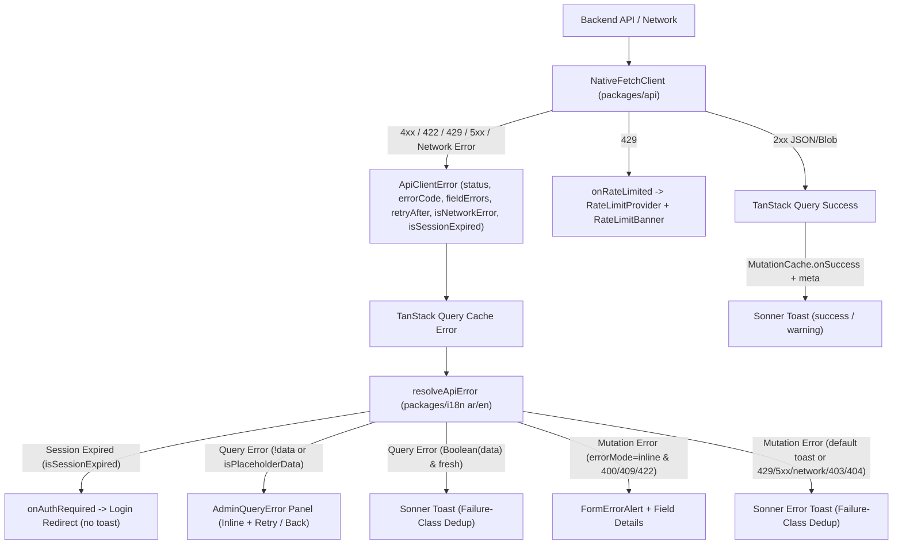

# Admin Backend Feedback Handling (Errors, Success & Recovery)

*   **Author:** Abdelrahman Eltokhy
*   **Status:** Proposed
*   **Date:** 2026-11-26

--------------------------------------------------------------------------------

## Overview

`apps/admin` currently handles backend responses inconsistently across its features. Some mutations succeed or fail silently, the existing error toast helper fails to look up backend error codes due to a property mismatch, failed data fetches look like empty tables, and inline error banners diverge from the shared design tokens and translation files.

This design defines a single feedback contract for `apps/admin` (along with the shared HTTP error normalization and translation fixes in `packages/api` and `packages/i18n` that admin depends on). It covers how backend successes, domain errors, validation errors, HTTP 429 rate limits, network errors, and query load failures are normalized, localized in Arabic (RTL) and English (LTR), and displayed to merchants.

## The Problem

Auditing `apps/admin`, `packages/api`, and `packages/i18n` shows six gaps:

1.  **Broken error-code translation lookup:** `packages/api/src/adapters/http/fetch-client.ts` throws `ApiClientError` with `errorCode` (plus `status`, `message`, `details`, and `retryAfter`). `apps/admin/src/lib/api-error-toast.ts` reads `errObj.code`, which is `undefined` on `ApiClientError`. As a result, backend error codes never resolve against `admin.errors.*`. In addition, `admin:errors.GENERIC_ERROR` is missing from both locale files, `retryAfter` is never interpolated into `RATE_LIMIT_EXCEEDED`, `packages/i18n/src/config.ts` omits `admin`, `auth`, and `account` from its `ns` array, and the helper falls back to a hardcoded English string.
2.  **Silent mutation failures and unhandled rejections:** `apps/admin/src/app/query-client.ts` defines no `MutationCache` or `QueryCache` error handler. Components such as `receipt-review-dialog.tsx` and `key-batch-import-sheet.tsx` wrap `mutateAsync` in empty `catch` blocks assuming TanStack Query handles errors globally, while `handleReject` and `handleExecuteRefund` in `receipt-review-dialog.tsx`, `handleToggleStatus` and `handleToggleFeatured` in `admin-products-route.tsx`, and `handleApprove` leave `mutateAsync` rejections uncaught. Separately, hooks used via `.mutate()` in `admin-promos-route.tsx` and `admin-audit-route.tsx` define no `onError` handler, causing failures to drop silently.
3.  **Missing and duplicated success feedback:** Only `categories` and part of `products` show success toasts. State-changing hooks in `orders`, `inventory`, `promos`, `tickets`, `audit`, and product image mutations have no shared success confirmation (while `admin-profile-route.tsx` and `key-update-dialog.tsx` render local inline success alerts). Conversely, `useUpdateProductStatus` delegates to `useUpdateProduct` (which fires a toast) while `admin-products-route.tsx` fires a second toast for both single and bulk status actions, and `ProductMediaSection` live edit handlers chain multiple mutations for one user click.
4.  **Silent query failures across admin views:** Data-fetching routes (dashboard, orders, products, product editor, categories, inventory, promos, tickets, ledger, audit) do not render an error state when `useQuery` fails. Only `admin-ticket-chat-sheet.tsx` and the receipt image blob query check `isError`. When the backend returns `403`, `429`, `5xx`, or is unreachable, merchants see empty lists, blank forms, or zeroed metrics with no explanation or retry action.
5.  **Incomplete HTTP error normalization:** `NativeFetchClient.request` only parses `apiErrorResponseSchema` (`{ error_code, message, details, retry_after }`). FastAPI's built-in `422` validation payloads (`{ detail: [{ loc, msg, type }] }`), plain `{ detail: "..." }` errors, non-JSON `5xx` bodies, proxy `2xx` non-JSON bodies, timeouts, and browser network `TypeError`s collapse to `REQUEST_FAILED` / `statusText` or unhandled exceptions without a normalized code.
6.  **Inconsistent feedback channels, hardcoded English strings, and non-semantic styling:** Inline feedback in `admin-profile-route.tsx`, `key-update-dialog.tsx`, `key-batch-import-sheet.tsx`, and `receipt-review-dialog.tsx` mixes local `Alert` state with raw palette classes (`emerald-*`, `amber-*`, `rose-*`) instead of `docs/design-system.md` tokens (`success`, `warning`, `destructive`), several target dialogs use `t('admin.xxx')` dot syntax instead of `admin:xxx`, and `product-editor-page.tsx` passes hardcoded English strings to `toast.error`.

## Goals

*   **Explicit outcomes for admin operations:** Every admin TanStack Query mutation surfaces localized success/warning feedback (unless an immediate post-action state such as post-create image upload summarizes the multi-step flow) and every mutation failure surfaces in either an inline form alert or a toast.
*   **Single HTTP error normalization contract:** HTTP responses (Muftahy domain errors, FastAPI `422` validation arrays, plain `{ detail }` payloads, `429` `Retry-After`, `5xx` responses, proxy non-JSON bodies) and network/timeout failures normalize in `NativeFetchClient` into one typed `ApiClientError` structure (`status`, `errorCode`, `message`, optional `fieldErrors` / `details`, `retryAfter`, `isNetworkError`, `isSessionExpired`).
*   **Bilingual localization (AR + EN):** Every mapped backend error code, fallback error, client-side validation check, query error panel, and client-authored confirmation resolves through `react-i18next` in Arabic (RTL) and English (LTR) with Western digits (`0-9`).
*   **Deterministic channel routing:** Forms/dialogs opt into inline alerts for `400`, `409`, and `422` errors while form-less table-row actions and transient failures (`429`, `5xx`, network, `403`, `404`) render via toast; initial query failures render inline error states with Retry while background refresh failures render deduplicated toasts.
*   **Recoverable query failures:** Every data-fetching admin route and detail sheet distinguishes a failed backend query from an empty dataset and lets the merchant retry (or navigate back on non-retryable `403`/`404` responses) without reloading the page.
*   **Design system and security compliance:** All feedback UI uses semantic tokens (`success`, `warning`, `destructive`, `info`) across light and dark modes, logical CSS properties, WCAG 2.1 AA live regions/focus management, and never exposes digital keys, auth tokens, or raw stack traces in toasts or logs.

## Non-Goals

*   **Storefront UI rollout:** Wiring toasts, inline alerts, or query error states into `apps/storefront` is out of scope (shared fixes in `packages/api` and `packages/i18n` remain storefront-compatible).
*   **Backend API changes:** This plan requires no new backend endpoints or changes to existing FastAPI response schemas.
*   **Offline mutation queue or notification center:** Failed requests are not queued for background replay, and there is no persistent notification history drawer.
*   **Fatal router crash boundary redesign:** `AdminRouteError` remains the React Router render-crash fallback.
*   **Unrelated palette cleanup or telemetry:** Replacing non-feedback Tailwind color utilities (such as dashboard KPI icons) and integrating external error telemetry (e.g., Sentry) are out of scope.

## Resolved Decisions

Open Questions: **None.** The five architectural decisions below govern this design:

*   **Mutation error dispatch:** Centralized in `MutationCache.onError`, with hooks defaulting to `'toast'` and mounted form call sites opting into `'inline'`.
*   **Success feedback ownership:** Centralized in `MutationCache.onSuccess` via typed `MutationMeta` populated through a thin typed mutation hook wrapper.
*   **Form and dialog failure channel:** Inline `FormErrorAlert` for `400`, `409`, and `422` errors inside open forms/dialogs/sheets; toast for `429`, `5xx`, network failures, and form-less table-row actions.
*   **Query failure presentation:** Inline `AdminQueryError` panel with Retry for initial load failures (`!data` or `isPlaceholderData`); deduplicated toast for background refresh failures (`Boolean(data) && !isPlaceholderData`).
*   **HTTP `429` rate-limit UX:** Shared session cooldown banner inside `AdminLayout` backed by a `RateLimitProvider` React Context (triggered via `NativeFetchClient`), paired with deduplicated toasts on mutations and background refetches (and local `retrySeconds` countdown on `/login`).

## Critical User Journeys (CUJs)

### CUJ 1: Merchant completes a state-changing action

*   **Given:** An authenticated admin is viewing an admin list, editor, or detail view in Arabic or English.
*   **When:** The merchant submits an action (e.g., approves an order, toggles a promo or product status, updates a key, resolves a ticket, or exports audit logs) and the backend returns `2xx`.
*   **Then:** Affected cached queries update/invalidate, any modal/sheet that completes its workflow closes, and exactly one localized confirmation toast appears.

### CUJ 2: Merchant submits a form or dialog that fails validation or a domain rule

*   **Given:** An authenticated admin submits a form, modal, or sheet (e.g., duplicate SKU/promo/category code, invalid order state, or missing required field).
*   **When:** Client validation fails or the backend returns `400`, `409`, or FastAPI `422`.
*   **Then:** The form or dialog stays open with the merchant's input preserved, `FormErrorAlert` displays the localized error summary (and field-level details where mapped without falling back to raw English for known codes), scrolls into view, and emits no duplicate toast.

### CUJ 3: Merchant hits a rate limit (`429`), server failure (`5xx`), or network outage

*   **Given:** An authenticated admin triggers any mutation or refresh while the backend is rate-limiting (`429`), returning `5xx`, timing out, or unreachable offline.
*   **When:** The request fails.
*   **Then:** `NativeFetchClient` classifies the failure (`RATE_LIMIT_EXCEEDED`, `SERVER_ERROR`, or `NETWORK_ERROR`), `RateLimitBanner` displays a session-wide Western-digit countdown on `429`, deduplicated toast feedback appears in the active language/direction and theme, and pending button states clear.

### CUJ 4: Admin page or detail sheet fails to load data

*   **Given:** An authenticated admin navigates to a data-fetching admin route or opens a detail dialog/sheet.
*   **When:** The initial `useQuery` load fails (`!data` or `isPlaceholderData`) due to `403`, `404`, `429`, `5xx`, or network error.
*   **Then:** The view renders `AdminQueryError` instead of an empty table, blank creation form, or zeroed KPIs, offering a Retry button for transient errors (disabled during active `429` cooldown) or a navigation fallback for `403`/`404`.

### CUJ 5: Batch or multi-step operation completes with partial or total failure

*   **Given:** An admin imports a key batch in `KeyBatchImportSheet`, runs bulk status toggles in `AdminProductsRoute`, or creates a product with staged images in `ProductEditorPage`.
*   **When:** Requests complete with a mix of successes and failures, or all items fail.
*   **Then:** Partial successes emit a single `toast.warning` with numeric counts only (never key serials) and preserve failed items for targeted retry; total failures (`succeeded === 0` or fatal `429`/`401`/`NETWORK_ERROR`) abort remaining requests and route through standard error handling.

## Technical Plan (Architecture)

The feedback system is organized into five layers matching the monorepo dependency direction (`apps/admin` imports from `packages/*`; `packages/ui` is untouched):

1.  **HTTP Error Normalization (`packages/api`):** Normalizes all HTTP error payloads, proxy non-JSON bodies, timeouts, `429` `Retry-After` headers, and network failures into `ApiClientError`, and surfaces `429` events via `onRateLimited`.
2.  **Localization & Error Resolution (`packages/i18n` & `apps/admin/src/lib/api-feedback.ts`):** Registers all namespaces in `i18n.init`, provides complete AR/EN error and confirmation keys, resolves `ApiClientError` / unknown errors into `ResolvedApiError`, and emits deduplicated Sonner toasts.
3.  **Centralized Query/Mutation Cache Dispatch (`apps/admin/src/app/query-client.ts` & `apps/admin/src/hooks/use-admin-mutation.ts`):** Dispatches mutation confirmations, inline vs. toast error routing, background query refresh toasts, and a rate-limit-safe query retry predicate via typed `MutationMeta` and `QueryMeta`.
4.  **Session Rate-Limit Cooldown Context (`apps/admin/src/app/rate-limit-context.tsx`):** Tracks active `429` cooldown deadlines inside `AdminLayout` using React Context without adding a global Zustand store.
5.  **Shared Feedback UI Components (`apps/admin/src/components/feedback/`):** Composes `@workspace/ui` primitives (`EmptyState`, `Alert`, `Button`, `Sonner`) into `AdminQueryError`, `FormErrorAlert`, and `RateLimitBanner` using semantic design tokens.



### Layer 1: HTTP Error Normalization (`packages/api`)

Keep HTTP wire parsing inside `packages/api/src/adapters/http/fetch-client.ts` rather than coupling FastAPI error transport shapes into `packages/domain/src/schemas/auth.ts`.

*   **Exported Types & Constructor (`packages/api/src/adapters/http/fetch-client.ts`):**
    ```ts
    export interface FieldValidationError {
      field: string
      message: string
      code?: string
    }

    export interface ApiClientErrorOptions {
      fieldErrors?: FieldValidationError[]
      isNetworkError?: boolean
      isSessionExpired?: boolean
    }
    ```
    Extend `ApiClientError` with a 6th optional `options?: ApiClientErrorOptions` parameter so existing 5-argument callers remain backward-compatible.
*   **Narrow Network & Timeout Wrapping:** Wrap only `fetchImpl(...)` in `try/catch`. Re-throw `AbortError` unchanged so TanStack Query cancellation works. Map `TimeoutError` (`DOMException` with `name === 'TimeoutError'`) and network `TypeError`s to `ApiClientError(0, 'NETWORK_ERROR', 'Network request failed', undefined, undefined, { isNetworkError: true })`.
*   **Error Response Normalization (`!response.ok`):**
    1.  Read response body safely (catching JSON parse errors on proxy HTML `502`/`503` responses without throwing `SyntaxError`).
    2.  Match Muftahy `apiErrorResponseSchema` (`{ error_code, message, details, retry_after }`). Extract `fieldErrors` if `details.field_errors` is an array or record.
    3.  Match FastAPI `422` `{ detail: Array<{ loc, msg, type }> }`, setting `errorCode = 'VALIDATION_ERROR'` and mapping each entry to `FieldValidationError`.
    4.  Match plain `{ detail: string }`, mapping HTTP status to `errorCode` (`400 -> BAD_REQUEST`, `401 -> AUTHENTICATION_FAILED`, `403 -> PERMISSION_DENIED`, `404 -> ENTITY_NOT_FOUND`, `409 -> CONFLICT`, `422 -> VALIDATION_ERROR`, `429 -> RATE_LIMIT_EXCEEDED`, `5xx -> SERVER_ERROR`, fallback `REQUEST_FAILED`).
    5.  For non-JSON or empty bodies, map HTTP status to the same status-based `errorCode` and store `response.statusText || \`HTTP \${response.status}\`` (never raw HTML).
*   **2xx Non-JSON Guard:** Guard `response.json()` on `2xx` responses with `application/json` content-type so a proxy returning `200 OK` HTML throws `ApiClientError(502, 'SERVER_ERROR', 'Invalid server response')` instead of an unnormalized `SyntaxError`.
*   **HTTP `429` & `401` Lifecycle Hooks (`FetchClientOptions` + `packages/api/src/factory.ts`):**
    *   Parse `Retry-After` (integer seconds or HTTP-date) or JSON `retry_after`, clamp to `[1, 300]` seconds, and default to `60` when missing/invalid.
    *   Add optional `onRateLimited?: (retryAfter: number) => void` on `FetchClientOptions` and `ServiceRegistry`, firing whenever a `429` is handled.
    *   On `401` after refresh fails (or no refresh token exists), mark `isSessionExpired: true` when `performTokenRefresh` clears tokens and invokes `onAuthRequired`. Note that `ServiceRegistry` relies on `tokenStorage.clearTokens()` triggering `AdminAuthProvider`'s `onTokensChanged` redirect listener.

### Layer 2: Localization & Error Resolver (`packages/i18n` & `apps/admin/src/lib/api-feedback.ts`)

*   **Namespace Registration (`packages/i18n/src/config.ts`):** Add `'admin'`, `'auth'`, and `'account'` to `ns` in `i18n.init(...)` while keeping `defaultNS: 'common'` unchanged so `apps/storefront` lookups are unaffected and `i18n.exists` / `i18n.t` resolve synchronously outside React hooks.
*   **Bilingual Key Reuse & Completion (`packages/i18n/src/locales/{en,ar}.json`):**
    *   Reuse existing `auth.errors.*` (`GENERIC_ERROR`, `NETWORK_ERROR`, `PERMISSION_DENIED`, `AUTHENTICATION_FAILED`, `RATE_LIMIT_EXCEEDED`) via fallback lookup instead of duplicating identical strings in `admin.errors.*`.
    *   Reuse existing `admin.categories.{createdSuccess,updatedSuccess,deletedSuccess}`, `admin.productEditor.savedSuccess`, `admin.productEditor.partialUploadError`, `admin.profile.updateSuccess`, and `admin.inventoryModule.updateSuccess`. Retire/fix the stale `admin.common.rateLimitExceeded` string (`"Automatic retry..."`) since auto-retry on `429` is disabled.
    *   Add missing domain error keys under `admin.errors.*` (`BAD_REQUEST`, `VALIDATION_ERROR`, `CONFLICT`, `SERVER_ERROR`, `REQUEST_FAILED`, `PRIMARY_IMAGE_CANNOT_BE_DELETED`, `PROMO_CODE_ALREADY_EXISTS`, `ORDER_INVALID_STATE`, `INSUFFICIENT_STOCK`) and missing confirmation/panel/validation keys under `admin.feedback.*`.
*   **Error Resolver & Toast Helpers (`apps/admin/src/lib/api-feedback.ts`):**
    *   Replace `api-error-toast.ts` (and fix `errObj.code` -> `error.errorCode`).
    *   Use `{ i18n } from '@workspace/i18n/config'` with a typed dynamic-key lookup helper (matching `packages/i18n/src/types.ts` strict keys without `any`), passing `formatNumber` from `@workspace/domain/formatters/number` for Western-digit counts and durations.
    *   **Resolution precedence:** (1) `admin:errors.${errorCode}`, (2) `auth:errors.${errorCode}`, (3) for `4xx` (excluding `422` Pydantic responses and key-mutation endpoints) accept `error.message` only when single-line, non-HTML, and `<= 160` characters, (4) otherwise use `fallbackKey` or `auth:errors.GENERIC_ERROR`.
    *   **Deduplicated Toast IDs:** Use failure-class IDs (`'admin-rate-limit'`, `'admin-network-error'`, `'admin-server-error'`, `'admin-query-refresh-error'`) so parallel query failures never produce notification storms, and never interpolate key serials, tokens, or stack traces into toast strings.

### Layer 3: Centralized Cache Dispatch & Typed Mutation Wrapper (`apps/admin/src/app/query-client.ts`, `apps/admin/src/hooks/use-admin-mutation.ts`)

*   **Typed Mutation Wrapper (`use-admin-mutation.ts`):** Because TanStack Query v5 `MutationMeta` is global and untyped per hook (`unknown`), provide a small `useAdminMutation<TData, TVariables>` wrapper that accepts typed `feedback` configuration (`successKey` or typed `getSuccessFeedback(data, variables)` and default `errorMode`) and serializes it into `MutationMeta` without requiring `unknown` casts in feature hooks.
*   **`MutationCache` & `QueryCache` Dispatch (`query-client.ts`):**
    *   Export named `createAdminQueryClient(options?)` and `queryClient = createAdminQueryClient()`. Set `mutations: { retry: false }`.
    *   `MutationCache.onSuccess`: if `!meta.suppressSuccessToast`, emit `toast.success` or `toast.warning` from the resolved feedback descriptor.
    *   `MutationCache.onError`: skip toast if `resolved.isSessionExpired`. If `meta.errorMode === 'inline'` and `resolved.isInlineCandidate` (`400 | 409 | 422`), return so `FormErrorAlert` displays it inline; otherwise emit deduplicated error toast.
    *   `QueryCache.onError`: skip toast if `resolved.isSessionExpired`. If `query.state.data === undefined` (initial load or fresh `placeholderData` page), emit **no** toast (including on `429`, where `AdminQueryError` + `RateLimitBanner` render on screen); if `query.state.data !== undefined`, emit a failure-class-deduplicated refresh error toast.
    *   **Query Retry Predicate:** Retry at most once (`failureCount < 1`) only when `error instanceof ApiClientError && (error.isNetworkError || error.status >= 500)`; return `false` for `400`, `401`, `403`, `404`, `409`, `422`, and `429`.

### Layer 4: Channel Routing & Mutation Coverage

| Event / Failure Class | Trigger Context | Primary UI Channel | Secondary Behavior |
| :--- | :--- | :--- | :--- |
| `2xx` Single Mutation | Any single CRUD/action hook | `toast.success` via `MutationCache` | Caller closes dialog/sheet on resolve |
| `2xx` Partial Batch | Key import (`failed_count > 0`) or bulk status | `toast.warning` (numeric counts only) | Failure list stays open; no serials in toast |
| `400` / `409` / `422` | Form/dialog hook called with `{ errorMode: 'inline' }` | `FormErrorAlert` + field errors | Dialog stays open; scrolls alert into view; no toast |
| `400` / `409` / `422` | Form-less table-row action (default `errorMode: 'toast'`) | `toast.error` via `MutationCache` | Localized error code shown |
| `429` Rate Limit | Any API request inside `AdminLayout` | `RateLimitBanner` (plus toast on mutations/refreshes) | Live Western-digit countdown; Retry disabled |
| `429` Rate Limit | `/login` (`AdminLoginForm`, outside `AdminLayout`) | Inline `FormErrorAlert` + local `retrySeconds` timer | Submit disabled until countdown finishes |
| `5xx` / `NETWORK_ERROR` / `403` / `404` | Any mutation | `toast.error` (failure-class dedup) | Form stays open; pending state cleared |
| Query Error (`!data \|\| isPlaceholderData`) | Initial page, card, or sheet load | Inline `AdminQueryError` (with Retry, or Back on `403`/`404`) | No toast |
| Query Error (`Boolean(data) && !isPlaceholderData`) | Background / manual refresh | `toast.error` (failure-class dedup) | Cached data remains visible |
| `401` Session Expired | Refresh token rejected/missing | `onAuthRequired` / `AdminGuard` redirect to `/login` | Suppresses stray error toasts |

#### Admin Mutation Hook Configuration

| Feature | Hook | Default `errorMode` | Form Call-Site Override | Success Confirmation |
| :--- | :--- | :--- | :--- | :--- |
| **Products** | `useCreateProduct`, `useUpdateProduct` | `toast` | `inline` (in `ProductEditorPage`) | `admin:productEditor.savedSuccess` |
| **Products** | `useUpdateProductStatus`, `useDeleteProduct` | `toast` | — | Published / draft / deleted |
| **Products** | `useBulkUpdateProductStatus` | `toast` | — | Summary `success` or partial `warning` |
| **Products Media** | `useUploadProductImage`, `useDeleteProductImage`, `useSetPrimaryProductImage`, `useReorderProductImages`, `useUploadProductThumbnail`, `useDeleteProductThumbnail` | `toast` (accepts `suppressSuccessToast` for live multi-upload/auto-thumbnail) | — | Specific media confirmation keys |
| **Categories** | `useCreateCategory`, `useUpdateCategory` | `toast` | `inline` (in `CategoryFormDialog`) | `admin:categories.createdSuccess` / `updatedSuccess` |
| **Categories** | `useDeleteCategory` | `toast` | — | `admin:categories.deletedSuccess` |
| **Orders** | `useStartOrderReview` | `toast` | — | `admin:feedback.orderReviewStarted` |
| **Orders** | `useReviewOrder`, `useRefundOrderItem` | `toast` | `inline` (in `ReceiptReviewDialog`) | Approved / rejected / refunded |
| **Inventory** | `useKeyBatchImport`, `useKeyUpdate` | `toast` | `inline` (in sheet/dialog) | Imported / partial `warning` / `admin:inventoryModule.updateSuccess` |
| **Promos** | `useCreatePromo`, `useUpdatePromo` | `toast` | `inline` (in `PromoFormDialog`) | Created / updated |
| **Promos** | `useTogglePromoStatus` | `toast` | — | Activated / deactivated |
| **Tickets** | `useAddTicketComment`, `useResolveTicket` | `toast` | `inline` (in sheet/dialog) | Reply sent / ticket resolved |
| **Audit** | `useExportAuditLogs` | `toast` | — | `admin:feedback.auditExported` |
| **Profile** | `useAdminProfile` (`updateMutation`) | `toast` | `inline` (in `AdminProfileRoute`) | `admin:profile.updateSuccess` |

*(Note: `AdminLoginForm` calls `useAdminAuth().login` directly without TanStack Query and renders inline `FormErrorAlert` via `resolveApiError`.)*

### Layer 5: Shared UI Components & Rate-Limit Context (`apps/admin`)

*   **`RateLimitProvider` (`apps/admin/src/app/rate-limit-context.tsx`):** React Context + provider mounted around `AdminLayout` (wired to `NativeFetchClient` `onRateLimited` and reset on logout), exposing `{ isLimited, remainingSeconds, triggerCooldown, clearCooldown }` without introducing a new global store.
*   **`RateLimitBanner` (`apps/admin/src/components/feedback/rate-limit-banner.tsx`):** Mounted inside `AdminLayout` above `<main>`, rendering `@workspace/ui/components/alert` with semantic `warning` tokens, `role="status"`, `aria-live="polite"`, and `tabular-nums` Western-digit countdown.
*   **`AdminQueryError` (`apps/admin/src/components/feedback/admin-query-error.tsx`):** Composes existing `EmptyState` for `page`/`section` densities and an `Alert`-based `compact` layout for cards/modals. Subscribes to `useTranslation()`, resolves copy via `resolveApiError`, hides/replaces Retry with a Dashboard/Back action on `403`/`404`, and disables Retry with countdown text during active `429` cooldown. Wired into all 10 data-fetching routes (`dashboard`, `orders`, `products`, `product-editor`, `categories`, `inventory`, `promos`, `tickets`, `ledger`, `audit`) plus 3 detail dialogs/sheets (`AdminTicketChatSheet`, `ReceiptReviewDialog`, `TicketResolveDialog`). Not wired into `AdminProfileRoute` because `useAdminProfile` intentionally falls back to `authUser`.
*   **`FormErrorAlert` (`apps/admin/src/components/feedback/form-error-alert.tsx`):** Accepts `{ error?: unknown; clientError?: string | null; className?: string }` directly (removing the need for a separate `useInlineMutationError` hook or RHF `setError` mapper). Renders `Alert` (`variant="destructive"`) when `clientError` is set or `resolveApiError(error).isInlineCandidate` is true, displays root + field-level messages, and scrolls into view on new error.
*   **`Toaster` Positioning (`apps/admin/src/app/root-layout.tsx`):** Pass `position={currentLang === 'ar' ? 'bottom-left' : 'bottom-right'}` (with comment noting the third-party prop requires physical names).

## Alternatives Considered

### Alternative A: Distributed Per-Hook Error and Success Handlers

*   **Pros:** Self-contained feature hooks with direct `(data, variables, error)` inference and no `MutationMeta` bridging.
*   **Cons:** Relies on manual consistency across 20+ hooks—the pattern that left `orders`, `inventory`, `promos`, `tickets`, and `audit` silent while duplicating toasts in `admin-products-route.tsx`.
*   **Reason for Rejection:** Centralizing default dispatch in `MutationCache` (paired with a thin typed `useAdminMutation` wrapper) enforces uniform fallback and avoids boilerplate across hooks.

### Alternative B: UI-Component-Owned Success Toasts at Call Sites

*   **Pros:** Call sites have full UI context for single vs. batch flows.
*   **Cons:** Hooks invoked from multiple views force duplicate success copy and i18n keys at every call site, risking silent omissions.
*   **Reason for Rejection:** Attaching confirmations to mutations via `useAdminMutation` + `MutationCache` keeps keys in one place while call-site options handle batch overrides cleanly.

### Alternative C: Toast-Only Feedback for Form Validation & Conflict Errors (`400`/`409`/`422`)

*   **Pros:** Eliminates `FormErrorAlert` and per-form error wiring.
*   **Cons:** Transient toasts auto-dismiss away from form inputs while merchants inspect field errors.
*   **Reason for Rejection:** Forms and dialogs need persistent inline errors next to inputs, reserving toasts for transient infrastructure errors (`429`, `5xx`, network) and form-less table actions.

### Alternative D: Toast-Only Handling for Failed Admin Queries

*   **Pros:** Requires no route-level `AdminQueryError` rendering.
*   **Cons:** Initial load failures leave merchants looking at empty tables, blank forms, or `0` KPI cards without a Retry control.
*   **Reason for Rejection:** Initial failures (`!data || isPlaceholderData`) require inline `AdminQueryError`, reserving toasts for background refresh failures on already-rendered data.

### Alternative E: Toast-Only `429` Handling or Global Zustand Store

*   **Pros:** Skips layout banner wiring or reuses Zustand directly.
*   **Cons:** A transient toast disappears during a 60s rate-limit window, while adding another Zustand store conflicts with `AGENTS.md` ("Cart: Zustand. Nothing else gets a global store without asking").
*   **Reason for Rejection:** A React Context (`RateLimitProvider`) scoped to `AdminLayout` provides a persistent cooldown banner without adding a new global Zustand store.

### Alternative F: Joint Admin and Storefront UI Rollout

*   **Pros:** Aligns both apps in one effort.
*   **Cons:** Doubles review, translation, and testing scope across customer checkout and account flows.
*   **Reason for Rejection:** Limiting UI changes to `apps/admin` while keeping `packages/api` and `packages/i18n` fixes shared delivers admin reliability without delaying behind storefront scope.

## Risks & Mitigations

| Risk / Constraint | Impact | Mitigation |
| :--- | :--- | :--- |
| Cross-origin CORS hides `Retry-After` header unless `Access-Control-Expose-Headers: Retry-After` is set on backend | `429` countdown falls back to default | Prefer JSON `retry_after` when present, clamp parsed values to `[1, 300]` seconds, and default to `60`s |
| In-memory `RateLimitProvider` state resets on full reload and does not sync across browser tabs | Merchant may retry early after reload/tab switch | Acceptable inside a 60s window; next `429` re-arms cooldown immediately and query auto-retries on `429` remain disabled |
| `placeholderData: keepPreviousData` leaves `useQuery().data` truthy while new page cache key has `query.state.data === undefined` | Silent query failure on pagination/filter switch | Guard route error checks with `isError && (!data || isPlaceholderData)` |
| Bulk status toggles against 30 req/60s budget | Parallel burst triggers `429` storm and partial updates | Execute `useBulkUpdateProductStatus` sequentially, abort on `429`/`401`/`NETWORK_ERROR`, and re-throw on zero successes |
| Backend FastAPI `422` `msg` strings are English-only | Raw English text leaks into Arabic UI | Display localized `admin:errors.VALIDATION_ERROR` summary plus field identifiers rather than raw English `msg` strings; sanitize unmapped `4xx` messages |

## Non-Functional Requirements

*   **Security & Privacy:** Never interpolate digital key serials, bearer/refresh tokens, or raw stack traces into toasts, inline alerts, or `console.log`. On `5xx` or unknown errors, show localized `admin:errors.SERVER_ERROR` / `auth:errors.GENERIC_ERROR` only (never raw server bodies or HTML). Unmapped `4xx` messages are suppressed on key endpoints and capped to single-line non-HTML text `<= 160` characters.
*   **Accessibility & Bilingual RTL/LTR (WCAG 2.1 AA):** All client-authored messages and known error codes are translated in `ar` (RTL) and `en` (LTR) with Western digits (`0-9`) via `formatNumber` and `tabular-nums`. `FormErrorAlert` (`role="alert"`) scrolls into view on submission error; `RateLimitBanner` uses `role="status"` and `aria-live="polite"`; semantic tokens (`destructive`, `warning`, `success`) are paired with icons and text in both light and dark themes.
*   **Rate-Limit Conservation:** Query `retry` predicate disables automatic retries on `400`, `401`, `403`, `404`, `409`, `422`, and `429`; failure-class toast IDs collapse simultaneous parallel outages; `RateLimitProvider` clears its 1-second interval immediately at `0` or unmount.

## Additional Resources

*   [AGENTS.md](../../AGENTS.md) — monorepo boundaries, UI/shadcn rules, RTL/i18n, state management, and security-minded UI constraints.
*   [design-system.md](../design-system.md) — semantic color tokens (`destructive`, `warning`, `success`, `info`), contrast ratios, and dark mode rules.
*   [admin-backend-api-integration.md](./admin-backend-api-integration.md) — documents the 30 req/60s rate-limit budget and original unimplemented `429` interceptor design notes.
*   [fetch-client.ts](../../packages/api/src/adapters/http/fetch-client.ts) — existing `NativeFetchClient` and `ApiClientError` implementation.

## Future Improvements

*   **Storefront Feedback Rollout:** Apply `MutationCache`/`QueryCache` dispatch and inline form error alerts to `apps/storefront` using the shared `NativeFetchClient` normalization and `packages/i18n` fixes.
*   **Shared Error Resolver Extraction:** Extract `resolveApiError` into a shared workspace package once both apps adopt identical error-resolution rules.

--------------------------------------------------------------------------------

## Detailed Implementation Plan

### Complete Bilingual i18n Key Catalog (`packages/i18n/src/locales/{en,ar}.json`)

**Reused existing keys (no duplicates added):**
*   `auth:errors.{GENERIC_ERROR, NETWORK_ERROR, PERMISSION_DENIED, AUTHENTICATION_FAILED, RATE_LIMIT_EXCEEDED}`
*   `admin:categories.{createdSuccess, updatedSuccess, deletedSuccess}`
*   `admin:productEditor.{savedSuccess, partialUploadError}`
*   `admin:profile.updateSuccess`
*   `admin:inventoryModule.{updateSuccess, cancelReasonRequired}`

**Updated / retired keys:**
*   `admin:common.rateLimitExceeded` — update copy from `"Automatic retry in {{seconds}}s."` to `"Rate limit reached. Please wait {{seconds}}s before retrying."` (AR: `"تم تجاوز حد الطلبات. يرجى الانتظار {{seconds}} ثانية قبل المحاولة مجدداً."`).

**New keys to add under `admin.errors.*` and `admin.feedback.*`:**

| Key Path | Params | English (`en.json`) | Arabic (`ar.json`) |
| :--- | :--- | :--- | :--- |
| `admin.errors.BAD_REQUEST` | — | `The request could not be processed. Check your input and try again.` | `تعذر تنفيذ الطلب. تحقق من البيانات المدخلة وأعد المحاولة.` |
| `admin.errors.VALIDATION_ERROR` | — | `Please check the highlighted fields and try again.` | `يرجى التحقق من الحقول المطلوبة وإعادة المحاولة.` |
| `admin.errors.CONFLICT` | — | `This action conflicts with the current state of the record.` | `يتعارض هذا الإجراء مع الحالة الحالية للسجل.` |
| `admin.errors.SERVER_ERROR` | — | `A server error occurred. Please try again in a moment.` | `حدث خطأ في الخادم. يرجى المحاولة مرة أخرى بعد قليل.` |
| `admin.errors.REQUEST_FAILED` | — | `The request failed. Please try again.` | `فشل تنفيذ الطلب. يرجى المحاولة مرة أخرى.` |
| `admin.errors.PRIMARY_IMAGE_CANNOT_BE_DELETED` | — | `Set another image as primary before deleting this one.` | `يرجى تعيين صورة أخرى كصورة رئيسية قبل حذف هذه الصورة.` |
| `admin.errors.PROMO_CODE_ALREADY_EXISTS` | — | `A discount code with this code already exists.` | `يوجد رمز خصم مسجل بنفس الرمز مسبقاً.` |
| `admin.errors.ORDER_INVALID_STATE` | — | `This order cannot be updated in its current status.` | `لا يمكن تنفيذ هذا الإجراء على الطلب في حالته الحالية.` |
| `admin.errors.INSUFFICIENT_STOCK` | — | `Not enough keys in stock to complete this operation.` | `لا تتوفر مفاتيح كافية في المخزون لإتمام هذه العملية.` |
| `admin.feedback.queryErrorTitle` | — | `Failed to load data` | `تعذر تحميل البيانات` |
| `admin.feedback.queryErrorDesc` | — | `Something went wrong while fetching this section. Try again.` | `حدث خطأ أثناء جلب هذه البيانات. يمكنك إعادة المحاولة.` |
| `admin.feedback.retry` | — | `Retry` | `إعادة المحاولة` |
| `admin.feedback.retrying` | — | `Retrying...` | `جاري إعادة المحاولة...` |
| `admin.feedback.retryIn` | `seconds` | `Retry in {{seconds}}s` | `إعادة المحاولة خلال {{seconds}} ث` |
| `admin.feedback.backToDashboard` | — | `Back to Dashboard` | `العودة إلى لوحة التحكم` |
| `admin.feedback.backgroundRefreshFailed` | — | `Could not refresh data. Showing last loaded results.` | `تعذر تحديث البيانات. يتم عرض آخر نتائج محمّلة.` |
| `admin.feedback.rateLimitBannerTitle` | — | `Too many requests` | `تم تجاوز الحد المسموح للطلبات` |
| `admin.feedback.rateLimitBannerDesc` | `seconds` | `Requests are paused for {{seconds}}s to respect server limits.` | `تم إيقاف الطلبات مؤقتاً لمدة {{seconds}} ثانية للحفاظ على استقرار الخدمة.` |
| `admin.feedback.productDeleted` | — | `Product deleted` | `تم حذف المنتج` |
| `admin.feedback.productPublished` | — | `Product published to storefront` | `تم نشر المنتج في المتجر` |
| `admin.feedback.productUnpublished` | — | `Product moved to draft` | `تم تحويل المنتج إلى مسودة` |
| `admin.feedback.productBulkStatusSuccess` | `count` | `Updated {{count}} products` | `تم تحديث {{count}} منتجات` |
| `admin.feedback.productBulkStatusPartial` | `succeeded`, `total` | `Updated {{succeeded}} of {{total}} products; some failed.` | `تم تحديث {{succeeded}} من أصل {{total}} منتجات؛ تعذر تحديث البقية.` |
| `admin.feedback.imageUploaded` | — | `Product image uploaded` | `تم رفع صورة المنتج` |
| `admin.feedback.imagesUploadedPartial` | `succeeded`, `total` | `Uploaded {{succeeded}} of {{total}} images; some failed.` | `تم رفع {{succeeded}} من أصل {{total}} صور؛ تعذر رفع البقية.` |
| `admin.feedback.imageDeleted` | — | `Product image removed` | `تم حذف صورة المنتج` |
| `admin.feedback.primaryImageUpdated` | — | `Primary product image updated` | `تم تعيين الصورة الرئيسية للمنتج` |
| `admin.feedback.imagesReordered` | — | `Image order saved` | `تم حفظ ترتيب الصور` |
| `admin.feedback.thumbnailUploaded` | — | `Thumbnail updated` | `تم تحديث الصورة المصغرة` |
| `admin.feedback.thumbnailDeleted` | — | `Thumbnail removed` | `تمت إزالة الصورة المصغرة` |
| `admin.feedback.orderReviewStarted` | — | `Order moved to under review` | `تم نقل الطلب إلى قيد المراجعة` |
| `admin.feedback.orderApproved` | — | `Order approved and keys delivered` | `تمت الموافقة على الطلب وتسليم المفاتيح` |
| `admin.feedback.orderRejectedWrongAmount` | — | `Order rejected (wrong amount)` | `تم رفض الطلب (مبلغ غير مطابق)` |
| `admin.feedback.orderRejectedRefund` | — | `Order rejected and marked for refund` | `تم رفض الطلب وتحويله للاسترداد` |
| `admin.feedback.orderItemRefunded` | — | `Order item refunded` | `تم استرداد قيمة عنصر الطلب` |
| `admin.feedback.keysImportedSuccess` | `count` | `Imported {{count}} keys successfully` | `تم استيراد {{count}} مفاتيح بنجاح` |
| `admin.feedback.keysImportedPartial` | `imported`, `failed` | `Imported {{imported}} keys; {{failed}} failed.` | `تم استيراد {{imported}} مفاتيح؛ فشل استيراد {{failed}}.` |
| `admin.feedback.keysImportNone` | `failed` | `No keys were imported ({{failed}} failed).` | `لم يتم استيراد أي مفاتيح (فشل {{failed}}).` |
| `admin.feedback.promoCreated` | — | `Discount code created` | `تم إنشاء رمز الخصم` |
| `admin.feedback.promoUpdated` | — | `Discount code updated` | `تم تحديث رمز الخصم` |
| `admin.feedback.promoActivated` | — | `Discount code activated` | `تم تفعيل رمز الخصم` |
| `admin.feedback.promoDeactivated` | — | `Discount code deactivated` | `تم تعطيل رمز الخصم` |
| `admin.feedback.ticketReplySent` | — | `Reply sent` | `تم إرسال الرد` |
| `admin.feedback.ticketResolved` | — | `Ticket resolved` | `تم إغلاق التذكرة وحلها` |
| `admin.feedback.auditExported` | — | `Audit log exported` | `تم تصدير سجل النشاط` |
| `admin.feedback.validation.titleRequired` | — | `Product title is required` | `عنوان المنتج مطلوب` |
| `admin.feedback.validation.basePriceRequired` | — | `Valid base price is required` | `السعر الأساسي الصحيح مطلوب` |
| `admin.feedback.validation.salePriceLessThanBase` | — | `Sale price must be less than base price` | `سعر التخفيض يجب أن يكون أقل من السعر الأساسي` |
| `admin.feedback.validation.categoryRequired` | — | `Category is required` | `التصنيف مطلوب` |
| `admin.feedback.validation.skuRequired` | — | `SKU is required` | `رمز SKU مطلوب` |
| `admin.feedback.validation.skuInvalid` | — | `Invalid SKU format for selected category` | `صيغة رمز SKU غير صالحة للتصنيف المختار` |
| `admin.feedback.validation.categoryNameRequired` | — | `Category name is required` | `اسم التصنيف مطلوب` |
| `admin.feedback.validation.categoryCodeRequired` | — | `Category code is required` | `رمز التصنيف مطلوب` |

---

### Core Interfaces & Signatures

```ts
// packages/api/src/adapters/http/fetch-client.ts
export interface FieldValidationError {
  field: string
  message: string
  code?: string
}

export interface ApiClientErrorOptions {
  fieldErrors?: FieldValidationError[]
  isNetworkError?: boolean
  isSessionExpired?: boolean
}

export class ApiClientError extends Error {
  readonly status: number
  readonly errorCode: string
  readonly details?: Record<string, unknown>
  readonly retryAfter?: number
  readonly fieldErrors?: FieldValidationError[]
  readonly isNetworkError: boolean
  readonly isSessionExpired: boolean

  constructor(
    status: number,
    errorCode: string,
    message: string,
    details?: Record<string, unknown>,
    retryAfter?: number,
    options?: ApiClientErrorOptions,
  )
}

export interface FetchClientOptions {
  baseURL?: string
  tokenStorage?: TokenStorage
  onAuthRequired?: () => void
  onRateLimited?: (retryAfter: number) => void
  fetchFn?: typeof fetch
}
```

```ts
// apps/admin/src/lib/api-feedback.ts
export interface FeedbackDescriptor {
  key: string
  params?: Record<string, string | number>
  variant?: 'success' | 'warning'
}

export interface ResolvedApiError {
  status: number
  errorCode: string
  message: string
  fieldErrors: Record<string, string> // first error per field; empty loc maps to '_root'
  retryAfter?: number
  isInlineCandidate: boolean // status === 400 || status === 409 || status === 422
  isRateLimited: boolean     // status === 429 || errorCode === 'RATE_LIMIT_EXCEEDED'
  isNetworkError: boolean
  isSessionExpired: boolean
}

export function resolveApiError(error: unknown, fallbackKey?: string): ResolvedApiError
export function showFeedbackToast(descriptor: FeedbackDescriptor): void
export function showResolvedErrorToast(resolved: ResolvedApiError): void
export function showBackgroundRefetchToast(resolved: ResolvedApiError): void
```

```ts
// apps/admin/src/components/feedback/admin-query-error.tsx & form-error-alert.tsx
export interface AdminQueryErrorProps {
  error: unknown
  onRetry?: () => void
  isRetrying?: boolean
  variant?: 'page' | 'section' | 'compact'
  cooldownSeconds?: number | null
  className?: string
}

export interface FormErrorAlertProps {
  error?: unknown
  clientError?: string | null
  className?: string
}
```

---

### Phased Implementation Plan

#### Phase 1: Shared HTTP Error Normalization & i18n (`packages/api`, `packages/i18n`)

1.  **`packages/api/src/adapters/http/fetch-client.ts`** (Modify)
    *   **Proposed Changes:** Add `FieldValidationError`, `ApiClientErrorOptions`, 6th `options` arg on `ApiClientError`, `onRateLimited` on `FetchClientOptions`, narrow `try/catch` around `fetchImpl` (`AbortError` rethrown; `TimeoutError` and `TypeError` mapped to `NETWORK_ERROR`), safe JSON/non-JSON parsing on both error and `2xx` paths, FastAPI `422` (`loc` minus leading `body`/`query`/`path`) + `details.field_errors` extraction, plain `{ detail }` status mapping, `[1, 300]` `Retry-After` clamping with `60`s fallback, and `isSessionExpired: true` when `performTokenRefresh` clears tokens and calls `onAuthRequired`.
2.  **`packages/api/src/factory.ts`** (Modify)
    *   **Proposed Changes:** Accept optional global/client rate-limit listener registration (`setRateLimitHandler(handler)`) in `ServiceRegistry` and forward it as `onRateLimited` into admin `NativeFetchClient` instances.
3.  **`packages/api/src/adapters/http/fetch-client.test.ts`** (Modify)
    *   **Proposed Changes:** Cover FastAPI `422` `fieldErrors`, `details.field_errors`, plain `{ detail }`, `502` HTML fallback, `200` non-JSON proxy guard, network `TypeError`, `TimeoutError`, `AbortError` passthrough, `Retry-After` integer/HTTP-date/clamping/`60`s default, `onRateLimited`, and `isSessionExpired`.
4.  **`packages/i18n/src/config.ts`** (Modify)
    *   **Proposed Changes:** Add `'admin'`, `'auth'`, and `'account'` to `ns` in `i18n.init(...)` while keeping `defaultNS: 'common'`.
5.  **`packages/i18n/src/locales/en.json` & `packages/i18n/src/locales/ar.json`** (Modify)
    *   **Proposed Changes:** Add all keys listed in the i18n Key Catalog above and update `admin.common.rateLimitExceeded`.
*   **Phase 1 Checkpoint:** `pnpm --filter @workspace/api test && pnpm --filter @workspace/api typecheck && pnpm --filter @workspace/i18n typecheck && pnpm --filter storefront build`.

#### Phase 2: Admin Core Feedback Infrastructure (`apps/admin/src/lib`, `apps/admin/src/app`, `apps/admin/src/hooks`)

6.  **`apps/admin/src/lib/api-feedback.ts`** (Create)
    *   **Proposed Changes:** Implement `resolveApiError`, `showFeedbackToast`, `showResolvedErrorToast`, and `showBackgroundRefetchToast` using `{ i18n } from '@workspace/i18n/config'`, typed dynamic key lookup matching `packages/i18n/src/types.ts`, `formatNumber` from `@workspace/domain/formatters/number`, first-error-wins `fieldErrors` mapping, `4xx` message safety cap (`<= 160` chars, single-line, non-HTML, suppressed on key endpoints), and failure-class Sonner toast IDs (`admin-rate-limit`, `admin-network-error`, `admin-server-error`, `admin-query-refresh-error`).
7.  **`apps/admin/src/lib/api-feedback.test.ts`** (Create)
    *   **Proposed Changes:** Verify EN and AR resolution, `RATE_LIMIT_EXCEEDED` Western-digit interpolation, `400`/`409`/`422` inline classification, `5xx` sanitization, `4xx` length/HTML guard, and failure-class toast deduplication.
8.  **`apps/admin/src/app/rate-limit-context.tsx`** (Create)
    *   **Proposed Changes:** Implement `RateLimitProvider` and `useRateLimitCooldown()` (`{ isLimited, remainingSeconds, triggerCooldown, clearCooldown }`) using React Context + single 1-second timer cleared at `0` or unmount, registering with `ServiceRegistry.setRateLimitHandler` on mount and clearing on unmount/logout.
9.  **`apps/admin/src/app/rate-limit-context.test.tsx`** (Create)
    *   **Proposed Changes:** Verify timer countdown with fake timers, overlapping `Math.max` extension, cleanup at `0`, and `clearCooldown` on logout.
10. **`apps/admin/src/app/query-meta.d.ts`** (Create)
    *   **Proposed Changes:** Augment `@tanstack/react-query` `Register` with `AdminMutationMeta` (`successDescriptor`, `getSuccessDescriptor`, `suppressSuccessToast`, `errorMode?: 'toast' | 'inline'`, `errorFallbackKey`) and `AdminQueryMeta` (`suppressErrorToast`, `errorFallbackKey`).
11. **`apps/admin/src/hooks/use-admin-mutation.ts`** (Create)
    *   **Proposed Changes:** Export `useAdminMutation` wrapping `useMutation` with strongly typed `feedback: { successKey?: string; getSuccessFeedback?: (data, variables) => FeedbackDescriptor | null; errorMode?: 'toast' | 'inline'; suppressSuccessToast?: boolean; errorFallbackKey?: string }` mapped into `MutationMeta`.
12. **`apps/admin/src/app/query-client.ts`** (Modify)
    *   **Proposed Changes:** Export named `createAdminQueryClient()` and `export const queryClient = createAdminQueryClient()`. Configure `MutationCache` (`onSuccess`, `onError`), `QueryCache` (`onError`), `mutations: { retry: false }`, and the query retry predicate (`failureCount < 1` only for `NETWORK_ERROR` or `status >= 500`).
13. **`apps/admin/src/app/query-client.test.ts`** (Create)
    *   **Proposed Changes:** Test `MutationCache.onSuccess` (`success` and `warning` variants, `suppressSuccessToast`), `MutationCache.onError` (`toast`, `inline` skipping `400`/`409`/`422` while toasting `429`/`5xx`/`NETWORK_ERROR`, `isSessionExpired` suppression), `QueryCache.onError` (`!data` silent including `429` vs `Boolean(data)` failure-class toast), and retry predicate.
14. **`apps/admin/src/app/root-layout.tsx`** (Modify)
    *   **Proposed Changes:** Add `position={currentLang === 'ar' ? 'bottom-left' : 'bottom-right'}` on `<Toaster />` with comment documenting why the library prop requires physical values.
*   **Phase 2 Checkpoint:** `pnpm --filter admin typecheck && pnpm --filter admin test src/lib/api-feedback.test.ts src/app/rate-limit-context.test.tsx src/app/query-client.test.ts`.

#### Phase 3: Shared Admin Feedback UI Components (`apps/admin/src/components/feedback`, `apps/admin/src/features/dashboard/components`)

15. **`apps/admin/src/components/feedback/admin-query-error.tsx`** (Create)
    *   **Proposed Changes:** Compose `EmptyState` (`page`/`section`) and semantic `Alert` (`compact`). Subscribe to `useTranslation(['admin', 'auth'])` and `useRateLimitCooldown()`, display localized message via `resolveApiError`, replace Retry with a `Back to Dashboard` link on `403`/`404`, and disable Retry with `retryIn` text while `isLimited` is active.
16. **`apps/admin/src/components/feedback/admin-query-error.test.tsx`** (Create)
    *   **Proposed Changes:** Verify EN and AR RTL rendering, Retry callback, `isRetrying` disabled state, cooldown disabled state, and `403`/`404` back link behavior.
17. **`apps/admin/src/components/feedback/form-error-alert.tsx`** (Create)
    *   **Proposed Changes:** Render `@workspace/ui/components/alert` (`variant="destructive"`) when `clientError` is present or `resolveApiError(error).isInlineCandidate` (`400`/`409`/`422`) is true, show mapped `fieldErrors` entries, subscribe to `useTranslation()`, and scroll into view on new error.
18. **`apps/admin/src/components/feedback/form-error-alert.test.tsx`** (Create)
    *   **Proposed Changes:** Verify `null` render for `500`/`429`/empty error, `clientError` rendering, `400`/`409`/`422` summary + `fieldErrors` list in EN and AR, and `role="alert"`.
19. **`apps/admin/src/components/feedback/rate-limit-banner.tsx`** (Create)
    *   **Proposed Changes:** Read `useRateLimitCooldown()`, render `@workspace/ui/components/alert` with semantic `warning` tokens (`border-warning/30 bg-warning/10`), `role="status"`, `aria-live="polite"`, and `tabular-nums` Western-digit countdown.
20. **`apps/admin/src/components/feedback/rate-limit-banner.test.tsx`** (Create)
    *   **Proposed Changes:** Verify live countdown visibility in EN and AR and removal upon expiry.
21. **`apps/admin/src/features/dashboard/components/admin-layout.tsx` & `apps/admin/src/features/auth/context/admin-auth-provider.tsx`** (Modify)
    *   **Proposed Changes:** Wrap `AdminLayout` in `RateLimitProvider` and render `<RateLimitBanner />` above `<main>`. In `admin-auth-provider.tsx`, call `clearCooldown` (or clear via `ServiceRegistry` callback) on logout, and throw `new ApiClientError(403, 'PERMISSION_DENIED', 'Access denied: not an administrator token')` when audience !== `'admin'`.
*   **Phase 3 Checkpoint:** `pnpm --filter admin typecheck && pnpm --filter admin test src/components/feedback/`.

#### Phase 4: Feature Hooks, Forms/Dialogs/Sheets, Legacy Cleanup, & Feature Tests (`apps/admin/src/features`)

22. **`apps/admin/src/features/products/hooks/use-admin-products.ts`** (Modify)
    *   **Proposed Changes:** Remove `toast` / `showApiErrorToast` imports. Migrate mutations to `useAdminMutation`: `useCreateProduct` and `useUpdateProduct` accept optional `{ errorMode?: 'toast' | 'inline' }` (default `'toast'`); refactor `useUpdateProductStatus` to call `service.updateProduct(id, { is_active })` directly preserving `setQueryData`/`setQueriesData`/`invalidateQueries`; add `useBulkUpdateProductStatus` running sequentially with abort on `429`/`isSessionExpired`/`NETWORK_ERROR` and re-throwing if `succeeded === 0`; add optional `{ suppressSuccessToast?: boolean }` on image/thumbnail hooks for live composite flows.
23. **`apps/admin/src/features/categories/hooks/use-admin-categories.ts`** (Modify)
    *   **Proposed Changes:** Remove `toast` / `showApiErrorToast` imports. Migrate to `useAdminMutation` (`useCreateCategory` and `useUpdateCategory` accept optional `{ errorMode }`, default `'toast'`; `useDeleteCategory` uses `'toast'` with default generic fallback—removing the misleading `CATEGORY_HAS_PRODUCTS` fallback).
24. **`apps/admin/src/lib/api-error-toast.ts`** (Delete)
    *   **Proposed Changes:** Delete now that all callers (`use-admin-categories.ts`, `use-admin-products.ts`) have migrated.
25. **`apps/admin/src/features/orders/hooks/use-admin-orders.ts`** (Modify)
    *   **Proposed Changes:** Migrate `useStartOrderReview` (`toast`), `useReviewOrder` (accepting `{ errorMode }`, branching `variables.payload.action` across `'approve'`, `'reject_wrong_amount'`, `'reject_refund'`), and `useRefundOrderItem` (accepting `{ errorMode }`) to `useAdminMutation`.
26. **`apps/admin/src/features/inventory/hooks/use-inventory.ts`** (Modify)
    *   **Proposed Changes:** Migrate `useKeyBatchImport` (accepting `{ errorMode }`, emitting `keysImportedSuccess`, `keysImportedPartial`, or `keysImportNone` warning with counts only) and `useKeyUpdate` (accepting `{ errorMode }`, using `admin:inventoryModule.updateSuccess`) to `useAdminMutation`.
27. **`apps/admin/src/features/promos/hooks/use-promos.ts`** (Modify)
    *   **Proposed Changes:** Migrate `useCreatePromo` and `useUpdatePromo` (accepting `{ errorMode }`), and refactor `useTogglePromoStatus` to call `service.updatePromo(code, { is_active })` directly preserving `setQueryData` on `promoKeys.detail` and `promoKeys.list()` plus `invalidateQueries`.
28. **`apps/admin/src/features/tickets/hooks/use-tickets.ts`**, **`apps/admin/src/features/audit/hooks/use-audit-logs.ts`**, & **`apps/admin/src/features/profile/hooks/use-admin-profile.ts`** (Modify)
    *   **Proposed Changes:** Migrate `useAddTicketComment`, `useResolveTicket`, `useExportAuditLogs`, and `useAdminProfile`'s `updateMutation` to `useAdminMutation` with their mapped confirmation keys and optional `{ errorMode }`.
29. **`apps/admin/src/features/products/components/product-editor-page.tsx` & `product-media-section.tsx`** (Modify)
    *   **Proposed Changes:** In `product-editor-page.tsx`, render `AdminQueryError` when `isEditing && isError && !product` (`useAdminProductDetail` or `useAdminCategories` initial failure), pass `{ errorMode: 'inline' }` to create/update hooks, replace hardcoded English validation `toast.error` checks with localized `clientValidationError` state rendered via `FormErrorAlert`, keep direct post-create staged uploads, invalidate `adminProductKeys.all`, and emit `toast.warning('admin:productEditor.partialUploadError')` on partial failure. In `product-media-section.tsx`, suppress per-call duplicate toasts during live multi-file upload and `handleSetPrimaryLive` auto-thumbnail, and localize client file rejections.
30. **`apps/admin/src/features/categories/components/category-form-dialog.tsx`** (Modify)
    *   **Proposed Changes:** Pass `{ errorMode: 'inline' }`, pass `clientError` + active mutation `error` to `FormErrorAlert`, localize client required checks (`categoryNameRequired`, `categoryCodeRequired`), reset mutations on dialog open/close, and remove the empty `catch` comment (`try/catch` keeps dialog open).
31. **`apps/admin/src/features/orders/components/receipt-review-dialog.tsx`** (Modify)
    *   **Proposed Changes:** Pass `{ errorMode: 'inline' }` to `useReviewOrder` and `useRefundOrderItem`, wrap `handleApprove`, `handleReject`, and `handleExecuteRefund` in `try/catch` (closing dialog only on success), render `FormErrorAlert` for the active mutation error (reset on dialog close/mode switch), render `AdminQueryError` (`compact`) on failed receipt image load, fix `admin.` -> `admin:` keys on touched strings, and replace `amber-*` banner classes with semantic `warning` tokens.
32. **`apps/admin/src/features/inventory/components/key-batch-import-sheet.tsx` & `key-update-dialog.tsx`** (Modify)
    *   **Proposed Changes:** In `key-batch-import-sheet.tsx`, pass `{ errorMode: 'inline' }`, render `FormErrorAlert` on `400`/`409`/`422`, reset mutation on sheet close, keep failure table open when `failed_count > 0`, and replace `amber-*`/`rose-*`/`emerald-*` classes inside the feedback banners with semantic `warning`/`destructive`/`success` tokens. In `key-update-dialog.tsx`, pass `{ errorMode: 'inline' }`, retain client `cancelReasonRequired` validation passed as `clientError` to `FormErrorAlert`, remove local green `emerald-*` success `Alert` and `700ms` close timeout (closing immediately on resolve), and use semantic `warning` tokens.
33. **`apps/admin/src/features/promos/components/promo-form-dialog.tsx`**, **`apps/admin/src/features/tickets/components/ticket-resolve-dialog.tsx`**, **`admin-ticket-chat-sheet.tsx`**, & **`apps/admin/src/features/auth/components/admin-login-form.tsx`** (Modify)
    *   **Proposed Changes:** Pass `{ errorMode: 'inline' }` + `FormErrorAlert` + `mutation.reset()` on open/close in promo/ticket modals and chat sheet; render `AdminQueryError` (`compact` in `TicketResolveDialog`, `section` in `AdminTicketChatSheet`); fix `admin.` -> `admin:` keys on touched headings/labels. In `admin-login-form.tsx`, keep its local `retrySeconds` timer on `/login`, pass `rawError` through `resolveApiError` + `FormErrorAlert` for localized `PERMISSION_DENIED` / `AUTHENTICATION_FAILED` / `RATE_LIMIT_EXCEEDED` / `NETWORK_ERROR`.
34. **Feature Hook & Component Tests** (Create / Modify)
    *   **Modify (switch wrappers to `createAdminQueryClient()`):** `apps/admin/src/features/categories/components/admin-categories-page.test.tsx`, `apps/admin/src/features/inventory/components/key-batch-import-sheet.test.tsx`, `apps/admin/src/features/inventory/components/key-update-dialog.test.tsx`, `apps/admin/src/features/orders/components/receipt-review-dialog.test.tsx`, `apps/admin/src/features/products/components/product-editor-page.test.tsx`, `apps/admin/src/features/promos/components/promo-form-dialog.test.tsx`, `apps/admin/src/features/tickets/components/admin-ticket-chat-sheet.test.tsx`.
    *   **Create:** `apps/admin/src/features/products/hooks/use-admin-products.test.ts`, `apps/admin/src/features/promos/hooks/use-promos.test.ts`, `apps/admin/src/features/auth/components/admin-login-form.test.tsx`.
*   **Phase 4 Checkpoint:** `pnpm --filter admin typecheck && pnpm --filter admin test src/features/`.

#### Phase 5: Admin Routes, Route Tests, & Docs (`apps/admin/src/routes`, `apps/admin/src/README.md`)

35. **Route Query Error Wiring (`apps/admin/src/routes/` & `admin-categories-page.tsx`)** (Modify)
    *   **`admin-dashboard-route.tsx`:** Render `AdminQueryError` (`section` for overview and sales cards; `compact` for preorders and recent audit logs) on `isError && (!data || isPlaceholderData)`; replace `amber-*` low-stock banner classes with `warning` tokens (leaving unrelated status dots/KPI icon colors out of scope).
    *   **`admin-inventory-route.tsx`:** Render `AdminQueryError` (`compact` for `useProductStockSummary` KPIs and `useAdminProducts` filter selector; `section` for `useInventoryKeys` table) independently so a KPI error does not block the key table.
    *   **`admin-ledger-route.tsx`:** Render `AdminQueryError` (`compact` for `useAdminLedgerSummary`; `section` for `useAdminLedgerEntries`).
    *   **`admin-orders-route.tsx`, `admin-promos-route.tsx`, `admin-tickets-route.tsx`, `admin-audit-route.tsx`, `admin-categories-page.tsx`:** Render `AdminQueryError` (`page`) on `isError && (!data || isPlaceholderData)`.
    *   **`admin-products-route.tsx`:** Render `AdminQueryError` (`page`), remove duplicate `toast.success` calls in `handleToggleStatus` and `handleBulkStatus`, wrap `handleToggleStatus` and `handleToggleFeatured` `mutateAsync` calls in `try/catch` (or use `.mutate`), and bind bulk buttons' `disabled` state to `bulkStatusMutation.isPending`.
    *   **`admin-profile-route.tsx`:** Remove local `emerald-*` success `Alert` state, pass `{ errorMode: 'inline' }` on profile update, and render `FormErrorAlert` for `400`/`409`/`422` errors.
36. **Route Tests & Documentation** (Create / Modify)
    *   **Modify:** `apps/admin/src/routes/admin-dashboard-route.test.tsx`, `apps/admin/src/routes/admin-profile-route.test.tsx` (use `createAdminQueryClient()`), `apps/admin/src/routes/admin-sections.test.tsx` (cover `AdminQueryError` across routes).
    *   **Create:** `apps/admin/src/routes/admin-products-route.test.tsx` (single toggle dedup, row `409` toast fallback, bulk sequential + partial failure).
    *   **Modify:** `apps/admin/src/README.md` (update folder descriptions to include `components/feedback/`, `app/rate-limit-context.tsx`, `app/query-meta.d.ts`, `hooks/use-admin-mutation.ts`, and `lib/api-feedback.ts`).
*   **Phase 5 Checkpoint:** Full monorepo verification below.

### Verification Plan

*   **Type Checking:** `pnpm typecheck` across all workspaces (`packages/domain`, `packages/api`, `packages/i18n`, `apps/admin`, `apps/storefront`) passes with zero errors.
*   **Linting:** `pnpm lint` passes with zero warnings or errors across all workspaces (`eslint` recommended + React hooks + refresh rules).
*   **Static Convention Checks (`rg`):** Explicitly verify zero barrel files (`index.ts`), zero physical direction classes (`ml-`, `mr-`, `pl-`, `pr-`, `text-left`, `text-right`) without justification, zero raw palette colors inside new/edited feedback components, and zero `console.log` calls with keys/tokens.
*   **Unit & Component Tests:** `pnpm test` passes across `packages/domain`, `packages/api`, and `apps/admin` (and `apps/storefront` if affected), covering AR RTL + Western digits, `400`/`409`/`422`/`429`/`5xx`/`NETWORK_ERROR` routing, toast deduplication, and zero key-serial leakage.
*   **Production Build:** `pnpm build` compiles and bundles both `apps/admin` and `apps/storefront` with zero errors.
*   **Manual UI Matrix (Light, Dark, `en` LTR, `ar` RTL):**
    *   **Mutation confirmations:** Trigger single mutations across admin features and confirm one localized toast appears at the logical bottom-end corner.
    *   **Inline vs. toast conflicts:** Trigger `409`/`422` inside an open modal/editor (`FormErrorAlert` renders and scrolls into view, input preserved, no toast) and on a table-row toggle (toast renders).
    *   **`429` cooldown:** Trigger `429` on an admin page and verify `RateLimitBanner` live Western-digit countdown across navigation with Retry disabled; verify `429` on `/login` triggers the local inline timer.
    *   **`5xx` / offline outage:** Trigger `500` and offline network errors and verify failure-class-deduplicated toasts without exposing raw HTML/stack traces, and confirm `AdminQueryError` renders on initial load (`!data`) across all 10 routes with working Retry (or Back on `403`/`404`).
