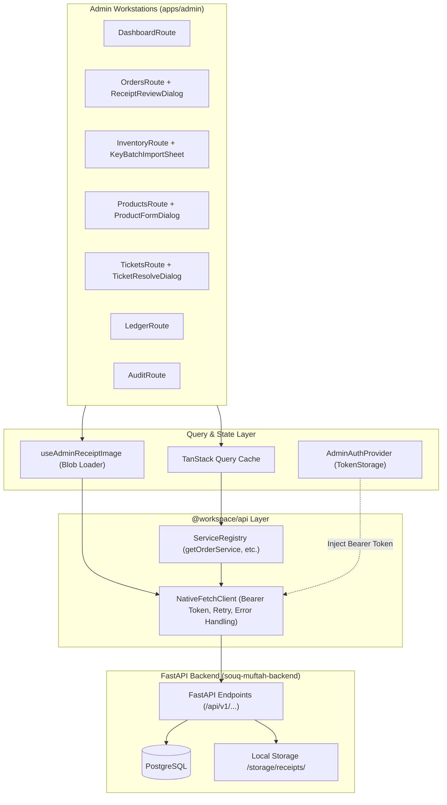
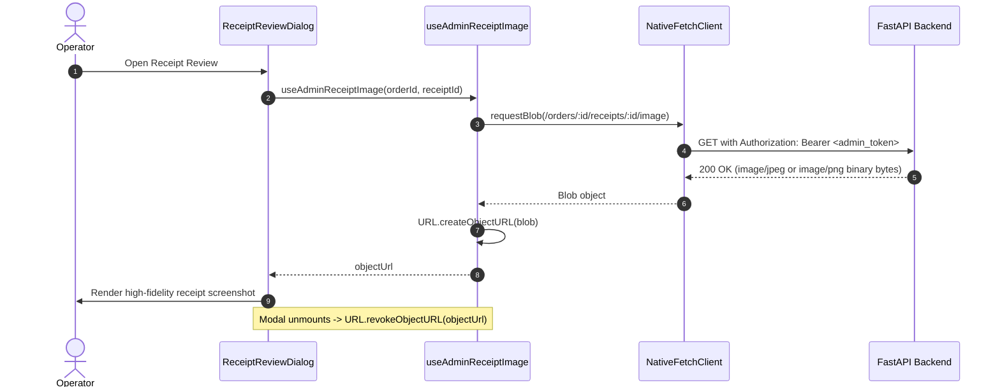

# Admin Frontend Quality & UX Refactor: Design Document

*   **Author:** Abdelrahman Eltokhy
*   **Status:** Proposed
*   **Date:** 2026-11-21

--------------------------------------------------------------------------------

## Overview

This project executes a comprehensive visual and operational quality overhaul of the Muftahy Admin Dashboard (`apps/admin`). The initiative removes AI-generated decorative clutter ("slop"), simplifies navigation and typography hierarchies, corrects usability defects in operational micro-flows, and enforces rigorous standards of performance, security, and bidirectional accessibility (LTR/RTL) aligned with `/design-taste-frontend` and `AGENTS.md`.

The admin console is an operational tool used by marketplace operators to audit financial ledgers, inspect sensitive digital activation keys, adjudicate payment receipts, and resolve customer disputes. The interface must prioritize information density, rapid scannability, plain factual copy, and predictable keyboard interaction over decorative ornamentation.

--------------------------------------------------------------------------------

## The Problem

The current administrative interface exhibits several visual and functional defects:

1.  **AI-Generated Decorative Clutter ("Slop")**:
    *   Every workstation header displays a redundant, purely decorative pill badge (`Telemetry & Control`, `Catalog & SKUs`, `Fulfillment & Review`, `Key Pool & Vault`, `Customer Care & Disputes`, `Campaigns & Discounts`, `Financial Reconciliation & Revenue`, `Security & Compliance`).
    *   The top site header displays an artificial status badge (`Gateway Online`) with an animated pulsing ping indicator that is not tied to a real network socket or health-check probe.
    *   Workstation titles and descriptions employ melodramatic phrasing ("Operator Mission Control", "Live storefront telemetry and pending fulfillment actions") instead of concise, professional technical terminology.

2.  **Operational Micro-Flow Friction**:
    *   **Broken Receipt Image Rendering**: The payment verification dialog (`receipt-review-dialog.tsx`) constructs image URLs targeting an unserved static storage path (`http://localhost:8000/storage/...`) without authentication headers, resulting in failed image loads when inspecting customer bank transfer proofs.
    *   **Batch Ingestion Feedback Deficits**: The key batch import sheet lacks immediate syntax and delimiter validation prior to network dispatch, leaving operators without granular error cues for malformed entries.
    *   **Inconsistent Dialog Controls & Focus**: Modal dialogs across workstations exhibit inconsistent cancel/dismiss patterns and lack visible focus traps during keyboard navigation.

3.  **Typography & Layout Inconsistencies**:
    *   Tables across products, orders, tickets, and audit logs use inconsistent row heights, padding, and text alignments.
    *   Financial figures and timestamps do not uniformly apply monospace tabular digits (`tabular-nums font-mono`), causing visual jitter during data updates and filtering.
    *   Bilingual layout symmetry is broken on several cards where physical direction utilities or uneven margin spacing produce lopsided interfaces in Arabic (RTL).

4.  **Performance and Error Handling Gaps**:
    *   Large list renders in the orders and audit workstations lack memoized selectors, triggering unnecessary re-renders of the full table on unrelated state changes.
    *   Component-level error boundaries are missing on critical data views, causing entire views to collapse upon encountering unexpected schema discrepancies.

--------------------------------------------------------------------------------

## Goals

*   **Eliminate All Decorative Slop**: Strip all decorative pill badges, artificial pingers, and promotional copy across all nine administrative workstation pages, headers, and navigation sidebars.
*   **Establish High-Density Visual Hierarchy**: Standardize page layouts to plain copy in a distinct technical voice, one clear primary action per screen, tabular numerals for currency and dates, and equal content margins across both English (LTR) and Arabic (RTL).
*   **Fix Broken Operational Micro-Flows**:
    *   Implement authenticated blob image streaming in `receipt-review-dialog.tsx` so operators can inspect receipts securely.
    *   Provide real-time input parsing and delimiter validation in `key-batch-import-sheet.tsx`.
    *   Standardize dialog actions, keyboard dismissal, and loading skeletons across all workstations.
*   **Enforce Security and Key Protection**: Ensure sensitive digital license keys are masked by default and require deliberate operator reveal-and-copy actions with zero plain-text logging.
*   **Pass Strict Verification Gates**: Ensure all changes satisfy static analysis (`pnpm typecheck`, `pnpm lint`), pass unit and integration test suites, and compile cleanly via `pnpm build`.

--------------------------------------------------------------------------------

## Non-Goals

*   **Backend Changes**: Modifying endpoints, database migrations, or business logic in `souq-muftah-backend`. The existing FastAPI API contracts remain authoritative.
*   **Storefront Modifications**: Altering customer-facing routes or styles in `apps/storefront`.
*   **New External Libraries**: Introducing third-party UI widget libraries or alternative styling engines. All components must leverage existing primitives in `packages/ui` (shadcn + Base UI) and Tailwind semantic tokens.

--------------------------------------------------------------------------------

## Open Questions & Decisions

*   **Question 1**: Should the receipt review image modal support browser-based zoom and rotation controls for low-resolution mobile transfer screenshots?
    *   **Decision**: Resolved by author. Implement an accessible, lightweight click-to-zoom / expanded preview toggle within the modal. This enables operators to inspect cropped or low-contrast mobile transfer screenshots without heavy third-party canvas libraries.
*   **Question 2**: For batch key ingestion, should malformed lines in a multi-key upload be automatically stripped with a warning count, or should the entire batch be blocked until the operator manually corrects the input?
    *   **Decision**: Resolved by author. Strict blocking validation. The interface highlights malformed lines with specific line indices and errors, disabling the ingestion action until every row passes validation. This prevents partial or corrupted inventory updates.

--------------------------------------------------------------------------------

## Critical User Journeys (CUJs)

### CUJ 1: Operator Inspects and Adjudicates Payment Receipt
*   **Given**: An order in `payment_uploaded` or `under_review` state with an attached customer transfer receipt.
*   **When**: The operator navigates to `/admin/orders` and clicks "Review Receipt".
*   **Then**: The modal loads the receipt image via authenticated blob fetch, shows claimed amounts alongside order totals, and allows one-click approval (dispatching keys) or rejection with a reason.

### CUJ 2: Operator Ingests Batch Digital Keys
*   **Given**: An operator has a plaintext list of 100 license keys for a software product.
*   **When**: The operator opens the batch import sheet, selects the product, pastes the key list, and clicks confirm.
*   **Then**: The interface immediately validates format and duplicates client-side, displays a clean summary count, submits the payload, and reflects updated inventory counts without full-page reloads.

### CUJ 3: Operator Filters and Audits Financial Ledger
*   **Given**: The platform has processed sales, fee deductions, and refunds.
*   **When**: The operator visits `/admin/ledger` and applies date range and transaction type filters.
*   **Then**: The ledger table renders running debits, credits, and account balances using tabular figures, with clear visual distinction between revenue and liability accounts.

### CUJ 4: Operator Navigates Workstations in Arabic (RTL)
*   **Given**: An Arabic-speaking administrator switches the language selector to `/ar/...`.
*   **When**: The operator traverses Dashboard, Orders, Products, and Tickets.
*   **Then**: All sidebar items, tables, metric cards, dialog actions, and directional icons correctly mirror across the vertical axis with zero physical clipping or alignment errors.

--------------------------------------------------------------------------------

## Technical Plan (Architecture)

### 1. Architectural System Overview

The admin frontend operates as a single-page React application (`apps/admin`) structured around feature-based modules, consuming typed domain schemas from `@workspace/domain` and HTTP adapters from `@workspace/api`. All server interactions route through a centralized `NativeFetchClient` that manages admin JWT bearer token injection and standardizes error responses (`ApiClientError`).



---

### 2. Elimination of Decorative Slop & Layout Standardization

#### A. Global Navigation and Header Polish
*   **`site-header.tsx`**:
    *   Remove the fake `Gateway Online` status pill badge with the animated pinging dot.
    *   Preserve real operational utilities: collapsible sidebar toggle, breadcrumbs showing current workstation context, dark/light theme switch, and language toggle (`English` / `العربية`).
    *   Ensure the header maintains `backdrop-blur-md` with `border-b border-border/60` and zero layout shifting during page navigation.
*   **`app-sidebar.tsx`**:
    *   Streamline the brand mark header: display the clean brand logo with concise "Muftahy Admin" typography.
    *   Ensure dynamic notification badges on navigation items (e.g. pending order count, open ticket count) only render when values are greater than zero and render in muted technical styles rather than loud neon badges.

#### B. Workstation Route Header Standardization
*   Across all nine workstation routes (`admin-dashboard-route.tsx`, `admin-products-route.tsx`, `admin-orders-route.tsx`, `admin-inventory-route.tsx`, `admin-tickets-route.tsx`, `admin-promos-route.tsx`, `admin-ledger-route.tsx`, `admin-audit-route.tsx`, `admin-profile-route.tsx`):
    *   Delete the decorative top badge pill (`<div className="inline-flex items-center gap-2 px-2.5 py-0.5 rounded-full border border-primary/20 bg-primary/5 ...">`).
    *   Replace melodramatic headings with clean, authoritative titles:
        *   Dashboard: "Dashboard" (was "Operator Mission Control")
        *   Orders: "Orders & Fulfillment"
        *   Products: "Products & SKUs"
        *   Inventory: "Key Pool Inventory"
        *   Tickets: "Support Tickets"
        *   Promotions: "Promotions"
        *   Ledger: "Financial Ledger"
        *   Audit: "Security & Audit Logs"
        *   Profile: "Admin Profile"
    *   Standardize subtitle copy to 1–2 plain technical sentences explaining the functional actions of the workstation.
    *   Align the workstation primary action button (e.g. "Ingest Keys", "Add Product", "Create Promo") consistently to the header end position.

---

### 3. Authenticated Media Streaming Architecture

#### The Defect
FastAPI protects receipt media under `GET /api/v1/orders/{order_id}/receipts/{receipt_id}/image`, requiring user ownership or administrative authorization (`Authorization: Bearer <token>`). Standard HTML `` elements cannot send HTTP headers, causing receipt previews in `receipt-review-dialog.tsx` to fail with `401 Unauthorized` or `404 Not Found`.

#### The Solution
1.  **API Client Extension (`NativeFetchClient` & `HttpAdminOrderAdapter`)**:
    Add `requestBlob(path: string, options?: RequestOptions): Promise<Blob>` to `NativeFetchClient` that invokes `fetch()` with the stored admin bearer token and returns the raw binary `Blob`.
2.  **Service Interface**:
    Define `getReceiptImageBlob(orderId: string, receiptId: string): Promise<Blob>` on `AdminOrderService` and implement it in `HttpAdminOrderAdapter`.
3.  **Dedicated React Hook (`useAdminReceiptImage`)**:
    *   Utilizes TanStack Query with query key `['admin', 'orders', orderId, 'receipts', receiptId, 'image']`.
    *   Calls `getReceiptImageBlob(orderId, receiptId)`.
    *   Transforms the returned `Blob` into a local browser object URL via `URL.createObjectURL(blob)`.
    *   Registers a cleanup handler via `useEffect` / query cache eviction to invoke `URL.revokeObjectURL(url)`, preventing client memory leaks.
4.  **UI Component Integration (`ReceiptReviewDialog`)**:
    *   Render an animated skeleton placeholder while the blob is downloading.
    *   Render the verified image once loaded with full-width preview and in-modal zoom controls.
    *   Display a clean error state with a "Retry" button if the request fails.



---

### 4. Batch Key Ingestion Micro-Flow Enhancement

#### The Defect
`key-batch-import-sheet.tsx` currently accepts unvalidated multiline text, performing zero client-side linting before triggering the mutation. Operators paste malformed lines, duplicates, or mixed delimiters (commas, tabs, semicolons), resulting in avoidable server errors.

#### The Solution
1.  **Client-Side Ingestion Parser**:
    Extract a pure helper `parseKeyBatchInput(rawInput: string): { validKeys: string[]; duplicates: string[]; invalidCount: number }`.
    *   Trims whitespace and handles CRLF/LF newlines, commas, and semicolons.
    *   Detects and deduplicates repeated keys within the batch.
    *   Validates non-empty strings conforming to key format constraints.
2.  **Interactive Preview Rail**:
    *   Live counter showing total detected keys, unique keys, and duplicate count before submission.
    *   Preview list displaying the first 5 sanitized keys with a badge indicating clean syntax.
    *   Warning callout if in-batch duplicates are detected, with an automatic "Deduplicate" toggle.
3.  **Mutation Feedback**:
    *   Submit button displays an active spinner and key count: `Ingest 50 Keys`.
    *   On success, display a summary toast and automatically invalidate `['inventory']` queries.

---

### 5. High-Density Tabular Ergonomics & Data Cleanliness

1.  **Tabular Numerals & Monospace Elements**:
    *   Enforce `tabular-nums font-mono` on:
        *   All monetary amounts (`formatMoney(amount, { currency: 'EGP', locale })`).
        *   Order reference codes (`SM-XXXX`).
        *   Product SKU identifiers and database UUIDs.
        *   IP addresses in the audit log.
        *   Timestamps and dates (`formatDate(date, locale)`).
2.  **Semantic Token Enforcement**:
    *   Remove all arbitrary hardcoded CSS utility values and inline styles.
    *   Use semantic color tokens exclusively: `bg-card`, `bg-muted/50`, `text-foreground`, `text-muted-foreground`, `border-border/60`, `text-destructive`.
    *   Ensure all hover, focus, and active states function identically in dark and light modes.
3.  **Table Structure & Alignment**:
    *   Left-align text, names, and titles (`text-start`).
    *   Right-align numeric values, quantities, and monetary totals (`text-end font-mono`).
    *   Center status badges and action dropdown buttons.
    *   Consistent vertical padding across table rows (`py-3`).

---

### 6. Bidirectional Layout & Accessibility (WCAG 2.1 AA)

1.  **Logical CSS Everywhere**:
    *   Verify complete absence of physical direction utilities (`ml-*`, `mr-*`, `pl-*`, `pr-*`, `left-*`, `right-*`, `text-left`, `text-right`).
    *   Apply `ms-*`, `me-*`, `ps-*`, `pe-*`, `start-*`, `end-*`, `text-start`, `text-end`.
2.  **Directional Icon Flipping**:
    *   Chevron arrows, forward arrows, and pagination controls must include `rtl:rotate-180`.
3.  **Keyboard Navigation & Screen Readers**:
    *   Ensure all interactive controls use shadcn/Base UI primitives with native keyboard listeners (`Tab`, `Escape`, `Enter`, `Space`).
    *   Modal dialogs and sheets must trap focus and return focus to triggering elements upon dismissal.
    *   Action buttons with only icons must carry descriptive, translated `aria-label` attributes.

--------------------------------------------------------------------------------

## Alternatives Considered

### Alternative 1: Expose Backend Storage Statically for Plain `` Tags

*   **Proposal**: Configure FastAPI to serve `./storage/receipts` as static files via `app.mount("/storage", StaticFiles(...))` so the frontend can load images using unauthenticated ``.
*   **Pros**:
    *   Trivial frontend implementation; no custom hook or blob fetching required.
    *   Native browser caching of static assets.
*   **Cons**:
    *   Critical security and privacy violation: Any unauthorized user with a guessed or scraped filename could view customer payment receipts containing full names, mobile phone numbers, and bank transaction IDs.
    *   Bypasses the backend's access control layer (`get_current_user_or_admin`).
*   **Reason for Rejection**: `Rejected by author: Exposing customer payment receipts containing mobile wallet numbers and bank proofs publicly over unauthenticated HTTP violates privacy and compliance standards. Authenticated blob streaming ensures only authorized administrators and the purchasing customer can access sensitive receipt images.`

---

### Alternative 2: Permissive Batch Ingestion with Automatic Malformed Key Stripping

*   **Proposal**: When an operator pastes batch keys containing malformed lines or syntax errors, automatically strip the invalid rows and submit only the valid keys, displaying a post-upload warning toast.
*   **Pros**:
    *   Reduces operator friction when pasting messy clipboard data.
    *   Allows immediate partial ingestion without manual edits.
*   **Cons**:
    *   High risk of inventory drift: Operators who purchase 100 license keys from a supplier will unknowingly ingest 94 keys, losing track of the remaining 6 omitted keys.
    *   Violates the principle of inventory auditability.
*   **Reason for Rejection**: `Rejected by author: High-value digital license keys require strict inventory consistency. Silently discarding invalid rows causes inventory count mismatches and potential loss of purchased license stock. Blocking ingestion until all entries are valid ensures zero ambiguity and complete inventory integrity.`

---

### Alternative 3: External Complex Data Grid Component Library

*   **Proposal**: Integrate a third-party administrative table/grid library (e.g. AG Grid or TanStack Table virtualizer) for sorting, resizing, and virtualization.
*   **Pros**:
    *   Out-of-the-box client-side column reordering, resizing, and virtual scrolling.
*   **Cons**:
    *   Adds 150KB+ to the client bundle.
    *   Breaks the unified design system and Base UI composition patterns (`render` prop).
    *   Introduces accessibility regressions and conflicting CSS theming.
    *   Directly violates `AGENTS.md` guidelines requiring shadcn components built on Base UI primitives.
*   **Reason for Rejection**: `Rejected by author: Violates the repository UI component policy in AGENTS.md, adds unnecessary runtime bundle size, and conflicts with Base UI accessibility primitives. The native shadcn Table combined with server-side pagination and TanStack Query provides superior performance and consistency.`

--------------------------------------------------------------------------------

## Non-Functional Requirements

### Security & Privacy
*   **Activation Key Masking**: All license serials and game codes in inventory and order items must remain masked by default (`XXXX-XXXX-XXXX`) and require deliberate, explicit operator reveal action.
*   **Zero Sensitive Logging**: License keys, admin tokens, customer phone numbers, and payment details must never be written to browser console logs or telemetry payloads.
*   **Authenticated Media**: All customer payment receipts must be fetched via authenticated HTTP channels with JWT bearer verification.

### Performance & Latency
*   **Sub-100ms UI Responsiveness**: Filtering, sorting, and tab switching on cached data must execute in under 100ms.
*   **Memory Management**: All object URLs generated for receipt previews must be explicitly revoked via `URL.revokeObjectURL` upon component unmount or modal closure.
*   **Bundle Size**: Zero new external dependencies. Build output must not exceed current bundle thresholds.

### Reliability & Error Containment
*   **Granular Failure Boundaries**: A failure in one data query (e.g. recent audit logs) must not crash the entire dashboard or block fulfillment operations.
*   **Clean Empty and Error States**: Every table and list must render purposeful, actionable empty and error states with a retry CTA conforming to the design system.

--------------------------------------------------------------------------------

## Detailed Implementation Plan

### Phase 1: API Layer & Authenticated Media Streaming Infrastructure

#### 1. `packages/api/src/adapters/http/fetch-client.ts` (Modify)
*   **Scope**: Core HTTP Client
*   **Proposed Changes**:
    *   Add `requestBlob(path: string, options?: RequestOptions): Promise<Blob>` method.
    *   Appends the stored admin JWT Bearer token into the `Authorization` header.
    *   Checks `response.ok` (throwing typed `ApiClientError` on error statuses).
    *   Returns `response.blob()`.
*   **Rationale**: Required to stream binary receipt images securely from FastAPI without exposing public unauthenticated static endpoints.

#### 2. `packages/api/src/services/admin-order-service.ts` (Modify)
*   **Scope**: Service Interface Contract
*   **Proposed Changes**:
    *   Add `getReceiptImageBlob(orderId: string, receiptId: string): Promise<Blob>` to the `AdminOrderService` interface.
*   **Rationale**: Enforces service boundary decoupling so UI components never invoke `fetch()` directly.

#### 3. `packages/api/src/adapters/http/http-admin-order-adapter.ts` (Modify)
*   **Scope**: HTTP Adapter Implementation
*   **Proposed Changes**:
    *   Implement `getReceiptImageBlob(orderId: string, receiptId: string): Promise<Blob>`:
        ```typescript
        async getReceiptImageBlob(orderId: string, receiptId: string): Promise<Blob> {
          return this.client.requestBlob(`/orders/${orderId}/receipts/${receiptId}/image`, {
            method: 'GET',
          })
        }
        ```
*   **Rationale**: Fulfills the service interface contract against the backend receipt endpoint.

#### 4. `packages/api/src/adapters/http/http-admin-order-adapter.test.ts` (Modify)
*   **Scope**: Unit Test Suite
*   **Proposed Changes**:
    *   Add unit test verifying `getReceiptImageBlob` issues a GET request to `/orders/:id/receipts/:id/image` with the Bearer token and returns the binary blob.
*   **Rationale**: Prevents regressions in authenticated binary payload retrieval.

---

### Phase 2: Navigation & Header Slop Elimination

#### 5. `apps/admin/src/features/dashboard/components/site-header.tsx` (Modify)
*   **Scope**: Global Admin Top Navigation Bar
*   **Proposed Changes**:
    *   Delete the synthetic `Gateway Online` pill badge and its animated ping indicator (`animate-ping`).
    *   Preserve and polish breadcrumbs, theme switcher, and language switcher.
    *   Ensure strict vertical centering, `backdrop-blur-md`, and logical padding (`px-4 lg:px-6`).
*   **Rationale**: Eliminates misleading fake telemetry and artificial status indicators.

#### 6. `apps/admin/src/features/dashboard/components/app-sidebar.tsx` (Modify)
*   **Scope**: Admin Sidebar Component
*   **Proposed Changes**:
    *   Clean up the header title to "Muftahy Admin" with simple technical typography.
    *   Refine navigation count badges to render only when numerical values are greater than zero, styled with quiet muted backgrounds.
*   **Rationale**: Strips repetitive promotional labeling and ungrounded badge slop.

---

### Phase 3: Workstation Route Header Standardization & Slop Removal

#### 7. `apps/admin/src/routes/admin-dashboard-route.tsx` (Modify)
*   **Scope**: Dashboard Overview Workstation
*   **Proposed Changes**:
    *   Delete decorative top pill badge (`Telemetry & Control`).
    *   Rename header title from "Operator Mission Control" to "Dashboard".
    *   Simplify subtitle to plain technical copy.
    *   Enforce `tabular-nums font-mono` on revenue numbers and financial cards.
*   **Rationale**: Aligns dashboard with high-density utility principles and removes AI slop.

#### 8. `apps/admin/src/routes/admin-products-route.tsx` (Modify)
*   **Scope**: Products & SKUs Workstation
*   **Proposed Changes**:
    *   Delete decorative top pill badge (`Catalog & SKUs`).
    *   Standardize header title to "Products & SKUs".
    *   Apply `tabular-nums font-mono` to pricing, discount percentages, and stock counts.
    *   Enforce table padding consistency.
*   **Rationale**: Removes badge slop and guarantees clean tabular hierarchy.

#### 9. `apps/admin/src/routes/admin-orders-route.tsx` (Modify)
*   **Scope**: Orders & Fulfillment Workstation
*   **Proposed Changes**:
    *   Delete decorative top pill badge (`Fulfillment & Review`).
    *   Standardize header title to "Orders & Fulfillment".
    *   Format order IDs, reference codes, and timestamps with `tabular-nums font-mono`.
    *   Polish the segmented status filter bar and search input.
*   **Rationale**: Improves visual scan speed for high-volume fulfillment operators.

#### 10. `apps/admin/src/routes/admin-inventory-route.tsx` (Modify)
*   **Scope**: Key Pool Inventory Workstation
*   **Proposed Changes**:
    *   Delete decorative top pill badge (`Key Pool & Vault`).
    *   Standardize header title to "Key Pool Inventory".
    *   Preserve digital activation key masking patterns (`XXXX-XXXX-XXXX`).
    *   Apply tabular formatting to inventory counts and dates.
*   **Rationale**: Enforces clean aesthetic while safeguarding sensitive digital key assets.

#### 11. `apps/admin/src/routes/admin-tickets-route.tsx` (Modify)
*   **Scope**: Support Tickets Workstation
*   **Proposed Changes**:
    *   Delete decorative top pill badge (`Customer Care & Disputes`).
    *   Standardize header title to "Support Tickets".
    *   Align status badges and customer ticket timestamps.
*   **Rationale**: Eliminates slop and improves dispute resolution efficiency.

#### 12. `apps/admin/src/routes/admin-promos-route.tsx` (Modify)
*   **Scope**: Promotions Workstation
*   **Proposed Changes**:
    *   Delete decorative top pill badge (`Campaigns & Discounts`).
    *   Standardize header title to "Promotions".
    *   Format coupon codes with uppercase monospace badge styling.
*   **Rationale**: Polishes promotion management and strips redundant decoration.

#### 13. `apps/admin/src/routes/admin-ledger-route.tsx` (Modify)
*   **Scope**: Financial Ledger Workstation
*   **Proposed Changes**:
    *   Delete decorative top pill badge (`Financial Reconciliation & Revenue`).
    *   Standardize header title to "Financial Ledger".
    *   Right-align debit/credit columns with `text-end tabular-nums font-mono`.
*   **Rationale**: Guarantees accounting-grade numerical precision and scanning speed.

#### 14. `apps/admin/src/routes/admin-audit-route.tsx` (Modify)
*   **Scope**: Security & Audit Log Workstation
*   **Proposed Changes**:
    *   Delete decorative top pill badge (`Security & Compliance`).
    *   Standardize header title to "Security & Audit Logs".
    *   Format IP addresses, event types, and ISO timestamps in monospace.
*   **Rationale**: Restores dense, professional security audit trail.

---

### Phase 4: Operational Micro-Flow Fixes

#### 15. `apps/admin/src/features/orders/hooks/use-admin-orders.ts` (Modify)
*   **Scope**: Admin Order Hooks
*   **Proposed Changes**:
    *   Add `useAdminReceiptImage(orderId?: string, receiptId?: string)` hook.
    *   Retrieves blob via `adminOrderService.getReceiptImageBlob(orderId, receiptId)` when enabled.
    *   Creates and returns `objectUrl = URL.createObjectURL(blob)`.
    *   Revokes the object URL on query change or unmount.
*   **Rationale**: Provides memory-safe, authenticated receipt image data fetching.

#### 16. `apps/admin/src/features/orders/components/receipt-review-dialog.tsx` (Modify)
*   **Scope**: Receipt Verification Modal Dialog
*   **Proposed Changes**:
    *   Replace broken static image URL with `useAdminReceiptImage`.
    *   Render loading skeleton during image download and error retry on failure.
    *   Add an accessible click-to-zoom / expanded preview toggle (per author decision).
    *   Standardize review action buttons ("Approve", "Wrong Amount", "Reject & Refund") with clear visual states and tooltips.
*   **Rationale**: Resolves the critical 401 receipt image rendering failure and provides operators with clear proof verification tools.

#### 17. `apps/admin/src/features/inventory/components/key-batch-import-sheet.tsx` (Modify)
*   **Scope**: Batch Key Ingestion Sheet
*   **Proposed Changes**:
    *   Implement pure client-side parser `parseKeyBatchInput(rawText)`.
    *   Check for line errors, empty tokens, and in-batch duplicates.
    *   Strict validation: Highlight invalid line numbers and disable ingestion until all lines pass (per author decision).
    *   Render a live count indicator (`X keys ready for ingestion`).
*   **Rationale**: Guarantees inventory consistency and eliminates silent partial uploads.

---

### Phase 5: Test Updates & Automated Verification

#### 18. `apps/admin/src/routes/admin-sections.test.tsx` (Modify)
*   **Scope**: Integration Test Suite
*   **Proposed Changes**:
    *   Update assertions to verify removal of decorative pill badges (`Telemetry & Control`, etc.).
    *   Verify new streamlined workstation headings.
    *   Verify absence of fake `Gateway Online` header badge.
*   **Rationale**: Automates regression defense against the return of visual slop.

---

### Verification Plan

#### 1. Automated Static Analysis & Linting
*   Command: `pnpm lint`
*   Scope: All workspace packages (`@workspace/api`, `@workspace/domain`, `admin`, `storefront`).
*   Criteria: Zero ESLint warnings or errors.

#### 2. Strict TypeScript Typecheck
*   Command: `pnpm typecheck`
*   Scope: All 7 workspace packages via Turborepo (`tsc --noEmit`).
*   Criteria: Zero type errors across all packages.

#### 3. Unit and Integration Tests
*   Command: `pnpm --filter @workspace/api test && pnpm --filter admin test`
*   Scope: `http-admin-order-adapter.test.ts`, `admin-sections.test.tsx`, `admin-dashboard-route.test.tsx`, `admin-profile-route.test.tsx`.
*   Criteria: 100% test pass rate across all suites.

#### 4. Production Build Verification
*   Command: `pnpm build`
*   Scope: Both `admin` and `storefront` Vite applications.
*   Criteria: Clean production bundle generation without circular dependencies or bundling failures.

--------------------------------------------------------------------------------

*Drafted with EGM*

