# Catalog Categories, SKUs, Slugs, and Product Images Frontend Integration

*   **Author:** Abdelrahman Eltokhy
*   **Status:** Approved
*   **Date:** 2026-11-24

--------------------------------------------------------------------------------

## Overview

This document specifies the frontend changes required across the Muftahy monorepo (`@workspace/domain`, `@workspace/api`, `@workspace/i18n`, `@workspace/ui`, `apps/storefront`, and `apps/admin`) to integrate the updated catalog domain in `souq-muftah-backend`.

The backend replaced its hardcoded two-value category string (`"windows" | "office"`) and static category-based placeholder images with four catalog capabilities:

1.  **Relational Categories**: Categories are database entities (`CategoryResponse`) with a UUID `id`, `name`, uppercase `code` (2 to 10 alphanumeric characters, such as `OS`, `OFF`, `SEC`), URL-safe `slug`, `description`, `display_order`, `is_active`, and `product_count`. Public callers list active categories (`GET /api/v1/categories`) and fetch a category with its active products by slug (`GET /api/v1/categories/slug/{slug}`). Administrators create, list, update, and delete categories under `/api/v1/admin/categories`.
2.  **Structured Product SKUs**: Every product carries a unique 4-segment uppercase SKU (`sku`, such as `OS-WIN11-PRO-RET`) whose first segment must match the assigned category's `code`.
3.  **SEO-Friendly Product and Category Slugs**: Products carry a unique URL slug (`slug`, auto-generated from `name` by the backend when omitted) and can be fetched via `GET /api/v1/products/slug/{slug}` in addition to the UUID fallback endpoint `GET /api/v1/products/{product_id}`. Storefront product links and category pages use slugs as their primary URL identifiers while retaining backward-compatible UUID lookup support.
4.  **Multi-Image Product Galleries**: Products support up to 10 uploaded images (`ProductImageResponse`, served from `/storage/products/{filename}` with immutable cache headers), with automated EXIF stripping, primary image designation (`is_primary` and `primary_image_url`), explicit primary reassignment (`PATCH /api/v1/products/{product_id}/images/{image_id}/primary`), batch display-order reordering (`PATCH /api/v1/products/{product_id}/images/reorder`), and image deletion (`DELETE /api/v1/products/{product_id}/images/{image_id}`).

All work is strictly confined to the frontend repository (`muftahy-fe`), adheres to the backend's exact Pydantic field and error-code naming conventions, and uses shadcn Sonner to surface localized error and action notifications.

--------------------------------------------------------------------------------

## The Problem

The current frontend catalog implementation is out of sync with the updated `souq-muftah-backend` API contract in five areas:

1.  **Broken Domain Validation (`@workspace/domain`)**: `productCategorySchema` in `packages/domain/src/schemas/product.ts` validates `product.category` as a two-value enum (`'windows' | 'office'`). Because the backend `ProductResponse` now returns `category` as a nested `CategoryResponse` object alongside `sku`, `slug`, `primary_image_url`, and `images: ProductImageResponse[]`, every product response from the backend fails Zod validation and breaks storefront and admin product queries.
2.  **Missing Category, Image, and Authenticated Service Contracts (`@workspace/api`)**: `HttpProductAdapter` still calls the deprecated `GET /api/v1/products/categories` (`string[]`) endpoint and lacks service methods for public category retrieval (`/api/v1/categories`, `/api/v1/categories/slug/{slug}`), product lookup by slug (`/api/v1/products/slug/{slug}`), admin category CRUD (`/api/v1/admin/categories`), and admin product image upload, deletion, primary selection, and reordering (`/api/v1/products/{product_id}/images*`). In addition, `getProductService()` in `packages/api/src/factory.ts` instantiates `NativeFetchClient` without `tokenStorage`, causing admin catalog mutations to omit the `Authorization: Bearer <token>` header.
3.  **Hardcoded Storefront Images and UUID-Only Routing (`apps/storefront`)**: Storefront product cards and detail pages ignore `product.primary_image_url` and `product.images`, instead calling `resolveProductImage(product.category, product.variant)` to pick one of three static files in `/images/products/`. Furthermore, storefront product URLs expose raw UUIDs (`/:lang/products/:id`) instead of product slugs (`/:lang/products/:slug`), lack a dedicated category catalog route (`/:lang/categories/:slug`), and restrict catalog filters to hardcoded `'windows'` and `'office'` strings instead of dynamic categories from `GET /api/v1/categories`.
4.  **Incomplete Admin Catalog and Media Operations (`apps/admin`)**: The admin product modal (`product-form-dialog.tsx`) does not send `category_id` or `sku`, prevents editing `name`, `category_id`, `sku`, `slug`, or `variant` on existing products, and provides no interface to upload, preview, reorder, set primary, or delete product images. Additionally, administrators have no top-level Categories view in `apps/admin` to create, edit, reorder, toggle, or delete categories via `/api/v1/admin/categories`.
5.  **Silent Mutation Errors**: In `apps/admin/src/features/products/components/product-form-dialog.tsx`, mutation errors are caught and ignored, leaving administrators with no feedback when the backend rejects an operation with domain error codes such as `SKU_ALREADY_EXISTS`, `SKU_CATEGORY_MISMATCH`, `INVALID_SKU_FORMAT`, `SLUG_ALREADY_EXISTS`, `CATEGORY_CODE_ALREADY_EXISTS`, `CATEGORY_CODE_IMMUTABLE_WITH_PRODUCTS`, `CATEGORY_HAS_PRODUCTS`, `FILE_TOO_LARGE`, `IMAGE_TOO_LARGE`, `INVALID_IMAGE_FORMAT`, `IMAGE_LIMIT_EXCEEDED`, or `RATE_LIMIT_EXCEEDED`.

--------------------------------------------------------------------------------

## Goals

*   **Backend-Aligned Domain Schemas**: Update `@workspace/domain/schemas/product.ts` to mirror the exact backend Pydantic models (`CategoryCreate`, `CategoryUpdate`, `CategoryResponse`, `CategoryDetailResponse`, `ProductImageResponse`, `ImageReorderItem`, `ImageReorderRequest`, `ProductCreate`, `ProductUpdate`, and `ProductResponse`) and register the new catalog and image error codes in `@workspace/domain`.
*   **Full API Adapter Coverage**: Extend `@workspace/api` with typed service methods and HTTP adapter implementations for public categories, slug-based category and product lookups, admin category CRUD, and multipart/JSON product image endpoints, attach admin `tokenStorage` only when `getProductService('admin')` is used, and add a shared asset URL helper that resolves `/storage/...` paths against the API origin.
*   **Storefront Dynamic Categories, Slug Routing, and Image Gallery**:
    *   Support slug-based product detail URLs (`/:lang/products/:slug`) with automatic fallback to UUID lookup when the route parameter is a UUID.
    *   Add the category catalog landing route (`/:lang/categories/:slug`) backed by `GET /api/v1/categories/slug/{slug}`, and drive storefront category filters and navigation from `GET /api/v1/categories`.
    *   Render `product.primary_image_url` (or the primary entry from `product.images`) on product cards with a fallback placeholder (`Box` icon) when a product has no uploaded images, and upgrade `DetailMedia` on the product detail page into an interactive thumbnail gallery sorted by `display_order`.
*   **Admin Top-Level Categories Route and Shopify-Style Product Create/Edit Page**:
    *   Add a top-level **Categories** route (`/:lang/categories`) in the admin sidebar under Store navigation so administrators can list all categories (active and inactive), create categories with `name`, `code`, optional `slug`, `description`, `display_order`, and `is_active`, edit categories, and delete categories with zero linked products.
    *   Replace the modal product form with a dedicated Shopify-style **Product Create (`/:lang/products/new`) and Edit (`/:lang/products/:id`) page** featuring a two-column dashboard layout with a dedicated **Media** section (supporting drag-and-drop image upload up to 10 images, primary image selection, debounced reordering, and deletion), alongside General Details (`name`, `slug`, `description`), Pricing (`base_price`, `sale_price`), Status & Availability (`is_active`, `preorder_enabled`), and Organization (`category_id`, `variant`, 4-segment `sku`).
*   **Standardized Toast Feedback with shadcn Sonner**: Add the shadcn `sonner` component (`@workspace/ui/components/sonner`), mount `<Toaster />` in the app root layouts wired to the active app theme and text direction, and map backend `ApiClientError` error codes to localized toast notifications and field-level form errors in both Arabic (RTL) and English (LTR).
*   **Verification Parity**: Pass `pnpm typecheck`, `pnpm lint`, `pnpm test`, and `pnpm build` across all workspace packages and applications, with unit and component tests covering new schemas, adapter endpoints, gallery rendering, slug resolution, and admin category and product pages.

--------------------------------------------------------------------------------

## Non-Goals

*   **Backend Changes**: Do not modify any files in `souq-muftah-backend`. All schemas, routes, validation rules, and error codes in `souq-muftah-backend` are treated as fixed contracts.
*   **Hand-Editing `@workspace/ui` Internals**: Use the shadcn CLI to add `sonner` to `@workspace/ui`, without hand-editing existing Base UI component primitives.
*   **Client-Side Image Cropping or Re-Encoding**: The backend strips EXIF metadata and validates image dimensions (up to `3840x2160` landscape or `2160x3840` portrait) and formats (`image/jpeg`, `image/png`, `image/webp`) via Pillow. The frontend performs pre-upload validation (MIME type, 5 MB file size limit, dimension boundary check, 10-image limit) without introducing a canvas image editor.
*   **Changes to Non-Catalog Domains**: Cart persistence mechanics, checkout receipt uploads, key inventory encryption, ticket adjudication, promotions, financial ledger, and audit log schemas remain unchanged except where product references consume updated `ProductResponse` fields.

--------------------------------------------------------------------------------

## Open Questions

*   None (all architectural questions resolved during drafting).

--------------------------------------------------------------------------------

## Resolved Questions

*   **Question 1 (Admin Category Management Surface)**: Should Admin Category CRUD (`/api/v1/admin/categories`) live inside `/:lang/products` or as a separate top-level sidebar route (`/:lang/categories`)?
    *   *Resolution (Decided by author)*: Treat Categories as a top-level admin sidebar navigation item (`/:lang/categories`) under the `Store` section.
*   **Question 2 (Admin Product Creation, Editing, and Media Workflow)**: How should product creation, editing, and image management be structured given that `POST /api/v1/products/{product_id}/images` requires an existing `product_id`?
    *   *Resolution (Decided by author)*: Replace the product modal dialog with a dedicated Shopify-style Product Create (`/:lang/products/new`) and Update (`/:lang/products/:id`) page containing a two-column form layout with an integrated Media section. During creation (`/:lang/products/new`), staged images are held in local client state. Once `POST /api/v1/products` succeeds, the editor latches the created `product_id` in component state (preventing duplicate product creation on retry) and sequentially uploads staged images while staying mounted, transitioning to `/:lang/products/:id` (`replace: true`) after all staged uploads complete (or retaining any failed staged files in memory with an inline retry action).

--------------------------------------------------------------------------------

## Critical User Journeys (CUJs)

### CUJ 1: Customer Browses Storefront by Dynamic Category and Views Product Gallery via Slug

*   **Given**: The backend has active categories (such as Operating Systems with slug `operating-systems` and Office Suites with slug `office-suites`) and active products with uploaded images and slugs (such as `windows-11-pro-retail`).
*   **When**: A customer visits `/:lang/categories/operating-systems` or filters the catalog at `/:lang/products`, then clicks a product card linking to `/:lang/products/windows-11-pro-retail`.
*   **Then**:
    *   The category page displays the category name, description, and active products returned by `GET /api/v1/categories/slug/operating-systems`.
    *   Each product card displays the resolved primary image URL (or a semantic `Box` icon placeholder if `images` is empty), the category badge (`product.category.name`), variant badge, stock status badge, and EGP price.
    *   The product detail page fetches `GET /api/v1/products/slug/windows-11-pro-retail`, renders the primary image and sorted thumbnail gallery (`display_order` ascending), allows switching the active preview image via click or keyboard, and displays the product SKU, description, and buy box.
    *   If a customer visits a legacy bookmark using a UUID (`/:lang/products/4f6b2160-b6da-4977-8c77-cecb7d556bd1`), the route detects the UUID format and fetches `GET /api/v1/products/{product_id}` without breaking navigation.

### CUJ 2: Administrator Creates and Manages Categories at `/:lang/categories`

*   **Given**: An authenticated administrator navigates to the top-level **Categories** route (`/:lang/categories`) in `apps/admin`.
*   **When**: The administrator creates a new category with `name: "Security Software"`, `code: "SEC"`, optional `slug: "security-software"`, `display_order: 3`, and `is_active: true`, or edits/deletes an existing category.
*   **Then**:
    *   Submitting the create form dispatches `POST /api/v1/admin/categories`. On `201 Created`, the categories table updates and a localized Sonner success toast is displayed.
    *   If the backend returns `409 CATEGORY_CODE_ALREADY_EXISTS` or `409 SLUG_ALREADY_EXISTS`, the form highlights the conflicting field and displays a localized Sonner error toast.
    *   If the administrator edits a category that already has products (`product_count > 0`), the `code` input is disabled (and if submitted, `409 CATEGORY_CODE_IMMUTABLE_WITH_PRODUCTS` is surfaced via Sonner).
    *   If the administrator deletes a category with `product_count === 0`, `DELETE /api/v1/admin/categories/{id}` succeeds and removes the category. If products are linked (`409 CATEGORY_HAS_PRODUCTS`), a Sonner error toast instructs the administrator to reassign or remove linked products first.

### CUJ 3: Administrator Creates a Product with Staged Media on `/:lang/products/new`

*   **Given**: An authenticated administrator clicks "Add Product" on `/:lang/products`, navigating to `/:lang/products/new`.
*   **When**: The administrator enters general details (`name: "Windows 11 Pro Retail"`, optional `slug`), selects a relational category (`OS`) and `variant` (`retail`) in the Organization card, enters a 4-segment `sku` (`"OS-WIN11-PRO-RET"`), enters pricing (`base_price`, optional `sale_price`), drops 3 product images (`<= 5 MB`, `.webp`/`.png`/`.jpg`) into the Media card (reordering them or choosing the primary cover in local preview), and clicks **Save Product**.
*   **Then**:
    *   The form validates `sku` format and confirms its prefix matches `${selectedCategory.code}-`, and validates that `base_price > 0` and any optional `sale_price < base_price`.
    *   The client sends `POST /api/v1/products` to create the product and latches the returned `createdProductId` in component state.
    *   While remaining mounted on the editor, the client sequentially uploads each staged image in display order to `POST /api/v1/products/{createdProductId}/images` (marking the designated primary image with `is_primary=true`), revoking each local preview blob URL as its upload succeeds.
    *   When all staged uploads succeed, a localized Sonner toast confirms creation and the router navigates (`replace: true`) to `/:lang/products/${createdProductId}`.
    *   If any image upload fails after `POST /api/v1/products` succeeded, a Sonner error toast identifies the failed image and the failed `File` items remain visible in the Media card with an inline **Retry Upload** action; because `createdProductId` is latched, clicking Retry or Save updates the existing product (`PATCH /api/v1/products/{createdProductId}`) and retries only the failed image uploads without re-posting `POST /api/v1/products`.

### CUJ 4: Administrator Updates a Product and Manages Live Media on `/:lang/products/:id`

*   **Given**: An authenticated administrator opens `/:lang/products/:id` for an existing product.
*   **When**: The administrator uploads a new image, reorders existing images in the Media card, clicks "Set as Primary" on a secondary image, deletes an image, or modifies product fields (`name`, `category_id`, `sku`, `slug`, `variant`, `base_price`, `sale_price`, `is_active`, `preorder_enabled`, `description`) and clicks **Save Changes**.
*   **Then**:
    *   Files exceeding 5 MB, dimensions exceeding `3840x2160` (landscape) or `2160x3840` (portrait), unsupported MIME types, or uploads when the product already has 10 images are blocked client-side with an immediate localized Sonner error toast.
    *   Valid uploads send `multipart/form-data` to `POST /api/v1/products/{product_id}/images` and update the product detail cache via `setQueryData`.
    *   Setting a primary image sends `PATCH /api/v1/products/{product_id}/images/{image_id}/primary`, step-wise reordering updates local display order immediately and coalesces `PATCH /api/v1/products/{product_id}/images/reorder` behind a 500ms trailing debounce, and deleting sends `DELETE /api/v1/products/{product_id}/images/{image_id}` (locally promoting the lowest remaining `display_order` image to `is_primary = true` to match backend promotion rules).
    *   Saving product fields sends `PATCH /api/v1/products/{product_id}` and surfaces a localized Sonner success or error toast.

--------------------------------------------------------------------------------

## Technical Plan (Architecture)

### 1. System Architecture & Data Flow

The frontend preserves strict unidirectional dependency boundaries: `apps/storefront` and `apps/admin` depend on `@workspace/api`, `@workspace/domain`, `@workspace/i18n`, and `@workspace/ui`. No component calls `fetch` directly; all network requests traverse `NativeFetchClient` and `HttpProductAdapter` (which is the sole implementation of `ProductService` in `@workspace/api`).

```mermaid
flowchart TD
    subgraph Backend ["FastAPI Backend (souq-muftah-backend)"]
        BE_PubCat["GET /api/v1/categories<br/>GET /api/v1/categories/slug/:slug"]
        BE_PubProd["GET /api/v1/products<br/>GET /api/v1/products/slug/:slug<br/>GET /api/v1/products/:id"]
        BE_AdmCat["POST | GET | PATCH | DELETE<br/>/api/v1/admin/categories/:id?"]
        BE_AdmProd["POST | PATCH | DELETE<br/>/api/v1/products/:id?"]
        BE_AdmImg["POST /api/v1/products/:id/images<br/>DELETE /api/v1/products/:id/images/:image_id<br/>PATCH /api/v1/products/:id/images/:image_id/primary<br/>PATCH /api/v1/products/:id/images/reorder"]
        BE_Storage["GET /storage/products/:filename<br/>(Immutable Cache)"]
    end

    subgraph Domain ["@workspace/domain"]
        Schemas_Cat["Category Schemas<br/>categoryResponseSchema, categoryDetailResponseSchema<br/>categoryCreateSchema, categoryUpdateSchema"]
        Schemas_Img["Image Schemas<br/>productImageResponseSchema<br/>imageReorderItemSchema, imageReorderRequestSchema"]
        Schemas_Prod["Product Schemas<br/>productResponseSchema, productCreateSchema, productUpdateSchema<br/>SKU_REGEX, SLUG_REGEX, slugify(), isUuid()"]
        Schemas_Err["Error Codes<br/>apiErrorCodeSchema"]
    end

    subgraph Api ["@workspace/api"]
        Factory["factory.ts<br/>getProductService(appOrOptions, options)<br/>resolveStorageUrl(pathOrUrl, baseURL)"]
        Service["services/product-service.ts<br/>ProductService interface"]
        Adapter["adapters/http/http-product-adapter.ts<br/>HttpProductAdapter"]
        Factory --> Service
        Adapter --> Service
    end

    subgraph I18n ["@workspace/i18n"]
        Locales["locales/en.json & locales/ar.json<br/>Catalog, Category, Editor & Error Keys"]
    end

    subgraph UI ["@workspace/ui"]
        Sonner["components/sonner.tsx<br/>Toaster & toast()"]
    end

    subgraph Storefront ["apps/storefront"]
        SF_Routes["Thin Routes<br/>/:lang/products<br/>/:lang/products/:slug<br/>/:lang/categories/:slug"]
        SF_Hooks["Hooks<br/>useProducts, useProduct<br/>usePublicCategories, useCategoryBySlug"]
        SF_Gallery["Feature Pages & Components<br/>CategoryCatalogPage, ProductDetailPage<br/>ProductCard, DetailMedia"]
    end

    subgraph Admin ["apps/admin"]
        ADM_CatRoute["/:lang/categories<br/>AdminCategoriesRoute -> AdminCategoriesPage & CategoryFormDialog"]
        ADM_ProdList["/:lang/products<br/>AdminProductsRoute (Dynamic Category Tabs & Thumbnails)"]
        ADM_ProdEditor["/:lang/products/new & /:lang/products/:id<br/>AdminProductEditorRoute -> ProductEditorPage & ProductMediaSection"]
        ADM_ErrToast["lib/api-error-toast.ts<br/>Localized Sonner Error Mapper"]
    end

    Storefront --> Api
    Storefront --> Domain
    Storefront --> I18n
    Storefront --> UI
    Admin --> Api
    Admin --> Domain
    Admin --> I18n
    Admin --> UI
    Api --> Domain
    Adapter --> BE_PubCat
    Adapter --> BE_PubProd
    Adapter --> BE_AdmCat
    Adapter --> BE_AdmProd
    Adapter --> BE_AdmImg
    SF_Gallery --> BE_Storage
    ADM_ProdEditor --> BE_Storage
```



### 2. Domain Layer (`@workspace/domain`)

#### 2.1 Category, Product Image, and Product Zod Schemas (`packages/domain/src/schemas/product.ts`)

The domain schema module replaces the hardcoded two-value category enum with relational category, image, and product contracts matching `souq-muftah-backend/app/catalog/schemas.py`:

| Schema / Helper | Purpose & Validation Rules |
| :--- | :--- |
| `categoryResponseSchema` | Validates backend category entities (`id`, `name`, 2–10 char uppercase alphanumeric `code`, URL-safe `slug`, `description`, `display_order`, `is_active`, and `product_count`). |
| `categoryCreateSchema` / `categoryUpdateSchema` | Validates admin category creation and partial update payloads; normalizes empty optional `slug` and `description` strings from controlled inputs to `null`/`undefined` prior to pattern checks. |
| `productImageResponseSchema` | Validates product image metadata (`id`, `file_path`, `alt_text`, `is_primary`, `display_order`, `file_size`, `mime_type`, `width`, `height`, and computed `url`). |
| `imageReorderItemSchema` / `imageReorderRequestSchema` | Validates batch image reorder payloads (`{ items: [{ image_id, display_order }] }`). |
| `productResponseSchema` | Validates product responses with nested `category: CategoryResponse`, `sku`, `slug`, `primary_image_url`, `images`, `variant`, EGP price fields (`base_price`, `sale_price`, `effective_price`, `discount_percentage`), `stock_status`, `available_count`, `preorder_enabled`, `description`, and optional `is_active` defaulting to `true`. |
| `categoryDetailResponseSchema` | Extends `categoryResponseSchema` with `products: ProductResponse[]`. |
| `productCreateSchema` / `productUpdateSchema` | Validates admin product creation and partial update payloads (`name`, `category_id`, 4-segment uppercase `sku`, optional `slug`, `variant`, `base_price`, optional `sale_price`, `is_active`, `preorder_enabled`, `description`); normalizes empty optional strings and enforces `base_price > 0` and `0 < sale_price < base_price`. |
| `isUuid(value)` | Distinguishes UUID route parameters from product slugs for backward-compatible detail routing. |
| `slugify(text, maxLength)` | Derives URL-safe ASCII slugs for form placeholder previews (returning an empty string when input contains no ASCII alphanumeric characters, signaling the backend to derive and deduplicate the slug). |
| `validateSkuForCategory(sku, categoryCode)` | Verifies 4-segment uppercase SKU format and confirms the first segment matches `${categoryCode}-`. |

#### 2.2 Error Code Registry (`packages/domain/src/schemas/auth.ts`)

`RATE_LIMIT_EXCEEDED` (429) is already registered in `apiErrorCodeSchema`. Extend `apiErrorCodeSchema` with the 15 catalog and image error codes emitted by `souq-muftah-backend`:
*   `ENTITY_NOT_FOUND` (404)
*   `CATEGORY_CODE_ALREADY_EXISTS` (409)
*   `CATEGORY_CODE_IMMUTABLE_WITH_PRODUCTS` (409)
*   `CATEGORY_HAS_PRODUCTS` (409)
*   `SKU_ALREADY_EXISTS` (409)
*   `INVALID_SKU_FORMAT` (422)
*   `SKU_CATEGORY_MISMATCH` (400)
*   `SLUG_ALREADY_EXISTS` (409)
*   `SLUG_COLLISION_RETRY_EXHAUSTED` (409)
*   `IMAGE_NOT_PROVIDED` (400)
*   `IMAGE_LIMIT_EXCEEDED` (400)
*   `IMAGE_OWNERSHIP_MISMATCH` (400)
*   `FILE_TOO_LARGE` (413)
*   `INVALID_IMAGE_FORMAT` (415)
*   `IMAGE_TOO_LARGE` (422)

### 3. API Layer (`@workspace/api`)

#### 3.1 Authenticated Service Factory & Asset Origin Helper (`packages/api/src/factory.ts`)

1.  **Scope-Aware `getProductService` with Backward-Compatible Overload**:
    Update `getProductService` in `ServiceRegistry` to support both `getProductService(options?)` and `getProductService(app, options?)`. When `app === 'admin'`, instantiate `NativeFetchClient` with `tokenStorage: this.getTokenStorage('admin')` so admin category, product, and image mutations include `Authorization: Bearer <token>` and participate in 401 token refresh. When `app === 'storefront'` (the default), leave `tokenStorage` undefined so public catalog queries never attach customer JWTs or trigger customer auth refresh flows.
2.  **Static Storage URL Resolution (`resolveStorageUrl`)**:
    Export `resolveStorageUrl(pathOrUrl: string | null | undefined, baseURL?: string): string | null` from `@workspace/api/factory` with complete path branching:
    *   If `pathOrUrl` is empty, null, or starts with the retired legacy static prefix `/images/products/`, return `null`.
    *   If `pathOrUrl` starts with `http://`, `https://`, `blob:`, or `data:`, return it unchanged.
    *   If `pathOrUrl` starts with `products/` (a raw `file_path`), normalize it to `/storage/${pathOrUrl}` and prepend the API server origin (derived by stripping `/api/v1` or `/v1` from the configured API base URL).
    *   If `pathOrUrl` starts with `/storage/` (or `storage/`) or any other root-relative path, prepend the stripped API server origin.

#### 3.2 `ProductService` Interface & `HttpProductAdapter` (`packages/api/src/services/product-service.ts`, `packages/api/src/adapters/http/http-product-adapter.ts`)

Remove the deprecated `getCategories(): Promise<string[]>` method (`GET /api/v1/products/categories`) and implement the active catalog contract on `ProductService` and `HttpProductAdapter`:

```text
Public Endpoints (called with skipAuth: true):
- getPublicCategories()                        -> GET /categories
- getCategoryBySlug(slug)                      -> GET /categories/slug/{encodeURIComponent(slug)}
- getProducts(params?: { category?: string; only_active?: boolean }) -> GET /products?category=...&only_active=...
- getProductBySlug(slug)                       -> GET /products/slug/{encodeURIComponent(slug)}
- getProductById(id)                           -> GET /products/{id}

Admin Category Endpoints (authenticated via admin tokenStorage):
- getAdminCategories()                         -> GET /admin/categories
- createCategory(data: CategoryCreateInput)    -> POST /admin/categories
- updateCategory(id, data: CategoryUpdateInput)-> PATCH /admin/categories/{id}
- deleteCategory(id)                           -> DELETE /admin/categories/{id}

Admin Product & Image Endpoints (authenticated via admin tokenStorage):
- createProduct(data: ProductCreateInput)      -> POST /products
- updateProduct(id, data: ProductUpdateInput)  -> PATCH /products/{id}
- deleteProduct(id)                            -> DELETE /products/{id}
- uploadProductImage(productId, input: { file: File | Blob; alt_text?: string | null; is_primary?: boolean })
                                               -> POST /products/{productId}/images (FormData)
- deleteProductImage(productId, imageId)       -> DELETE /products/{productId}/images/{imageId}
- setPrimaryProductImage(productId, imageId)   -> PATCH /products/{productId}/images/{imageId}/primary
- reorderProductImages(productId, data: ImageReorderRequest)
                                               -> PATCH /products/{productId}/images/reorder
```

### 4. Storefront Architecture (`apps/storefront`)

#### 4.1 Routing & Slug/UUID Resolution (`apps/storefront/src/app/router.tsx`, `apps/storefront/src/routes/category-route.tsx`)

*   Change `products/:id` to `products/:slug` (handled by `ProductDetailRoute` delegating to `ProductDetailPage`).
*   Add `categories/:slug` handled by a thin route module (`CategoryRoute`) that delegates to `CategoryCatalogPage` (`apps/storefront/src/features/products/pages/category-catalog-page.tsx`).
*   In `useProduct(slugOrId: string)`:
    *   If `isUuid(slugOrId)` is `true`, call `productService.getProductById(slugOrId)`.
    *   Otherwise, call `productService.getProductBySlug(slugOrId)`.
*   In `ProductCard`:
    *   Link to `/${currentLang}/products/${product.slug || product.id}`.

#### 4.2 Dynamic Categories & Filtering (`apps/storefront/src/features/products/hooks/*`, `apps/storefront/src/features/products/components/*`)

*   Add `usePublicCategories()` and `useCategoryBySlug(slug: string)` in `apps/storefront/src/features/products/hooks/use-products.ts`.
*   Update `ProductCatalogFilters.category` to `string | undefined` (representing the category `slug`, which `GET /api/v1/products?category={slug}` expects).
*   Update `CategoryRow`, `FilterSidebar`, `FilterSheet`, `useProductFilters`, and `calculateFilterCounts`:
    *   Drive category pills and filter lists from `usePublicCategories()` ordered by `display_order`.
    *   To avoid coupled facet count distortion when a category filter is active, category count badges in `FilterSidebar` and `FilterSheet` display each category's `product_count` from `CategoryResponse` (with `"All"` displaying the sum of active categories' `product_count` values when filtered by category), while `calculateFilterCounts(products)` computes variant (`retailCount`, `oemCount`) and stock (`inStockCount`, `preorderCount`) counts for the active product list.

#### 4.3 Product Image Resolution & Multi-Image Gallery (`apps/storefront/src/features/products/utils/asset-resolver.ts`, `apps/storefront/src/features/products/components/detail/detail-media.tsx`)

*   Consolidate primary image URL resolution in `apps/storefront/src/features/products/utils/asset-resolver.ts`:
    *   Replace the legacy `resolveProductImage(category, variant)` function with `getProductMainImageUrl(product)` (which resolves `product.primary_image_url` or the primary/first entry of `product.images` via `resolveStorageUrl` from `@workspace/api/factory` and returns `string | null`).
*   Update `ProductCard`:
    *   Render `getProductMainImageUrl(product)` when non-null; if `null` or `onError` fires, render a semantic placeholder (`Box` icon) with `role="img"` and `aria-label={product.name}`.
    *   Render `product.category.name` in the category badge.
*   Upgrade `DetailMedia`:
    *   Accept `images?: ProductImageResponse[]`, `coverImage?: string | null`, and `productTitle: string`.
    *   Sort `images` by `display_order` ascending and default the active image to the `is_primary` image (or first sorted image, or `coverImage`).
    *   Track failed image loads per URL (`failedUrls: Set<string>`) rather than a single boolean, and reset the active image selection whenever the product's `images` or `coverImage` props change across route transitions.
    *   When multiple images exist, render a horizontal thumbnail strip below the 4:3 main stage with keyboard-accessible thumbnail buttons (`aria-label`, `aria-pressed`). When no images exist or the active image URL fails to load, render the `Box` icon placeholder.
*   Update `DetailBuyBox` & `DetailBreadcrumb`:
    *   Display `product.category.name` in the badge and breadcrumb, linking the breadcrumb category item to `/${lang}/categories/${product.category.slug}`.
    *   Display `product.sku` in `DetailBuyBox` with `dir="ltr"` to prevent BiDi separator reordering in Arabic.

### 5. Admin Architecture (`apps/admin`)

#### 5.1 Top-Level Categories Page (`/:lang/categories`)

*   **Navigation & Thin Route Delegation**:
    *   In `apps/admin/src/features/dashboard/components/app-sidebar.tsx`, add **Categories** (`url: /${lang}/categories`, icon: `FolderTree`) under the `Store` section right below `Products`.
    *   In `apps/admin/src/app/router.tsx`, register `{ path: 'categories', element: <AdminCategoriesRoute /> }`, where `AdminCategoriesRoute` is a thin route wrapper delegating to `AdminCategoriesPage` (`apps/admin/src/features/categories/components/admin-categories-page.tsx`).
*   **Hooks (`apps/admin/src/features/categories/hooks/use-admin-categories.ts`)**:
    *   `useAdminCategories()` -> `getProductService('admin').getAdminCategories()`
    *   `useCreateCategory()`, `useUpdateCategory()`, `useDeleteCategory()` with cache updates and localized Sonner toasts.
*   **UI (`AdminCategoriesPage` & `CategoryFormDialog`)**:
    *   High-density table listing categories sorted by `display_order` ascending, showing category `name` and description preview, uppercase `code` badge (`dir="ltr"`), `/categories/{slug}` path (`dir="ltr"`), `display_order`, `product_count`, `is_active` switch, and Edit/Delete actions (with Delete disabled when `product_count > 0`).
    *   `CategoryFormDialog`: creates or edits a category (`name`, `code` with `dir="ltr"`, optional `slug` with `dir="ltr"` and non-empty `slugify(name, 110)` placeholder preview, `display_order`, `description`, `is_active`), disabling `code` editing when `category.product_count > 0` to respect `CATEGORY_CODE_IMMUTABLE_WITH_PRODUCTS`.

#### 5.2 Shopify-Style Product Create (`/:lang/products/new`) & Edit (`/:lang/products/:id`) Page

*   **Routing & Admin Catalog Query**:
    *   In `useAdminProducts(params)` (`apps/admin/src/features/products/hooks/use-admin-products.ts`), default `only_active` to `false` (`service.getProducts({ only_active: false, ...params })`) so both active and inactive products appear in the admin table, and remove the deprecated `useProductCategories()` hook.
    *   `/:lang/products` -> `AdminProductsRoute` ("Add Product" navigates to `/${lang}/products/new`; "Edit" navigates to `/${lang}/products/${product.id}`; category filter tabs derive from `useAdminCategories()`; product row renders primary image thumbnail via `getProductMainImageUrl(product)` and `product.sku` with `dir="ltr"`).
    *   `/:lang/products/new` and `/:lang/products/:id` -> `AdminProductEditorRoute` delegating to `ProductEditorPage`.
*   **Two-Column Shopify Dashboard Layout (`ProductEditorPage`)**:

```text
+-----------------------------------------------------------------------------------+
| [<- Back to Products]   Windows 11 Pro Retail [Live]        [Discard] [Save]      |
+-------------------------------------------------------+---------------------------+
| MAIN COLUMN                                           | SIDEBAR                   |
|                                                       |                           |
| +---------------------------------------------------+ | +-----------------------+ |
| | General Details                                   | | | Status & Availability | |
| | - Product Name (name)                             | | | - Active (is_active)  | |
| | - URL Slug (slug, dir="ltr", auto-derived/custom) | | | - Preorder Enabled    | |
| | - Description (description)                       | | | - Stock: 14 keys      | |
| +---------------------------------------------------+ | +-----------------------+ |
|                                                       |                           |
| +---------------------------------------------------+ | +-----------------------+ |
| | Media (Up to 10 images, JPEG/PNG/WEBP <= 5MB)     | | | Organization & SKU    | |
| | +---------------+ +-----------+ +-----------+     | | | - Category (Select)   | |
| | | [PRIMARY]     | | #2        | | + Upload  |     | | | - Variant (Retail/OEM)| |
| | | Main Cover    | | [Primary] | | Dropzone  |     | | | - SKU (dir="ltr")     | |
| | | [<-] [->] [X] | | [<-][->][X]| |           |     | | |   Pattern:            | |
| | +---------------+ +-----------+ +-----------+     | | |   [CAT]-[PROD]-[ED]-[T]|
| +---------------------------------------------------+ | +-----------------------+ |
|                                                       |                           |
| +---------------------------------------------------+ |                           |
| | Pricing (EGP)                                     | |                           |
| | - Base Price (> 0)   - Sale Price (< Base Price)  | |                           |
| | - Effective Price & Discount Preview              | |                           |
| +---------------------------------------------------+ |                           |
+-------------------------------------------------------+---------------------------+
```

*   **Media Section Mechanics (`ProductMediaSection`)**:
    *   **Pre-Upload Client Validation**:
        1.  Total image count (`<= 10`, else Sonner toast for `IMAGE_LIMIT_EXCEEDED`).
        2.  Allowed MIME types (`image/jpeg`, `image/png`, `image/webp`, else Sonner toast for `INVALID_IMAGE_FORMAT`).
        3.  File size (`<= 5 MB`, else Sonner toast for `FILE_TOO_LARGE`).
        4.  Pixel dimensions via `new Image()` decode: longest side `<= 3840` and shortest side `<= 2160` (supporting up to `3840x2160` landscape or `2160x3840` portrait, else Sonner toast for `IMAGE_TOO_LARGE`), immediately revoking the temporary validation object URL inside both `onload` and `onerror`.
    *   **Directional & RTL Accessibility**:
        *   Reorder buttons use logical labels ("Move Earlier" / "Move Later") and flip directional arrow icons in RTL (`rtl:rotate-180`), matching the "Back to Products" header button.
    *   **Create Mode (`/:lang/products/new`) — Staged Queue & Latched Product ID**:
        *   Validated files enter a local `stagedImages` queue with per-item status (`'staged' | 'uploading' | 'uploaded' | 'failed'`).
        *   On form submit:
            1.  If `createdProductId` is not yet set, the editor calls `POST /api/v1/products` and latches `createdProductId = createdProduct.id` in component state (if `createdProductId` is already latched from an earlier partial attempt, it calls `PATCH /api/v1/products/{createdProductId}`).
            2.  While staying mounted, the editor iterates sequentially through `stagedImages` in display order and uploads any `'staged' | 'failed'` items to `POST /api/v1/products/{createdProductId}/images`, revoking each item's `previewUrl` as it succeeds.
            3.  Once all staged uploads succeed, the router navigates (`replace: true`) to `/${lang}/products/${createdProductId}`. If one or more image uploads fail, the failed `stagedImages` entries remain visible in memory with an inline **Retry Upload** button (and a button to continue to `/${lang}/products/${createdProductId}`).
    *   **Edit Mode (`/:lang/products/:id`) — Live API Operations & Debounced Reorder**:
        *   Dropping or selecting files immediately uploads each validated file via `POST /api/v1/products/{id}/images` and updates the product cache via `setQueryData`.
        *   Clicking "Set as Primary" calls `PATCH /api/v1/products/{id}/images/{image_id}/primary` and updates `setQueryData`.
        *   Clicking "Move Earlier" or "Move Later" updates the local ordered array immediately and coalesces `PATCH /api/v1/products/{id}/images/reorder` behind a 500ms trailing debounce (flushed on save/unmount, with rollback on failure).
        *   Clicking Delete calls `DELETE /api/v1/products/{id}/images/{image_id}` and updates `setQueryData` (promoting the lowest remaining `display_order` image to `is_primary = true` locally if the deleted image was primary).

### 6. Toast Notifications & Error Mapping (`@workspace/ui`, `@workspace/i18n`, `apps/*`)

*   Add `packages/ui/src/components/sonner.tsx` via shadcn CLI (`sonner` dependency in `@workspace/ui`), accepting `theme` via props without importing `next-themes`.
*   Mount `<Toaster theme={theme} dir={currentLang === 'ar' ? 'rtl' : 'ltr'} position={currentLang === 'ar' ? 'bottom-left' : 'bottom-right'} />` inside `apps/admin/src/app/root-layout.tsx` and `apps/storefront/src/app/root-layout.tsx`, reading `theme` from each app's `useTheme()` hook.
*   Create `apps/admin/src/lib/api-error-toast.ts` exporting `resolveApiErrorMessage(error: unknown, t: TFunction): { message: string; field?: 'sku' | 'slug' | 'code' | 'category_id' }`:
    *   Maps `SKU_ALREADY_EXISTS`, `INVALID_SKU_FORMAT`, `SKU_CATEGORY_MISMATCH` to `{ field: 'sku', message: ... }`.
    *   Maps `SLUG_ALREADY_EXISTS`, `SLUG_COLLISION_RETRY_EXHAUSTED` to `{ field: 'slug', message: ... }`.
    *   Maps `CATEGORY_CODE_ALREADY_EXISTS`, `CATEGORY_CODE_IMMUTABLE_WITH_PRODUCTS` to `{ field: 'code', message: ... }`.
    *   Maps `ENTITY_NOT_FOUND` to `{ field: 'category_id', message: ... }` when returned during product category assignment (or a general not-found toast message otherwise).
    *   Maps `CATEGORY_HAS_PRODUCTS`, `IMAGE_NOT_PROVIDED`, `FILE_TOO_LARGE`, `IMAGE_TOO_LARGE`, `INVALID_IMAGE_FORMAT`, `IMAGE_LIMIT_EXCEEDED`, `IMAGE_OWNERSHIP_MISMATCH`, and `RATE_LIMIT_EXCEEDED` (interpolating `{ seconds: error.retryAfter }`) to localized user-facing toast messages in `packages/i18n/src/locales/{en,ar}.json`.

--------------------------------------------------------------------------------

## Alternatives Considered

### Alternative A: Implementing the Synthetic Field Names and Endpoints from `temp/backend-changes.md` (`title`, `price`, `PUT /reorder`, `{ detail }`)

*   **Pros**: Matches the literal TypeScript snippets pasted into `temp/backend-changes.md` without cross-checking the backend repository.
*   **Cons**: Fails at runtime against `souq-muftah-backend`, which serializes `name`, `base_price`, `sale_price`, `effective_price`, `available_count`, `stock_status`, `preorder_enabled`, `variant`, and `primary_image_url`, exposes `PATCH /api/v1/products/{product_id}/images/reorder` (not `PUT`), and formats errors as `{ error_code, message, details, correlation_id }`.
*   **Reason for Rejection**: Rejected by author: The frontend must remain strictly consistent with actual `souq-muftah-backend` naming conventions and contracts without modifying the backend.

### Alternative B: Embedding Category Management as a Tab or Modal Inside `/:lang/products`

*   **Pros**: Avoids adding a new route (`/:lang/categories`) and sidebar entry in `apps/admin`.
*   **Cons**: Crowds the Products view with two distinct entity lifecycles, obscures category `code` prefix rules and `display_order` management, and makes it harder for operators to audit category `product_count` and active visibility independently of product rows.
*   **Reason for Rejection**: Rejected by author: Categories must be treated as a top-level admin route (`/:lang/categories`) in the sidebar navigation.

### Alternative C: Retaining `ProductFormDialog` Modal or Separating Image Uploads into a Post-Create Drawer

*   **Pros**: Keeps product creation in a single modal overlay on `/:lang/products` and avoids two-phase staged image uploads during product creation.
*   **Cons**: A `max-w-xl` modal cannot fit general product metadata, pricing, relational category and 4-segment SKU controls, and a 10-image drag-and-drop gallery with primary selection and reordering without excessive vertical scrolling. Forcing administrators to save a product in one modal and open a separate drawer to attach media splits a single merchant task across two disconnected surfaces.
*   **Reason for Rejection**: Rejected by author: Product creation (`/:lang/products/new`) and updating (`/:lang/products/:id`) must use a dedicated Shopify-style page and form with an integrated Media section.

### Alternative D: Retaining Hardcoded Fallback Artwork (`/images/products/windows-*.webp`) for Missing Product Images

*   **Pros**: Guarantees a decorative software box illustration even when no images are uploaded.
*   **Cons**: Misleads customers once relational categories expand beyond Windows and Office (for example, Security Software or Developer Tools rendering a Windows or Office box), and violates the backend guide's specification to render an explicit placeholder when `product.images.length === 0`.
*   **Reason for Rejection**: Rejected by author: Use backend-served product images (`/storage/products/...`) with a neutral semantic placeholder component (`Box` icon) when a product has no uploaded images.

--------------------------------------------------------------------------------

## Non-Functional Requirements

*   **Security & Privacy**:
    *   Admin category, product, and image mutations require an authenticated admin JWT sent via `getProductService('admin')`, whereas public storefront catalog queries omit `tokenStorage` and set `skipAuth: true`.
    *   Client-side file validation restricts image uploads to `image/jpeg`, `image/png`, and `image/webp` (`<= 5 MB`, longest side `<= 3840` and shortest side `<= 2160` pixels, max 10 images) before transmission; the backend strips EXIF metadata and verifies magic bytes.
    *   `URL.createObjectURL` blob URLs created for image dimension validation are revoked immediately inside `onload`/`onerror`, and staged image preview blob URLs on `/:lang/products/new` are revoked as each upload succeeds, on item removal, or on component unmount to prevent browser memory leaks.
*   **Performance & Caching**:
    *   Backend product images under `/storage/products/:filename` carry `Cache-Control: public, max-age=31536000, immutable`. Storefront product cards use `loading="lazy"` for below-the-fold cards (`priority` cards use `loading="eager"`), and the main image in `DetailMedia` uses `loading="eager"` with `decoding="async"`.
    *   Public categories (`['categories', 'public']`) are cached in TanStack Query with a 5-minute `staleTime` so navigation bars, filter sidebars, and category rows share a single network fetch.
*   **Accessibility & Internationalization (WCAG 2.1 AA, RTL/LTR)**:
    *   All new views (`/:lang/categories`, `/:lang/products/new`, `/:lang/products/:id`, `/:lang/categories/:slug`, and `DetailMedia` thumbnail buttons) use logical CSS properties (`ms-*`, `me-*`, `ps-*`, `pe-*`, `start-*`, `end-*`, `text-start`, `text-end`), flip directional arrow icons in RTL (`rtl:rotate-180`), apply `dir="ltr"` to Latin identifiers (`sku`, `slug`, category `code`, and URL path previews), and work in both light and dark themes.
    *   All thumbnail selector buttons, logical reorder buttons ("Move Earlier" / "Move Later"), primary image toggles, and delete controls include translated `aria-label` attributes and visible keyboard focus rings.
    *   The shadcn Sonner `<Toaster />` receives the active document direction (`rtl` / `ltr`) and theme (`light` / `dark`) from the app's `useTheme()` provider.
*   **Backward Compatibility**:
    *   Storefront product detail routes (`/:lang/products/:slug`) inspect the parameter with `isUuid(param)` and fall back to `GET /api/v1/products/{product_id}` so existing bookmarked UUID URLs, cart links, and order item links continue to resolve.

--------------------------------------------------------------------------------

## Risks & Mitigations

*   **Risk 1: Non-Atomic Two-Phase Product Creation and Media Uploads**:
    *   *Failure Mode*: On `/:lang/products/new`, `POST /api/v1/products` can succeed while one or more subsequent `POST /api/v1/products/{id}/images` requests fail (due to network interruption or `429 RATE_LIMIT_EXCEEDED`). Navigating away immediately would discard un-uploaded `File` objects in memory, whereas re-submitting `POST /api/v1/products` would fail with `409 SKU_ALREADY_EXISTS`.
    *   *Mitigation*: Latch `createdProductId` in editor state as soon as `POST /api/v1/products` returns, keep the editor mounted while uploading staged images, switch subsequent form saves to `PATCH /api/v1/products/{createdProductId}`, retain failed `stagedImages` items in memory with an inline **Retry Upload** action, and transition to `/:lang/products/${createdProductId}` (`replace: true`) only after all staged uploads complete (or when the operator explicitly clicks to continue).
*   **Risk 2: Admin Rate-Limit Saturation (`30 requests / 60 seconds` `admin_limiter`)**:
    *   *Failure Mode*: Rapid step-wise image reordering clicks (`Move Earlier` / `Move Later`) combined with multi-image uploads and query invalidation refetches can exceed `30 req/60s` and trigger `429 RATE_LIMIT_EXCEEDED` or out-of-order `PATCH` races.
    *   *Mitigation*: Update image order optimistically in local state and coalesce `PATCH /api/v1/products/{id}/images/reorder` behind a 500ms trailing debounce (flushed on save/unmount), and synchronize `adminProductKeys.detail(id)` and `adminProductKeys.list()` via `queryClient.setQueryData` instead of triggering full network refetches on every media mutation.
*   **Risk 3: Slug Mutation and Persisted Cart / Bookmark Drift**:
    *   *Failure Mode*: When an administrator changes an existing product's `slug` or a customer has pre-existing cart items persisted in `localStorage` (`muftahy_guest_cart`) with legacy `/images/products/...` paths or UUIDs, stale slugs or legacy image paths could fail to resolve.
    *   *Mitigation*: `useProduct(slugOrId)` supports UUID fallback (`isUuid`), `CartLineItem` looks up live product data by `item.product_id || item.slug`, and `resolveStorageUrl` returns `null` for retired `/images/products/*` paths so cart thumbnails fall back to the live product's primary image URL or the `KeyRound` icon.
*   **Risk 4: Browser Memory Pressure During Multi-Image Decode**:
    *   *Failure Mode*: Creating `URL.createObjectURL` blobs for up to 10 high-resolution (5 MB, `3840x2160`) images during validation and staging can leak browser memory if not revoked.
    *   *Mitigation*: Revoke temporary dimension-validation blob URLs immediately inside both `img.onload` and `img.onerror`, and revoke staged preview blob URLs individually as each upload succeeds, when a staged item is removed, or when the editor unmounts.

--------------------------------------------------------------------------------

## Additional Resources

*   [Frontend Integration Guide: Categories, SKUs, Slugs & Product Images](../../temp/backend-changes.md)
*   [Frontend Realignment with Backend API Specification](./frontend-backend-api-alignment.md)
*   [Admin Dashboard Backend API Integration & UI Redesign](./admin-backend-api-integration.md)
*   [Design System Specification](../design-system.md)

--------------------------------------------------------------------------------

## Detailed Implementation Plan

### Target Files to Create/Modify

#### 1. `packages/domain/src/schemas/product.ts` (Modify)

*   **Type / Scope**: Domain Zod Schemas & Helpers (`@workspace/domain`)
*   **Proposed Changes**:
    *   Replace `productCategorySchema = z.enum(['windows', 'office'])` with relational category schemas matching `souq-muftah-backend/app/catalog/schemas.py`: `categoryCreateSchema`, `categoryUpdateSchema`, `categoryResponseSchema` (`id`, `name`, `code`, `slug`, `description`, `display_order`, `is_active`, `product_count: z.number().int().nonnegative().optional().default(0)`), and `categoryDetailResponseSchema`.
    *   Add image schemas: `productImageResponseSchema` (`id`, `file_path`, `alt_text`, `is_primary`, `display_order`, `file_size`, `mime_type`, `width`, `height`, `url`), `imageReorderItemSchema`, and `imageReorderRequestSchema`.
    *   Update `productResponseSchema`, `productCreateSchema`, and `productUpdateSchema` to include `sku`, `slug`, `category` (`categoryResponseSchema` on response, `category_id` on create/update), `primary_image_url`, and `images` (`z.array(productImageResponseSchema)`), while supporting `name` update on `productUpdateSchema`, coercing `base_price`, `sale_price`, `effective_price`, and `discount_percentage` from string/number Decimal representations, normalizing empty optional strings (`""` -> `null`/`undefined`) on `slug`, `sale_price`, and `description`, and enforcing `Number(base_price) > 0` and `0 < Number(sale_price) < Number(base_price)` (on `productUpdateSchema`, `sale_price < base_price` is validated when both prices are present in the payload, while `Number(sale_price) > 0` is enforced whenever `sale_price` is non-null).
    *   Export validation constants and pure helpers: `CATEGORY_CODE_REGEX = /^[A-Z0-9]{2,10}$/`, `SLUG_REGEX = /^[a-z0-9]+(?:-[a-z0-9]+)*$/`, `SKU_REGEX = /^[A-Z0-9]{2,10}-[A-Z0-9]{2,10}-[A-Z0-9]{2,10}-[A-Z0-9]{2,10}$/`, `DECIMAL_PRICE_REGEX = /^\d+(\.\d{1,2})?$/`, `UUID_REGEX`, `isUuid(value)`, `slugify(text, maxLength)` (returning `""` when no ASCII alphanumeric characters exist), and `validateSkuForCategory(sku, categoryCode)`.

#### 2. `packages/domain/src/schemas/auth.ts` (Modify)

*   **Type / Scope**: Domain Error Code Schema (`@workspace/domain`)
*   **Proposed Changes**:
    *   Retain existing error codes (including `RATE_LIMIT_EXCEEDED`) and extend `apiErrorCodeSchema` with the 15 backend catalog and image error codes: `ENTITY_NOT_FOUND`, `CATEGORY_CODE_ALREADY_EXISTS`, `CATEGORY_CODE_IMMUTABLE_WITH_PRODUCTS`, `CATEGORY_HAS_PRODUCTS`, `SKU_ALREADY_EXISTS`, `INVALID_SKU_FORMAT`, `SKU_CATEGORY_MISMATCH`, `SLUG_ALREADY_EXISTS`, `SLUG_COLLISION_RETRY_EXHAUSTED`, `IMAGE_NOT_PROVIDED`, `IMAGE_LIMIT_EXCEEDED`, `IMAGE_OWNERSHIP_MISMATCH`, `FILE_TOO_LARGE`, `INVALID_IMAGE_FORMAT`, and `IMAGE_TOO_LARGE`.

#### 3. `packages/domain/src/schemas/product.test.ts` (Modify)

*   **Type / Scope**: Unit Tests (`@workspace/domain`)
*   **Proposed Changes**:
    *   Update existing product schema tests for nested `category: CategoryResponse`, `sku`, `slug`, `primary_image_url`, and `images`.
    *   Add unit tests for `categoryCreateSchema`, `categoryUpdateSchema`, `categoryResponseSchema`, `categoryDetailResponseSchema`, `productImageResponseSchema`, `imageReorderRequestSchema`, empty-string normalization on optional `slug`/`sale_price`, price relational refinements (`sale_price < base_price`), `slugify()` (including Arabic input returning `""`), `isUuid()`, and `validateSkuForCategory()`.

#### 4. `packages/domain/src/schemas/README.md` and `packages/domain/README.md` (Modify)

*   **Type / Scope**: Package Documentation (`@workspace/domain`)
*   **Proposed Changes**:
    *   Document the relational category schemas, product image schemas, SKU/slug validation helpers, and updated `ProductResponse` contract.

#### 5. `packages/api/src/services/product-service.ts` (Modify)

*   **Type / Scope**: Service Interface (`@workspace/api`)
*   **Proposed Changes**:
    *   Update `ProductFilterParams.category` to `string` (category slug).
    *   Define `ProductImageUploadInput` (`{ file: File | Blob; alt_text?: string | null; is_primary?: boolean }`).
    *   Remove deprecated `getCategories(): Promise<string[]>` and extend `ProductService` with `getPublicCategories()`, `getCategoryBySlug(slug)`, `getProductBySlug(slug)`, `getAdminCategories()`, `createCategory(data)`, `updateCategory(id, data)`, `deleteCategory(id)`, `uploadProductImage(productId, input)`, `deleteProductImage(productId, imageId)`, `setPrimaryProductImage(productId, imageId)`, and `reorderProductImages(productId, data)`.

#### 6. `packages/api/src/adapters/http/http-product-adapter.ts` (Modify)

*   **Type / Scope**: HTTP Adapter (`@workspace/api`)
*   **Proposed Changes**:
    *   Remove deprecated `getCategories()` and implement all new `ProductService` methods against the exact backend routes (`GET /categories`, `GET /categories/slug/{slug}`, and `GET /products/slug/{slug}` with `skipAuth: true`; `GET /admin/categories`, `POST /admin/categories`, `PATCH /admin/categories/{id}`, `DELETE /admin/categories/{id}`; `POST /products/{id}/images` with `FormData`, `DELETE /products/{id}/images/{imageId}`, `PATCH /products/{id}/images/{imageId}/primary`, and `PATCH /products/{id}/images/reorder`).

#### 7. `packages/api/src/factory.ts` (Modify)

*   **Type / Scope**: Service Registry & Asset URL Resolver (`@workspace/api`)
*   **Proposed Changes**:
    *   Update `getProductService` with an overloaded signature `(appOrOptions?: AppScope | { useMock?: boolean; baseURL?: string }, options?: { useMock?: boolean; baseURL?: string }): ProductService` and runtime check (`typeof appOrOptions === 'object'`). Attach `tokenStorage: this.getTokenStorage('admin')` only when `app === 'admin'` (leaving `tokenStorage` undefined for `'storefront'`).
    *   Add and export `resolveStorageUrl(pathOrUrl: string | null | undefined, baseURL?: string): string | null` handling empty/null (`null`), retired `/images/products/*` (`null`), `http(s):`/`blob:`/`data:` (unchanged), `products/*` (normalized to `/storage/products/*` with API origin), and `/storage/*` or root-relative paths (prepended with API origin after stripping `/api/v1` or `/v1`).
    *   Add and export `getProductMainImageUrl(product: Pick<ProductResponse, 'primary_image_url' | 'images'> | null | undefined, baseURL?: string): string | null` resolving `product.primary_image_url ?? product.images.find(img => img.is_primary)?.url ?? product.images[0]?.url` through `resolveStorageUrl` for shared use across `apps/storefront` and `apps/admin`.

#### 8. `packages/api/src/adapters/http/http-product-adapter.test.ts` (Modify)

*   **Type / Scope**: Unit Tests (`@workspace/api`)
*   **Proposed Changes**:
    *   Replace the deprecated `GET /products/categories` test and add adapter unit tests verifying HTTP verbs, paths, query strings, JSON payloads, `FormData` bodies, and `resolveStorageUrl` / `getProductMainImageUrl` resolution for public categories, category by slug, product by slug, admin category CRUD, image upload, image delete, set primary image (`PATCH`), and image reorder (`PATCH`).

#### 9. `packages/api/src/services/README.md`, `packages/api/src/adapters/README.md`, `packages/api/src/README.md`, and `packages/api/README.md` (Modify)

*   **Type / Scope**: Package Documentation (`@workspace/api`)
*   **Proposed Changes**:
    *   Update documented `ProductService` methods, `HttpProductAdapter` endpoint mappings, `getProductService` overloaded signature, and `resolveStorageUrl` / `getProductMainImageUrl` exports.

#### 10. `packages/ui/package.json` (Modify), `packages/ui/src/components/sonner.tsx` (Create via shadcn CLI) & `packages/ui/src/components/README.md` (Modify)

*   **Type / Scope**: UI Component & Dependencies (`@workspace/ui`)
*   **Proposed Changes**:
    *   Add `"sonner": "^2.0.3"` to `packages/ui/package.json` (updating `pnpm-lock.yaml` via `pnpm install` after approval per `AGENTS.md`).
    *   Add the shadcn `sonner` toast primitive (`Toaster` and `toast` re-export) using the shadcn CLI (`pnpm dlx shadcn@latest add sonner`), accepting `theme?: 'light' | 'dark' | 'system'` via props without importing `next-themes`, and document it in `packages/ui/src/components/README.md`.

#### 11. `packages/i18n/src/locales/en.json` and `packages/i18n/src/locales/ar.json` (Modify)

*   **Type / Scope**: Localization Dictionaries (`@workspace/i18n`)
*   **Proposed Changes**:
    *   Add English and Arabic translation keys for:
        *   Admin Categories page (`admin.categories.*`: table headers, form labels, code immutability hints, empty states, delete guard messages).
        *   Admin Shopify-style Product Editor (`admin.productEditor.*`: General Details, Media Section dropzone, primary badge, logical "Move Earlier" / "Move Later" reorder controls, delete/retry controls, SKU format helper, Organization card, Status card).
        *   Storefront Category landing page and Product Gallery (`products.gallery.*`, `detail.skuLabel`).
        *   Backend error code notifications (`admin.errors.ENTITY_NOT_FOUND`, `SKU_ALREADY_EXISTS`, `INVALID_SKU_FORMAT`, `SKU_CATEGORY_MISMATCH`, `SLUG_ALREADY_EXISTS`, `SLUG_COLLISION_RETRY_EXHAUSTED`, `CATEGORY_CODE_ALREADY_EXISTS`, `CATEGORY_CODE_IMMUTABLE_WITH_PRODUCTS`, `CATEGORY_HAS_PRODUCTS`, `IMAGE_NOT_PROVIDED`, `FILE_TOO_LARGE`, `IMAGE_TOO_LARGE`, `INVALID_IMAGE_FORMAT`, `IMAGE_LIMIT_EXCEEDED`, `IMAGE_OWNERSHIP_MISMATCH`, `RATE_LIMIT_EXCEEDED`).

#### 12. `apps/storefront/src/app/root-layout.tsx` (Modify)

*   **Type / Scope**: Storefront Root Layout (`apps/storefront`)
*   **Proposed Changes**:
    *   Read `const { theme } = useTheme()` from `./theme-context` and mount `<Toaster theme={theme} dir={currentLang === 'ar' ? 'rtl' : 'ltr'} position={currentLang === 'ar' ? 'bottom-left' : 'bottom-right'} />` from `@workspace/ui/components/sonner`.

#### 13. `apps/storefront/src/app/router.tsx` (Modify)

*   **Type / Scope**: Storefront Router (`apps/storefront`)
*   **Proposed Changes**:
    *   Update product detail route path from `products/:id` to `products/:slug` (supporting both slugs and legacy UUIDs).
    *   Register `{ path: 'categories/:slug', element: <CategoryRoute /> }` under `/:lang`.

#### 14. `apps/storefront/src/routes/category-route.tsx` (Create), `apps/storefront/src/features/products/pages/category-catalog-page.tsx` (Create), & `apps/storefront/src/routes/README.md` (Modify)

*   **Type / Scope**: Storefront Thin Route & Feature Page (`apps/storefront`)
*   **Proposed Changes**:
    *   Create `CategoryRoute` in `apps/storefront/src/routes/category-route.tsx` as a thin route wrapper rendering `<CategoryCatalogPage />`.
    *   Create `CategoryCatalogPage` in `apps/storefront/src/features/products/pages/category-catalog-page.tsx` to read `:slug` from URL params, fetch `useCategoryBySlug(slug)`, render breadcrumbs (`Home > Products > {category.name}`), category title and description header, and the product grid / loading / empty / error presentation.
    *   Document `CategoryRoute` in `apps/storefront/src/routes/README.md`.

#### 15. `apps/storefront/src/features/products/hooks/use-products.ts` and `apps/storefront/src/features/products/hooks/README.md` (Modify)

*   **Type / Scope**: Storefront Data Hooks (`apps/storefront`)
*   **Proposed Changes**:
    *   Change `ProductCatalogFilters.category` type from `ProductCategory` to `string | undefined` (category slug).
    *   Update `useProduct(slugOrId: string)` to call `productService.getProductById(slugOrId)` when `isUuid(slugOrId)` is true and `productService.getProductBySlug(slugOrId)` otherwise.
    *   Add `usePublicCategories()` (`queryKey: ['categories', 'public']`, `staleTime: 5 * 60 * 1000`) calling `productService.getPublicCategories()`.
    *   Add `useCategoryBySlug(slug: string)` (`queryKey: ['categories', 'slug', slug]`, `staleTime: 5 * 60 * 1000`) calling `productService.getCategoryBySlug(slug)`.
    *   Update `useRelatedProducts(categorySlug?: string, currentId?: string)` to filter by category slug.

#### 16. `apps/storefront/src/features/products/hooks/use-product-filters.ts` (Modify)

*   **Type / Scope**: Storefront Filter URL State Hook (`apps/storefront`)
*   **Proposed Changes**:
    *   Accept any non-empty category slug string from `searchParams.get('category')` instead of restricting to `'windows' | 'office'`.

#### 17. `apps/storefront/src/features/products/hooks/use-filter-counts.ts` (Modify)

*   **Type / Scope**: Storefront Facet Count Helper (`apps/storefront`)
*   **Proposed Changes**:
    *   Replace hardcoded `windowsCount` and `officeCount` with `byCategorySlug: Record<string, number>` keyed by `product.category.slug`, alongside `retailCount`, `oemCount`, `inStockCount`, `preorderCount`, and `total`.

#### 18. `apps/storefront/src/features/products/utils/asset-resolver.ts` (Modify)

*   **Type / Scope**: Storefront Image URL Resolver (`apps/storefront`)
*   **Proposed Changes**:
    *   Re-export `getProductMainImageUrl` and `resolveStorageUrl` from `@workspace/api/factory` (and export `getProductMainImage(product)` returning the sorted primary `ProductImageResponse | null`), removing the legacy hardcoded `resolveProductImage(category, variant)` function.

#### 19. `apps/storefront/src/features/products/components/types.ts` (Modify)

*   **Type / Scope**: Storefront Feature Type Re-exports (`apps/storefront`)
*   **Proposed Changes**:
    *   Re-export `CategoryResponse`, `CategoryDetailResponse`, `ProductImageResponse`, `ProductVariant`, `StockStatus`, `ProductResponse`, and `Product` from `@workspace/domain/schemas/product`.

#### 20. `apps/storefront/src/features/products/components/product-card.tsx` (Modify)

*   **Type / Scope**: Storefront Product Card (`apps/storefront`)
*   **Proposed Changes**:
    *   Update the fallback `ProductResponse` in `ProductCard`'s `useMemo` to include relational `category: { id: 'cat-mock', name: 'Windows', slug: 'windows', code: 'WIN', display_order: 1, is_active: true }`, `sku: 'MOCK-SKU'`, `slug: 'mock-product'`, `primary_image_url: null`, and `images: []`.
    *   Link product card to `/${currentLang}/products/${product.slug || product.id}`.
    *   Resolve cover image via `getProductMainImageUrl(product)`; when `null` or image load fails (`onError`), render a fallback placeholder (`Box` icon on `bg-secondary/40`) with `role="img"` and `aria-label={product.name}`.
    *   Render `product.category.name` in the top category badge.
    *   Pass `slug: product.slug`, `coverImage: coverImageUrl ?? undefined`, and `category: product.category.slug` when adding to cart.

#### 21. `apps/storefront/src/features/products/components/category-row.tsx` (Modify)

*   **Type / Scope**: Storefront Category Pill Navigation (`apps/storefront`)
*   **Proposed Changes**:
    *   Fetch active categories via `usePublicCategories()` and render an "All" pill plus dynamic category pills sorted by `display_order` using `cat.slug` and `cat.name`.

#### 22. `apps/storefront/src/features/products/components/filter-sidebar.tsx` and `apps/storefront/src/features/products/components/filter-sheet.tsx` (Modify)

*   **Type / Scope**: Storefront Desktop & Mobile Filter Controls (`apps/storefront`)
*   **Proposed Changes**:
    *   Accept `categories: CategoryResponse[]` (from `usePublicCategories()`) and render dynamic category filter buttons displaying `cat.product_count` (with the `"All"` button displaying the sum of active categories' `product_count` when a category filter is active, or `counts?.total`).

#### 23. `apps/storefront/src/routes/products-route.tsx` (Modify)

*   **Type / Scope**: Storefront Catalog Listing Route (`apps/storefront`)
*   **Proposed Changes**:
    *   Resolve the active category's display name and description from `usePublicCategories()` by matching `cat.slug === selectedCategory`, and pass dynamic categories into `CategoryRow`, `FilterSidebar`, and `FilterSheet`.

#### 24. `apps/storefront/src/features/products/components/detail/detail-media.tsx` (Modify)

*   **Type / Scope**: Storefront Product Detail Gallery (`apps/storefront`)
*   **Proposed Changes**:
    *   Accept `images?: ProductImageResponse[]`, `coverImage?: string | null`, and `productTitle: string`.
    *   Sort `images` by `display_order ASC`, resolve each image URL through `resolveStorageUrl`, track failed URLs in a `Set<string>`, and reset active image selection whenever `images` or `coverImage` changes across product navigation.
    *   Render the 4:3 main image stage (with `Box` icon placeholder when no images exist or the active URL fails) and an accessible thumbnail button strip when `sortedImages.length > 1`.

#### 25. `apps/storefront/src/features/products/components/detail/detail-breadcrumb.tsx` (Modify)

*   **Type / Scope**: Storefront Product Detail Breadcrumb (`apps/storefront`)
*   **Proposed Changes**:
    *   Accept `category: Pick<CategoryResponse, 'name' | 'slug'>` and link the category breadcrumb item to `/${lang}/categories/${category.slug}` (with `category.name` as label).

#### 26. `apps/storefront/src/features/products/components/detail/detail-buy-box.tsx` (Modify)

*   **Type / Scope**: Storefront Product Detail Buy Box (`apps/storefront`)
*   **Proposed Changes**:
    *   Render `product.category.name` in the category badge and display `product.sku` in a monospace badge with `dir="ltr"` (`SKU: {product.sku}`).

#### 27. `apps/storefront/src/features/products/components/detail/detail-related-rail.tsx` and `apps/storefront/src/features/products/components/product-rail.tsx` (Modify)

*   **Type / Scope**: Storefront Product Rails (`apps/storefront`)
*   **Proposed Changes**:
    *   Accept `category?: string` (category slug) instead of the removed `ProductCategory` enum.

#### 28. `apps/storefront/src/features/products/pages/product-detail-page.tsx` (Modify)

*   **Type / Scope**: Storefront Product Detail Page (`apps/storefront`)
*   **Proposed Changes**:
    *   Read `{ lang = 'ar', slug = '', id = '' }` from `useParams` and pass `slug || id` into `useProduct()`.
    *   Pass `images={product.images}` and `coverImage={getProductMainImageUrl(product)}` to `DetailMedia`, `category={product.category}` to `DetailBreadcrumb`, and `category={product.category.slug}` to `DetailRelatedRail`.
    *   In `handleAddToCart`, pass `slug: product.slug`, `coverImage: coverImageUrl ?? undefined`, `category: product.category.slug`, and `variant: product.variant` when adding to cart.

#### 29. `apps/storefront/src/features/products/components/README.md`, `apps/storefront/src/features/products/components/detail/README.md`, and `apps/storefront/src/features/products/pages/README.md` (Modify)

*   **Type / Scope**: Feature Documentation (`apps/storefront`)
*   **Proposed Changes**:
    *   Update component and page documentation for `CategoryCatalogPage`, dynamic categories, and the multi-image `DetailMedia` gallery.

#### 30. `apps/storefront/src/features/home/home.config.ts` and `apps/storefront/src/features/home/components/browse-section.tsx` (Modify)

*   **Type / Scope**: Storefront Homepage Category Browsing (`apps/storefront`)
*   **Proposed Changes**:
    *   Update `ProductRailSectionConfig.category` and `BrowseCategoryTile.id` to `string`.
    *   In `BrowseSection`, render active categories from `usePublicCategories()` linking to `/${currentLang}/categories/${cat.slug}` (falling back to the default static items if the query has not populated yet).

#### 31. `apps/storefront/src/features/cart/stores/cart-store.ts`, `apps/storefront/src/features/cart/hooks/use-cart.ts`, `apps/storefront/src/features/cart/components/cart-line-item.tsx`, `apps/storefront/src/components/site-header/cart-button.tsx`, and `apps/storefront/src/components/site-header/search-panel.tsx` (Modify)

*   **Type / Scope**: Storefront Cart Pipeline & Site Header Search (`apps/storefront`)
*   **Proposed Changes**:
    *   Change `category?: ProductCategory` to `category?: string` in `CartItem`, `CartInputItem`, and `UnifiedCartItem`; add `slug?: string` to `UnifiedCartItem` and map `slug: i.slug` in `useCart()`.
    *   Extend `useAddToCart()`'s mutation parameter type and `onMutate` in `use-cart.ts` to accept and forward `slug?: string`, `coverImage?: string`, `category?: string`, and `variant?: ProductVariant` to `addGuestItem(...)`.
    *   In `CartButton`, resolve thumbnails using `resolveStorageUrl(item.coverImage)` with the existing placeholder icon fallback when null (without calling `useProduct` in `.map()`), and link product titles to `/${lang}/products/${item.slug || item.product_id}`.
    *   In `CartLineItem`, resolve thumbnails using `resolveStorageUrl(item.coverImage) ?? getProductMainImageUrl(product)` and link product titles to `/${lang}/products/${product?.slug ?? item.slug ?? item.product_id}`.
    *   In `SearchPanel`, update live search result links from `/${currentLang}/products/${prod.id}` to `/${currentLang}/products/${prod.slug || prod.id}`.

#### 32. `apps/admin/src/app/root-layout.tsx` (Modify)

*   **Type / Scope**: Admin Root Layout (`apps/admin`)
*   **Proposed Changes**:
    *   Read `const { theme } = useTheme()` from `./theme-context` and mount `<Toaster theme={theme} dir={currentLang === 'ar' ? 'rtl' : 'ltr'} position={currentLang === 'ar' ? 'bottom-left' : 'bottom-right'} />` from `@workspace/ui/components/sonner`.

#### 33. `apps/admin/src/lib/api-error-toast.ts` (Create)

*   **Type / Scope**: Admin Error-to-Sonner Mapper (`apps/admin`)
*   **Proposed Changes**:
    *   Inspect `ApiClientError` instances and translate backend `errorCode` values (`ENTITY_NOT_FOUND`, `SKU_ALREADY_EXISTS`, `INVALID_SKU_FORMAT`, `SKU_CATEGORY_MISMATCH`, `SLUG_ALREADY_EXISTS`, `SLUG_COLLISION_RETRY_EXHAUSTED`, `CATEGORY_CODE_ALREADY_EXISTS`, `CATEGORY_CODE_IMMUTABLE_WITH_PRODUCTS`, `CATEGORY_HAS_PRODUCTS`, `IMAGE_NOT_PROVIDED`, `FILE_TOO_LARGE`, `IMAGE_TOO_LARGE`, `INVALID_IMAGE_FORMAT`, `IMAGE_LIMIT_EXCEEDED`, `IMAGE_OWNERSHIP_MISMATCH`, `RATE_LIMIT_EXCEEDED` with `{ seconds: error.retryAfter }`) into localized message strings and optional form field targets (`'sku' | 'slug' | 'code' | 'category_id'`), triggering `toast.error(message)`.

#### 34. `apps/admin/src/features/dashboard/components/app-sidebar.tsx` and `apps/admin/src/app/router.tsx` (Modify)

*   **Type / Scope**: Admin Navigation & Routing (`apps/admin`)
*   **Proposed Changes**:
    *   Add top-level **Categories** (`/${lang}/categories`, icon: `FolderTree`) under the `Store` navigation section in `AppSidebar`.
    *   Register `categories` -> `<AdminCategoriesRoute />`, `products/new` -> `<AdminProductEditorRoute />`, and `products/:id` -> `<AdminProductEditorRoute />` in `apps/admin/src/app/router.tsx`.

#### 35. `apps/admin/src/features/categories/hooks/use-admin-categories.ts` (Create)

*   **Type / Scope**: Admin Category TanStack Query Hooks (`apps/admin`)
*   **Proposed Changes**:
    *   Implement `adminCategoryKeys`, `useAdminCategories()`, `useCreateCategory()`, `useUpdateCategory()`, and `useDeleteCategory()` backed by `getProductService('admin')`, updating query caches via `setQueryData` and emitting localized Sonner success/error toasts.

#### 36. `apps/admin/src/features/categories/components/category-form-dialog.tsx` (Create)

*   **Type / Scope**: Admin Category Create/Edit Dialog (`apps/admin`)
*   **Proposed Changes**:
    *   Build a form dialog using `@workspace/ui` (`Dialog`, `Field`, `Input`, `Textarea`, `Switch`, `Button`) to create or update a category (`name`, `code` with `dir="ltr"`, `slug` with `dir="ltr"`, `display_order`, `description`, `is_active`).
    *   Auto-uppercase `code`, preview auto-generated `slug` via `slugify(name, 110)` when non-empty, disable `code` editing when `category.product_count > 0`, and highlight field errors returned by `resolveApiErrorMessage`.

#### 37. `apps/admin/src/routes/admin-categories-route.tsx` and `apps/admin/src/features/categories/components/admin-categories-page.tsx` (Create)

*   **Type / Scope**: Admin Top-Level Categories Thin Route & Feature Page (`apps/admin`)
*   **Proposed Changes**:
    *   Create `AdminCategoriesRoute` as a thin route wrapper rendering `<AdminCategoriesPage />`.
    *   In `AdminCategoriesPage`, render the Categories header ("Add Category" button), search bar, and sortable table (`name`, `code` badge with `dir="ltr"`, `slug` with `dir="ltr"`, `display_order`, `product_count`, `is_active` switch, Edit and Delete actions).
    *   Disable Delete when `category.product_count > 0` and surface backend errors via Sonner.

#### 38. `apps/admin/src/features/products/hooks/use-admin-products.ts` (Modify)

*   **Type / Scope**: Admin Product & Image TanStack Query Hooks (`apps/admin`)
*   **Proposed Changes**:
    *   Switch `getProductService()` calls to `getProductService('admin')`, default `useAdminProducts(params)` to `{ only_active: false, ...params }`, and remove the deprecated `useProductCategories()` hook.
    *   Add image mutation hooks: `useUploadProductImage()`, `useDeleteProductImage()`, `useSetPrimaryProductImage()`, and `useReorderProductImages()`, synchronizing `adminProductKeys.detail(productId)` and `adminProductKeys.list()` caches via `queryClient.setQueryData` (including local promotion of the lowest remaining `display_order` image to `is_primary = true` when the primary image is deleted).

#### 39. `apps/admin/src/features/products/components/product-media-section.tsx` (Create)

*   **Type / Scope**: Admin Shopify-Style Product Media Card (`apps/admin`)
*   **Proposed Changes**:
    *   Implement the Media section card supporting drag-and-drop and file input selection for `.jpg`, `.jpeg`, `.png`, and `.webp`.
    *   Enforce client-side validation (`<= 10` images total, `<= 5 MB` file size, `image/jpeg | image/png | image/webp` MIME type, and `Math.max(width, height) <= 3840 && Math.min(width, height) <= 2160` image dimensions with immediate `URL.revokeObjectURL` inside `onload`/`onerror`) with immediate Sonner error toasts.
    *   Use logical reorder controls ("Move Earlier" / "Move Later") with RTL-flipped arrow icons (`rtl:rotate-180`).
    *   Support **Staged Mode** (for `/:lang/products/new`, where `ProductEditorPage` owns `stagedImages: StagedImageItem[]` and passes `stagedImages` and `onStagedImagesChange` as props to `ProductMediaSection`, tracking per-item status `'staged' | 'uploading' | 'uploaded' | 'failed'`, revoking each `previewUrl` as it succeeds or is removed, and exposing an inline **Retry Upload** button on failed items) and **Live Mode** (for `/:lang/products/:id`, invoking `useUploadProductImage`, `useSetPrimaryProductImage`, `useDeleteProductImage`, and a 500ms trailing debounced `useReorderProductImages` flushed on save/unmount).

#### 40. `apps/admin/src/features/products/components/product-editor-page.tsx` and `apps/admin/src/routes/admin-product-editor-route.tsx` (Create)

*   **Type / Scope**: Admin Shopify-Style Product Create & Edit Page (`apps/admin`)
*   **Proposed Changes**:
    *   Implement `AdminProductEditorRoute` as a thin route wrapper rendering `<ProductEditorPage />` for `/:lang/products/new` and `/:lang/products/:id`.
    *   Main column (`lg:col-span-2`): General Details card (`name`, `slug` with `dir="ltr"` and non-empty `slugify` placeholder preview, `description`), Media card (`ProductMediaSection`, receiving `stagedImages` and `onStagedImagesChange` props in create mode), and Pricing card (`base_price > 0`, optional `sale_price < base_price`, computed effective price and discount badge).
    *   Sidebar column (`lg:col-span-1`): Status & Availability card (`is_active` switch, `preorder_enabled` checkbox, current stock count and link to Inventory (`/:lang/inventory`) in edit mode) and Organization & SKU card (`category_id` Select populated from `useAdminCategories()`, `variant` Select, and 4-segment `sku` Input with `dir="ltr"`, `${selectedCategory.code}-` prefix validation, and inline error display).
    *   In Create mode, on submit: call `createProduct` once and latch `createdProductId` in component state (switching any subsequent Save/Retry to `updateProduct(createdProductId, ...)`), sequentially upload all `'staged' | 'failed'` items in `stagedImages` to `POST /api/v1/products/${createdProductId}/images` while remaining mounted, and navigate (`replace: true`) to `/${lang}/products/${createdProductId}` once all staged uploads succeed (or retain failed items on screen with an inline Retry Upload button and a link to continue to `/${lang}/products/${createdProductId}`).

#### 41. `apps/admin/src/features/products/components/product-form-dialog.tsx` (Delete)

*   **Type / Scope**: Deprecated Modal Component (`apps/admin`)
*   **Proposed Changes**:
    *   Delete `product-form-dialog.tsx` now that product creation and editing live on dedicated routes (`/:lang/products/new` and `/:lang/products/:id`).

#### 42. `apps/admin/src/routes/admin-products-route.tsx` (Modify)

*   **Type / Scope**: Admin Products Catalog Table Route (`apps/admin`)
*   **Proposed Changes**:
    *   Replace hardcoded `['all', 'windows', 'office']` filter tabs with dynamic category tabs from `useAdminCategories()`, using `cat.slug` as the `TabsTrigger` value and `'all'` for all categories, and filtering `filteredProducts` with `selectedCategory === 'all' || p.category.slug === selectedCategory`.
    *   Update the search query filter to match `p.name`, `p.sku`, `p.category.name`, and `p.category.code`.
    *   Add `category: (p) => p.category.name` to the `useDataTableSort` custom accessors map.
    *   Display product thumbnail (`getProductMainImageUrl(product)` with `PackageCheck` fallback), product `name`, monospace `product.sku` (`dir="ltr"`), and `product.category.name` (`product.category.code` with `dir="ltr"`) badge in the table.
    *   Update "Add Product" to navigate to `/${lang}/products/new` and "Edit" / row click to navigate to `/${lang}/products/${product.id}`.

#### 43. `apps/admin/src/features/inventory/components/key-batch-import-sheet.tsx` (Modify)

*   **Type / Scope**: Admin Inventory Batch Import Sheet (`apps/admin`)
*   **Proposed Changes**:
    *   Update `p.category` references to `p.category.name` and display `selectedProduct.sku` (`dir="ltr"`) instead of `selectedProduct.id.slice(0, 8)`.

#### 44. `apps/storefront/src/features/design/design-page.tsx`, `apps/storefront/src/features/home/home.test.tsx`, `apps/storefront/src/features/products/products.test.tsx`, `apps/storefront/src/features/products/product-detail.test.tsx`, `apps/storefront/src/routes/cart-route.test.tsx`, and `apps/admin/src/routes/admin-sections.test.tsx` (Modify)

*   **Type / Scope**: Showcase Page & Component/Route Integration Tests (`apps/storefront`, `apps/admin`)
*   **Proposed Changes**:
    *   Update `SAMPLE_PRODUCTS` in `design-page.tsx` and mock `ProductResponse` test fixtures to use relational `category: CategoryResponse`, `sku`, `slug`, `primary_image_url`, and `images`.
    *   In `home.test.tsx`, update category bento tile link assertions from hardcoded query parameters (`/en/products?category=windows`) to dynamic category routes (`/${lang}/categories/${slug}`).
    *   In `admin-sections.test.tsx`, update the `getProductService` mock spy in `beforeEach` to include `getAdminCategories: vi.fn().mockResolvedValue([])`.
    *   In `products.test.tsx` and `product-detail.test.tsx`, mock `getProducts` and `getPublicCategories`, and assert `product.category.name` rather than the removed `t('categories.windows')` translation key.
    *   Add storefront tests for slug-based product routing (`/en/products/windows-11-pro`), UUID fallback routing (`/en/products/00000000-...`), category landing route (`/en/categories/operating-systems`), multi-image thumbnail switching and per-URL error isolation in `DetailMedia`, and fallback placeholder rendering when `images` is empty.
    *   Add admin tests for `AdminCategoriesRoute` (`/en/categories`), `AdminProductEditorRoute` (`/en/products/new` and `/en/products/:id`), latched `createdProductId` retry on partial staged image upload failure, debounced image reorder, SKU prefix validation, image upload validation, and Sonner error toast rendering.

### Verification Plan

*   **Type Checking**: `pnpm typecheck` must pass with zero TypeScript errors across `@workspace/domain`, `@workspace/api`, `@workspace/i18n`, `@workspace/ui`, `apps/storefront`, and `apps/admin`.
*   **Static Analysis & Linting**: `pnpm lint` must pass with zero ESLint warnings or errors.
*   **Unit & Component Tests**: `pnpm test` (Vitest + Testing Library) must pass across all workspace packages and apps, including new tests for category/image/product schemas, HTTP adapter endpoints, slug/UUID dual resolution, multi-image gallery interaction, top-level admin categories CRUD, and the Shopify-style admin product editor.
*   **Production Build**: `pnpm build` must succeed with zero errors for both `apps/storefront` and `apps/admin`.

--------------------------------------------------------------------------------

<!-- Provenance: Indicates initial structural drafting via EGM. -->

*Drafted with EGM*
