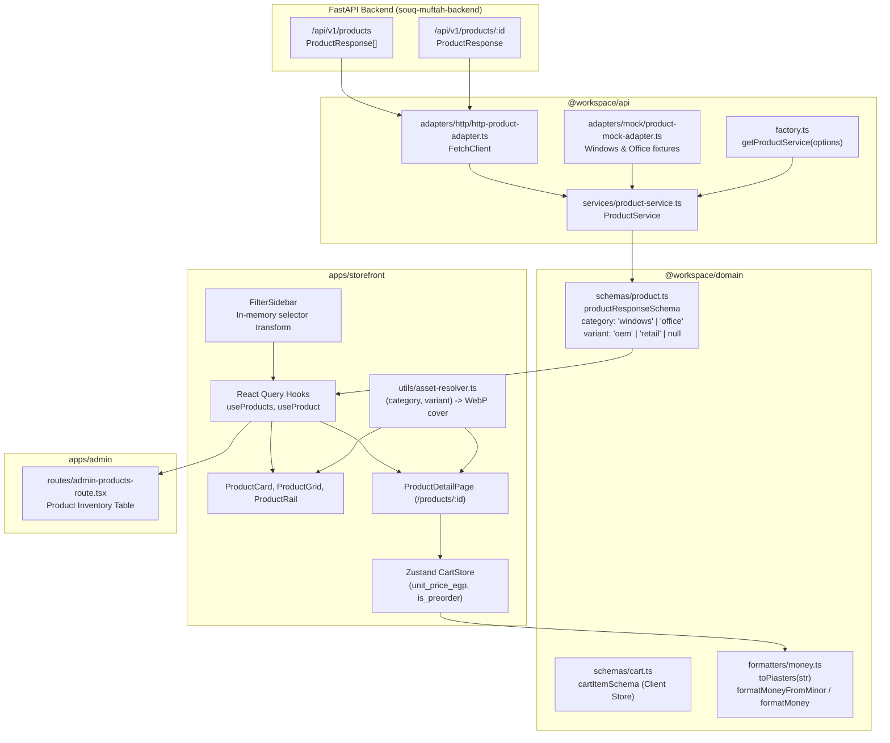

# Frontend Realignment with Backend API Specification

*   **Author:** Abdelrahman Eltokhy
*   **Status:** Approved
*   **Date:** 2026-11-19

---

## Overview

This project realigns the Muftahy frontend monorepo (`apps/storefront`, `apps/admin`, `packages/domain`, and `packages/api`) with the canonical backend API specification established in `souq-muftah-backend`. The existing frontend was scaffolded with speculative e-commerce structures: multi-platform gaming filters (Steam, PlayStation, Xbox, Nintendo), regional licensing codes (MENA, GCC, EU, US), multi-tier subscription plans, customer star ratings, and multi-currency models.

The production backend operates as a specialized Egyptian digital marketplace selling Microsoft Windows and Office activation keys. Transactions are priced in Egyptian Pounds (EGP) and fulfilled through manual receipt validation (Vodafone Cash and InstaPay) or preorders. This design removes unsupported data models, dead UI controls, and speculative attributes from the frontend. It establishes schema parity with backend Pydantic models across `@workspace/domain` schemas, `@workspace/api` service interfaces, and HTTP/mock adapters.

---

## The Problem

The frontend currently operates on a divergent domain model that does not match backend reality:

1. **Schema Incompatibility:** The frontend `productSchema` in `@workspace/domain` mandates nested structures (`platform`, `region`, `plans`, `specs`, `rating`, `mediaItems`, and bilingual `{ en, ar }` strings) that the backend does not store or return. The backend `ProductResponse` is a flat structure returning `name`, `category` (`windows` | `office`), `variant` (`oem` | `retail` | `null`), EGP Decimal pricing, and stock status metrics.
2. **Storefront and Backend Catalog Mismatch:** Storefront UI components display platform selectors, gaming badges, and customer review stars for inventory that does not exist in the backend.
3. **Dead Code and Maintenance Overhead:** Significant frontend code exists to render, filter, and test mock attributes unsupported by the backend. This adds unnecessary bundle size, increases test execution time, and complicates feature development.
4. **Currency and Price Calculation Discrepancies:** The frontend models money through a multi-currency minor-unit structure (`MoneyValue`), whereas the backend operates in EGP Decimal values directly, with separate fields for base price, sale price, and discount percentage.

---

## Goals

*   **Schema Parity:** Define Zod schemas and TypeScript types in `@workspace/domain` that match backend Pydantic schemas for `ProductResponse`, `ProductCreate`, and `ProductUpdate`.
*   **Removal of Unsupported Catalog Features:** Remove UI components, filters, sample data, and types related to gaming platforms (Steam, PlayStation, Xbox, Nintendo), regional locking, tiered plan pickers, customer reviews, and FAQ accordions.
*   **Catalog Presentation Update:** Reconfigure storefront product cards, grids, rails, and detail pages to focus on product identity, software category, edition/variant badge (`OEM` vs `Retail`), pricing in EGP, and stock state (`In Stock`, `Preorder`, `Out of Stock`).
*   **Accurate Filtering and Search:** Limit catalog filtering to attributes supported by the business model: category (`windows`, `office`), variant (`oem`, `retail`), and stock availability.
*   **Service & Mock Synchronization:** Re-seed `@workspace/api` mock adapters and service definitions with Windows and Office catalog items matching backend fixtures, ensuring consistent interface parity between mock and HTTP adapters.
*   **Preserved Quality & Accessibility:** Ensure all refactored components meet WCAG 2.1 AA standards, support RTL (Arabic) and LTR (English) layout rendering, and pass all verification checks (`pnpm typecheck`, `pnpm lint`, `pnpm test`, `pnpm build`).

---

## Non-Goals

*   **Backend Modifications:** No changes to backend database migrations, route handlers, or Pydantic schemas. The frontend adapts to existing backend contracts.
*   **Checkout & Order Processing Overhaul:** This milestone focuses on catalog realignment, product schemas, and presentation components. Full checkout flows, payment receipt uploads, and admin refund processing remain bounded within their dedicated feature milestones.
*   **Expanding Catalog Scope:** No addition of other software vendors or digital gift cards beyond Microsoft Windows and Office.
*   **Altering UI Foundation:** No replacement of Base UI primitives or core shadcn theme tokens.

---

## Open Questions

*   None (all architectural questions resolved during drafting and review).

---

## Resolved Questions

*   **Question 1 (Localized Product Names):** The backend stores `name` as a single string (e.g., "Windows 11 Pro").
    *   *Resolution (Decided by author):* Render the product name as returned by the backend across both English and Arabic locales. No client-side bilingual overrides or localized title mappings in `i18n`. System taxonomy (categories, variants, stock statuses) remains localized via `react-i18next`.
*   **Question 2 (Preorder Cart UX):** Handling products with `stock_status: "preorder"` when added to cart.
    *   *Resolution (Decided by author):* No explicit confirmation modal or interruption. The item is added to the cart with `is_preorder: true`, and the cart line item displays a localized preorder badge and delivery disclaimer.

---

## Critical User Journeys (CUJs)

### CUJ 1: Customer Browses and Filters Software Licenses

*   **Given:** A customer navigates to the storefront catalog page (`/:lang/products`).
*   **When:** The customer filters by category `windows` and variant `retail`.
*   **Then:** The page displays Windows retail products with EGP pricing, discount tags (if on sale), and stock status indicators, without showing gaming platform icons or regional restrictions.

### CUJ 2: Customer Views Product Details

*   **Given:** A customer clicks on a product card (e.g., "Windows 11 Pro").
*   **When:** The product detail page loads (`/:lang/products/:id`).
*   **Then:** The page renders the product title, description text, variant badge, EGP pricing breakdown (base price, sale price, discount percentage), and stock indicator. No tier selectors, platform chips, review stars, or FAQs appear.

### CUJ 3: Customer Adds In-Stock or Preorder Item to Cart

*   **Given:** A product detail page displays an item with either `stock_status: "in_stock"` or `stock_status: "preorder"`.
*   **When:** The customer clicks the Add to Cart button.
*   **Then:** The item is added to the client cart store with its canonical `product_id`, `unit_price_egp`, and `is_preorder` flag. The cart slide-over displays subtotal and preorder disclaimers in EGP.

---

## Technical Plan (Architecture)

### Architecture: Backend Schema Alignment

The architecture enforces a strict mapping between the backend FastAPI / Pydantic schemas and the frontend TypeScript / Zod types. No layer above `@workspace/api` may fabricate attributes or expect structures absent from `souq-muftah-backend`.



---

### 1. Domain Layer Alignment (`packages/domain`)

#### A. Canonical Product Schema (`packages/domain/src/schemas/product.ts`)
The legacy `productSchema` is replaced with schemas mirroring backend Pydantic models:

```typescript
export const productCategorySchema = z.enum(['windows', 'office']);
export type ProductCategory = z.infer<typeof productCategorySchema>;

export const productVariantSchema = z.enum(['oem', 'retail']).nullable();
export type ProductVariant = z.infer<typeof productVariantSchema>;

export const stockStatusSchema = z.enum(['in_stock', 'preorder', 'out_of_stock']);
export type StockStatus = z.infer<typeof stockStatusSchema>;

export const productResponseSchema = z.object({
  id: z.string().uuid(),
  name: z.string().min(2).max(255),
  category: productCategorySchema,
  variant: productVariantSchema,
  base_price: z.string().regex(/^\d+(\.\d{1,2})?$/), // EGP Decimal string
  sale_price: z.string().regex(/^\d+(\.\d{1,2})?$/).nullable(),
  effective_price: z.string().regex(/^\d+(\.\d{1,2})?$/),
  discount_percentage: z.number().nullable(),
  stock_status: stockStatusSchema,
  available_count: z.number().int().nonnegative(),
  preorder_enabled: z.boolean(),
  description: z.string().nullable(),
  is_active: z.boolean().default(true),
});
export type ProductResponse = z.infer<typeof productResponseSchema>;

export const productCreateSchema = z.object({
  name: z.string().min(2).max(255),
  category: productCategorySchema,
  variant: productVariantSchema.optional(),
  base_price: z.string().regex(/^\d+(\.\d{1,2})?$/),
  sale_price: z.string().regex(/^\d+(\.\d{1,2})?$/).nullable().optional(),
  preorder_enabled: z.boolean().default(true),
  description: z.string().nullable().optional(),
});
export type ProductCreateInput = z.infer<typeof productCreateSchema>;

export const productUpdateSchema = z.object({
  base_price: z.string().regex(/^\d+(\.\d{1,2})?$/).optional(),
  sale_price: z.string().regex(/^\d+(\.\d{1,2})?$/).nullable().optional(),
  is_active: z.boolean().optional(),
  preorder_enabled: z.boolean().optional(),
  description: z.string().nullable().optional(),
});
export type ProductUpdateInput = z.infer<typeof productUpdateSchema>;
```

**Deleted from `packages/domain`:**
*   `productPlatformSchema` (`steam`, `playstation`, `xbox`, etc.)
*   `productRegionSchema` (`global`, `gcc`, `eg`, etc.)
*   `productPlanSchema` (tiers/subscription plans)
*   `productSpecsSchema`
*   `productFaqItemSchema`
*   `productMediaItemSchema`
*   `localizedStringSchema` within the Product entity (name and description are single strings)

#### B. Client Cart Store Schema (`packages/domain/src/schemas/cart.ts`)
The client shopping cart is managed via Zustand in `apps/storefront` and persisted to `localStorage`. Its item interface is defined as:

```typescript
export const cartItemSchema = z.object({
  product_id: z.string().uuid(),
  product_name: z.string(),
  quantity: z.number().int().min(1),
  is_preorder: z.boolean(),
  unit_price_egp: z.string(),
});
export type CartItem = z.infer<typeof cartItemSchema>;
```

#### C. Lossless Monetary Conversion (`packages/domain/src/formatters/money.ts`)
To prevent floating-point precision drift when calculating cart line items and subtotals from backend decimal strings, conversion to minor units (piasters) is provided:

```typescript
export function toPiasters(decimalStr: string): number {
  const [units, fraction = '00'] = decimalStr.split('.');
  const normalizedFraction = fraction.padEnd(2, '0').slice(0, 2);
  return parseInt(units, 10) * 100 + parseInt(normalizedFraction, 10);
}
```
Client cart calculations (item subtotals, cart total) execute integer arithmetic in piasters before formatting via `formatMoneyFromMinor(amountInPiasters, 'EGP', locale)`. When formatting product prices directly from the backend decimal string, `formatMoney(Number(product.effective_price), { currency: 'EGP', locale })` is used.

---

### 2. Service Layer Alignment (`packages/api`)

#### A. ProductService Interface (`packages/api/src/services/product-service.ts`)
```typescript
import type { ProductCategory, ProductResponse, ProductCreateInput, ProductUpdateInput } from '@workspace/domain/schemas/product';

export interface ProductFilterParams {
  category?: ProductCategory;
  only_active?: boolean;
}

export interface ProductService {
  getProducts(params?: ProductFilterParams): Promise<ProductResponse[]>;
  getCategories(): Promise<string[]>;
  getProductById(id: string): Promise<ProductResponse>;
  createProduct(data: ProductCreateInput): Promise<ProductResponse>;
  updateProduct(id: string, data: ProductUpdateInput): Promise<ProductResponse>;
  deleteProduct(id: string): Promise<{ message: string }>;
}
```

*Filtering Architecture:* `ProductService.getProducts()` queries the backend API strictly with supported backend parameters (`category`, `only_active`). Secondary faceting by `variant` (`retail`, `oem`) and `stock_status` is executed client-side via memoized TanStack Query selector transforms (`select: (data) => filterCatalog(data, filters)`), avoiding unneeded network roundtrips for the small product set (~10 discrete items).

#### B. ProductMockAdapter Fixtures (`packages/api/src/adapters/mock/product-mock-adapter.ts`)
Replaces synthetic gaming fixtures with authentic Microsoft catalog items:

| ID | Name | Category | Variant | Base Price | Sale Price | Effective Price | Discount | Stock Status | Available | Preorder |
|---|---|---|---|---|---|---|---|---|---|---|
| `00000000-0000-0000-0000-000000000001` | Windows 11 Professional | `windows` | `retail` | `499.00` | `349.00` | `349.00` | 30% | `in_stock` | 14 | true |
| `00000000-0000-0000-0000-000000000002` | Windows 11 Professional | `windows` | `oem` | `299.00` | null | `299.00` | null | `in_stock` | 28 | true |
| `00000000-0000-0000-0000-000000000003` | Windows 11 Home | `windows` | `retail` | `399.00` | `299.00` | `299.00` | 25% | `in_stock` | 9 | true |
| `00000000-0000-0000-0000-000000000004` | Windows 10 Professional | `windows` | `retail` | `349.00` | `249.00` | `249.00` | 28% | `in_stock` | 5 | true |
| `00000000-0000-0000-0000-000000000005` | Office 2021 Professional Plus | `office` | `retail` | `899.00` | `699.00` | `699.00` | 22% | `in_stock` | 12 | true |
| `00000000-0000-0000-0000-000000000006` | Office 2019 Professional Plus | `office` | `retail` | `599.00` | null | `599.00` | null | `preorder` | 0 | true |

#### C. HttpProductAdapter & Factory (`packages/api/src/adapters/http/http-product-adapter.ts`)
Implements `ProductService` connecting to backend endpoints via `FetchClient`:
*   `GET /api/v1/products?category=...&only_active=...`
*   `GET /api/v1/products/categories`
*   `GET /api/v1/products/:id`
*   `POST /api/v1/products` (admin auth)
*   `PATCH /api/v1/products/:id` (admin auth)
*   `DELETE /api/v1/products/:id` (admin auth)

In `packages/api/src/factory.ts`, `ServiceRegistry.getProductService(options?: { useMock?: boolean; baseURL?: string })` is updated to instantiate `HttpProductAdapter` when `useMock === false`.

---

### 3. Storefront Presentation Layer (`apps/storefront`)

#### A. Component Deletions (Unsupported Elements)
*   **DELETE** `apps/storefront/src/features/products/components/platforms-row.tsx`
*   **DELETE** `apps/storefront/src/features/products/components/plan-picker.tsx`
*   **DELETE** `apps/storefront/src/features/products/components/sample-data.ts`
*   **DELETE** `apps/storefront/src/features/products/hooks/use-product-collection.ts`

#### B. Deterministic Product Asset Resolution (`utils/asset-resolver.ts`)
Because the backend schema does not store image URLs, `apps/storefront` introduces a client-side asset resolver mapping `(category, variant)` tuples to static WebP artwork:

```typescript
export function resolveProductImage(category: ProductCategory, variant: ProductVariant): string {
  if (category === 'windows') {
    return variant === 'oem' ? '/images/products/windows-oem.webp' : '/images/products/windows-retail.webp';
  }
  return '/images/products/office-retail.webp';
}
```

#### C. Component Simplification
1. **`product-card.tsx`**:
   - Header: Product category pill (`Windows` / `Office`), variant badge (`Retail` / `OEM` if variant is not null).
   - Image: Derived from `resolveProductImage(product.category, product.variant)`.
   - Title: Render `product.name` directly.
   - Stock Status Pill:
     - `in_stock`: Green badge with `In Stock` (`متوفر`)
     - `preorder`: Amber badge with `Preorder` (`طلب مسبق`)
     - `out_of_stock`: Muted badge with `Out of Stock` (`غير متوفر`)
   - Price Block:
     - Formatted in EGP using `formatMoney(Number(product.effective_price), { currency: 'EGP', locale })`.
     - Strikethrough `base_price` and discount pill (`-30%`) if `sale_price` is active.
   - Action: `Add to Cart` button (disabled only if `stock_status === "out_of_stock"` and `preorder_enabled === false`).
2. **`filter-sidebar.tsx` & `filter-sheet.tsx`**:
   - Filter dimensions:
     - Category (All, Windows, Office).
     - Variant (All, Retail, OEM).
     - Stock Status (All, In Stock Only, Preorders Allowed).
   - Removed: Platforms, Regions, Price sliders with non-EGP currencies.
3. **`product-detail-page.tsx` & Detail Views**:
   - Route path updated in `router.tsx` to `/:lang/products/:id`.
   - Primary Hero Grid: Cover image via asset resolver, title, variant chip, stock counter (`14 keys available` or `Available for preorder`), price card with EGP total.
   - Delivery Info: Digital key delivery instant on payment approval (or preorder fulfillment on stock replenishment).
   - Removed: Tabs for system specs, ratings/reviews, and synthetic FAQ accordion.
4. **`cart-store.ts` (`apps/storefront/src/features/cart/stores/cart-store.ts`)**:
   - Tracks `CartItem[]` (`product_id`, `product_name`, `quantity`, `is_preorder`, `unit_price_egp`).
   - Line-item subtotals and cart total calculated in piasters using `toPiasters` before formatting via `formatMoneyFromMinor`.
   - Downstream consumers updated: `cart-line-item.tsx`, `cart-selectors.ts`, `cart-route.tsx`, `cart-button.tsx`, and `checkout-route.tsx`.

---

### 4. Admin Dashboard Alignment (`apps/admin`)

#### Product Inventory Management (`apps/admin/src/routes/admin-products-route.tsx`)
*   **Table Columns:** Name, Category (`windows` | `office`), Variant (`oem` | `retail`), Base Price (EGP), Sale Price (EGP), Effective Price, Available Keys, Stock Status, Preorder Status, Actions.
*   **Product Create/Edit Form:** When creating, all fields are editable. When editing an existing product, identity attributes (`name`, `category`, `variant`) are rendered as read-only badges to reflect backend immutability, while operational attributes (`base_price`, `sale_price`, `preorder_enabled`, `description`) remain editable.

---

## Alternatives Considered

### Alternative 1: Retaining Mock-Only Attributes as Client-Side UI Decorations

*   **Pros:** Preserves existing gaming icons (Steam, PlayStation, Xbox) and tier selectors in `apps/storefront` without requiring immediate component deletion.
*   **Cons:** Directly misleads users into expecting gaming codes and non-existent software products; causes runtime errors when accessing undefined response fields on live backend data.
*   **Reason for Rejection:** Rejected by author: Violates the user directive to strictly align the frontend with backend API schemas and eliminate extraneous data.

### Alternative 2: Dual-Language Title Translation in Client Dictionaries vs. Verbatim Backend Strings

*   **Pros:** Allows translating product names into Arabic (e.g., translating "Windows 11 Pro" into "ويندوز 11 برو").
*   **Cons:** Product names are standard commercial brand names recognized in Latin script; maintaining client-side translation dictionaries introduces synchronization overhead whenever catalog items are added or edited by admins.
*   **Reason for Rejection:** Rejected by author: Product titles render as returned by the backend across both Arabic and English locales. System taxonomy (categories, variants, stock statuses) will be translated via `react-i18next`.

### Alternative 3: Explicit Modal Confirmation for Preorder Cart Additions

*   **Pros:** Forces customer awareness that an item is currently out of stock before adding it to the cart.
*   **Cons:** Introduces unnecessary checkout friction; interrupts shopping flow for digital products where preorders are standard practice for restocked keys.
*   **Reason for Rejection:** Rejected by author: Non-blocking visual badges (`Preorder` pill on product cards, delivery timeline callouts on product details, and preorder indicators in the cart line item) communicate fulfillment status directly without requiring an additional confirmation modal.

### Alternative 4: Storing Monetary Values as Floating-Point Numbers vs. Decimal Strings

*   **Pros:** Permits native JavaScript arithmetic without string conversion.
*   **Cons:** Floating-point precision errors (e.g., `0.1 + 0.2 !== 0.3`) accumulate in cart totals and discount percentages; violates project instructions against floating-point money handling; conflicts with backend `Decimal(12, 2)` types.
*   **Reason for Rejection:** Rejected by author: Serializing money as strings on the wire and converting to minor integer units (piasters) for client-side calculations preserves exact numeric integrity across network and formatting boundaries.

---

## Non-Functional Requirements

### Security & Privacy
*   **Presentation Masking for Keys:** Digital activation keys and serials (`XXXXX-XXXXX-XXXXX`) are masked behind an explicit reveal-and-copy UI control to prevent shoulder-surfing and accidental screen-share exposure.
*   **Input Sanitization:** Search query parameters, filter inputs, and cart quantities are validated via Zod schemas to prevent prototype pollution or invalid state injection.

### Performance & Latency
*   **Bundle Size Reduction:** Deleting unused components (`platforms-row.tsx`, `plan-picker.tsx`, `sample-data.ts`, `use-product-collection.ts`) and removing unused Lucide gaming icons reduces storefront bundle footprint.
*   **Optimistic UI & Cache Strategy:** TanStack Query caches catalog responses with a 5-minute `staleTime`, minimizing redundant network roundtrips during catalog filtering.

### Accessibility & Internationalization (WCAG 2.1 AA)
*   **RTL-First Styling:** All layout utilities use CSS logical properties (`ms-*`, `me-*`, `ps-*`, `pe-*`, `text-start`, `text-end`). Directional chevrons flip automatically under `dir="rtl"`.
*   **Western Digits:** All formatted prices, quantities, and dates render using Western Arabic numerals (0-9) across both English and Arabic locales via `@workspace/domain/formatters`.
*   **Focus & Screen Readers:** All interactive controls (Add to Cart buttons, filter checkboxes, variant badges) retain Base UI visible focus rings and accessible ARIA attributes.

---

## Detailed Implementation Plan

The implementation proceeds in five sequential phases, executing package-scoped verification during intermediate stages and full monorepo verification upon completion.

```text
Phase 1: Domain Schemas Alignment (@workspace/domain)
  ├── Redefine productResponseSchema, productCreateSchema, productUpdateSchema
  ├── Add is_active: z.boolean().default(true)
  ├── Create client cart schema (cartItemSchema)
  ├── Implement lossless money conversion helper (toPiasters)
  ├── Prune dead schemas (platforms, regions, plans, specs, ratings, faqs)
  └── Run: pnpm --filter @workspace/domain typecheck && pnpm --filter @workspace/domain test

Phase 2: Service Layer & Mock Adapter Realignment (@workspace/api)
  ├── Update ProductService interface with ProductCategory and active flags
  ├── Overhaul ProductMockAdapter with Windows & Office catalog fixtures table
  ├── Implement HttpProductAdapter connecting to /api/v1/products
  ├── Update getProductService() in factory.ts to instantiate HttpProductAdapter when useMock is false
  └── Run: pnpm --filter @workspace/api typecheck && pnpm --filter @workspace/api test

Phase 3: Localization & Taxonomy Update (@workspace/i18n)
  ├── Add Arabic and English keys under existing products namespace:
  │     products.categories.windows, products.categories.office
  │     products.variants.retail, products.variants.oem
  │     products.stock.in_stock, products.stock.preorder, products.stock.out_of_stock
  ├── Purge obsolete gaming platform and regional taxonomy translation keys
  └── Run: pnpm --filter @workspace/i18n typecheck

Phase 4: Storefront Catalog Cleanup & Refactoring (apps/storefront)
  ├── Delete dead files: platforms-row.tsx, plan-picker.tsx, sample-data.ts, use-product-collection.ts
  ├── Update router.tsx from /products/:slug to /products/:id
  ├── Create utils/asset-resolver.ts for deterministic WebP product artwork
  ├── Refactor product-card.tsx, product-grid.tsx, product-rail.tsx, add-to-cart-button.tsx
  ├── Refactor filter-sidebar.tsx, filter-sheet.tsx, category-row.tsx, listing-toolbar.tsx
  ├── Refactor use-product-filters.ts and use-products.ts for in-memory selector faceting
  ├── Refactor pages/product-detail-page.tsx and components/detail/* (strip specs tabs, reviews, faqs)
  ├── Refactor stores/cart-store.ts for normalized EGP pricing & integer piaster math
  ├── Update downstream cart consumers: cart-line-item.tsx, cart-selectors.ts, cart-route.tsx, cart-button.tsx, checkout-route.tsx
  ├── Update home.tsx, home.config.ts, and features/home/components/*
  ├── Update search-route.tsx and search-panel.tsx
  └── Run: pnpm --filter storefront typecheck && pnpm --filter storefront test

Phase 5: Admin Management Realignment & Monorepo Verification (apps/admin)
  ├── Update admin-products-route.tsx table columns and forms to backend attributes
  ├── Run full monorepo typecheck: pnpm typecheck
  ├── Run full monorepo linting: pnpm lint && pnpm format:check
  ├── Run full monorepo test suite: pnpm test
  └── Validate production build: pnpm build
```

### Target Files to Create, Modify, or Delete

#### 1. Domain Package (`packages/domain`)

*   **`packages/domain/src/schemas/product.ts`** (*Modify*)
    *   *Type / Scope*: TypeScript Module / Zod Schemas
    *   *Rationale*: Replace speculative gaming/subscription schema with `productResponseSchema` (including `is_active`), `productCreateSchema`, and `productUpdateSchema` matching FastAPI Pydantic definitions. Delete `productPlatformSchema`, `productRegionSchema`, `productPlanSchema`, `productSpecsSchema`, `productFaqItemSchema`, and `productMediaItemSchema`.
*   **`packages/domain/src/schemas/product.test.ts`** (*Modify*)
    *   *Type / Scope*: Vitest Unit Tests
    *   *Rationale*: Update schema tests to validate required backend fields (`id`, `name`, `category`, `variant`, `base_price`, `stock_status`, `available_count`, `preorder_enabled`, `is_active`) and test null versus non-null `sale_price` and `discount_percentage`.
*   **`packages/domain/src/schemas/cart.ts`** (*Create*)
    *   *Type / Scope*: TypeScript Module / Zod Schemas
    *   *Rationale*: Define `cartItemSchema` for client Zustand cart state tracking `product_id`, `product_name`, `quantity`, `is_preorder`, and `unit_price_egp`.
*   **`packages/domain/src/formatters/money.ts`** (*Modify*)
    *   *Type / Scope*: Formatter Module
    *   *Rationale*: Add `toPiasters` conversion helper for integer minor-unit arithmetic.
*   **`packages/domain/src/formatters/formatters.test.ts`** (*Modify*)
    *   *Type / Scope*: Vitest Unit Tests
    *   *Rationale*: Add unit tests for `toPiasters` validating string decimal parsing without floating-point errors.

#### 2. API Package (`packages/api`)

*   **`packages/api/src/services/product-service.ts`** (*Modify*)
    *   *Type / Scope*: Service Interface
    *   *Rationale*: Update `ProductService` method signatures: `getProducts(params?: ProductFilterParams)` where params support `category?: ProductCategory` and `only_active?: boolean`. Update return types to `ProductResponse`.
*   **`packages/api/src/adapters/mock/product-mock-adapter.ts`** (*Modify*)
    *   *Type / Scope*: Mock Service Implementation
    *   *Rationale*: Replace synthetic gaming products with 6 authentic Microsoft Windows & Office products matching backend catalog fixtures.
*   **`packages/api/src/adapters/mock/product-mock-adapter.test.ts`** (*Modify*)
    *   *Type / Scope*: Vitest Unit Tests
    *   *Rationale*: Test mock adapter querying by category (`windows`, `office`), single product lookup by UUID, and stock filtering.
*   **`packages/api/src/adapters/http/http-product-adapter.ts`** (*Create*)
    *   *Type / Scope*: HTTP Client Adapter
    *   *Rationale*: Implement `ProductService` targeting backend endpoints `/api/v1/products`, `/api/v1/products/categories`, and `/api/v1/products/:id` via native `FetchClient`.
*   **`packages/api/src/factory.ts`** (*Modify*)
    *   *Type / Scope*: Factory Module
    *   *Rationale*: Update `getProductService(options)` on `ServiceRegistry` to instantiate `HttpProductAdapter` when mock mode is disabled.

#### 3. Localization Package (`packages/i18n`)

*   **`packages/i18n/src/locales/en.json`** (*Modify*)
    *   *Type / Scope*: Locale Dictionary (English)
    *   *Rationale*: Add translation keys under existing `products` namespace (`products.categories.windows`, `products.categories.office`, `products.variants.retail`, `products.variants.oem`, `products.stock.in_stock`, `products.stock.preorder`, `products.stock.out_of_stock`), and delete obsolete gaming platform keys.
*   **`packages/i18n/src/locales/ar.json`** (*Modify*)
    *   *Type / Scope*: Locale Dictionary (Arabic)
    *   *Rationale*: Add Arabic terminology under `products` namespace for categories, variants, and stock indicators.

#### 4. Storefront Application (`apps/storefront`)

*   **`apps/storefront/src/app/router.tsx`** (*Modify*)
    *   *Type / Scope*: Router Configuration
    *   *Rationale*: Update route path from `products/:slug` to `products/:id` to match backend UUID identifiers.
*   **`apps/storefront/src/features/products/utils/asset-resolver.ts`** (*Create*)
    *   *Type / Scope*: Utility Module
    *   *Rationale*: Deterministic resolver mapping `(category, variant)` tuples to static WebP cover images.
*   **`apps/storefront/src/features/products/components/platforms-row.tsx`** (*Delete*)
    *   *Type / Scope*: Presentation Component
    *   *Rationale*: Platform chips (Steam, Xbox, PlayStation) do not exist in the backend product model.
*   **`apps/storefront/src/features/products/components/plan-picker.tsx`** (*Delete*)
    *   *Type / Scope*: Presentation Component
    *   *Rationale*: Tier/plan selectors are unsupported by the backend; products are discrete license items.
*   **`apps/storefront/src/features/products/components/sample-data.ts`** (*Delete*)
    *   *Type / Scope*: Static Mock Data
    *   *Rationale*: Obsolete synthetic data file containing phantom games; data must flow exclusively from `@workspace/api`.
*   **`apps/storefront/src/features/products/hooks/use-product-collection.ts`** (*Delete*)
    *   *Type / Scope*: React Hook
    *   *Rationale*: Pruned collection query hook unsupported by backend catalog.
*   **`apps/storefront/src/features/products/components/types.ts`** (*Modify*)
    *   *Type / Scope*: Local Type Re-exports
    *   *Rationale*: Forward types directly from `@workspace/domain/schemas/product` instead of maintaining duplicated local definitions.
*   **`apps/storefront/src/features/products/components/product-card.tsx`** (*Modify*)
    *   *Type / Scope*: Presentation Component
    *   *Rationale*: Strip platform chips, plan radio buttons, and fake rating stars. Render category/variant badge, title, EGP price formatting, stock status pill, cover image via asset resolver, and Add-to-Cart button.
*   **`apps/storefront/src/features/products/components/add-to-cart-button.tsx`** (*Modify*)
    *   *Type / Scope*: Presentation Component
    *   *Rationale*: Remove `PlanPicker` import and simplify to add canonical product item directly.
*   **`apps/storefront/src/features/products/components/product-grid.tsx`** (*Modify*)
    *   *Type / Scope*: Presentation Component
    *   *Rationale*: Update props and render loop to consume `ProductResponse[]`.
*   **`apps/storefront/src/features/products/components/product-rail.tsx`** (*Modify*)
    *   *Type / Scope*: Presentation Component
    *   *Rationale*: Update rail to pass canonical product fields to cards and navigate by UUID `id`.
*   **`apps/storefront/src/features/products/components/filter-sidebar.tsx` & `filter-sheet.tsx`** (*Modify*)
    *   *Type / Scope*: Filter Sidebar Components
    *   *Rationale*: Remove platform, region, and foreign currency filters. Retain only Category (`windows`, `office`), Variant (`retail`, `oem`), and Stock Availability.
*   **`apps/storefront/src/features/products/components/category-row.tsx`** (*Modify*)
    *   *Type / Scope*: Presentation Component
    *   *Rationale*: Remove obsolete game and gift-card categories, rendering only Windows and Office.
*   **`apps/storefront/src/features/products/components/listing-toolbar.tsx`** (*Modify*)
    *   *Type / Scope*: Presentation Component
    *   *Rationale*: Remove platform and region filter chip rendering.
*   **`apps/storefront/src/features/products/hooks/use-product-filters.ts`** (*Modify*)
    *   *Type / Scope*: React Hook
    *   *Rationale*: Update state reducer to handle canonical filter keys (`category`, `variant`, `stock_status`).
*   **`apps/storefront/src/features/products/hooks/use-filter-counts.ts`** (*Modify*)
    *   *Type / Scope*: React Hook
    *   *Rationale*: Calculate counts strictly for valid categories, variants, and stock availability.
*   **`apps/storefront/src/features/products/hooks/use-products.ts`** (*Modify*)
    *   *Type / Scope*: TanStack Query Hook
    *   *Rationale*: Wire catalog fetching to `productService.getProducts()` with 5-minute cache time and in-memory selector faceting.
*   **`apps/storefront/src/routes/products-route.tsx`** (*Modify*)
    *   *Type / Scope*: Route Component
    *   *Rationale*: Synchronize URL search params with canonical category and variant filters.
*   **`apps/storefront/src/features/products/pages/product-detail-page.tsx` & `components/detail/*`** (*Modify*)
    *   *Type / Scope*: Page & Detail Subcomponents
    *   *Rationale*: Query by UUID `id`, display cover image via asset resolver, title, description, variant badge, stock availability, and EGP price card with instant/preorder Add-to-Cart. Remove specs tabs, fake reviews, and synthetic FAQs.
*   **`apps/storefront/src/features/cart/stores/cart-store.ts`** (*Modify*)
    *   *Type / Scope*: Zustand Store
    *   *Rationale*: Update cart item structure to track `product_id`, `product_name`, `quantity`, `is_preorder`, and `unit_price_egp`, calculating subtotals using integer piasters via `toPiasters`.
*   **`apps/storefront/src/features/cart/components/cart-line-item.tsx`** (*Modify*)
    *   *Type / Scope*: Presentation Component
    *   *Rationale*: Update line-item display to consume canonical cart fields and format via `formatMoneyFromMinor`.
*   **`apps/storefront/src/features/cart/lib/cart-selectors.ts`** (*Modify*)
    *   *Type / Scope*: Selector Module
    *   *Rationale*: Update subtotal calculation to integer piaster summation in EGP.
*   **`apps/storefront/src/routes/cart-route.tsx` & `apps/storefront/src/routes/checkout-route.tsx`** (*Modify*)
    *   *Type / Scope*: Route Components
    *   *Rationale*: Update to consume realigned cart state without breaking type safety.
*   **`apps/storefront/src/components/site-header/cart-button.tsx`** (*Modify*)
    *   *Type / Scope*: Header Component
    *   *Rationale*: Update slide-over drawer item rendering to match canonical cart item fields.
*   **`apps/storefront/src/routes/home.tsx`, `features/home/home.config.ts`, and `features/home/components/*`** (*Modify*)
    *   *Type / Scope*: Route & Components
    *   *Rationale*: Update hero highlights and featured rail to feature genuine Windows and Office licenses without dead gaming tags.
*   **`apps/storefront/src/routes/search-route.tsx` & `components/site-header/search-panel.tsx`** (*Modify*)
    *   *Type / Scope*: Search Components
    *   *Rationale*: Update search result rendering to consume `ProductResponse` array and navigate by UUID.
*   **Storefront Test Suites** (*Modify*)
    *   `apps/storefront/src/features/products/products.test.tsx`
    *   `apps/storefront/src/features/products/product-detail.test.tsx`
    *   `apps/storefront/src/features/home/home.test.tsx`
    *   `apps/storefront/src/routes/cart-route.test.tsx`
    *   *Rationale*: Update assertions to match aligned catalog cards, stock badges, integer money formatting, and UUID links.

#### 5. Admin Application (`apps/admin`)

*   **`apps/admin/src/routes/admin-products-route.tsx`** (*Modify*)
    *   *Type / Scope*: Route Component & Table
    *   *Rationale*: Align admin product inventory table columns with backend attributes (`category`, `variant`, `base_price`, `sale_price`, `effective_price`, `stock_status`, `available_count`, `preorder_enabled`, `is_active`).

---

### Verification Plan

*   **1. Static Analysis & Type Checking**:
    *   `pnpm typecheck`: Execute across all packages and applications with strict TypeScript checks. Must pass with zero errors.
*   **2. Code Style & Linting**:
    *   `pnpm lint`: Run ESLint across all modified and newly created files. Must pass with zero warnings or errors.
    *   `pnpm format:check`: Validate Prettier formatting rules.
*   **3. Automated Unit & Integration Testing**:
    *   `pnpm test`: Run full Vitest test suite across `@workspace/domain`, `@workspace/api`, `apps/storefront`, and `apps/admin`.
    *   Unit tests in `packages/domain/src/schemas/product.test.ts` for canonical schema parsing and validation.
    *   Unit tests in `packages/domain/src/formatters/formatters.test.ts` for `toPiasters`.
    *   Unit tests in `packages/api/src/adapters/mock/product-mock-adapter.test.ts` for catalog filtering.
    *   Component tests in `apps/storefront/src/features/products/products.test.tsx`, `product-detail.test.tsx`, `home.test.tsx`, and `cart-route.test.tsx`.
*   **4. Monorepo Production Build**:
    *   `pnpm build`: Verify that both `storefront` and `admin` applications bundle successfully with zero missing module or type errors.
*   **5. Accessibility & RTL Visual Verification**:
    *   Verify that all text labels render correctly in Arabic (`/ar/...`) using CSS logical properties (`dir="rtl"`).
    *   Verify all numbers and currency amounts render in Western digits (0-9) via `formatMoney` and `formatMoneyFromMinor`.

---

*Drafted with EGM*
