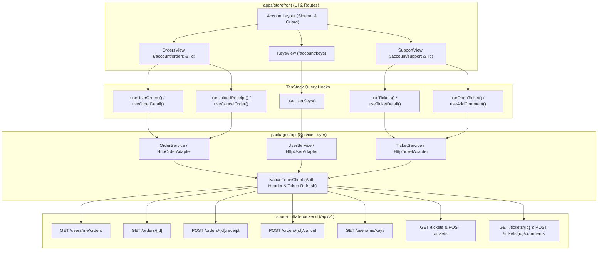

# Storefront Account Routes: Orders, Digital Keys & Support Tickets

* **Author:** Abdelrahman Eltokhy
* **Status:** Proposed
* **Date:** 2026-11-20

---

## Overview

This technical design specifies the full implementation of the protected customer account routes in Souq Muftah (`apps/storefront`):
- `/account/orders`: Order history summary list and detailed order inspection (`/account/orders/:orderId`), including offline payment receipt upload (Vodafone Cash, InstaPay) and order cancellation for pending payment states.
- `/account/keys`: A dedicated digital license vault displaying all fulfilled activation keys with explicit reveal-and-copy security controls, product association, and instant complaint linking.
- `/account/support`: A complete customer helpdesk interface for listing support tickets, lodging defective key complaints tied to specific delivered order items with screenshot evidence, and participating in two-way discussion threads.

All views strictly consume the live backend REST endpoints in `souq-muftah-backend`, completely replacing temporary placeholder routes and synthetic mock storage.

---

## The Problem

Currently, the customer account hub (`/:lang/account`) only provides an active implementation for the profile view (`/account/profile`). The remaining three core customer self-service views (`/account/orders`, `/account/keys`, and `/account/support`) render static coming-soon placeholders (`PlaceholderAccountPage`).

This leaves severe functional gaps in the storefront user journey:
1. **No Purchase Transparency**: Customers who complete checkout cannot check the status of their order, view administrative review deadlines, cancel mistaken orders, or upload manual payment receipts if their initial checkout upload failed or was delayed.
2. **Inaccessible Digital Goods**: Fulfilled activation keys are delivered only on the ephemeral checkout completion screen or via email. Customers have no central dashboard to view, copy, or reference their purchased software licenses.
3. **Absence of Post-Purchase Support**: The backend provides a full complaint and replacement state machine (`/api/v1/tickets`), but storefront users have no mechanism to submit defective key complaints, upload proof screenshots, or converse with support operators when a key fails to activate.

---

## Goals

* **Complete Customer Order Lifecycle**: Implement `/account/orders` and `/account/orders/:orderId` consuming `GET /api/v1/users/me/orders` and `GET /api/v1/orders/{order_id}`, with support for `POST /api/v1/orders/{order_id}/receipt` (Vodafone Cash / InstaPay receipt upload) and `POST /api/v1/orders/{order_id}/cancel`.
* **Centralized Digital Goods Vault**: Implement `/account/keys` consuming `GET /api/v1/users/me/keys`, rendering license keys behind a reveal-and-copy UI pattern with copy feedback, quick-search filtering, and a direct "Report Issue" action for each delivered key.
* **Customer Ticket Helpdesk**: Implement `/account/support` (and thread view `/account/support/:ticketId`) consuming `GET /api/v1/tickets`, `POST /api/v1/tickets`, `GET /api/v1/tickets/{ticket_id}`, and `POST /api/v1/tickets/{ticket_id}/comments`.
* **Schema Strictness & Mock Elimination**: Replace all placeholder components in `apps/storefront/src/features/account` with type-safe domain schemas matching `souq-muftah-backend` Pydantic models. Remove synthetic mock adapters for orders, keys, and tickets.
* **Frontend Design System Adherence**: Build UI according to `design-taste-frontend` and `AGENTS.md` standards: semantic tokens, Base UI primitives, zero layout shifts, WCAG 2.1 AA accessibility, and native Arabic (RTL) / English (LTR) bidirectional layout support.
* **100% Quality & Verification Parity**: Ensure full test coverage using Vitest and Testing Library, with clean passes for `pnpm typecheck`, `pnpm lint`, `pnpm test`, and `pnpm build`.

---

## Non-Goals

* **Backend Modification**: No changes to backend database models, migrations, or route signatures. The backend API is fixed and authoritative.
* **Admin Ticket Operations**: Operator review, ticket resolution, key replacement dispatch, and refund actions are handled exclusively in `apps/admin`. Storefront scope is strictly customer-facing.
* **Automated Gateway Integrations**: Online card processing or third-party payment webhooks are out of scope; payment confirmation relies exclusively on the backend receipt upload mechanism.
* **Unauthenticated Guest Order Lookup**: Order lookup without an authenticated session is out of scope. All account subroutes are protected by `AccountGuard`.

---

## Open Questions

* **Question 1**: Should `/account/orders/:orderId` and `/account/support/:ticketId` render as dedicated subroutes (separate URL paths) or modal sheet panels over the list views?
  * *Context*: Subroutes provide deep-linking from transactional emails and SMS, whereas sheets minimize navigation friction on mobile.
* **Question 2**: For defective key complaint submission, should the form live at `/account/support/new` or be triggered contextually from `/account/keys` via a dialog prefilled with the `order_item_id`?

---

## Critical User Journeys (CUJs)

### CUJ 1: Track Order Status & Upload Payment Receipt

* **Given**: A customer placed an order for a Windows 11 Pro key via Vodafone Cash and closed the tab before uploading their transfer screenshot.
* **When**: The customer navigates to `/:lang/account/orders`, finds their order in `pending_payment` status, opens the order details, and uploads their payment screenshot.
* **Then**: The order status transitions to `payment_uploaded`, the review deadline is displayed, and the customer receives visual confirmation that their payment is queued for administrative verification.

### CUJ 2: Reveal & Copy Activation Key from Key Vault

* **Given**: An authenticated customer with approved orders navigates to `/:lang/account/keys`.
* **When**: The customer searches for "Office", locates their purchased Office 2024 Home & Business key, and clicks the reveal toggle followed by the copy button.
* **Then**: The serial code is unmasked, copied to the system clipboard with tactile feedback, and an audit-safe display prevents accidental shoulder surfing.

### CUJ 3: Report Defective Key & Communicate with Support

* **Given**: A customer attempts to activate a product key that Microsoft servers reject as invalid.
* **When**: The customer clicks "Report Issue" next to the key in `/account/keys`, enters the problem description, attaches an error screenshot, and submits the ticket.
* **Then**: A ticket is created with status `open`, the customer is directed to `/account/support/:ticketId` displaying the conversation timeline, and any operator responses or replacement keys appear in the thread.

---

## Technical Plan (Architecture)

### 1. High-Level Component & Service Boundary



---

### 2. Domain Schemas (`packages/domain/src/schemas/`)

We introduce strictly typed, zero-mutation Zod schemas matching backend Pydantic models:

#### 2.1 Order Domain (`packages/domain/src/schemas/order.ts`)
```typescript
// Summary list item from GET /api/v1/users/me/orders
export const userOrderSummarySchema = z.object({
  id: z.string().uuid(),
  reference_code: z.string().min(1),
  status: z.enum([
    'pending_payment',
    'payment_uploaded',
    'under_review',
    'completed',
    'cancelled',
    'refunded',
  ]),
  total_egp: z.number().nonnegative(),
  created_at: z.string().datetime(),
  item_count: z.number().int().positive(),
})

// Detailed order item from GET /api/v1/orders/{order_id}
export const orderItemDetailSchema = z.object({
  id: z.string().uuid(),
  product_id: z.string().uuid(),
  product_name: z.string().min(1),
  is_preorder: z.boolean(),
  unit_price_egp: z.number().nonnegative(),
  discount_amount_egp: z.number().nonnegative(),
  final_price_egp: z.number().nonnegative(),
  key_serial: z.string().nullable().optional(),
  is_refunded: z.boolean().default(false),
  replacement_entitlement_used: z.boolean().default(false),
})

// Detailed payment attempt from GET /api/v1/orders/{order_id}
export const paymentAttemptSchema = z.object({
  id: z.string().uuid(),
  order_id: z.string().uuid(),
  receipt_image_path: z.string(),
  payment_method: z.string(),
  amount_claimed_egp: z.number().nullable().optional(),
  status: z.string(),
  rejection_reason: z.string().nullable().optional(),
  created_at: z.string().datetime(),
})

// Full order detail response
export const orderResponseSchema = z.object({
  id: z.string().uuid(),
  reference_code: z.string().min(1),
  status: z.enum([
    'pending_payment',
    'payment_uploaded',
    'under_review',
    'completed',
    'cancelled',
    'refunded',
  ]),
  subtotal_egp: z.number().nonnegative(),
  discount_total_egp: z.number().nonnegative(),
  total_egp: z.number().nonnegative(),
  payment_method: z.string().nullable().optional(),
  payment_instructions: z.object({
    vodafone_cash_number: z.string(),
    instapay_ipa: z.string(),
    reference_code: z.string(),
  }),
  payment_deadline: z.string().datetime().nullable().optional(),
  review_deadline: z.string().datetime().nullable().optional(),
  wrong_amount_attempts: z.number().int().default(0),
  rejection_reason: z.string().nullable().optional(),
  items: z.array(orderItemDetailSchema),
  payment_attempts: z.array(paymentAttemptSchema).default([]),
  created_at: z.string().datetime(),
})

// Receipt upload request schema (for form validation before multipart submission)
export const uploadReceiptFormSchema = z.object({
  payment_method: z.enum(['vodafone_cash', 'instapay']),
  amount_claimed: z.number().positive().optional(),
  receipt: z.instanceof(File, { message: 'A receipt image screenshot is required' }),
})
```

#### 2.2 Digital License Key Domain (`packages/domain/src/schemas/key.ts`)
```typescript
// Delivered user license key from GET /api/v1/users/me/keys
export const userKeySchema = z.object({
  key_id: z.string().uuid(),
  product_name: z.string().min(1),
  serial: z.string().min(1),
  sold_at: z.string().datetime().nullable().optional(),
})

export type UserKey = z.infer<typeof userKeySchema>
```

#### 2.3 Support Tickets Domain (`packages/domain/src/schemas/ticket.ts`)
```typescript
export const commentResponseSchema = z.object({
  id: z.string().uuid(),
  author_type: z.enum(['customer', 'admin', 'system']),
  author_name: z.string(),
  content: z.string().min(1),
  created_at: z.string().datetime(),
})

export const attachmentResponseSchema = z.object({
  id: z.string().uuid(),
  file_name: z.string(),
  file_size_bytes: z.number().int().nonnegative(),
  created_at: z.string().datetime(),
})

export const ticketDetailSchema = z.object({
  id: z.string().uuid(),
  user_id: z.string().uuid(),
  order_item_id: z.string().uuid(),
  key_serial: z.string().min(1),
  status: z.enum(['open', 'in_progress', 'resolved', 'closed']),
  outcome: z.enum(['replacement', 'refund', 'refused']).nullable().optional(),
  is_locked: z.boolean().default(false),
  admin_override: z.boolean().default(false),
  replacement_key_serial: z.string().nullable().optional(),
  comments: z.array(commentResponseSchema).default([]),
  attachments: z.array(attachmentResponseSchema).default([]),
  created_at: z.string().datetime(),
  resolved_at: z.string().datetime().nullable().optional(),
})

export const openTicketFormSchema = z.object({
  order_item_id: z.string().uuid(),
  initial_comment: z.string().min(10, 'Please provide details about the activation failure'),
  attachments: z.array(z.instanceof(File)).max(3).optional(),
})

export const addCommentFormSchema = z.object({
  content: z.string().min(1, 'Message cannot be empty'),
})
```

---

### 3. Service Layer Architecture (`packages/api`)

#### 3.1 OrderService & HttpOrderAdapter
```typescript
export interface OrderService {
  listUserOrders(): Promise<UserOrderSummary[]>
  getOrder(orderId: string): Promise<OrderResponse>
  uploadReceipt(orderId: string, payload: {
    receipt: File
    payment_method: string
    amount_claimed?: number
  }): Promise<OrderResponse>
  cancelOrder(orderId: string): Promise<OrderResponse>
}
```
*   `listUserOrders`: Calls `GET /users/me/orders` and parses through `z.array(userOrderSummarySchema)`.
*   `getOrder`: Calls `GET /orders/{order_id}` and parses through `orderResponseSchema`.
*   `uploadReceipt`: Constructs `FormData` with fields `receipt` (binary), `payment_method` (string), and `amount_claimed` (string decimal), posts via `POST /orders/{order_id}/receipt`, and parses the updated `OrderResponse`.
*   `cancelOrder`: Dispatches `POST /orders/{order_id}/cancel` and returns the cancelled `OrderResponse`.

#### 3.2 UserService Extension for Keys
```typescript
export interface UserService {
  getProfile(): Promise<UserProfile>
  updateProfile(payload: UpdateProfileRequest): Promise<UserProfile>
  getUserKeys(): Promise<UserKey[]>
}
```
*   `getUserKeys`: Calls `GET /users/me/keys` and parses through `z.array(userKeySchema)`.

#### 3.3 TicketService & HttpTicketAdapter
```typescript
export interface TicketService {
  listTickets(status?: string): Promise<TicketDetail[]>
  getTicket(ticketId: string): Promise<TicketDetail>
  openTicket(payload: {
    order_item_id: string
    initial_comment: string
    attachments?: File[]
  }): Promise<TicketDetail>
  addComment(ticketId: string, content: string): Promise<CommentResponse>
}
```
*   `listTickets`: Calls `GET /tickets` (with optional `?status=open|resolved`) and parses through `z.array(ticketDetailSchema)`.
*   `getTicket`: Calls `GET /tickets/{ticket_id}` and parses `ticketDetailSchema`.
*   `openTicket`: Submits multipart `FormData` to `POST /tickets` with fields `order_item_id`, `initial_comment`, and repeated `attachments` files.
*   `addComment`: Posts JSON `{ content }` to `POST /tickets/{ticket_id}/comments`.

---

### 4. Storefront UI Layout & Route Tree (`apps/storefront`)

We organize the subroutes under `apps/storefront/src/features/account` with dedicated URL paths for deep linking:

```text
apps/storefront/src/
├── features/account/
│   ├── components/
│   │   ├── account-layout.tsx              (Active tab sidebar navigation)
│   │   ├── account-guard.tsx               (Unauthenticated session protection)
│   │   ├── orders/
│   │   │   ├── order-status-badge.tsx      (Semantic status pills with iconography)
│   │   │   ├── order-card.tsx              (Compact order summary row with deep-link)
│   │   │   ├── order-timeline.tsx          (Visual step tracker: Payment -> Review -> Completed)
│   │   │   ├── upload-receipt-dialog.tsx   (Instant modal with file dropzone + method picker)
│   │   │   └── cancel-order-dialog.tsx     (Confirmation dialog before order cancellation)
│   │   ├── keys/
│   │   │   ├── key-vault-card.tsx          (Reveal-and-copy activation license widget)
│   │   │   └── report-key-dialog.tsx       (Prefilled complaint modal linking key to ticket)
│   │   └── support/
│   │       ├── ticket-status-badge.tsx     (Open, In Progress, Resolved status indicator)
│   │       ├── ticket-card.tsx             (Summary item with relative date and comment count)
│   │       ├── ticket-message-item.tsx     (Chat bubble formatted by customer vs admin author)
│   │       ├── replacement-key-card.tsx    (Special highlight banner displaying issued replacement)
│   │       └── add-comment-box.tsx         (Quick reply text box)
│   ├── hooks/
│   │   ├── use-orders.ts                   (List and detail queries + receipt/cancel mutations)
│   │   ├── use-keys.ts                     (Key vault query with client-side search filter)
│   │   └── use-tickets.ts                  (Ticket queries, create ticket mutation, reply mutation)
│   └── pages/
│       ├── profile-page.tsx                (Already implemented & verified)
│       ├── orders-page.tsx                 (Paginated/filterable list of past customer orders)
│       ├── order-detail-page.tsx           (Deep-linked inspection, receipt re-upload & key display)
│       ├── keys-page.tsx                   (Searchable activation key vault)
│       ├── tickets-page.tsx                (List of support cases + 'Open Ticket' action)
│       └── ticket-thread-page.tsx          (Full two-way conversation thread)
```

#### 4.1 Route Declarations in `router.tsx`
```tsx
{
  path: 'account',
  element: <AccountLayoutRoute />,
  children: [
    { index: true, element: <AccountIndexRoute /> },
    { path: 'profile', element: <ProfileRoute /> },
    { path: 'orders', element: <OrdersRoute /> },
    { path: 'orders/:id', element: <OrderDetailRoute /> },
    { path: 'keys', element: <KeysRoute /> },
    { path: 'support', element: <TicketsRoute /> },
    { path: 'support/:id', element: <TicketThreadRoute /> },
  ],
}
```

---

### 5. Interaction Patterns & Security Measures

1. **Reveal-and-Copy Key Guard**:
   - Software licenses are masked by default (`•••••-•••••-•••••-•••••-•••••`).
   - Clicking the reveal button unmasks the serial code in a monospaced font with high contrast.
   - Clicking "Copy" writes the unmasked plaintext to `navigator.clipboard`, triggers a 2-second visual checkmark, and logs no sensitive strings to browser telemetry.
2. **Defective Key Flow**:
   - Each delivered key in the vault and completed order view has a direct "Report Issue" action button.
   - Triggering this opens the `ReportKeyDialog` with `order_item_id` pre-bound, asking for the error message/behavior and screenshot evidence.
   - On submission, the user is navigated directly to `/account/support/:newTicketId` where they can track administrative evaluation.
3. **Receipt Re-Upload & Review Timeline**:
   - Orders in `pending_payment` display payment transfer coordinates (Vodafone Cash wallet number and InstaPay IPA) along with payment deadline countdowns.
   - If an order has status `under_review`, a calm status indicator displays the estimated administrative verification window and prohibits duplicate uploads until a rejection or request for clarification occurs.
4. **Optimistic Updates & Cache Synchrony**:
   - Cancelling an order immediately transitions the local cache to `status: 'cancelled'` with server rollback on network error.
   - Posting a comment appends an optimistic comment bubble while the server writes to the database.

---

## Alternatives Considered

### Alternative A: Modal Sheet / Side Drawer for Order Details & Ticket Threads

* **Pros**: Keeps the user on the master list page without full navigation; fast on mobile for quick glances.
* **Cons**: Fails to provide durable URL paths. Customers cannot bookmark or click direct notification links from transactional SMS or emails (e.g. `https://souqmuftah.com/en/account/orders/a90184bc` or `https://souqmuftah.com/en/account/support/tk-4819`). Breaks native browser back-button history.
* **Reason for Rejection**: *Rejected by author: Transactional customer support workflows require deep-linking. When a customer receives an email notification alerting them of a required receipt re-upload or an issued replacement key, the URL must land directly on the specific order or ticket entity.*

### Alternative B: Standalone General Support Ticket Form (`/account/support/new`)

* **Pros**: Allows users to lodge questions before purchasing or ask general platform inquiries.
* **Cons**: The backend database model (`app/tickets/models.py`) strictly enforces `order_item_id: UUID NOT NULL` via foreign key constraint. Submitting a ticket without an associated delivered key fails schema validation on `POST /api/v1/tickets`.
* **Reason for Rejection**: *Rejected by author: The backend ticket engine is specifically architected as a defective key replacement and refund system, requiring an exact delivered key identifier. Contextual ticket creation directly from `/account/keys` and fulfilled order items guarantees referential integrity.*

### Alternative C: Unmasked Key Display by Default

* **Pros**: Eliminates one click to view purchased codes.
* **Cons**: Exposes sensitive, high-value software activation codes to shoulder-surfing, accidental screen sharing, and streaming capture.
* **Reason for Rejection**: *Rejected by author: Violates AGENTS.md security guidelines requiring an explicit reveal-and-copy UI pattern for all sensitive digital keys and codes.*

---

## Detailed Implementation Plan

### Target Files to Create/Modify/Delete

#### 1. `packages/domain/src/schemas/order.ts` (Create)
*   **Type / Scope**: Domain Schemas & Validation
*   **Proposed Changes**: Export `userOrderSummarySchema`, `orderItemDetailSchema`, `paymentAttemptSchema`, `orderResponseSchema`, and `uploadReceiptFormSchema` matching backend Pydantic models in `souq-muftah-backend/app/orders/schemas.py`.

#### 2. `packages/domain/src/schemas/order.test.ts` (Create)
*   **Type / Scope**: Unit Test
*   **Proposed Changes**: Test schema parsing and validation for order summaries, full order details with payment attempts, and receipt upload forms.

#### 3. `packages/domain/src/schemas/key.ts` (Create)
*   **Type / Scope**: Domain Schemas & Validation
*   **Proposed Changes**: Export `userKeySchema` representing delivered customer license keys (`key_id`, `product_name`, `serial`, `sold_at`) matching backend `UserKeyResponse`.

#### 4. `packages/domain/src/schemas/key.test.ts` (Create)
*   **Type / Scope**: Unit Test
*   **Proposed Changes**: Test schema parsing for valid and invalid user key payloads.

#### 5. `packages/domain/src/schemas/ticket.ts` (Create)
*   **Type / Scope**: Domain Schemas & Validation
*   **Proposed Changes**: Export `commentResponseSchema`, `attachmentResponseSchema`, `ticketDetailSchema`, `openTicketFormSchema`, and `addCommentFormSchema` matching backend `app/tickets/schemas.py`.

#### 6. `packages/domain/src/schemas/ticket.test.ts` (Create)
*   **Type / Scope**: Unit Test
*   **Proposed Changes**: Test schema validation for ticket threads, comments, attachments, and resolution states.

#### 7. `packages/api/src/services/order-service.ts` (Create)
*   **Type / Scope**: Service Interface
*   **Proposed Changes**: Define `OrderService` interface (`listUserOrders`, `getOrder`, `uploadReceipt`, `cancelOrder`).

#### 8. `packages/api/src/adapters/http/http-order-adapter.ts` (Create)
*   **Type / Scope**: HTTP Client Adapter
*   **Proposed Changes**: Implement `OrderService` using `NativeFetchClient`, executing `GET /users/me/orders`, `GET /orders/{id}`, `POST /orders/{id}/receipt` (with multipart `FormData`), and `POST /orders/{id}/cancel`. Parse all outputs via domain Zod schemas.

#### 9. `packages/api/src/adapters/http/http-order-adapter.test.ts` (Create)
*   **Type / Scope**: Unit Test
*   **Proposed Changes**: Mock `NativeFetchClient` and assert HTTP verbs, paths, headers, multipart form boundary generation, and schema parsing for all order operations.

#### 10. `packages/api/src/services/ticket-service.ts` (Create)
*   **Type / Scope**: Service Interface
*   **Proposed Changes**: Define `TicketService` interface (`listTickets`, `getTicket`, `openTicket`, `addComment`).

#### 11. `packages/api/src/adapters/http/http-ticket-adapter.ts` (Create)
*   **Type / Scope**: HTTP Client Adapter
*   **Proposed Changes**: Implement `TicketService` using `NativeFetchClient`, executing `GET /tickets`, `GET /tickets/{id}`, `POST /tickets` (with multipart `FormData` for defect screenshots), and `POST /tickets/{id}/comments`.

#### 12. `packages/api/src/adapters/http/http-ticket-adapter.test.ts` (Create)
*   **Type / Scope**: Unit Test
*   **Proposed Changes**: Test ticket listing, thread retrieval, ticket creation, and comment posting against mocked fetch calls.

#### 13. `packages/api/src/services/user-service.ts` (Modify)
*   **Type / Scope**: Service Interface
*   **Proposed Changes**: Add `getUserKeys(): Promise<UserKey[]>` method to `UserService`.

#### 14. `packages/api/src/adapters/http/http-user-adapter.ts` (Modify)
*   **Type / Scope**: HTTP Client Adapter
*   **Proposed Changes**: Implement `getUserKeys(): Promise<UserKey[]>` calling `GET /users/me/keys` and parsing with `z.array(userKeySchema)`.

#### 15. `packages/api/src/adapters/http/http-user-adapter.test.ts` (Modify)
*   **Type / Scope**: Unit Test
*   **Proposed Changes**: Add test case asserting `GET /users/me/keys` call and return structure.

#### 16. `packages/api/src/factory.ts` (Modify)
*   **Type / Scope**: Service Factory
*   **Proposed Changes**: Add `getOrderService(app)` and `getTicketService(app)` to `ServiceRegistry` and export accessor functions.

#### 17. `packages/i18n/src/locales/en.json` (Modify)
*   **Type / Scope**: English Translations
*   **Proposed Changes**: Add translation keys under `account` for orders list, order detail milestones, receipt upload dialog, key vault controls, and support ticket threads.

#### 18. `packages/i18n/src/locales/ar.json` (Modify)
*   **Type / Scope**: Arabic Translations
*   **Proposed Changes**: Add Arabic translation keys with natural phrasing for all order statuses, key reveal/copy labels, and ticket messaging.

#### 19. `apps/storefront/src/features/account/hooks/use-orders.ts` (Create)
*   **Type / Scope**: React Custom Hook
*   **Proposed Changes**: Export `useUserOrders()`, `useOrderDetail(id)`, `useUploadReceipt()`, and `useCancelOrder()` using TanStack Query.

#### 20. `apps/storefront/src/features/account/hooks/use-keys.ts` (Create)
*   **Type / Scope**: React Custom Hook
*   **Proposed Changes**: Export `useUserKeys()` with client-side query filtering by product title.

#### 21. `apps/storefront/src/features/account/hooks/use-tickets.ts` (Create)
*   **Type / Scope**: React Custom Hook
*   **Proposed Changes**: Export `useTicketsList(status)`, `useTicketDetail(id)`, `useOpenTicket()`, and `useAddTicketComment()`.

#### 22. `apps/storefront/src/features/account/components/orders/order-status-badge.tsx` (Create)
*   **Type / Scope**: UI Presentation Component
*   **Proposed Changes**: Renders semantic status badge (`pending_payment` = warning, `payment_uploaded`/`under_review` = info, `completed` = success, `cancelled`/`refunded` = destructive/muted) using Base UI / shadcn Badge.

#### 23. `apps/storefront/src/features/account/components/orders/order-card.tsx` (Create)
*   **Type / Scope**: UI Presentation Component
*   **Proposed Changes**: Renders an individual order summary card with reference code, creation date, item count, formatted EGP total, status badge, and navigation arrow to `/account/orders/:id`.

#### 24. `apps/storefront/src/features/account/components/orders/upload-receipt-dialog.tsx` (Create)
*   **Type / Scope**: Interactive Dialog Component
*   **Proposed Changes**: Modal containing payment method select (`vodafone_cash`, `instapay`), claimed transfer amount input, receipt image file upload dropzone, and form validation using `uploadReceiptFormSchema`.

#### 25. `apps/storefront/src/features/account/components/orders/cancel-order-dialog.tsx` (Create)
*   **Type / Scope**: Interactive Dialog Component
*   **Proposed Changes**: Confirmation dialog with destructive warning before cancelling a pending payment order.

#### 26. `apps/storefront/src/features/account/components/keys/key-vault-card.tsx` (Create)
*   **Type / Scope**: UI Presentation Component
*   **Proposed Changes**: License card displaying product title, purchase date, masked key with reveal toggle button, copy button with checkmark feedback, and a "Report Issue" action button.

#### 27. `apps/storefront/src/features/account/components/support/ticket-status-badge.tsx` (Create)
*   **Type / Scope**: UI Presentation Component
*   **Proposed Changes**: Renders ticket status pill (`open`, `in_progress`, `resolved`, `closed`).

#### 28. `apps/storefront/src/features/account/components/support/ticket-message-item.tsx` (Create)
*   **Type / Scope**: UI Presentation Component
*   **Proposed Changes**: Renders a discussion bubble with avatar/badge distinguishing customer messages from support operator messages, including formatted relative timestamps.

#### 29. `apps/storefront/src/features/account/components/support/open-ticket-dialog.tsx` (Create)
*   **Type / Scope**: Interactive Dialog Component
*   **Proposed Changes**: Form dialog with `order_item_id` selector or prefill, problem description textarea, screenshot attachment file picker, and submit mutation.

#### 30. `apps/storefront/src/features/account/pages/orders-page.tsx` (Create)
*   **Type / Scope**: Page View Component
*   **Proposed Changes**: Orders list view showing summary metrics, status filter tabs (All, Pending, Completed), order cards list, and empty state with "Browse Products" link.

#### 31. `apps/storefront/src/features/account/pages/order-detail-page.tsx` (Create)
*   **Type / Scope**: Page View Component
*   **Proposed Changes**: Full order inspection view displaying order header, payment countdown/review deadline, payment instructions banner for pending orders, line items breakdown with key reveal (if completed), payment receipt attempt history, and action buttons (Upload Receipt, Cancel Order).

#### 32. `apps/storefront/src/features/account/pages/keys-page.tsx` (Create)
*   **Type / Scope**: Page View Component
*   **Proposed Changes**: Digital license vault view with search input, count of active licenses, key cards grid, and empty state.

#### 33. `apps/storefront/src/features/account/pages/tickets-page.tsx` (Create)
*   **Type / Scope**: Page View Component
*   **Proposed Changes**: Support dashboard view with status filter tabs, ticket summary cards, and quick-link to open ticket from vault.

#### 34. `apps/storefront/src/features/account/pages/ticket-thread-page.tsx` (Create)
*   **Type / Scope**: Page View Component
*   **Proposed Changes**: Discussion thread view with ticket meta header, outcome banner (replacement key or refund notice), chronological conversation messages, and reply input box.

#### 35. `apps/storefront/src/features/account/pages/placeholder-account-page.tsx` (Delete)
*   **Type / Scope**: Dead Code Removal
*   **Proposed Changes**: Delete the placeholder component since real pages now handle orders, keys, and support.

#### 36. `apps/storefront/src/routes/orders-route.tsx` (Create)
*   **Type / Scope**: Thin Route Component
*   **Proposed Changes**: Thin wrapper rendering `OrdersPage`.

#### 37. `apps/storefront/src/routes/order-detail-route.tsx` (Create)
*   **Type / Scope**: Thin Route Component
*   **Proposed Changes**: Thin wrapper rendering `OrderDetailPage`.

#### 38. `apps/storefront/src/routes/keys-route.tsx` (Create)
*   **Type / Scope**: Thin Route Component
*   **Proposed Changes**: Thin wrapper rendering `KeysPage`.

#### 39. `apps/storefront/src/routes/support-route.tsx` (Create)
*   **Type / Scope**: Thin Route Component
*   **Proposed Changes**: Thin wrapper rendering `TicketsPage`.

#### 40. `apps/storefront/src/routes/ticket-thread-route.tsx` (Create)
*   **Type / Scope**: Thin Route Component
*   **Proposed Changes**: Thin wrapper rendering `TicketThreadPage`.

#### 41. `apps/storefront/src/routes/account-placeholder-route.tsx` (Delete)
*   **Type / Scope**: Dead Code Removal
*   **Proposed Changes**: Delete obsolete placeholder route module.

#### 42. `apps/storefront/src/app/router.tsx` (Modify)
*   **Type / Scope**: Router Configuration
*   **Proposed Changes**: Update child routes under `account` to mount `OrdersRoute`, `OrderDetailRoute`, `KeysRoute`, `SupportRoute`, and `TicketThreadRoute`.

#### 43. `apps/storefront/src/features/account/pages/orders-page.test.tsx` (Create)
*   **Type / Scope**: Integration & Component Test
*   **Proposed Changes**: Tests rendering of order summaries, status filter tabs, navigation to order detail, and receipt upload dialog interaction.

#### 44. `apps/storefront/src/features/account/pages/keys-page.test.tsx` (Create)
*   **Type / Scope**: Integration & Component Test
*   **Proposed Changes**: Tests rendering of key vault, product title search filter, masked key state, reveal button unmasking, clipboard copy interaction, and opening report dialog.

#### 45. `apps/storefront/src/features/account/pages/tickets-page.test.tsx` (Create)
*   **Type / Scope**: Integration & Component Test
*   **Proposed Changes**: Tests ticket listing, status filtering, thread rendering with comments, replacement key callout, and replying with a new comment.

---

### Verification Plan

*   **Compilation & Type Safety**:
    *   `pnpm typecheck`: Must pass across all 7 workspace packages with 0 errors.
*   **Static Code Analysis**:
    *   `pnpm lint`: Must pass with 0 errors and 0 warnings.
*   **Unit & Integration Test Suite**:
    *   `pnpm test`: Execute all Vitest test suites across `@workspace/domain`, `@workspace/api`, and `storefront`.
    *   Verify 100% pass rate for new domain tests (`order.test.ts`, `key.test.ts`, `ticket.test.ts`), adapter tests (`http-order-adapter.test.ts`, `http-ticket-adapter.test.ts`), and storefront page tests (`orders-page.test.tsx`, `keys-page.test.tsx`, `tickets-page.test.tsx`).
*   **Production Build**:
    *   `pnpm build`: Verify that `storefront` and `admin` bundle cleanly into `dist/` with no packaging errors.

---

*Drafted with EGM*

