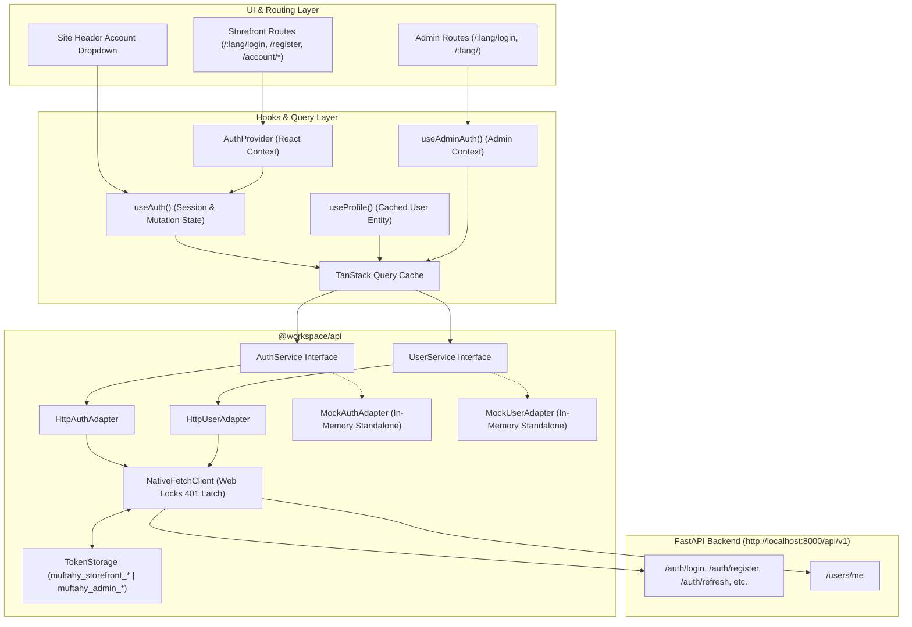
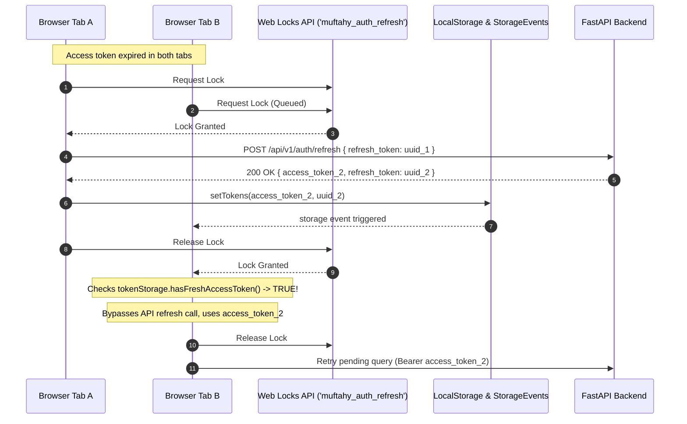

# Storefront and Admin Authentication Integration

* **Author:** Abdelrahman Eltokhy
* **Status:** In Review (Consolidated EGM Review Addressed)
* **Date:** 2026-11-18

--------------------------------------------------------------------------------

## Overview

Muftahy is a digital marketplace for software licenses, digital keys, game codes, and subscriptions tailored to the Middle East and GCC. A production-ready marketplace requires trusted identity verification, persistent authenticated sessions, and strict access controls across two distinct user surfaces:
1. **The Storefront (`apps/storefront`):** Used by retail consumers to browse products, purchase digital keys, access their personal profile, and manage account security in Arabic (RTL) or English (LTR).
2. **The Admin Dashboard (`apps/admin`):** Used by back-office operators and support staff to manage catalog inventory, review payments, and oversee platform operations.

This design document specifies the frontend authentication architecture integrating both applications with the backend authentication API described in `docs/examples/authentication.md` and the account route specification in `docs/examples/customer-account-routes.md`. It covers customer registration with background auto-login, credential and Google OAuth sign-in, email OTP verification, password recovery, a dual-state storefront header account menu, protected nested account routing with locale-aware return parameter preservation, and isolated admin dashboard authentication.

## The Problem

Prior to this work, neither the storefront nor the admin application had a functional authentication layer:
- The storefront header contained non-functional placeholder links to `/account` that led nowhere or triggered catch-all redirects.
- No client-side service layer existed in `@workspace/api` for authentication, session verification, or token refresh.
- The admin application existed only as an unrouted placeholder component (`App.tsx`) with no authentication gate or role verification, allowing anyone loading the app to view the raw shell.
- Retail customers had no self-service mechanism to register, verify their email address via OTP, reset forgotten passwords, or view their account details.
- Attempting to implement authentication naively on `localhost` risks cross-contaminating tokens between customer (`aud: "customer"`) and operator (`aud: "admin"`) sessions, while concurrent requests or multi-tab usage risk destroying single-use refresh tokens during 401 token rotations.
- Standard frontend mock architectures were absent, causing components to fail offline when external Python/Docker backend services were not running.

This design establishes a zero-dependency, type-safe authentication and session boundary built on native browser `fetch`, Base UI primitives, and mockable service adapters that resolves these challenges while strictly complying with the repository rules in `AGENTS.md`.

## Goals

* Provide a self-contained, typed `AuthService` and `UserService` in `@workspace/api` implementing all endpoints from `docs/examples/authentication.md` with both HTTP and standalone Mock adapters.
* Prevent token thrashing and 401 session invalidation through a Web Locks-coordinated single-flight refresh latch that protects single-use UUID refresh tokens across tabs.
* Guarantee multi-app session isolation on shared origins through app-scoped storage namespaces (`muftahy_storefront_*` and `muftahy_admin_*`) and client-side audience claim validation.
* Decouple access token expiration from refresh token persistence to enable silent session hydration on page reload without bouncing authenticated users to login.
* Deliver an accessible customer registration experience that eliminates redundant credential re-entry by performing immediate background authentication upon account creation, with graceful fallback to prefilled login on failure.
* Provide Google OAuth login via Google Identity Services in popup mode, with lazy script loading, runtime fallback for missing client IDs, and contextual guidance for restricted in-app mobile WebViews.
* Implement email OTP verification and password recovery flows using the installed Base UI `input-otp` component.
* Replace placeholder header links with an accessible, keyboard-navigable dual-state account menu reflecting real-time authentication status.
* Secure customer account views behind a client-side route guard that preserves same-origin relative `returnTo` / `returnUrl` parameters and mandatory `/:lang/` locale prefixes.
* Structure `/account` as a nested portal with an index redirect to `/account/profile` and placeholder tabs for future milestones.
* Introduce React Router v7 into `apps/admin` with bilingual routing (`/:lang/login` and `/:lang/`), QueryClientProvider, and an authenticated dashboard route guarded by `aud === "admin"`.
* Enforce bilingual parity across Arabic (RTL) and English (LTR) with semantic Tailwind tokens and Western digits (0-9).

## Non-Goals

* Implementing full customer order history, license key reveals, payment receipt uploads, or support ticket messaging threads (these domain views are deferred to separate feature milestones; placeholder states are provided).
* Adding external HTTP client libraries such as `axios` or modifying `pnpm-lock.yaml` without explicit user permission.
* Supporting SMS-based OTP verification (the backend contract is strictly email-based).
* Building self-serve admin registration or administrative user management.
* Intercepting unauthenticated users with modal dialogs (dedicated full-page routes are used to ensure deep-linking and bookmarkability).
* Changing backend endpoint signatures, token schemas, or rate-limiting rules.

## Open Questions

* None. (All architectural boundaries, storage isolation rules, and scope limits were verified against codebase documentation).

## Critical User Journeys (CUJs)

### CUJ 1: New Customer Registration and Immediate Onboarding
* **Given**: An unauthenticated visitor on the storefront who wants to create an account.
* **When**: The user navigates to `/:lang/register`, fills out their full name, email, and password (>= 8 characters), and submits the form.
* **Then**: The client posts to `POST /api/v1/auth/register`. Upon receiving `201 Created`, the client immediately and transparently issues `POST /api/v1/auth/login` with the submitted credentials. Raw password memory is purged. The resulting access and refresh tokens are stored under the storefront prefix, the global session activates, and the user is redirected to `/:lang/account/profile` with an active session and a non-blocking "Verify your email" prompt with OTP confirmation dialog. If the background login fails, the UI transitions to the Login form with the submitted email prefilled and an informational alert.

### CUJ 2: Existing Customer Login with Protected Route Redirection
* **Given**: An unauthenticated visitor clicks a link to `/:lang/account/profile`.
* **When**: The route guard intercepts navigation because no active session or refresh token exists.
* **Then**: The user is redirected to `/:lang/login?returnUrl=%2F<lang>%2Faccount%2Fprofile`. Upon submitting valid credentials, tokens are stored, the session initializes, and the client redirects the user directly back to the sanitized target path retaining the locale prefix.

### CUJ 3: Google OAuth Popup Sign-In in Standard and In-App Browsers
* **Given**: A customer visiting the login page on a mobile device or desktop browser.
* **When**: In a standard browser, the user clicks "Continue with Google". The Google Identity Services script loads on demand, and a popup window opens. The user authorizes, and the resulting authorization code is sent to `POST /api/v1/auth/login/google`.
* **Then**: The backend provisions the account (if new), returns tokens, the popup closes, and the user is signed in without page reloads. If the visitor is inside an in-app WebView (Instagram/Facebook), the Google button is disabled or hidden, and an informational alert prompts the user to sign in with email/password or open the site in their system browser.

### CUJ 4: Forgotten Password Recovery via 6-Digit Email OTP
* **Given**: A customer who has forgotten their password.
* **When**: The user clicks "Forgot password?", enters their email at `/:lang/forgot-password`, and submits.
* **Then**: `POST /api/v1/auth/password/reset-request` is called. The UI advances to the OTP confirmation step. The user types or pastes the 6-digit code received via email into `InputOTP`, inputs a new password (>= 8 characters), and submits. `POST /api/v1/auth/password/reset-confirm` executes. Upon success, a confirmation message appears and the user can log in with their new credentials.

### CUJ 5: Admin Operator Authentication and Dashboard Access
* **Given**: An administrative operator navigating to the admin application on `localhost` or admin domain.
* **When**: The user accesses `/:lang/` without an active admin session.
* **Then**: The admin route guard redirects them to `/:lang/login`. The operator enters their credentials, posting to `POST /api/v1/auth/admin/login`. The issued tokens carry `aud: "admin"` and are stored under `muftahy_admin_*`. The operator is redirected to the root dashboard (`/:lang/`). If a customer token is present in local storage instead, the admin guard rejects it and keeps the operator on the login screen.

--------------------------------------------------------------------------------

## Technical Architecture

### 1. High-Level Architecture & Data Flow



### 2. Package Boundaries and Responsibilities

#### A. `@workspace/domain` (Contracts & Validation)
- Located at `packages/domain/src/schemas/auth.ts`.
- Defines all request and response Zod schemas and TypeScript types:
  - `loginRequestSchema` & `LoginRequest`: `{ email: string, password: string }`
  - `registerRequestSchema` & `RegisterRequest`: `{ email: string, password: string (min 8), full_name: string (2-255), phone?: string | null }`
  - `updateProfileRequestSchema` & `UpdateProfileRequest`: `{ full_name?: string, phone?: string | null }`
  - `googleLoginRequestSchema` & `GoogleLoginRequest`: `{ code: string }`
  - `tokenResponseSchema` & `TokenResponse`: `{ access_token: string, refresh_token: string, token_type: "bearer", expires_in: number }`
  - `passwordResetRequestSchema` & `PasswordResetRequest`: `{ email: string }`
  - `passwordResetConfirmSchema` & `PasswordResetConfirm`: `{ email: string, code: string (6 digits), new_password: string (min 8) }`
  - `otpRequestSchema` & `OTPRequest`: `{ email: string, purpose?: string }`
  - `otpVerifySchema` & `OTPVerify`: `{ email: string, code: string (6 digits), purpose?: string }`
  - `userProfileSchema` & `UserProfile`: `{ id: string, email: string, full_name: string, phone: string | null, is_active: boolean, created_at: string }`
  - `apiErrorResponseSchema` & `ApiErrorResponse`: `{ error_code: string, message: string, details?: Record<string, unknown>, retry_after?: number }`

#### B. `@workspace/api` (Transport, Storage & Service Abstractions)
- **Token Storage (`token-storage.ts`):**
  - Parameterized with a prefix (`"muftahy_storefront_"` or `"muftahy_admin_"`).
  - Methods: `getAccessToken()`, `getRefreshToken()`, `setTokens(tokens)`, `clearTokens()`, `hasValidToken(expectedAudience)`, `hasRefreshToken()`.
  - Decodes base64url JWT payload using URL-safe normalization (`replace(/-/g, '+').replace(/_/g, '/')` plus padding) before `atob()`.
  - **Decoupled Eviction Policy**: Inspects `aud` and `exp`. If `aud` mismatches, storage is cleared immediately. If the access token is expired, `getAccessToken()` returns `null`, but `getRefreshToken()` continues to return the stored 30-day UUID refresh token. Tokens are only cleared if the refresh token is missing, invalid, or explicitly rejected by `POST /auth/refresh`.
  - Listens to browser `window.addEventListener('storage', ...)` to synchronize token updates across open tabs.
- **Native Fetch Client (`fetch-client.ts`):**
  - Manages `baseURL` (configurable via `VITE_API_URL` with default `http://localhost:8000/api/v1`).
  - Injects `Authorization: Bearer <access_token>` from `TokenStorage` when available.
  - Intercepts `429 Too Many Requests` responses, parses the `Retry-After` header into `retry_after` seconds, and attaches it to the error object.
  - **Web Locks-Coordinated 401 Refresh Latch:**
    - When a request returns `401 Unauthorized` and is not already a retry or refresh call:
      1. Uses `navigator.locks.request('muftahy_auth_refresh', async () => ...)` to coordinate token refresh across browser tabs.
      2. If another tab already updated `TokenStorage` with a fresh access token while waiting for the lock, skips the HTTP refresh call and immediately retries the request with the new access token.
      3. Otherwise, dispatches `POST /auth/refresh` with the active refresh token.
      4. On refresh success: writes new access and rotated refresh tokens to `TokenStorage`, draining pending requests.
      5. On refresh failure (or missing refresh token): invokes `tokenStorage.clearTokens()`, clears the TanStack Query cache (`queryClient.clear()`), and triggers an authentication required event to redirect to login.
- **Service Interfaces & Concrete Adapters:**
  - `AuthService` and `UserService` interfaces defined in `packages/api/src/services/`.
  - `HttpAuthAdapter` and `HttpUserAdapter` in `packages/api/src/adapters/http/`.
  - `MockAuthAdapter` and `MockUserAdapter` in `packages/api/src/adapters/mock/` with realistic stateful memory stores, enabling full offline development, Storybook, and CI testing.
  - `packages/api/src/factory.ts` instantiates mock adapters when `VITE_USE_MOCK_API === "true"` or when `VITE_API_URL` is empty, preserving monorepo standalone development per `AGENTS.md`.

#### C. `packages/ui` (Base UI Form Primitives)
- Exports the already-installed `input-otp.tsx` primitive.
- Provides accessible forms, inputs, alert banners, cards, buttons, and popover menus using Base UI composition patterns (`render` prop).

#### D. `packages/i18n` (Bilingual Resources)
- Comprehensive `auth` and `account` namespaces added to both `en.json` and `ar.json`:
  - Form field labels, validation messages, and placeholders.
  - Error codes mapped from backend `error_code` enums (`AUTHENTICATION_FAILED`, `EMAIL_ALREADY_EXISTS`, `INVALID_CREDENTIALS`, `RATE_LIMIT_EXCEEDED`, `PERMISSION_DENIED`).
  - Dual-state header account dropdown labels, OTP dialog prompts, and in-app browser warnings.

#### E. `apps/storefront` (Customer Feature & Routing Layer)
- **State & Context (`features/auth/context/auth-context.tsx` & `use-auth.ts`):**
  - `AuthProvider` mounted in `apps/storefront/src/app/providers.tsx` under `QueryClientProvider`.
  - Exposes `user`, `isAuthenticated`, `isLoading`, `isInitializing`, `login`, `register`, `logout`, and `loginWithGoogle`.
  - **Silent Hydration**: On mount, if `tokenStorage.hasRefreshToken()` is true, `isInitializing` remains true while a background refresh or profile fetch executes, preventing premature redirection to login.
  - **Session Termination**: `logout()` clears `TokenStorage`, resets `queryClient.clear()`, and redirects to `/:lang/login`.
- **Forms & Components (`features/auth/components/`):**
  - `LoginForm`: Adapted from shadcn `login-03` with email/password, password visibility toggle (`end-3` placement), "Continue with Google" button, and links to registration and password reset.
  - `RegisterForm`: Adapted from shadcn `signup-03` with full name, email, password, and confirmation. On submission, executes background login with submitted credentials. If background login fails, transitions to login view with email prefilled and an informative alert.
  - `ForgotPasswordForm` & `ResetPasswordConfirmForm`: Multi-step password recovery with 6-digit `InputOTP` entry.
  - `VerifyEmailDialog`: Modal or embedded prompt allowing unverified customers to request and enter a 6-digit verification code.
  - `InAppBrowserHint`: Lightweight alert that checks for embedded WebViews and suggests using email/password or system browser.
- **Protected Nested Account Portal (`features/account/` & `routes/`):**
  - `AccountGuard`: Suspends evaluation while `isInitializing === true`. If unauthenticated, sanitizes the target path and redirects to `/:lang/login?returnUrl=<encoded_path>`.
  - `AccountLayout`: Responsive sidebar navigation with links to Profile, Orders, Keys, Support, and Logout action. Orders, Keys, and Support render accessible placeholder cards ("Coming Soon") without breaking navigation.
  - `ProfilePage`: Connected to `useProfile()` querying `GET /api/v1/users/me`, displaying user ID, email, full name, phone number, and account creation date.
  - Route nesting: `/:lang/account` acts as a layout route rendering `<AccountGuard><AccountLayout><Outlet /></AccountLayout></AccountGuard>`. An index route redirects `/:lang/account` to `/:lang/account/profile`.
- **Site Header (`components/site-header/`):**
  - `AccountDropdown` replaces placeholder links with dynamic session navigation:
    - Unauthenticated: Pill trigger showing "Sign In", opening a menu with Sign In and Register actions.
    - Authenticated: Avatar pill with user's initials/name, displaying Profile link (`/:lang/account/profile`), Orders, Keys, Support, and Logout button.

#### F. `apps/admin` (Operator App Layer)
- **Dependencies & Manifest:**
  - Adds `@workspace/api`, `@workspace/domain`, `@workspace/i18n`, `react-router: ^7.2.0`, `@tanstack/react-query: ^5.66.0`, `react-hook-form: ^7.54.2`, `@hookform/resolvers: ^4.1.0`, `zod: ^3.24.2`, and `react-i18next: ^15.4.1` to `apps/admin/package.json`.
  - Strict compliance with `AGENTS.md`: Engineer must prompt the user before running `pnpm install` mutating `pnpm-lock.yaml`.
- **Application Entry & Providers (`apps/admin/src/App.tsx`):**
  - Wraps the application with `QueryClientProvider` and `I18nextProvider` around `RouterProvider`.
- **Router Setup (`apps/admin/src/app/router.tsx`):**
  - Bilingual route tree with `/:lang/login` and protected `/:lang/` root dashboard.
- **Features (`features/auth/`):**
  - `useAdminAuth()`: Manages admin token state using the `muftahy_admin_` storage prefix, verifying `aud === "admin"`.
  - `AdminLoginForm`: High-density operator login form.
  - `AdminGuard`: Route wrapper redirecting unauthenticated or non-admin visitors to `/:lang/login`.
- **Dashboard Placeholder:**
  - Authenticated root `/:lang/` renders a structured dashboard shell (`dashboard-01` layout).

### 3. Service & Adapter Interface Specifications

```typescript
export interface AuthService {
  login(credentials: LoginRequest): Promise<TokenResponse>;
  register(payload: RegisterRequest): Promise<{ status: string; message: string; user_id: string }>;
  loginWithGoogle(code: GoogleLoginRequest): Promise<TokenResponse>;
  refreshToken(refreshToken: string): Promise<TokenResponse>;
  logout(): Promise<void>;
  requestPasswordReset(payload: PasswordResetRequest): Promise<{ message: string }>;
  confirmPasswordReset(payload: PasswordResetConfirm): Promise<{ message: string }>;
  requestOtp(payload: OTPRequest): Promise<{ message: string }>;
  verifyOtp(payload: OTPVerify): Promise<{ message: string }>;
  adminLogin(credentials: LoginRequest): Promise<TokenResponse>;
}

export interface UserService {
  getProfile(): Promise<UserProfile>;
  updateProfile(payload: UpdateProfileRequest): Promise<UserProfile>;
}
```

### 4. Cross-Tab Concurrency & Single-Flight Refresh Sequence



--------------------------------------------------------------------------------

## Risks & Mitigations

| Risk | Impact | Mitigation Strategy |
| :--- | :--- | :--- |
| **Refresh Token Reuse Lockout** | High: Concurrent 401s across multiple tabs reuse the single-use UUID refresh token, triggering backend account lockout. | Coordinate refresh calls using the Web Locks API (`navigator.locks.request`). Secondary tabs acquire the lock, detect that fresh tokens were already saved by the first tab, and retry immediately without issuing redundant refresh calls. |
| **Premature Storage Purge on Reload** | High: Expired 15-minute access token wipes out the valid 30-day refresh token, logging users out on page refresh. | Decouple access token expiration from refresh token storage in `TokenStorage`. Retain refresh token even if access token is expired; clear storage only on explicit audience mismatch, missing refresh token, or 401 during token refresh. |
| **Silent Hydration Route Bouncing** | Medium: Route guard executes synchronously before refresh token exchange completes, flashing login page. | Introduce `isInitializing` state in `useAuth`. If a refresh token exists on startup, hold route guard redirection until the initial refresh or profile query resolves. |
| **Dual-Call Registration Failure** | Medium: `POST /register` succeeds on backend, but automatic follow-up `POST /login` fails, leaving the user stranded on registration form. | If registration succeeds but background login fails, immediately navigate the user to `/login` with the email prefilled and an informational alert: *"Account created successfully! Please enter your password to sign in."* |
| **In-App WebView Google OAuth Blocks** | Medium: Google OAuth popup returns `403 disallowed_useragent` in mobile embedded WebViews (Instagram, Facebook). | Detect in-app browsers; disable the Google button and present a contextual alert prompting the user to sign in with email/password or open the link in their system browser. Lazy-load the Google script on demand. |
| **Cross-Session Data Leakage** | Medium: User logs out or token expires, but sensitive profile and orders data remain cached in memory. | Explicitly invoke `queryClient.clear()` on logout and terminal 401 refresh latch failure. |
| **Open Redirect Phishing** | High: Attackers craft login links with malicious `returnUrl` (e.g., `//attacker.com` or `https://evil.com`). | Whitelist sanitize all return URLs: reject protocol-relative and external domains; enforce relative paths that strictly preserve or prepend the active `/:lang/` prefix. |
| **Rate-Limit Lockouts (429)** | Low: Users spam submit button when encountering errors, triggering backend IP rate limiting. | Parse `Retry-After` header into `retry_after` seconds and display an active countdown timer that temporarily disables the submit button. |

--------------------------------------------------------------------------------

## Detailed Implementation Plan (Phased Execution)

### Target Files Manifest

| Target File | Package / App | Action | Description |
| :--- | :--- | :---: | :--- |
| `packages/domain/src/schemas/auth.ts` | `@workspace/domain` | Create | Zod schemas and TypeScript types for auth, profile, and errors. |
| `packages/domain/src/schemas/auth.test.ts` | `@workspace/domain` | Create | Unit tests validating schema rules and validation invariants. |
| `packages/api/package.json` | `@workspace/api` | Modify | Update subpath exports to expose adapters and storage modules. |
| `packages/api/src/services/auth-service.ts` | `@workspace/api` | Create | TypeScript interface declaration for authentication services. |
| `packages/api/src/services/user-service.ts` | `@workspace/api` | Create | TypeScript interface declaration for customer profile services. |
| `packages/api/src/adapters/http/token-storage.ts` | `@workspace/api` | Create | Storage abstraction with decoupled eviction and base64url normalization. |
| `packages/api/src/adapters/http/token-storage.test.ts` | `@workspace/api` | Create | Unit tests for storage isolation, prefixing, and audience verification. |
| `packages/api/src/adapters/http/fetch-client.ts` | `@workspace/api` | Create | Native fetch client with Web Locks-coordinated 401 refresh latch. |
| `packages/api/src/adapters/http/fetch-client.test.ts` | `@workspace/api` | Create | Unit tests with mock fetch testing 401 queueing and Web Locks. |
| `packages/api/src/adapters/http/http-auth-adapter.ts` | `@workspace/api` | Create | HTTP adapter calling backend authentication endpoints. |
| `packages/api/src/adapters/http/http-user-adapter.ts` | `@workspace/api` | Create | HTTP adapter fetching customer profile from `/users/me`. |
| `packages/api/src/adapters/mock/mock-auth-adapter.ts` | `@workspace/api` | Create | Stateful mock adapter enabling standalone offline UI development. |
| `packages/api/src/adapters/mock/mock-user-adapter.ts` | `@workspace/api` | Create | Stateful mock adapter for customer profile management. |
| `packages/api/src/factory.ts` | `@workspace/api` | Modify | Factory configuring mock vs HTTP adapters based on env flags. |
| `packages/i18n/src/locales/en.json` | `@workspace/i18n` | Modify | English translations for auth, account, and error strings. |
| `packages/i18n/src/locales/ar.json` | `@workspace/i18n` | Modify | Arabic translations with RTL and Western numerals. |
| `apps/storefront/.env.example` | `apps/storefront` | Create | Environment template declaring `VITE_API_URL` and `VITE_GOOGLE_CLIENT_ID`. |
| `apps/storefront/src/vite-env.d.ts` | `apps/storefront` | Modify | TypeScript declarations for Vite client environment variables. |
| `apps/storefront/src/features/auth/context/auth-context.tsx` | `apps/storefront` | Create | React Context and provider managing session state and silent hydration. |
| `apps/storefront/src/features/auth/hooks/use-auth.ts` | `apps/storefront` | Create | Hook exposing session state and authentication actions. |
| `apps/storefront/src/features/auth/hooks/use-auth.test.ts` | `apps/storefront` | Create | Unit tests for auth hook, login actions, and error handling. |
| `apps/storefront/src/features/auth/hooks/use-google-auth.ts` | `apps/storefront` | Create | Hook managing on-demand Google Identity Services script lifecycle. |
| `apps/storefront/src/features/auth/lib/in-app-browser.ts` | `apps/storefront` | Create | Helper detecting mobile in-app browser WebViews. |
| `apps/storefront/src/features/auth/lib/sanitize-return-to.ts` | `apps/storefront` | Create | Open-redirect sanitizer preserving mandatory `/:lang/` prefix. |
| `apps/storefront/src/features/auth/lib/sanitize-return-to.test.ts` | `apps/storefront` | Create | Unit tests validating open redirect attacks and locale prefix retention. |
| `apps/storefront/src/features/auth/components/login-form.tsx` | `apps/storefront` | Create | Customer login form with Base UI primitives and Google sign-in. |
| `apps/storefront/src/features/auth/components/register-form.tsx` | `apps/storefront` | Create | Customer registration form with auto-login and failure fallback. |
| `apps/storefront/src/features/auth/components/forgot-password-form.tsx` | `apps/storefront` | Create | Email input step for password recovery. |
| `apps/storefront/src/features/auth/components/reset-password-confirm-form.tsx` | `apps/storefront` | Create | OTP entry via `InputOTP` and new password confirmation. |
| `apps/storefront/src/features/auth/components/verify-email-dialog.tsx` | `apps/storefront` | Create | Modal dialog allowing users to enter email verification OTP code. |
| `apps/storefront/src/routes/login-route.tsx` | `apps/storefront` | Create | Route endpoint for `/:lang/login`. |
| `apps/storefront/src/routes/register-route.tsx` | `apps/storefront` | Create | Route endpoint for `/:lang/register`. |
| `apps/storefront/src/routes/forgot-password-route.tsx` | `apps/storefront` | Create | Route endpoint for `/:lang/forgot-password`. |
| `apps/storefront/src/features/account/components/account-guard.tsx` | `apps/storefront` | Create | Security route guard with `isInitializing` hold and `returnUrl` pass-through. |
| `apps/storefront/src/features/account/components/account-guard.test.tsx` | `apps/storefront` | Create | Unit tests verifying redirect triggers and session guards. |
| `apps/storefront/src/features/account/components/account-layout.tsx` | `apps/storefront` | Create | Nested portal layout with sidebar and placeholder states for secondary tabs. |
| `apps/storefront/src/features/account/pages/profile-page.tsx` | `apps/storefront` | Create | Profile details view bound to `useProfile()`. |
| `apps/storefront/src/routes/account-layout-route.tsx` | `apps/storefront` | Create | Layout route mounting guard, layout, and `<Outlet />`. |
| `apps/storefront/src/routes/account-index-route.tsx` | `apps/storefront` | Create | Redirects `/:lang/account` to `/:lang/account/profile`. |
| `apps/storefront/src/routes/profile-route.tsx` | `apps/storefront` | Create | Route endpoint for `/:lang/account/profile`. |
| `apps/storefront/src/components/site-header/account-dropdown.tsx` | `apps/storefront` | Create | Dynamic session menu trigger in site header. |
| `apps/storefront/src/components/site-header/site-header.tsx` | `apps/storefront` | Modify | Embeds `AccountDropdown` in desktop navigation bar. |
| `apps/storefront/src/components/site-header/mobile-menu.tsx` | `apps/storefront` | Modify | Adds authentication and profile links to mobile drawer. |
| `apps/storefront/src/app/providers.tsx` | `apps/storefront` | Modify | Wraps application tree with `<AuthProvider>`. |
| `apps/storefront/src/app/router.tsx` | `apps/storefront` | Modify | Registers auth and nested account routes under `/:lang`. |
| `apps/admin/package.json` | `apps/admin` | Modify | Adds routing, query, form, and monorepo package dependencies. |
| `apps/admin/src/App.tsx` | `apps/admin` | Modify | Wraps admin tree with `QueryClientProvider` and `I18nextProvider`. |
| `apps/admin/src/app/router.tsx` | `apps/admin` | Create | Bilingual React Router v7 setup with `/:lang/login` and `/:lang/`. |
| `apps/admin/src/features/auth/hooks/use-admin-auth.ts` | `apps/admin` | Create | Admin session management hook checking `aud === "admin"`. |
| `apps/admin/src/features/auth/components/admin-login-form.tsx` | `apps/admin` | Create | Operator credential sign-in form. |
| `apps/admin/src/features/auth/components/admin-guard.tsx` | `apps/admin` | Create | Route guard restricting access to active admin sessions. |
| `apps/admin/src/routes/admin-login-route.tsx` | `apps/admin` | Create | Route endpoint for `/:lang/login`. |
| `apps/admin/src/routes/admin-dashboard-route.tsx` | `apps/admin` | Create | Route endpoint for protected `/:lang/` dashboard shell. |

---

### Execution Phases & Verification Checkpoints

#### Phase 1: Domain Schemas & Validation Contracts
* **Target Package**: `packages/domain`
* **Tasks**:
  1. Create `packages/domain/src/schemas/auth.ts` implementing all schemas including `updateProfileRequestSchema` and `apiErrorResponseSchema` with `retry_after`.
  2. Create `packages/domain/src/schemas/auth.test.ts` verifying parsing, password constraints, email normalization, and error structures.
* **Checkpoint**: `pnpm --filter @workspace/domain test`

#### Phase 2: API Transport, Storage & Service Adapters
* **Target Package**: `packages/api`
* **Tasks**:
  1. Update `packages/api/package.json` subpath exports for `./adapters/http/*` and `./adapters/mock/*`.
  2. Create `TokenStorage` with namespace prefixing, safe URL-base64 decoding, decoupled expiration eviction, and `storage` event listeners.
  3. Create `NativeFetchClient` with `Retry-After` header extraction and Web Locks 401 refresh latch.
  4. Create `AuthService` and `UserService` interfaces.
  5. Create `HttpAuthAdapter` and `HttpUserAdapter`.
  6. Create `MockAuthAdapter` and `MockUserAdapter` with stateful mock storage.
  7. Update `factory.ts` to conditionally return mock or HTTP adapters based on `VITE_USE_MOCK_API`.
  8. Create unit tests for `TokenStorage` and `NativeFetchClient`.
* **Checkpoint**: `pnpm --filter @workspace/api test && pnpm --filter @workspace/api typecheck`

#### Phase 3: Bilingual Resources & Localization
* **Target Package**: `packages/i18n`
* **Tasks**:
  1. Add `auth` and `account` namespaces to `en.json` and `ar.json` covering all form fields, validation errors, backend error mappings, dialog text, and in-app browser hints.
* **Checkpoint**: `pnpm --filter @workspace/i18n typecheck`

#### Phase 4: Storefront Feature Layer & Route Shells
* **Target App**: `apps/storefront`
* **Tasks**:
  1. Add `apps/storefront/.env.example` and update `vite-env.d.ts`.
  2. Implement `sanitizeReturnTo` supporting both `returnUrl` and `returnTo` while enforcing active `/:lang/` prefix retention; create `sanitize-return-to.test.ts`.
  3. Implement `isInAppBrowser` WebView detection and `useGoogleAuth` hook.
  4. Implement `AuthProvider` and `useAuth` hook supporting `isInitializing` silent hydration, background register auto-login, and `queryClient.clear()` on logout.
  5. Build `LoginForm`, `RegisterForm` with dual-call fallback, `ForgotPasswordForm`, `ResetPasswordConfirmForm`, and `VerifyEmailDialog`.
  6. Create route endpoints: `login-route.tsx`, `register-route.tsx`, and `forgot-password-route.tsx`.
* **Checkpoint**: `pnpm --filter storefront typecheck && pnpm --filter storefront test`

#### Phase 5: Protected Nested Account Portal & Site Header Integration
* **Target App**: `apps/storefront`
* **Tasks**:
  1. Create `AccountGuard` and `account-guard.test.tsx`.
  2. Create `AccountLayout` with sidebar navigation and placeholder cards for secondary tabs.
  3. Create `ProfilePage` querying user profile.
  4. Create `account-layout-route.tsx`, `account-index-route.tsx`, and `profile-route.tsx`.
  5. Create `AccountDropdown` and integrate into `site-header.tsx` and `mobile-menu.tsx`.
  6. Mount `<AuthProvider>` in `providers.tsx` and register new routes in `router.tsx`.
* **Checkpoint**: `pnpm --filter storefront build`

#### Phase 6: Admin Routing, Providers, & Guarded Dashboard
* **Target App**: `apps/admin`
* **Tasks**:
  1. **Lockfile Rule Compliance**: Prompt the user before updating `apps/admin/package.json` and running `pnpm install`.
  2. Wrap `apps/admin/src/App.tsx` with `QueryClientProvider` and `I18nextProvider`.
  3. Create `useAdminAuth` hook verifying `aud === "admin"`.
  4. Create `AdminLoginForm` and `AdminGuard`.
  5. Create bilingual router in `apps/admin/src/app/router.tsx` with `/:lang/login` and `/:lang/`.
  6. Mount minimal placeholder dashboard (`dashboard-01` layout).
* **Checkpoint**: `pnpm --filter admin typecheck && pnpm --filter admin build`

#### Phase 7: Full Monorepo Definition of Done Verification
* **Scope**: Entire repository
* **Tasks**:
  1. Execute full monorepo typecheck: `pnpm typecheck`.
  2. Execute linting: `pnpm lint`.
  3. Execute unit test suites across all packages: `pnpm test`.
  4. Execute production builds across all applications: `pnpm build`.
* **Checkpoint**: All root verification commands exit with code 0.

--------------------------------------------------------------------------------

*Document updated and verified against EGM Consensus Report*
