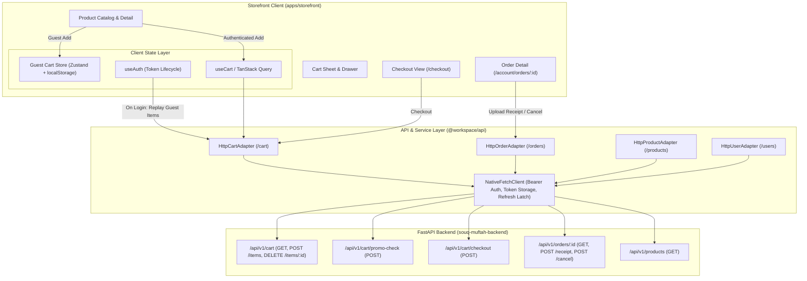

# Storefront Backend API Integration and Mock Elimination

* **Author:** Abdelrahman Eltokhy
* **Status:** Proposed
* **Date:** 2026-11-20

---

## Overview

This project transitions Souq Muftah (`apps/storefront`) from simulated local state and mock adapters to direct integration with the canonical FastAPI backend (`souq-muftah-backend`). It eliminates synthetic mock services in `@workspace/api`, implements the backend shopping cart and checkout lifecycle (`/api/v1/cart`), realigns the storefront checkout route with offline receipt payment validation (Vodafone Cash and InstaPay), strips speculative frontend fields absent from backend schemas, and hardens test infrastructure to validate realistic HTTP communication.

---

## The Problem

1. **Simulated Cart and Checkout Lifecycle**: The storefront currently relies on a standalone client-side Zustand store and an artificial checkout view (`apps/storefront/src/routes/checkout-route.tsx`). The checkout view accepts credit card data and simulates order placement using `setTimeout`, producing client-generated order numbers without communicating with the server. The backend provides a transactional cart and checkout engine (`POST /api/v1/cart/checkout`) that creates real orders in `pending_payment` status requiring payment receipt submission (`POST /api/v1/orders/{order_id}/receipt`). Customers completing the current checkout flow never reserve inventory or create actual orders.
2. **Synthetic Mock Debt and Divergence**: `packages/api` maintains mock adapters (`MockProductAdapter`, `MockAuthAdapter`, `MockUserAdapter`) that mask integration discrepancies. As long as mock adapters remain, runtime behavior diverges from the live backend, concealing deserialization bugs, missing headers, and error handling oversights.
3. **Speculative Frontend Remnants**: Legacy fields (such as `platform`, `region`, `planId`, and `priceMinor`) persist in cart stores, selector helpers, and components, despite the backend selling only Microsoft Windows and Office software licenses priced in Egyptian Pounds (EGP).
4. **Test Harness Dependency on In-Memory Mocks**: Existing test suites frequently rely on mock adapter state instead of asserting actual HTTP request construction, header handling, token refresh flows, and error boundaries.

---

## Goals

* **Backend Cart and Checkout Parity**: Define domain schemas in `@workspace/domain` matching `souq-muftah-backend` Pydantic models for cart and checkout (`CartResponse`, `CartItemResponse`, `CartItemAddRequest`, `PromoCheckRequest`, `PromoCheckResponse`, `CartCheckoutRequest`). Implement `CartService` and `HttpCartAdapter` in `@workspace/api` covering all `/api/v1/cart` endpoints.
* **Complete Mock Elimination**: Permanently delete `packages/api/src/adapters/mock/` (`MockProductAdapter`, `MockAuthAdapter`, `MockUserAdapter`). Strip all mock branches, environment flag fallbacks (`VITE_USE_MOCK_API`), and mock singletons from `packages/api/src/factory.ts`. The frontend will operate exclusively via `NativeFetchClient`.
* **Checkout Flow Realignment**: Reconstruct `apps/storefront/src/routes/checkout-route.tsx` to execute backend checkout (`POST /api/v1/cart/checkout`), validate promo codes (`POST /api/v1/cart/promo-check`), and redirect customers immediately to the canonical order detail page (`/:lang/account/orders/:orderId?new=true`) to display `payment_instructions` (Vodafone Cash wallet number and InstaPay address) and trigger receipt upload.
* **Speculative Data Cleanse**: Remove all obsolete properties (`platform`, `region`, `planId`, `priceMinor`) from cart stores, product components, and formatters.
* **Deterministic Network Test Harness**: Refactor tests in `packages/api` and `apps/storefront` to use Vitest fetch spies/mocks (`vi.stubGlobal('fetch', ...)`), testing realistic HTTP status codes (200, 400, 401, 403, 404, 429) and response payloads without mock adapters.
* **Verification Parity**: Ensure `pnpm typecheck`, `pnpm lint`, `pnpm test`, and `pnpm build` pass with zero regressions.

---

## Non-Goals

* **Backend Modifications**: No changes to backend database models, route handlers, or Pydantic schemas in `souq-muftah-backend`. The backend API is fixed and authoritative.
* **Admin Dashboard Scope**: This milestone is focused on the storefront and shared client libraries. Admin features (`apps/admin`) remain bounded within their current operational scope.
* **Automated Credit Card Processing**: No implementation of automated payment gateway SDKs or credit card forms; transactions strictly follow the backend offline receipt verification flow.
* **Component Library Alterations**: No modification to Base UI primitives or core shadcn presets in `packages/ui`.

---

## Open / Resolved Questions

* **Question 1: Guest Cart Synchronization**: The backend cart API enforces customer authentication (`get_current_user`), but unauthenticated visitors browse and add products to the cart before authenticating.
  * *Resolution*: Retain unauthenticated cart items in client-side storage (Zustand with localStorage persistence). When a customer logs in or registers, the client replays the local items by calling `POST /api/v1/cart/items` for each item using a concurrency latch (`isSyncing`), retrieves the unified server cart via `GET /api/v1/cart`, and purges the local guest cache.
* **Question 2: Backend Line Item Quantity Modification**: The backend FastAPI cart service exposes `GET /cart`, `POST /cart/items` (strictly additive, `quantity >= 1`), `DELETE /cart/items/{item_id}`, `POST /cart/promo-check`, and `POST /cart/checkout`. There is no endpoint for decrementing or updating quantity.
  * *Resolution*: Prune the quantity stepper in `cart-line-item.tsx` to a static quantity badge and a single delete button (`onRemove` -> `DELETE /cart/items/{id}`). For unauthenticated guest items, direct removal or quantity adjustments operate locally.

---

## Risks & Mitigations

| Risk | Impact | Likelihood | Mitigation |
| :--- | :--- | :--- | :--- |
| **Guest Cart Replay Failure** | High | Low | If a network or validation error occurs during guest replay on login, catch the failure, retain un-synced items in local storage, display a localized warning toast, and fetch the remaining server cart. |
| **Double-Replay / Concurrency Race Condition** | High | Medium | Guard `syncGuestCart` with an atomic boolean latch (`isSyncing`) in `cart-store.ts`. If multiple components (`SiteHeader` and route views) call `useCart` simultaneously upon login, only the first trigger executes replay; subsequent calls await or exit immediately. |
| **Backend Quantity Decrement Limitation** | Medium | High | Prune stepper controls in `cart-line-item.tsx` to a static badge and an explicit delete action. If re-adding is required, execute `removeItem(itemId)` followed by `addItem(productId, targetQty)`. |
| **Mock Removal Test Breakages** | High | High | Implement changes in 5 incremental phases. Introduce `http-auth-adapter.test.ts` and Vitest `fetch` stubs before deleting mock adapters, ensuring every intermediate phase compiles and passes tests. |
| **Offline Receipt Payment Expiration** | Medium | Medium | Post-checkout navigation directs immediately to `/:lang/account/orders/:orderId?new=true`. `order-detail-page.tsx` renders countdown timers, clear Vodafone Cash / InstaPay details, and automatically opens `UploadReceiptDialog`. |

---

## Critical User Journeys (CUJs)

### CUJ 1: Guest Browses Catalog and Adds License to Cart

* **Given**: An unauthenticated visitor navigates to `/:lang/products` and views "Windows 11 Pro".
* **When**: The visitor clicks "Add to Cart".
* **Then**: The item is stored in the local guest cart store (Zustand persisted in localStorage). The header cart badge increments, and the cart slide-over displays the item with EGP pricing. No network call is made yet because no authentication token exists.

### CUJ 2: Guest Authenticates and Cart Synchronizes to Server

* **Given**: A guest user has items in their local cart and navigates to `/:lang/login` (or `/:lang/signup`).
* **When**: The customer successfully authenticates.
* **Then**: The authentication effect detects the session transition, sets the `isSyncing` latch, iterates through the guest cart items, dispatches `POST /api/v1/cart/items` requests with the newly acquired bearer token, fetches the canonical server cart via `GET /api/v1/cart`, clears the local guest store, and releases the latch.

### CUJ 3: Customer Validates Promo Code Against Cart

* **Given**: An authenticated customer opens the cart slide-over or visits checkout with items in their cart.
* **When**: The customer enters a promo code (e.g., `SAVE10`) and clicks "Apply".
* **Then**: The storefront calls `POST /api/v1/cart/promo-check` with `{ promo_code: "SAVE10" }`. If valid, the UI renders the discounted line items, discount amount, and updated final total in EGP. If invalid, the backend error message is displayed without mutating the cart.

### CUJ 4: Customer Completes Checkout and Enters Payment State

* **Given**: An authenticated customer with items in their server cart navigates to `/:lang/checkout`.
* **When**: The customer reviews order items and clicks "Confirm Order" (`POST /api/v1/cart/checkout`).
* **Then**: An order in `pending_payment` status is created with inventory locked. The server returns the order ID, reference code, total in EGP, and `payment_instructions` (Vodafone Cash wallet number, InstaPay address). The customer is redirected directly to the order inspection page (`/:lang/account/orders/:orderId?new=true`) displaying payment instructions and the receipt upload form.

### CUJ 5: Customer Uploads Offline Payment Receipt

* **Given**: A customer views their order on `order-detail-page.tsx` in `pending_payment` state.
* **When**: The customer selects their payment method (`vodafone_cash` or `instapay`), enters the amount claimed, attaches a screenshot image, and submits.
* **Then**: The client dispatches `POST /api/v1/orders/{order_id}/receipt` via multipart/form-data. The order status updates to `payment_uploaded` / `under_review`, and the review deadline is displayed.

---

## Proposed Architecture

### 1. High-Level System Architecture



### 2. Domain Schemas (`packages/domain`)

Add canonical schemas in `packages/domain/src/schemas/cart.ts` matching `souq-muftah-backend/app/cart/schemas.py`:

* `cartItemAddRequestSchema`:
  ```ts
  export const cartItemAddRequestSchema = z.object({
    product_id: z.string().uuid(),
    quantity: z.number().int().positive().default(1),
  })
  export type CartItemAddRequest = z.infer<typeof cartItemAddRequestSchema>
  ```

* `cartItemResponseSchema`:
  ```ts
  export const cartItemResponseSchema = z.object({
    id: z.string().uuid(),
    product_id: z.string().uuid(),
    product_name: z.string().min(1),
    quantity: z.number().int().positive(),
    is_preorder: z.boolean(),
    unit_price: z.coerce.number().nonnegative(),
  })
  export type CartItemResponse = z.infer<typeof cartItemResponseSchema>
  ```

* `cartResponseSchema`:
  ```ts
  export const cartResponseSchema = z.object({
    id: z.string().uuid(),
    items: z.array(cartItemResponseSchema),
    subtotal_egp: z.coerce.number().nonnegative(),
    item_count: z.number().int().nonnegative(),
  })
  export type CartResponse = z.infer<typeof cartResponseSchema>
  ```

* `promoCheckRequestSchema` and `promoCheckResponseSchema`:
  ```ts
  export const promoCheckRequestSchema = z.object({
    promo_code: z.string().min(1),
  })
  export type PromoCheckRequest = z.infer<typeof promoCheckRequestSchema>

  export const promoDiscountItemSchema = z.object({
    product_id: z.string().uuid(),
    product_name: z.string().min(1),
    original_price: z.coerce.number().nonnegative(),
    discount_percentage: z.coerce.number().nonnegative(),
    discount_amount: z.coerce.number().nonnegative(),
    discounted_price: z.coerce.number().nonnegative(),
  })

  export const promoCheckResponseSchema = z.object({
    valid: z.boolean(),
    promo_code: z.string().min(1),
    items: z.array(promoDiscountItemSchema),
    original_subtotal: z.coerce.number().nonnegative(),
    total_discount: z.coerce.number().nonnegative(),
    final_total: z.coerce.number().nonnegative(),
    error_message: z.string().nullable().optional(),
  })
  export type PromoCheckResponse = z.infer<typeof promoCheckResponseSchema>
  ```

* `cartCheckoutRequestSchema`:
  ```ts
  export const cartCheckoutRequestSchema = z.object({
    promo_code: z.string().optional(),
  })
  export type CartCheckoutRequest = z.infer<typeof cartCheckoutRequestSchema>
  ```

* Purge obsolete fields (`platform`, `region`, `planId`, `priceMinor`) from `packages/domain/src/schemas/cart.ts`.

### 3. API Services & Adapters (`packages/api`)

* **Define `CartService` interface (`packages/api/src/services/cart-service.ts`)**:
  ```ts
  import type {
    CartResponse,
    PromoCheckResponse,
    CartCheckoutRequest,
  } from '@workspace/domain/schemas/cart'
  import type { OrderResponse } from '@workspace/domain/schemas/order'

  export interface CartService {
    getCart(): Promise<CartResponse>
    addItem(productId: string, quantity?: number): Promise<CartResponse>
    removeItem(itemId: string): Promise<CartResponse>
    validatePromo(promoCode: string): Promise<PromoCheckResponse>
    checkout(payload?: CartCheckoutRequest): Promise<OrderResponse>
  }
  ```

* **Implement `HttpCartAdapter` (`packages/api/src/adapters/http/http-cart-adapter.ts`)**:
  Consumes `NativeFetchClient` to call `/cart`, `/cart/items`, `/cart/items/:id`, `/cart/promo-check`, and `/cart/checkout`. Validates all payloads using Zod schemas.

* **Delete `packages/api/src/adapters/mock/` entirely**:
  * Delete `mock-auth-adapter.ts`, `mock-user-adapter.ts`, `product-mock-adapter.ts`.
  * Delete `auth-mock-adapter.test.ts`, `product-mock-adapter.test.ts`.

* **Create `packages/api/src/adapters/http/http-auth-adapter.test.ts`**:
  Unit test suite validating `HttpAuthAdapter` (`login`, `register`, `refreshToken`) against simulated HTTP error codes using Vitest fetch stubs.

* **Refactor `packages/api/src/factory.ts`**:
  * Remove mock adapter imports and registrations.
  * Remove `isMockApiPreferred()`, `getEnvMockFlag()`, and `getEnvLiveApiTest()`.
  * Expose `getCartService(app?: AppScope, options?: { baseURL?: string }): CartService`.
  * Every service registry method (`getProductService`, `getAuthService`, `getUserService`, `getOrderService`, `getTicketService`, `getCartService`) instantiates the live HTTP adapter.

### 4. Storefront Cart & Checkout Realignment (`apps/storefront`)

* **Guest Cart Storage (`features/cart/stores/cart-store.ts`)**:
  * Retain local Zustand storage strictly for unauthenticated guest items (`guestItems`).
  * Add an `isSyncing` concurrency latch and `syncGuestCart(cartService)` to sequentially replay guest items to `POST /api/v1/cart/items` upon login, evicting local items and invalidating the TanStack Query cart cache (`queryClient.invalidateQueries({ queryKey: ['cart'] })`).

* **Cart Query Hook (`features/cart/hooks/use-cart.ts`)**:
  * Expose `useCart()`, `useAddToCart()`, `useRemoveCartItem()`, `useApplyPromoCode()`, and `useCheckout()`.
  * Unifies guest state and server queries behind a consistent `UnifiedCart` contract:
    ```ts
    export interface UnifiedCartItem {
      id: string
      product_id: string
      product_name: string
      quantity: number
      is_preorder: boolean
      unit_price: number
    }

    export interface UnifiedCart {
      items: UnifiedCartItem[]
      subtotal_egp: number
      item_count: number
      isLoading: boolean
      isError: boolean
    }
    ```

* **Cart Line Items (`features/cart/components/cart-line-item.tsx`)**:
  * Remove plus/minus quantity steppers. Render a static quantity badge and an accessible delete button (`onRemove` -> `DELETE /cart/items/{id}`).
  * Format item prices using canonical `unit_price` directly via `formatMoney(item.unit_price, { currency: 'EGP', locale: lang })`.

* **Product Catalog Components**:
  * Refactor `product-card.tsx` and `product-detail-page.tsx` to invoke `useAddToCart` mutation hook instead of directly writing to `useCartStore`.

* **Reconstruct `CheckoutRoute` (`apps/storefront/src/routes/checkout-route.tsx`)**:
  * Remove mock credit card inputs, fake card expiry, CVC, Apple Pay, and `setTimeout` simulation.
  * If the visitor is not authenticated, redirect to `/:lang/login?returnTo=/:lang/checkout`.
  * If the cart is empty, render an empty state with a "Browse Catalog" CTA.
  * Render real order line items, promo code application box with live discount display, order summary in EGP, and digital delivery agreement checkbox.
  * On submit, trigger `cartService.checkout({ promo_code })`.
  * On success, navigate to `/:lang/account/orders/:orderId?new=true`.

* **Order Detail Page (`features/account/pages/order-detail-page.tsx`)**:
  * The canonical destination for single order inspection.
  * When navigated with `?new=true`, automatically focus the Vodafone Cash / InstaPay payment instructions and open `UploadReceiptDialog`.

---

## Alternatives Considered

### Alternative A: Retaining In-Memory Mock Adapters Behind Dev/Test Flags

* **Pros**: Tests execute without explicit fetch stubbing; offline development is possible when the backend server is stopped.
* **Cons**: In-memory mocks diverge silently from backend Pydantic models; disguises serialization, header, and cookie discrepancies; doubles maintenance burden across all domain changes.
* **Resolution**: Rejected. Maintaining separate mock adapters generates false confidence and masks real integration failures. Network tests assert against `NativeFetchClient` wire behavior using deterministic `fetch` stubs.

### Alternative B: Mandatory Authentication Before Allowing Cart Additions

* **Pros**: Eliminates guest cart storage and replay synchronization complexity; all cart operations map 1:1 to `/api/v1/cart`.
* **Cons**: Introduces high onboarding friction; unauthenticated visitors cannot explore product selections or build an order bag before registering.
* **Resolution**: Rejected. Preserving client-side guest cart storage and replaying items to `POST /api/v1/cart/items` on authentication maintains a standard, low-friction e-commerce browsing experience.

### Alternative C: Retaining Simulated Credit Card UI on the Checkout Page

* **Pros**: Provides a familiar multi-payment visual shell.
* **Cons**: Deceives users into submitting credit card details to an unencrypted frontend simulation with zero backend gateway processing; directly violates the production business model of Vodafone Cash and InstaPay receipt verification.
* **Resolution**: Rejected. Collecting mock credit card data creates security risks and misaligns customer expectations. The UI must accurately present the real payment instructions and receipt upload flow.

### Alternative D: Adopting Mock Service Worker (MSW) for Integration Testing

* **Pros**: Intercepts requests at the network layer without modifying test runner globals.
* **Cons**: Requires adding new dependencies to `package.json` and modifying `pnpm-lock.yaml`, violating project constraints against modifying lockfiles.
* **Resolution**: Rejected. Vitest's built-in global stubs (`vi.stubGlobal('fetch', ...)`) provide complete request inspection and response manipulation with zero external dependencies and zero lockfile changes.

---

## Non-Functional Requirements

### Security & Privacy

* **Zero Card Data Retention**: No credit card, CVV, or banking credentials collected or processed on client forms.
* **Strict Token Audience Claims**: All API calls use JWT tokens verified by `TokenStorage` with `muftahy_storefront_` prefix and `aud: "customer"`.
* **Receipt Image Type Validation**: Uploaded payment receipts are strictly limited to valid image MIME types (`image/jpeg`, `image/png`, `image/webp`) and capped at 5MB before multipart transmission.
* **Digital Key Security**: Delivered keys render behind an explicit reveal-and-copy UI control, with temporary clipboard clear timeouts.

### Performance & Latency

* **Bundle Trimming**: Removing `packages/api/src/adapters/mock/` and dead legacy attributes strips unused code and dead mock fixtures from build artifacts.
* **Query Caching & Deduplication**: TanStack Query manages cart and product data caching, preventing redundant HTTP roundtrips during tab switching and navigation.
* **Idempotent Replay Queue**: Guest cart items are replayed sequentially during login with an `isSyncing` concurrency latch, preventing server rate limits or duplicate items.

### Rollout & Rollback

* **Environment Configuration**: API base URL is resolved dynamically via `VITE_API_URL` (defaulting to `http://localhost:8000/api/v1`).
* **Resilient Error State Rendering**: Network failures, 401 token expirations, and 429 rate limit errors surface actionable, localized notifications rather than crashing views.

---

## Detailed Implementation Plan (Phased Execution)

### Phase 1: Domain Schemas (`packages/domain`)

* **Scope**: Define canonical Zod schemas matching backend FastAPI models and purge legacy attributes.
* **Files**:
  * `packages/domain/src/schemas/cart.ts` (Modify): Add `cartItemAddRequestSchema`, `cartItemResponseSchema`, `cartResponseSchema`, `promoCheckRequestSchema`, `promoDiscountItemSchema`, `promoCheckResponseSchema`, `cartCheckoutRequestSchema`. Purge `platform`, `region`, `planId`, `priceMinor`.
  * `packages/domain/src/schemas/cart.test.ts` (Modify): Add unit tests validating schema parsing, type coercion, and edge cases.
* **Verification Checkpoint**:
  ```bash
  pnpm --filter @workspace/domain test
  pnpm --filter @workspace/domain typecheck
  ```

### Phase 2: API Services & HTTP Adapters (`packages/api`)

* **Scope**: Create `CartService` interface, implement `HttpCartAdapter`, and add unit test coverage for HTTP adapters without modifying existing mock fallbacks yet.
* **Files**:
  * `packages/api/src/services/cart-service.ts` (Create): Define `CartService` interface contract.
  * `packages/api/src/adapters/http/http-cart-adapter.ts` (Create): Implement `CartService` using `NativeFetchClient`.
  * `packages/api/src/adapters/http/http-cart-adapter.test.ts` (Create): Unit tests for HTTP cart requests using Vitest fetch stubs.
  * `packages/api/src/adapters/http/http-auth-adapter.test.ts` (Create): Unit tests for `HttpAuthAdapter` (`login`, `register`, `refreshToken`).
* **Verification Checkpoint**:
  ```bash
  pnpm --filter @workspace/api test
  pnpm --filter @workspace/api typecheck
  ```

### Phase 3: Storefront State & Cart Hooks (`apps/storefront`)

* **Scope**: Refactor Zustand store for guest items with concurrency latching and create unified TanStack Query hooks.
* **Files**:
  * `apps/storefront/src/features/cart/stores/cart-store.ts` (Modify): Store guest items only; add `isSyncing` latch and `syncGuestCart(cartService)`.
  * `apps/storefront/src/features/cart/cart-store.test.ts` (Modify): Validate guest store actions and replay idempotency.
  * `apps/storefront/src/features/cart/hooks/use-cart.ts` (Create): Implement `useCart`, `useAddToCart`, `useRemoveCartItem`, `useApplyPromoCode`, `useCheckout`.
  * `apps/storefront/src/features/cart/hooks/use-cart.test.tsx` (Create): Unit tests for hooks, mutations, and guest-to-server sync.
  * `apps/storefront/src/features/cart/lib/cart-selectors.ts` (Modify): Use `unit_price` directly with `formatMoney`.
* **Verification Checkpoint**:
  ```bash
  pnpm --filter storefront test src/features/cart/
  pnpm --filter storefront typecheck
  ```

### Phase 4: Storefront UI & Route Integration (`apps/storefront`)

* **Scope**: Integrate the unified cart hooks and offline payment flow across catalog components, cart UI, checkout, and order detail views.
* **Files**:
  * `apps/storefront/src/features/cart/components/cart-line-item.tsx` (Modify): Replace quantity steppers with static quantity badge + single delete button.
  * `apps/storefront/src/components/site-header/cart-button.tsx` (Modify): Bind badge count and subtotal to `useCart()`.
  * `apps/storefront/src/features/products/components/product-card.tsx` (Modify): Bind "Add to Cart" to `useAddToCart`.
  * `apps/storefront/src/features/products/pages/product-detail-page.tsx` (Modify): Bind "Add to Cart" to `useAddToCart`.
  * `apps/storefront/src/routes/cart-route.tsx` (Modify): Connect to `useCart()`, rendering backend line items and promo code box.
  * `apps/storefront/src/routes/cart-route.test.tsx` (Modify): Update tests to assert against `useCart` hook behavior.
  * `apps/storefront/src/routes/checkout-route.tsx` (Modify): Reconstruct checkout page: authenticate guard, real cart summary, promo code application, checkout submission, and transition to order details.
  * `apps/storefront/src/routes/checkout-route.test.tsx` (Modify): Update tests to verify backend checkout mutation and redirection.
  * `apps/storefront/src/features/account/pages/order-detail-page.tsx` (Modify): Handle `?new=true` query param to auto-open `UploadReceiptDialog` and emphasize payment instructions.
* **Verification Checkpoint**:
  ```bash
  pnpm --filter storefront test
  pnpm --filter storefront typecheck
  ```

### Phase 5: Mock Adapter Purge & Monorepo Validation

* **Scope**: Permanently remove mock adapters, update factory registrations and package exports, migrate remaining tests to `fetch` stubs, and execute full monorepo verification.
* **Files**:
  * `packages/api/src/factory.ts` (Modify): Remove mock imports, flags, and fallbacks. Register `getCartService()`.
  * `packages/api/package.json` (Modify): Remove `./adapters/mock/*` exports.
  * `packages/api/src/adapters/mock/` (Delete): Delete `mock-auth-adapter.ts`, `mock-user-adapter.ts`, `product-mock-adapter.ts`, `auth-mock-adapter.test.ts`, `product-mock-adapter.test.ts`, `README.md`.
  * `packages/api/src/adapters/README.md` (Modify): Remove mock adapter references.
  * `packages/api/src/README.md` (Modify): Remove mock adapter references.
  * `packages/api/README.md` (Modify): Remove mock adapter references.
  * `apps/storefront/src/features/home/home.test.tsx` (Modify): Replace mock adapter usage with Vitest `fetch` stubs.
  * `apps/storefront/src/components/site-header/site-header.test.tsx` (Modify): Ensure compatibility with updated cart contract.
* **Verification Checkpoint**:
  ```bash
  pnpm typecheck
  pnpm lint
  pnpm test
  pnpm build
  ```

---

## Verification Plan

### 1. Static Analysis & Type Checking

* Run workspace typecheck across all packages:
  ```bash
  pnpm typecheck
  ```
* Ensure zero type errors in `@workspace/domain`, `@workspace/api`, `apps/storefront`, and `apps/admin`.

### 2. Code Linting & Formatting

* Run linter:
  ```bash
  pnpm lint
  ```
* Enforce strict formatting and zero ESLint errors across all touched files.

### 3. Unit & Integration Testing

* Test domain schemas:
  ```bash
  pnpm --filter @workspace/domain test
  ```
* Test API service adapters:
  ```bash
  pnpm --filter @workspace/api test
  ```
* Test storefront routes, hooks, and components:
  ```bash
  pnpm --filter storefront test
  ```
* All test suites must execute deterministically using global `fetch` stubs without requiring a live backend daemon.

### 4. Production Build Validation

* Run production bundle build across the monorepo:
  ```bash
  pnpm build
  ```
* Verify clean production artifacts with zero missing exports, broken imports, or unresolved symbols.

---

*Drafted with EGM*
