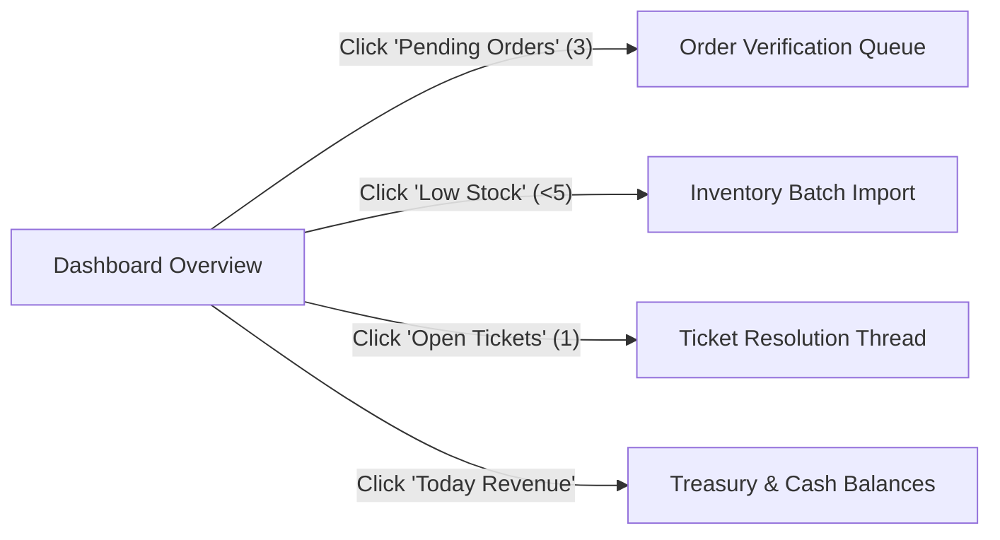

# Admin Dashboard API Examples

This document provides detailed API specifications, cURL commands, request/response payloads, and frontend integration contracts for the **Admin Dashboard** in Souq Muftah.

---

## 1. Core Architecture & Access Control

### Base URLs

- **Local Development**: `http://localhost:8000/api/v1`
- **Docker / Production**: `https://api.yourdomain.com/api/v1`

### Authentication & Token Isolation

All admin dashboard endpoints strictly require an **Administrator JWT Access Token**:

```http
Authorization: Bearer <admin_access_token>
```

- **Audience Enforcement**: Tokens must have claim `"aud": "admin"`, issued via `POST /api/v1/auth/admin/login`.
- **RBAC Guard**: Customer tokens (`"aud": "customer"`) attempting to access these routes are immediately rejected with `403 Forbidden`:
  ```json
  {
    "error_code": "FORBIDDEN",
    "message": "Admin privileges required",
    "details": {}
  }
  ```

### Rate Limiting (`admin_limiter`)

Administrative endpoints are governed by a sliding window limiter:

- **Limit**: 30 requests per 60 seconds per IP address.
- **On Limit Exceeded (`429 Too Many Requests`)**:
  ```http
  HTTP/1.1 429 Too Many Requests
  Retry-After: 45
  Content-Type: application/json

  {
    "error_code": "RATE_LIMIT_EXCEEDED",
    "message": "Too many requests. Please try again in 45 seconds.",
    "details": { "retry_after": 45 }
  }
  ```

---

## 2. Admin Dashboard Endpoints Overview

| Method | Endpoint                            | Description                                                                | Primary UI Component                  |
| :----- | :---------------------------------- | :------------------------------------------------------------------------- | :------------------------------------ |
| `GET`  | `/api/v1/admin/dashboard/overview`  | Real-time counts of pending orders, tickets, low stock, and today's sales. | Header Metric Cards & Quick Alerts    |
| `GET`  | `/api/v1/admin/dashboard/sales`     | Aggregated sales volume, revenue, and daily breakdown over a date range.   | Sales Revenue Trend Chart & Bar Graph |
| `GET`  | `/api/v1/admin/dashboard/preorders` | Outstanding preorder backorders grouped by product with oldest wait time.  | Preorders / Backlog Queue Table       |

---

## 3. Real-Time Overview Metrics (`GET /api/v1/admin/dashboard/overview`)

Retrieves a snapshot of actionable operational KPIs. Powers the top metric cards and immediate alert badges on the back-office dashboard.

### Business Logic & Counters

1. **`pending_orders_count`**: Total orders in `payment_uploaded` or `under_review` states requiring manual verification.
2. **`open_tickets_count`**: Total support tickets in `open` or `investigating` states.
3. **`today_sales_count`**: Count of approved orders placed since UTC midnight today (`00:00:00 UTC`).
4. **`today_revenue_egp`**: Cumulative EGP revenue of approved orders placed since UTC midnight today.
5. **`low_stock_products`**: Active products where net available physical stock (`available unassigned keys - pending reserved orders`) is less than 5 units.

### Request

```bash
curl -X GET "http://localhost:8000/api/v1/admin/dashboard/overview" \
  -H "Authorization: Bearer <admin_token>" \
  -H "Accept: application/json"
```

```http
GET /api/v1/admin/dashboard/overview HTTP/1.1
Host: localhost:8000
Authorization: Bearer <admin_token>
Accept: application/json
```

### Response (`200 OK`)

```json
{
  "pending_orders_count": 3,
  "open_tickets_count": 1,
  "low_stock_products": [
    {
      "product_id": "7b2c0119-a1b2-4d56-8e9f-c8a7e4b2d100",
      "product_name": "Office 2021 Professional Plus",
      "net_stock": 2
    },
    {
      "product_id": "e3b8a8b1-4f11-4a81-9b19-e58f0d8fa001",
      "product_name": "Windows 11 Professional Retail",
      "net_stock": 4
    }
  ],
  "today_sales_count": 12,
  "today_revenue_egp": 7800.0
}
```

---

## 4. Sales & Revenue Analytics (`GET /api/v1/admin/dashboard/sales`)

Returns aggregated revenue statistics and day-by-day performance within a customizable date window. Ideal for revenue line charts and periodic sales reports.

### Query Parameters

| Parameter   | Type                | Required | Default                      | Description                          |
| :---------- | :------------------ | :------- | :--------------------------- | :----------------------------------- |
| `date_from` | `string` (ISO 8601) | No       | Epoch `1970-01-01T00:00:00Z` | Start timestamp of reporting window. |
| `date_to`   | `string` (ISO 8601) | No       | Current UTC timestamp        | End timestamp of reporting window.   |

### Request (Last 7 Days Example)

```bash
curl -X GET "http://localhost:8000/api/v1/admin/dashboard/sales?date_from=2026-11-12T00:00:00Z&date_to=2026-11-19T00:00:00Z" \
  -H "Authorization: Bearer <admin_token>" \
  -H "Accept: application/json"
```

```http
GET /api/v1/admin/dashboard/sales?date_from=2026-11-12T00:00:00Z&date_to=2026-11-19T00:00:00Z HTTP/1.1
Host: localhost:8000
Authorization: Bearer <admin_token>
Accept: application/json
```

### Response (`200 OK`)

```json
{
  "date_from": "2026-11-12T00:00:00Z",
  "date_to": "2026-11-19T00:00:00Z",
  "total_orders": 85,
  "total_sales_egp": 54250.0,
  "daily_breakdown": [
    {
      "date": "2026-11-12",
      "orders_count": 10,
      "sales_egp": 6500.0
    },
    {
      "date": "2026-11-13",
      "orders_count": 14,
      "sales_egp": 8900.0
    },
    {
      "date": "2026-11-14",
      "orders_count": 12,
      "sales_egp": 7650.0
    },
    {
      "date": "2026-11-15",
      "orders_count": 9,
      "sales_egp": 5800.0
    },
    {
      "date": "2026-11-16",
      "orders_count": 16,
      "sales_egp": 10200.0
    },
    {
      "date": "2026-11-17",
      "orders_count": 12,
      "sales_egp": 7400.0
    },
    {
      "date": "2026-11-18",
      "orders_count": 12,
      "sales_egp": 7800.0
    }
  ]
}
```

---

## 5. Preorder Backorders Analytics (`GET /api/v1/admin/dashboard/preorders`)

Lists unfulfilled preorder items for approved orders. Informs administrators which keys need supplier procurement and highlights customer wait duration.

### Metric Definitions

- `total_pending_preorders`: Sum of unfulfilled preorder items across all products.
- `count`: Number of pending units for this specific product.
- `oldest_preorder_age_hours`: Elapsed time in hours since the oldest unfulfilled customer order was placed.

### Request

```bash
curl -X GET "http://localhost:8000/api/v1/admin/dashboard/preorders" \
  -H "Authorization: Bearer <admin_token>" \
  -H "Accept: application/json"
```

```http
GET /api/v1/admin/dashboard/preorders HTTP/1.1
Host: localhost:8000
Authorization: Bearer <admin_token>
Accept: application/json
```

### Response (`200 OK`)

```json
{
  "total_pending_preorders": 6,
  "per_product_preorders": [
    {
      "product_id": "7b2c0119-a1b2-4d56-8e9f-c8a7e4b2d100",
      "product_name": "Office 2021 Professional Plus",
      "count": 4,
      "oldest_preorder_age_hours": 14.5
    },
    {
      "product_id": "f4c9b9c2-5022-4b92-ac20-f69f1e9fb002",
      "product_name": "Windows 10 Professional OEM",
      "count": 2,
      "oldest_preorder_age_hours": 3.2
    }
  ]
}
```

---

## 6. Actionable Dashboard Drill-Down Workflows

Clicking metrics on the Admin Dashboard navigates the administrator directly into operational workflows:



### 6.1 Drill-Down A: Pending Order Verification Queue

- **Origin**: Clicking the `pending_orders_count` badge.
- **Fetch Queue**: `GET /api/v1/orders/pending`
  ```bash
  curl -X GET "http://localhost:8000/api/v1/orders/pending" \
    -H "Authorization: Bearer <admin_token>"
  ```
- **Claim for Review**: `POST /api/v1/orders/{order_id}/start-review`
- **Apply Decision**: `POST /api/v1/orders/{order_id}/review`
  ```bash
  curl -X POST "http://localhost:8000/api/v1/orders/{order_id}/review" \
    -H "Authorization: Bearer <admin_token>" \
    -H "Content-Type: application/json" \
    -d '{
      "action": "approve",
      "reason": "Payment verified via InstaPay reference"
    }'
  ```

### 6.2 Drill-Down B: Key Inventory Restock

- **Origin**: Clicking any product in the `low_stock_products` list.
- **Inspect Stock Breakdown**: `GET /api/v1/keys/stats?product_id={product_id}`
- **Batch Import Replenishment**: `POST /api/v1/keys/import`
  ```bash
  curl -X POST "http://localhost:8000/api/v1/keys/import" \
    -H "Authorization: Bearer <admin_token>" \
    -H "Content-Type: application/json" \
    -d '{
      "product_id": "7b2c0119-a1b2-4d56-8e9f-c8a7e4b2d100",
      "total_cost_usd": 75.00,
      "serials": [
        "W269N-WFGWX-YVC9B-4J6C9-T83GX",
        "MH37W-N47XK-V7XM9-C7227-GCQG9"
      ],
      "replacement_only": false
    }'
  ```

### 6.3 Drill-Down C: Financial Health & Treasury Snapshot

- **Origin**: Validating cash reserves against today's sales.
- **Inspect Cash on Hand**: `GET /api/v1/ledger/balance`
  ```json
  {
    "egp_cash_balance": 24500.5,
    "usd_wallet_balance": 820.0,
    "held_deferred_revenue_egp": 1200.0,
    "last_updated": "2026-11-19T01:00:00Z"
  }
  ```
- **Inspect Profit & Margins**: `GET /api/v1/ledger/summary`

---

---

## 8. Cross-Reference & Related Documentation

- For the full catalog of administrative endpoints (including product deactivation and promo management), see [apis.md](file:///home/abdelrahman/dev/muftahy/souq-muftah-backend/docs/examples/apis.md).
- For admin authentication (login, password reset, and token rotation), see [authentication.md](file:///home/abdelrahman/dev/muftahy/souq-muftah-backend/docs/examples/authentication.md).
- For customer-facing counterparts (order placement and support tickets), see [customer-account-routes.md](file:///home/abdelrahman/dev/muftahy/souq-muftah-backend/docs/examples/customer-account-routes.md).
